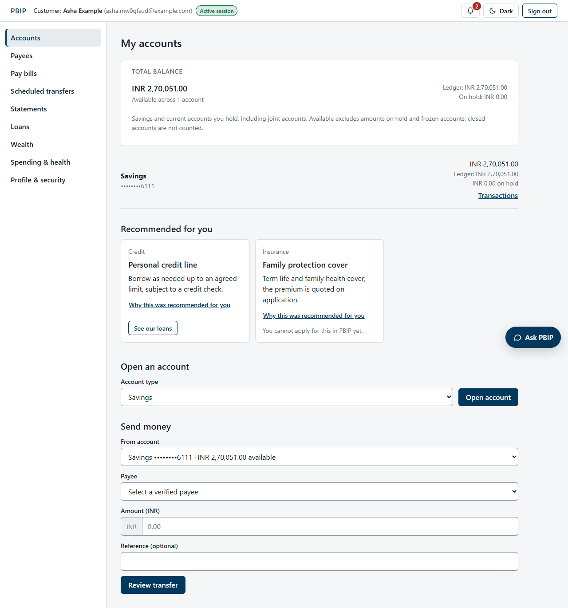
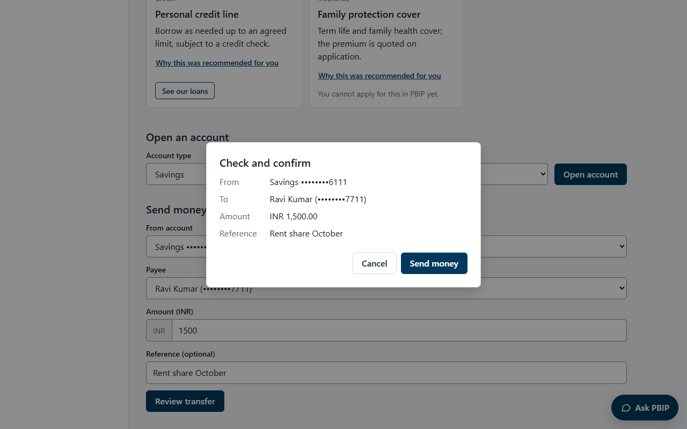
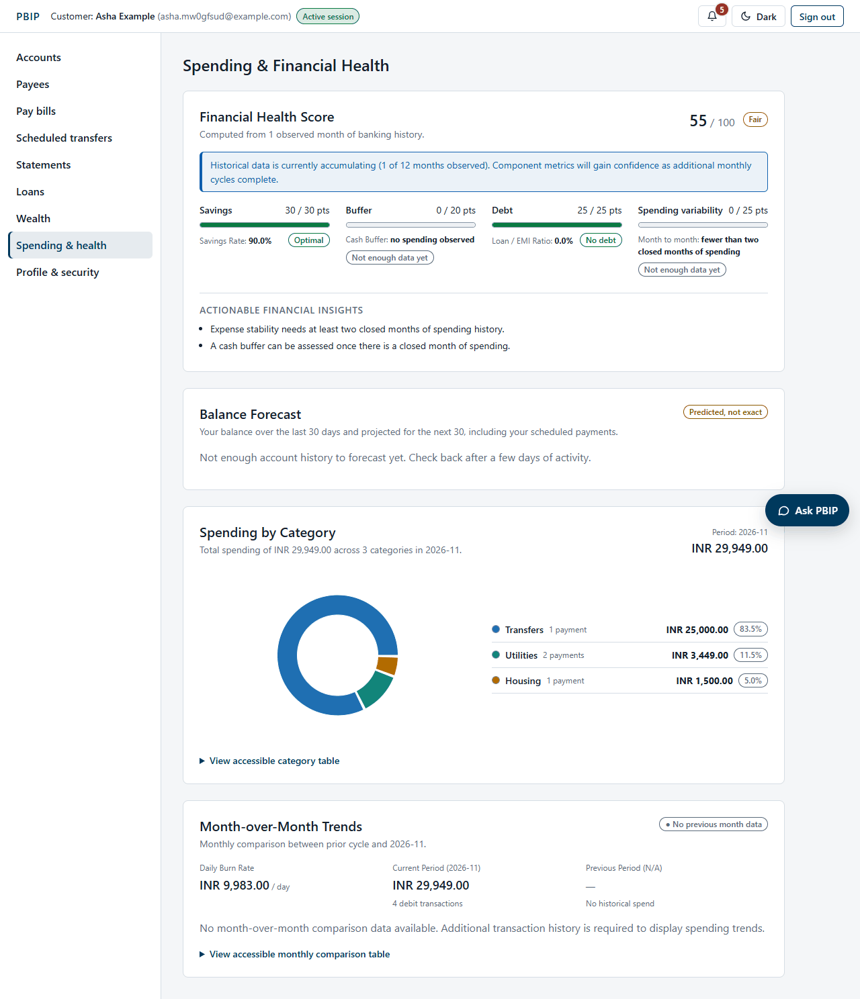
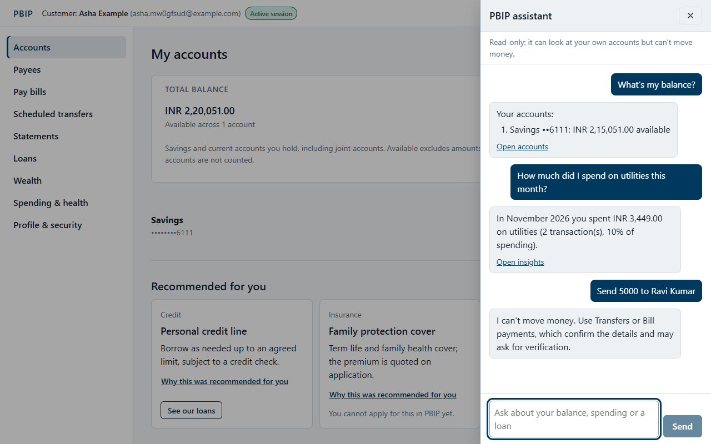
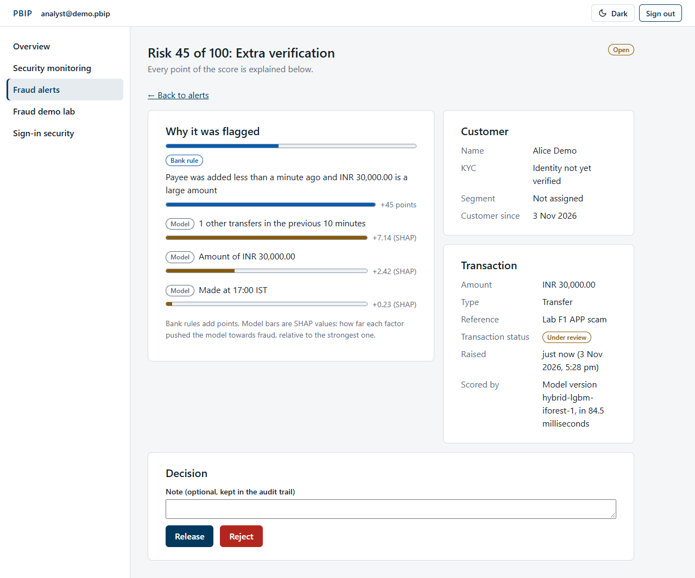
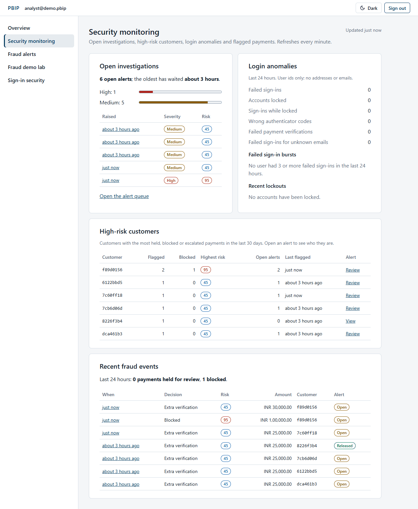
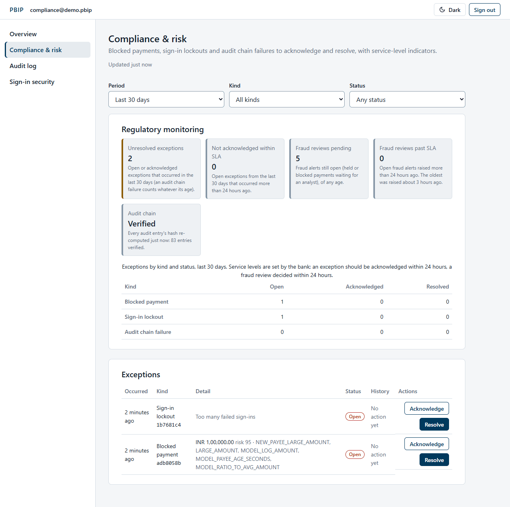
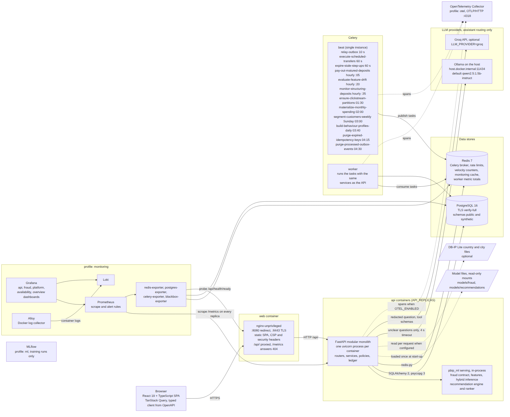

# PBIP: Personal Banking Intelligence Platform

[](https://github.com/rachitst/pbip/actions/workflows/ci.yml)
[](https://github.com/rachitst/pbip/actions/workflows/codeql.yml)
[](https://github.com/rachitst/pbip/actions/workflows/perf.yml)
[](https://github.com/rachitst/pbip/releases/latest)

PBIP is a simulated retail bank with a fraud, analytics and AI layer, engineered to the standards of a regulated
financial product. Customers open accounts, manage payees, send money, pay bills, set up standing orders, download
statements, take loans, book fixed deposits and ask an AI assistant about their own finances. Behind every payment a
hybrid fraud engine (explainable rules plus LightGBM and Isolation Forest models) decides to allow, verify, hold or
block, and bank staff work the resulting alerts, audit trail and customer insights in a separate, MFA-protected staff
area. Money lives in a double-entry ledger with idempotent, deadlock-free payments. No real money moves and all
customer data is synthetic.



## Key features

| Area | What it does |
|---|---|
| **Accounts and ledger** | Savings and current accounts on a double-entry ledger: integer minor units, immutable entries, compensating reversals, holds, per-currency totals, keyset-paginated history with search |
| **Payments** | Transfers to own accounts and verified payees with review, TOTP step-up and receipts; bill payments; daily, weekly and monthly standing orders with missed-date recovery; every money-moving request idempotent |
| **Security** | Argon2id passwords, TOTP MFA with recovery codes, rotating refresh tokens with reuse detection, immediate token revocation, lockout and rate limits, object-level authorization on every customer route, field encryption, hash-chained audit log |
| **Fraud** | Rules for amount, velocity, new payee, new country, new device, impossible travel, mule pass-through, structuring and dormant reactivation; a hybrid model served in-process with a rules-only fail-safe; reasons, scores and feature snapshots stored for every decision; analyst queue with release and reject; hourly drift and structuring monitors |
| **Lending and wealth** | Loan catalogue, EMI schedules, explainable eligibility, instant disbursal and scheduled repayments; fixed deposits with exact maturity maths, early closure and automatic payout; investment and insurance catalogues with comparison |
| **Analytics and recommendations** | Spending by category, trends, financial health score, end-of-month balance forecast, RFM segments, clickstream analytics, product recommendations with reasons from the customer's own figures |
| **AI assistant** | Read-only banking questions answered from nine approved tools; rules first, then a local (Ollama) or hosted (Groq) model only to choose a tool; guard against injection, redacted history, audited |
| **Staff area** | Fraud alert queue and alert detail, security monitoring, relationship-manager insights and outreach log, behavioural analytics, compliance exceptions and audit-log verification, administration of staff users, lockouts and runtime settings |
| **Operations** | Docker Compose stack behind nginx with TLS, Prometheus, Grafana, Loki and OpenTelemetry profiles, encrypted backups with restore drills, tagged releases deployed to an Arm staging host with automatic rollback |

## Screenshots

| | |
|---|---|
|  |  |
| Transfer review before sending | Spending insights and financial health |
|  |  |
| AI assistant | Fraud alert detail for an analyst |
|  |  |
| Security monitoring | Compliance and risk dashboard |

More screens, step by step, are in the [user manual](docs/user-manual/README.md).

## Architecture

One FastAPI modular monolith (routers, services, policies, the ledger) serves a React single-page app through nginx.
PostgreSQL is the system of record; Redis carries rate limits, velocity counters and the Celery queue for the worker
and beat. The `pbip_ml` package is imported in-process for fraud scoring and recommendations; training runs offline.



Read more: [high-level design](docs/architecture/HLD.md), [low-level design](docs/architecture/LLD.md),
[ER diagram](docs/architecture/er-diagram.md) and the [diagrams](docs/diagrams/README.md) (use case, activity,
sequence, state, module, component, deployment and data flow).

## Quick start

Prerequisites: Git, [uv](https://docs.astral.sh/uv/), Node.js 22, Docker and the GitHub CLI. Ubuntu, macOS and native
Windows 10/11 are supported; the [setup guide](docs/SETUP_GUIDE.md) covers each step, including PowerShell
(`.\dev.ps1 <command>` replaces `make <command>` on Windows).

### 1. Run it

```bash
make setup        # .env with generated local secrets, Python and Node dependencies, git hooks
make infra-up     # PostgreSQL and Redis in Docker
make migrate      # create the schema
make seed         # demo customers, funded accounts and MFA-enrolled staff (local database only)
make up           # the whole stack in Docker
```

Open https://localhost:8443. The stack uses a local development CA (`infra/certs/`), so the browser warns once;
http://localhost:8080 redirects. `make up-all` adds Grafana (http://localhost:3000), Prometheus
(http://localhost:9090) and MLflow (http://localhost:5000). For development with hot reload use `make dev-api`
(http://localhost:8000/docs) and `make dev-web` (http://localhost:5173) instead of `make up`.

Optional models: `make fraud-model-release` installs the pinned, checksummed fraud model and
`make recommendation-model` trains the recommendation ranker; without them the stack serves its rule-based fallbacks
([deployment guide](docs/operations/deployment-guide.md#5-model-files)).

### 2. Demo accounts

| Account | Role | Notes |
|---|---|---|
| `alice@demo.pbip` | Customer | Has an authenticator, for the step-up demo |
| `bob@demo.pbip` | Customer | Alice's payee |
| `carol@demo.pbip` | Customer | The fraud demo lab's customer |
| `analyst@demo.pbip` | Fraud analyst | Staff area, MFA |
| `compliance@demo.pbip` | Compliance officer | Staff area, MFA |
| `rm@demo.pbip` | Relationship manager | Staff area, MFA; looks after Alice |
| `admin@demo.pbip` | Administrator | Staff area, MFA |

The password is the `PBIP_DEMO_PASSWORD` you set for `make seed`, or otherwise (local only) the `DEMO_PASSWORD`
constant in [`scripts/seed_dev.py`](scripts/seed_dev.py); it is never printed. Authenticator codes come from
`uv run python scripts/totp.py <email>`, which decrypts the secret from your local database.

### 3. Prove it works

```bash
make check                                             # lint, types, boundaries, security and all tests
uv run python demo/demo_scenarios.py idempotency       # 10 identical requests make 1 transfer
uv run python demo/demo_scenarios.py fraud-new-payee   # a large transfer to a new payee is held
uv run python demo/demo_scenarios.py bola              # Bob cannot read Carol's account (404)
make test-e2e                                          # Playwright journeys against the running stack
```

The live demo script and its fallback plan are in [`demo/demo-script.md`](demo/demo-script.md).

## Documentation

| Topic | Start here |
|---|---|
| Everything, indexed | [`docs/README.md`](docs/README.md) |
| Requirements and traceability | [requirements specification](docs/requirements/requirements-specification.md), [use cases as built](docs/requirements/use-cases.md), [user stories](docs/requirements/user-stories.md), [traceability](docs/requirements/traceability.md) |
| Architecture | [blueprint](docs/PROJECT_BLUEPRINT.md), [HLD](docs/architecture/HLD.md), [LLD](docs/architecture/LLD.md), [diagrams](docs/diagrams/README.md), [ADRs](docs/adr/) |
| API | [OpenAPI contract](docs/api/openapi.json), and `/docs` on a running API |
| Security | [threat model](docs/security/threat-model.md), [AI assistant security](docs/security/ai-assistant-security.md), [security audit](docs/security/security-audit-2026-11.md) |
| Machine learning | [fraud models](docs/ml/fraud-models.md), [evaluation report](docs/ml/model-evaluation-report-v1.md), [model cards](docs/ml/model-cards.md) |
| Testing | [test strategy and report](docs/testing/test-strategy-and-report.md), [E2E](docs/testing/e2e.md) |
| Operations | [deployment guide](docs/operations/deployment-guide.md), [support guide](docs/operations/support-guide.md), [runbook](docs/operations/runbook.md) |
| Using PBIP | [user manual](docs/user-manual/README.md), [setup guide](docs/SETUP_GUIDE.md) |
| Contributing | [CONTRIBUTING.md](CONTRIBUTING.md), [AGENTS.md](AGENTS.md) (engineering rules for people and AI assistants) |

## Releases

The latest release is **[v1.1.4](https://github.com/rachitst/pbip/releases/tag/v1.1.4)** (8 November 2026): deploys
that replace the API rolling, so it keeps answering (v1.1.3, with v1.1.4's fix for a retired replica's address), on
top of v1.1.2's staging over HTTPS, the trained models on the
staging host and a faster assistant fallback, v1.1.1's staging fixes,
monitoring, off-host backups and database admission fix and v1.1.0's recommendation, behaviour-profile, investing and
staff-dashboard features. Every release is listed on the [releases page](https://github.com/rachitst/pbip/releases),
with notes in [`docs/release/`](docs/release/) and the full history in [`CHANGELOG.md`](CHANGELOG.md).

**Staging:** `https://pbip.duckdns.org`, an Oracle Cloud Always Free Arm VM (2 OCPUs, 12 GB) built with the
[Oracle Cloud guide](docs/operations/deploy-oracle-cloud-arm.md). It holds no demo data (customers register
themselves); the demo runs on the local stack.

A release is a `vX.Y.Z` tag on `main`: the Deploy workflow verifies it, builds `linux/amd64` and `linux/arm64` images
to GHCR and, when enabled, deploys them to the staging host with a health-gated start, a smoke test and automatic
rollback ([deployment guide](docs/operations/deployment-guide.md)).

## Repository layout

| Path | Contents |
|---|---|
| `apps/api` | FastAPI modular monolith, Alembic migrations, Celery worker and beat |
| `apps/web` | React and TypeScript single-page app, Vitest and Playwright tests |
| `ml` | `pbip_ml`: contracts, features, training and inference for fraud, recommendations, forecasting, segmentation |
| `data-gen` | Deterministic synthetic data and fraud scenario generator |
| `infra` | nginx, PostgreSQL TLS, Prometheus, Grafana, Loki, Alloy, OpenTelemetry, k6, ZAP, deployment files |
| `docs` | Documentation ([index](docs/README.md)) |
| `scripts` | Developer commands (`scripts/dev.py` behind `make`), seed, OpenAPI export, backups, smoke tests, diagram rendering |
| `demo` | Live demo scenarios and script |

## Troubleshooting

* `make: command not found` on Windows: use `.\dev.ps1 <command>` or `dev.cmd <command>` ([setup guide](docs/SETUP_GUIDE.md)).
* Tests skip with "run `make infra-up`": PostgreSQL is not running (in CI a missing database is a hard failure).
* `NoReferencedTableError`: a new `models.py` was not added to `pbip_api/modules/__init__.py` and `alembic/env.py`.
* `alembic check` fails: a model changed without a migration; run `alembic revision --autogenerate` and review it.
* Port in use (5432, 6379, 8000, 8080, 8443): stop the other service or change the published port in `docker-compose.yml`.
* More, for a running stack: the [support guide](docs/operations/support-guide.md).

## Third-party data

* [IP Geolocation by DB-IP](https://db-ip.com): the optional "IP to Country Lite" database used by the
  NEW_COUNTRY fraud rule and the optional "IP to City Lite" database used by the IMPOSSIBLE_TRAVEL rule are
  licensed under [CC BY 4.0](https://creativecommons.org/licenses/by/4.0/). They are downloaded by
  `scripts/fetch_geoip.py`, not committed (ADR-0014, ADR-0034).
