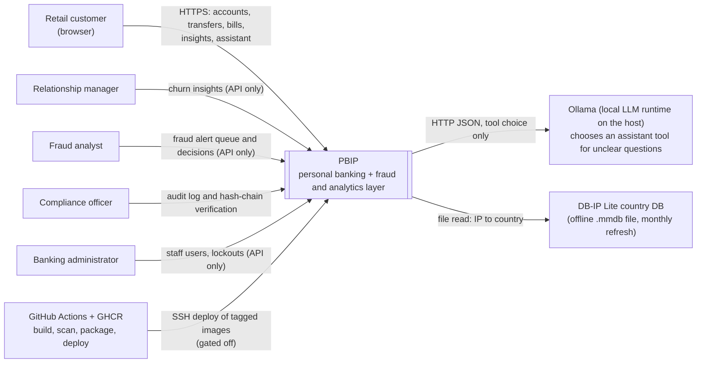
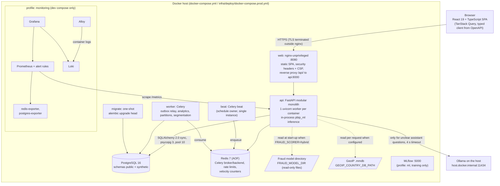
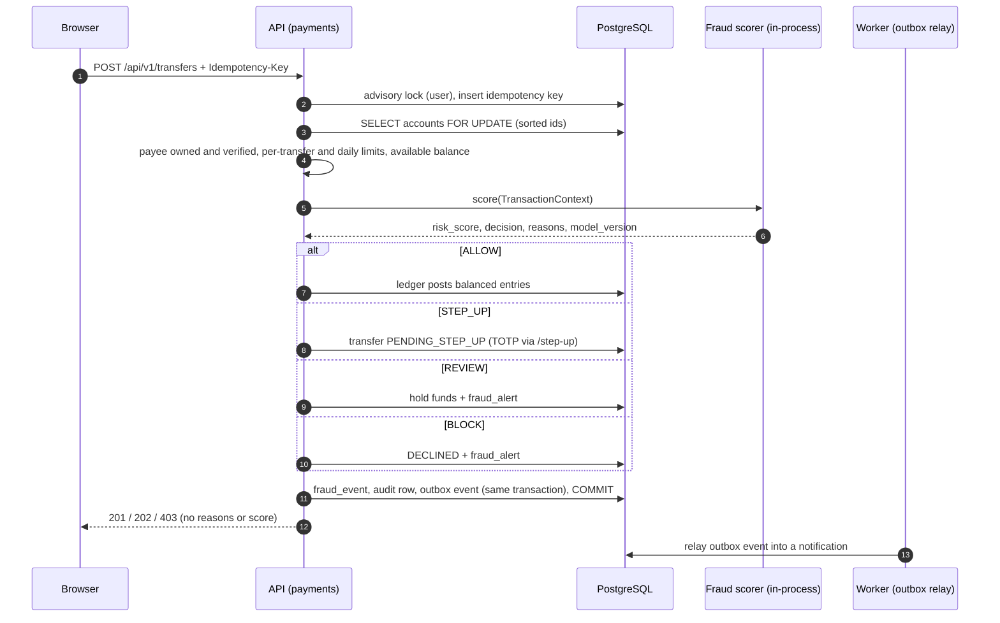

# PBIP High-Level Design (HLD)

| | |
|---|---|
| Task | TASK-053 (#76) |
| Scope | System boundaries, C4 context and container views, components, data stores, API and ML inference contracts, security, scalability, observability, production roadmap |
| Verified against | `main` at `8c93ed3` (1 Nov 2026): code, compose files, workflows and tests, not earlier documents |
| Related | [Blueprint](../PROJECT_BLUEPRINT.md) (engineering rules), [ER diagram](er-diagram.md) (generated from the schema), [threat model](../security/threat-model.md), [AI assistant security](../security/ai-assistant-security.md), [runbook](../operations/runbook.md), [traceability](../requirements/traceability.md) |

**Status labels used throughout.** Each capability is marked with one of three labels:

* **Implemented**: the code is on `main` and tests cover it.
* **Partial**: part of it is on `main`. The text says what is missing and which task owns the rest.
* **Planned**: it is not on `main`. The owning task is named. "No task" means nobody has been assigned the work yet.

The low-level design (TASK-027) and the user manual (TASK-092) are separate deliverables and are not covered here.

---

## 1. Purpose and system boundary

PBIP simulates a retail bank. It has a customer portal (accounts, transfers, bill payments, insights, an AI assistant)
and an internal portal (fraud alerts, compliance audit, relationship-manager insights) on top of one double-entry
ledger. The analytics and ML layer adds fraud scoring, spending analytics, a balance forecast, segmentation and
product recommendations.

**Inside the boundary:**

* the React single-page app;
* the FastAPI modular monolith;
* the Celery worker and beat;
* PostgreSQL and Redis;
* the in-process `pbip_ml` inference code;
* the offline training and data-generation code;
* the monitoring configuration.

**Outside the boundary:**

* the local LLM runtime (Ollama), which runs on the host;
* the DB-IP Lite country database, an offline file;
* GitHub Actions and GHCR, used for build and delivery;
* the TLS terminator in front of nginx, which is the operator's responsibility (runbook section 1.4).

There are no external payment rails, card networks, credit bureaus, e-mail or SMS gateways. Money moves only between
accounts on PBIP's own ledger. Customer notifications are in-app only.

## 2. C4 level 1: system context



The use-case document lists six actors. Here is the support for each:

| Actor | Role in code | What exists | Status |
|---|---|---|---|
| Retail customer | `CUSTOMER` (plus a customer profile) | Web app and API | Partial (see [traceability](../requirements/traceability.md)) |
| Relationship manager | `RELATIONSHIP_MANAGER` | `GET /api/v1/insights/customers` | Partial: no UI (TASK-066) |
| Fraud analyst | `FRAUD_ANALYST` | Alert queue, detail and decision API | Partial: no UI (TASK-036) |
| Compliance officer | `COMPLIANCE_OFFICER` | Audit-log API and web page with chain verification | Implemented (audit); alerts and exceptions Planned (TASK-100) |
| Banking administrator | `ADMIN` | Create staff users, inspect and clear lockouts (API) | Partial: no configuration UI (no task) |
| AI assistant | none; it acts as the customer | Read-only tools with the customer id injected server-side | Implemented (narrow scope; TASK-105 for FAQ, product discovery and investments) |

Every staff route requires both the role and a session that completed TOTP (`require_roles(..., mfa=True)`).

## 3. C4 level 2: containers



| Container | Image / source | Responsibility | Status |
|---|---|---|---|
| `web` | `apps/web/Dockerfile` (Vite build behind nginx) | Serves the SPA, proxies `/api/`, hides `/metrics` (404) | Implemented |
| `api` | `apps/api/Dockerfile`, non-root | All HTTP use cases; fraud scoring and assistant in-process | Implemented |
| `worker` | same image, `celery worker` | Runs the scheduled jobs in section 4.2 | Implemented |
| `beat` | same image, `celery beat` | Owns the schedule; must stay a single instance | Implemented |
| `migrate` | same image | `alembic upgrade head` before the API starts | Implemented |
| `db` | `postgres:16-alpine` | System of record | Implemented |
| `redis` | `redis:7-alpine`, AOF | Broker, rate limits, velocity windows | Implemented |
| `mlflow` | `ghcr.io/mlflow/mlflow:v3.5.0` (compose profile `ml`) | Experiment tracking for training runs | Implemented (dev only) |
| Monitoring | Prometheus v3.5.0, Grafana 12.1.0, Loki 3.5.0, Alloy v1.10.0, exporters (profile `monitoring`) | Metrics, dashboards, logs | Partial: dev compose only; not in the staging compose; no Alertmanager (TASK-069, TASK-103) |
| Ollama | host process, not in compose | Picks an assistant tool for unclear questions | Implemented locally. Staging compose sets no `OLLAMA_*` variables, so the LLM path is not provisioned there |

The staging compose (`infra/deploy/docker-compose.prod.yml`) runs `db`, `redis`, `migrate`, `api`, `worker`, `beat` and
`web`. Only `web` is published (`${PUBLIC_PORT:-80}`). It mounts `./geoip` read-only into `api`.

## 4. Components

### 4.1 API modules (`apps/api/src/pbip_api/modules/`)

The layering is `router.py` (HTTP only), then `service.py` (use case, owns the transaction), then
`policy.py`/`repository.py`, then `models.py`. Two boundaries are enforced by import-linter:

* `core` must not import `modules`;
* `pbip_ml` and `pbip_datagen` must not import `pbip_api`.

Across modules, code calls the other module's `service` or `policy` functions only ([ADR-0001](../adr/0001-modular-monolith.md)).

| Module | Responsibility | Main endpoints (`/api/v1`) | Status |
|---|---|---|---|
| `auth` | Registration, password login, TOTP MFA and recovery codes, refresh rotation, logout, password change, admin user and lockout management | `/auth/*`, `/admin/users*` | Implemented (API). No web registration or MFA-enrolment screens (no task) |
| `customers` | Profile, device fingerprints | `/customers/me`, `/customers/devices*` | Implemented |
| `accounts` | Open and list accounts; ledger history with keyset pagination | `/accounts*` | Implemented. Search and filter Planned (TASK-017) |
| `ledger` | The only writer of balances, holds and entries (no router) | none | Implemented ([ADR-0002](../adr/0002-double-entry-ledger.md)) |
| `payees` | Add, list, get, delete, confirmation-of-payee verify | `/payees*` | Partial: no edit (TASK-094), no UI (TASK-020) |
| `payments` | Idempotent transfers, limits, fraud decision, TOTP step-up, analyst release/reject | `/transfers*` | Implemented (API). Review and step-up UI Planned (TASK-037) |
| `bills` | Biller catalogue, idempotent bill payments sharing the daily limit | `/bills/*` | Implemented (API). UI Planned (TASK-020) |
| `fraud` | Baseline rules, hybrid scorer adapter, event persistence, alert queue | `/fraud/alerts*` | Implemented (API). Analyst UI Planned (TASK-036) |
| `notifications` | Inbox, read state, outbox relay target | `/notifications*` | Implemented (API and web bell) |
| `analytics` | Spending, trends, health score, balance forecast, segment; nightly and weekly jobs | `/analytics/*` | Implemented. Forecast UI Planned (TASK-050) |
| `insights` | Relationship-manager churn signals | `/insights/customers` | Partial: no UI (TASK-066) |
| `recommendations` | Rule-based product recommendations with reasons (`rules-v1`) | `/recommendations` | Partial: no UI (TASK-062); age band fixed to `unknown` until TASK-107 |
| `loans` | Catalogue (3 products), EMI schedule, explainable eligibility | `/loans/*` | Partial: applications and tracking Planned (TASK-047, TASK-051) |
| `assistant` | Read-only tool registry, rules-first router, Ollama adapter, guard, sanitiser, output filter, SSE | `/assistant/*` | Implemented (5 tools). FAQ, product and investment tools Planned (TASK-105) |
| `events` | Clickstream batch ingestion into monthly partitions | `/events/batch` | Partial: the web app does not send events yet (TASK-055 In Progress) |
| `compliance` | Hash-chained audit log read and verify | `/compliance/audit-logs*` | Implemented |
| `health` | Liveness and readiness (DB + Redis) | `/api/health/live`, `/api/health/ready` | Implemented |
| `statements` | PDF/CSV statements | none (empty package) | Planned (TASK-016, TASK-074) |
| `wealth` | Deposits, funds, insurance, comparison | none (empty package) | Planned (TASK-063, TASK-064, TASK-065, TASK-096, TASK-097, TASK-098) |

Scheduled and recurring transfers have no module yet. They are Planned (TASK-015, TASK-021).

### 4.2 Background jobs (`apps/api/src/pbip_api/worker/celery_app.py`)

| Beat entry | Task | Schedule | What it does | Status |
|---|---|---|---|---|
| `relay-outbox` | `pbip.outbox.relay` | every 10 s | Turns unprocessed `outbox_events` into `notifications` (`FOR UPDATE SKIP LOCKED`, batch 100) | Implemented. It does not publish to an external broker; the generic relay is Planned (TASK-026) |
| `materialize-monthly-spending` | `pbip.analytics.materialize_monthly_spending` | 02:00 UTC daily | Writes `monthly_category_spending` ([ADR-0011](../adr/0011-monthly-spending-aggregates.md)) | Implemented |
| `ensure-clickstream-partitions` | `pbip.events.ensure_partitions` | 01:30 UTC daily | Creates future monthly partitions (idempotent) | Implemented |
| `segment-customers-weekly` | `pbip.analytics.segment_customers` | Sunday 03:00 UTC | K-Means segmentation into `customer_segments` ([ADR-0012](../adr/0012-customer-segmentation-offline-job.md)) | Implemented |

The worker runs with `acks_late`, `reject_on_worker_lost` and prefetch 1, so a task interrupted by a crash is
re-delivered. Every job is written to be idempotent.

### 4.3 Web application (`apps/web/src`)

There is one design system and one role-aware shell ([ADR-0016](../adr/0016-web-ui-architecture-and-design-system.md)). The generated `schema.d.ts` is the only
source of API types.

**Customer screens on `main`:**

* login with the MFA code step;
* accounts with balances, open account, expandable ledger history;
* a send-money form (first account only, verified payees, no review step);
* insights (spending, trends, health score);
* profile, devices and password change;
* the notification bell;
* the assistant drawer, streamed over SSE.

**Staff screens:** a staff home page and the compliance audit log.

Every other screen is Planned under the task named in section 4.1.

### 4.4 ML and data packages

| Package | Contents | Runs where |
|---|---|---|
| `ml/src/pbip_ml/fraud` | Contract, features (offline/online parity-tested), rule registry, LightGBM, Isolation Forest, hybrid combiner, TreeSHAP reasons, `inference.load` | Training: offline scripts, tracked in MLflow. Inference: in-process in `api` |
| `ml/src/pbip_ml/forecasting` | Balance forecast with 80/95% intervals | In-process, on request |
| `ml/src/pbip_ml/segmentation` | RFM + lifestyle K-Means | Celery weekly job only |
| `ml/src/pbip_ml/recommendations` | Eligibility rules + hand-weighted ranking (explicitly not a trained model) | In-process, on request |
| `data-gen/src/pbip_datagen` | Seeded synthetic customers and transactions, fraud injectors F1-F6 with labels | Offline; loaded with COPY into schema `synthetic` ([ADR-0009](../adr/0009-synthetic-dataset-schema.md)) |

## 5. Data stores

| Store | What lives there | Notes |
|---|---|---|
| PostgreSQL `public` | 26 tables: identity and sessions, customers and devices, accounts, ledger, holds, idempotency keys, payees, bills, fraud events and alerts, notifications and outbox, hash-chained audit log, security events, analytics aggregates, segments, clickstream (monthly range partitions), assistant messages | Full diagram: [er-diagram.md](er-diagram.md) (generated, CI-checked). Integer minor units for money. CHECK constraints for enums and ranges. Triggers keep `transaction_entries` immutable and balanced and `audit_logs` append-only |
| PostgreSQL `synthetic` | Generation runs, synthetic customers, synthetic transactions | Training data only, never read on the request path ([ADR-0009](../adr/0009-synthetic-dataset-schema.md)) |
| Redis | Celery broker and result backend (results expire after 1 h); fixed-window rate limits `rl:{name}:{subject}`; sorted-set velocity windows for transfers and login failures | Not a system of record. Rate limits fail open if Redis is down. Velocity falls back to PostgreSQL ([ADR-0020](../adr/0020-device-network-signals-and-velocity-counters.md)). Idempotency is in PostgreSQL, not Redis ([ADR-0003](../adr/0003-idempotency-in-postgresql.md)) |
| Fraud model directory | `lightgbm.txt`, `isolation_forest.joblib`, `hybrid_params.json`, `manifest.json` (SHA-256 of each file) | Read once per process when `FRAUD_SCORER=hybrid`. A damaged or missing artefact means rules-only |
| MLflow | SQLite backend store and proxied artefacts (dev compose, profile `ml`) | Training runs only. The API does **not** load models from the MLflow registry; registry promotion is Planned (TASK-038) |
| GeoIP file | DB-IP Lite country `.mmdb` (CC BY 4.0) | Optional. Unset means no `NEW_COUNTRY` signal ([ADR-0014](../adr/0014-geoip-country-for-fraud-signals.md)) |

Sensitive columns (e.g. the TOTP secret) are encrypted with MultiFernet (`core/crypto.py`). Keys are rotated with
`scripts/rotate_field_key.py`.

## 6. API contract

* **Shape:**
  * 56 operations, all under `/api/v1` except the health probes;
  * the contract is `docs/api/openapi.json`, generated from the code;
  * CI fails if the file or the generated `apps/web/src/api/schema.d.ts` is stale (`scripts/export_openapi.py --check`);
  * breaking changes need `/api/v2`.
* **Authentication:**
  * `Authorization: Bearer` access JWT (HS256 with an algorithm allow-list, issuer and audience checked, 15 min TTL);
  * the refresh token lives in an HttpOnly, `SameSite=Strict` cookie scoped to `/api/v1/auth` (7 days), rotated on every use, with family revocation on reuse ([ADR-0004](../adr/0004-refresh-rotation-cookie.md));
  * cookie endpoints require `X-Requested-With: pbip-web` and an allowed `Origin` (CSRF guard).
* **Authorization:**
  * every non-public route depends on `get_current_principal`, which `tests/security/test_route_policy_registry.py` enforces;
  * customer data is read only through policy functions keyed on the authenticated customer id;
  * a non-owned or non-existent object returns 404, proven by the BOLA matrix in `test_rbac_bola.py`.
* **Money-moving POSTs** (`/transfers`, `/bills/pay`):
  * require an `Idempotency-Key`;
  * a replay returns the original result; the same key with a different body returns 409.
* **Ledger lock order** (a deadlock contract, [ADR-0002](../adr/0002-double-entry-ledger.md)):
  1. the per-user advisory lock;
  2. the idempotency-key insert;
  3. account rows `FOR UPDATE` in sorted id order;
  4. then the transaction header and entries.
* **Pagination:** keyset (`cursor`) for ledger history ([ADR-0008](../adr/0008-ledger-keyset-cursor.md)). The audit log pages by `before_seq`.
* **Errors:**
  * RFC 7807 `application/problem+json` with a request id;
  * no stack traces, SQL or echoed input;
  * an unhandled error becomes a generic 500.
* **Streaming:** `/assistant/chat/stream` uses Server-Sent Events.
* **Limits:**
  * per transfer ₹2,00,000 (`MAX_TRANSFER_MINOR`);
  * per UTC day ₹5,00,000 across transfers and bills (`DAILY_TRANSFER_LIMIT_MINOR`);
  * rate limits per minute: login 10/IP, password change 5, events 120, assistant 10/user;
  * registration 10/hour.

## 7. ML inference contracts

ML runs behind versioned, typed contracts and executes in-process ([ADR-0007](../adr/0007-ml-contracts-in-process.md)). The API imports only `pbip_ml.*.contract`
and the inference modules, never training code. Changing a `contract.py` requires an ADR.

### 7.1 Fraud (`ml/src/pbip_ml/fraud/contract.py`)

```text
FraudScorer.score(TransactionContext) -> FraudScoreResult      # side-effect free, well under 100 ms

TransactionContext  transaction_id, customer_id, account_id, amount_minor (>0, paise), currency,
                    occurred_at (tz-aware), channel WEB|MOBILE|API, payee_id?, device_id?,
                    ip_country?, ip_network? (/24 or /48, never the full IP), geo_lat?, geo_lon?
FraudScoreResult    risk_score 0-100, decision ALLOW|STEP_UP|REVIEW|BLOCK,
                    reasons[] {code, message, source RULE|MODEL|ANOMALY, contribution?},
                    model_version, latency_ms, features{} (snapshot), scored_at
```

**Decision bands:** below 30 is ALLOW; 30 is STEP_UP; 60 is REVIEW; 85 or more is BLOCK.

**What each decision does on the transfer path:**

| Decision | Effect |
|---|---|
| ALLOW | Posts the transfer |
| STEP_UP | The transfer waits for a TOTP code. A user without MFA is escalated to REVIEW |
| REVIEW | Places a hold and opens an alert |
| BLOCK | Declines the transfer and opens an alert |

On bill payments, any decision other than ALLOW declines the payment and opens an alert. There is no hold or step-up
path for bills.

**After every decision:**

* the score, reasons, feature snapshot, model version and latency are written to `fraud_events`;
* the customer response never contains the reasons or the score.

| Serving mode | Model version | Status |
|---|---|---|
| `FRAUD_SCORER=rules` (default) | `baseline-rules-0.3` (`modules/fraud/baseline.py`) | Implemented. Rules: LARGE_AMOUNT, NEW_PAYEE, NEW_PAYEE_LARGE_AMOUNT, VELOCITY_BURST, AMOUNT_SPIKE, NEW_COUNTRY, RECENT_LOGIN_FAILURES, NEW_DEVICE_OR_NETWORK |
| `FRAUD_SCORER=hybrid` + `FRAUD_MODEL_DIR` | `hybrid-lgbm-iforest-1` | Implemented behind the flag ([ADR-0019](../adr/0019-hybrid-fraud-scorer-serving.md)). It combines calibrated LightGBM, Isolation Forest and the rule registry, and adds the top-3 TreeSHAP reasons. The final score is `max(baseline, hybrid)`. Not the default until #251, because the synthetic data has no legitimate new payees |
| Fail-safe | `...+rules-only` with reason `MODEL_UNAVAILABLE` | Implemented. It applies when the model is missing, raises an error or exceeds `FRAUD_MODEL_BUDGET_MS` (default 50 ms). It never falls back to allow-all |

Model metrics, latency and limits are recorded in the [evaluation report](../ml/model-evaluation-report-v1.md) and
[fraud-models.md](../ml/fraud-models.md).

**Planned fraud work:**

* champion/challenger promotion through the MLflow registry (TASK-038);
* drift and PSI monitoring (TASK-068);
* F7-F8 and F11 scenarios (TASK-071, TASK-072);
* final retraining (TASK-084).

### 7.2 Other ML contracts

| Contract | Types | Consumer | Status |
|---|---|---|---|
| `forecasting/contract.py` | `ForecastKind`, `ForecastPoint`, `Forecast` | `GET /analytics/forecast`, assistant `get_balance_forecast` | Implemented ("Predicted, not exact" label) |
| `segmentation/contract.py` | `CustomerSegmentName` (5 personas), `CustomerRFMFeatures`, `SegmentAssignment`, `ClusteringValidationReport` | Weekly job, `GET /analytics/segment`, recommendations, insights | Implemented |
| `recommendations/contract.py` | `ProductType`, `BankingProduct`, `CustomerRecommendationContext`, `Recommendation` | `GET /recommendations`, insights | Implemented (rules-v1). The input does not include products already held (no task) |
| `features/contract.py` | `FeatureSource`, `FeatureDefinition`, `TransactionEvent`, `CustomerFeatures` | Fraud features ([ADR-0010](../adr/0010-customer-feature-contract-draft.md)) | Implemented |

### 7.3 Assistant (LLM) contract

The LLM only chooses one tool from a fixed registry and fills bounded, enum-validated arguments. The server runs the
tool for the authenticated customer and writes the answer ([ADR-0018](../adr/0018-assistant-llm-routes-server-answers.md)).

**Request pipeline:**

1. sanitise;
2. guard, which refuses money movement, other-customer, SQL, instruction-override and privilege requests;
3. a regex fast path for clear questions (no model call);
4. Ollama `qwen2.5:1.5b-instruct` with grammar-constrained JSON and a 4 s timeout, only for unclear questions;
5. deterministic rules if the model fails.

**Tools:** `get_account_summary`, `get_recent_transactions`, `get_spend`, `get_balance_forecast`, `get_loan_affordability`.

The details and the adversarial suite are in [ai-assistant-security.md](../security/ai-assistant-security.md).

## 8. Key runtime flows

### 8.1 Transfer



### 8.2 Analyst decision

`POST /api/v1/fraud/alerts/{id}/decision` with `RELEASE` or `REJECT` (FRAUD_ANALYST or ADMIN, with MFA):

* RELEASE captures the hold and posts the transfer;
* REJECT releases the hold and declines the transfer;
* an already-resolved alert returns 409;
* each decision is audited as `FRAUD_ALERT_RESOLVED`.

## 9. Security architecture

The full analysis is in the [threat model](../security/threat-model.md) (STRIDE, OWASP Top 10 mapping, Argon2id
parameters, token rotation, BOLA, fraud evasion, compliance mapping) and the
[AI assistant security architecture](../security/ai-assistant-security.md) (seven hard rules, OWASP LLM Top 10,
adversarial transcripts). Here is the summary, with the enforcing code:

| Control | Implementation | Status |
|---|---|---|
| Password storage | Argon2id: time 3, memory 64 MiB, parallelism 4; breached-password blocklist | Implemented |
| MFA | TOTP (pyotp, ±1 step, replay-protected) and recovery codes. Mandatory for staff routes. Optional for customers, with a step-up fallback to analyst review | Implemented |
| Sessions | 15 min access JWT, rotating refresh cookie with reuse detection | Implemented |
| Lockout | 5 failures, then `60 s × 2^n` up to 1 h; admin unlock is audited | Implemented |
| Authorization | Role checks, plus ownership policy functions (BOLA → 404); route-policy registry test | Implemented |
| Input validation | Pydantic bounds, UUID path ids, positive integer amounts, free-text validation | Implemented |
| Transport and browser | nginx and API security headers, strict CSP, CORS allow-list, HSTS when `COOKIE_SECURE` | Partial: TLS is terminated outside the repo (runbook section 1.4) |
| Data at rest | MultiFernet field encryption with rotation | Implemented |
| Audit | SHA-256 hash-chained `audit_logs`, append-only trigger, verification endpoint | Implemented |
| Logging hygiene | structlog JSON with a final redaction processor (secrets, tokens, e-mails, long digit runs) | Implemented |
| Safe configuration | Staging and production refuse to boot with the dev JWT secret, an empty encryption key, insecure cookies, wildcard CORS or the memory trace exporter. API docs are off when deployed | Implemented |
| Supply chain | First-party or SHA-pinned actions, Bandit, pip-audit, npm audit, detect-secrets, CodeQL, Dependabot, nightly Schemathesis fuzzing ([ADR-0006](../adr/0006-ci-supply-chain.md)) | Implemented |
| Passkeys | Evaluated ([ADR-0013](../adr/0013-passkeys-evaluation.md)) | Planned (roadmap in the ADR; no task) |
| DAST and final audit | Against a deployed environment | Planned (TASK-090) |

## 10. Scalability

**What already supports horizontal scaling:**

* The API process holds no session state. Refresh tokens, idempotency keys, lockouts and the outbox are in
  PostgreSQL. Rate limits and velocity windows are in Redis.
* Per-process state is limited to the loaded fraud engine and a 1-second readiness cache.
* The Dockerfile runs one uvicorn worker per container, so throughput scales by adding replicas behind nginx.
* Correctness under concurrency rests on PostgreSQL rather than process memory:
  * row locks, the advisory lock and unique idempotency keys;
  * `test_concurrent_spending_never_overdraws` and `test_concurrent_duplicates_create_exactly_one_transfer` prove
    this with real threads.
* The outbox relay uses `SKIP LOCKED`, so several workers can drain it safely.

**What has not been exercised, and the limits we expect:**

| Concern | Current state | Consequence | Owner |
|---|---|---|---|
| Multi-replica deployment | No `replicas` setting in either compose file; never run with more than one API container | Horizontal scaling is designed but unproven | TASK-079 (#102) |
| Load evidence | `infra/k6/baseline.js` covers health endpoints only (50 VUs, p95 < 50 ms). Analytics endpoints were measured locally (p95 12-19 ms, sequential) | No evidence under concurrent business load | TASK-078 (#101), TASK-102 (#185) |
| DB connections | Pool size 10 per API process | `replicas × 10` (+ workers) must stay under PostgreSQL `max_connections`. A pooler (PgBouncer) would be needed beyond a few replicas | TASK-079 |
| Write hot spot | Per-user advisory lock serialises one customer's money movements | Intended (correctness first); throughput across customers is unaffected | none |
| Single PostgreSQL primary | No replica or failover; backup and PITR procedures are in the runbook | Vertical scaling plus read replicas for analytics would be the next step | TASK-083 (#106) |
| ML in-process | Each replica loads its own model copy; inference p95 23 ms at 1 thread on the reference laptop, slower at 4 threads | Memory grows per replica; the 50 ms budget falls back to rules under CPU contention | Evaluation report |
| LLM | Ollama on CPU: 12-50 s for unclear questions; clear questions take < 0.1 s via the rules path | The LLM path does not meet the API latency target on CPU-only hardware | Documented (ADR-0018); no task |
| Beat | Must be a single instance | Run exactly one `beat` | none |

## 11. Observability

| Signal | Implementation | Status |
|---|---|---|
| Logs | structlog JSON with request id; access log without query string or body; Alloy ships container logs to Loki | Implemented (dev compose, profile `monitoring`) |
| Metrics | `GET /metrics` (blocked at nginx): `http_requests_total`, `http_request_duration_seconds` (route templates, never ids), `fraud_inference_seconds`, `fraud_decisions_total`, `transfers_total`, `idempotent_replays_total`, `login_failures_total`; Redis and PostgreSQL exporters | Implemented |
| Dashboards | Grafana `pbip-overview.json` (traffic, latency, fraud decisions and latency, failed logins) | Partial: polish and alerting (TASK-069) |
| Alert rules | `ApiHighErrorRate` (>2% 5xx), `ApiSlowP95` (>0.5 s), `FraudScoringSlow` (p95 >0.1 s), `LoginFailureSpike`, `CeleryBacklog` | Partial: no Alertmanager or receiver, so alerts are not delivered (TASK-069) |
| Health | `/api/health/live`, `/api/health/ready` (DB + Redis), compose health checks, post-deploy smoke test | Implemented |
| Tracing | OpenTelemetry for FastAPI and SQLAlchemy, **off by default**; exporters none, console or memory; no OTLP backend ([ADR-0017](../adr/0017-opentelemetry.md)) | Partial (spike) |
| Error tracking | No error-tracking service | Planned (TASK-103) |
| Availability (99% NFR) | Nothing deployed to measure | Planned (TASK-103) |

## 12. Delivery and deployment

* **CI (`.github/workflows/ci.yml`):**
  * jobs: API quality (lint, mypy strict, import boundaries, OpenAPI drift), API tests on PostgreSQL and Redis
    (migrations up, down and up, `alembic check`, ER-diagram drift check, coverage gate 80%), ML tests without a
    database, web (lint, types, Vitest, build), security scans, Docker build, Playwright E2E on the full stack,
    actionlint;
  * the single `CI Gate` job requires all of them.
* **CodeQL** runs weekly and on every PR. **Schemathesis** fuzzing runs nightly.
* **Deploy (`.github/workflows/deploy.yml`)** is triggered by a `vX.Y.Z` tag on `main` and runs these steps:
  1. push the images to GHCR;
  2. SSH to the staging host;
  3. `deploy.sh deploy` (pull, migrate, health-gated start);
  4. the smoke test;
  5. an automatic rollback if any step fails.

  **Status: Partial.** The deploy job runs only when `DEPLOY_ENABLED=true`, and no staging host exists yet, so it has
  never run against a host (#198).

## 13. Production roadmap

These are the changes needed to go from the current demonstrable system to a production bank, in dependency order.
Items without a task are recommendations that nobody has been assigned yet.

| # | Change | Why | Task |
|---|---|---|---|
| 1 | Provision staging; enable the gated deploy; smoke test and roll back for real | Turns the deployment pipeline from Unverified into verified | #198, TASK-091 |
| 2 | TLS at an edge proxy or load balancer with HSTS; `COOKIE_SECURE=true` (already enforced at boot) | Transport security outside the repo | Runbook 1.4; no task |
| 3 | Run the monitoring stack in staging, add Alertmanager and receivers, error tracking and availability probes | Observability NFR; alerts currently go nowhere | TASK-069, TASK-103 |
| 4 | Load and concurrency tests on business endpoints; pool tuning; multi-replica run | Performance and scalability NFR evidence | TASK-078, TASK-079, TASK-102 |
| 5 | Backup automation and a restore drill; PITR | Recoverability | TASK-083 |
| 6 | Model registry promotion (champion alias), drift monitoring, retraining, model cards; switch the default scorer to `hybrid` once #251 is fixed | Today the API reads a model directory and serves rules by default | TASK-038, TASK-068, TASK-084, TASK-088, #251 |
| 7 | Secrets from a secret manager rather than a host `.env`; managed KMS for the field-encryption key | Key custody | no task |
| 8 | Managed PostgreSQL with HA and read replicas for analytics; PgBouncer | Removes the single-primary limit | no task |
| 9 | GPU-backed or hosted LLM runtime behind the same adapter, or keep rules-only in production | The CPU LLM path is 12-50 s | no task (ADR-0018) |
| 10 | Real payment rails, KYC and sanctions screening, e-mail/SMS notification channels | Outside the simulated scope | not in scope |
| 11 | Final security audit and DAST against staging | OWASP evidence on a deployed system | TASK-090 |

Splitting services out of the monolith is **not** on the roadmap ([ADR-0001](../adr/0001-modular-monolith.md)). If it is ever needed, the fraud scorer
is the first candidate, because it already sits behind the `FraudScorer` protocol.

## 14. Architecture decision records

| ADR | Decision |
|---|---|
| [0001](../adr/0001-modular-monolith.md) | Modular monolith, not microservices |
| [0002](../adr/0002-double-entry-ledger.md) | Double-entry ledger with immutable entries |
| [0003](../adr/0003-idempotency-in-postgresql.md) | Idempotency enforced in PostgreSQL, not Redis |
| [0004](../adr/0004-refresh-rotation-cookie.md) | Rotating refresh tokens in HttpOnly cookies; access token in memory |
| [0005](../adr/0005-sync-sqlalchemy.md) | Synchronous SQLAlchemy 2.0 |
| [0006](../adr/0006-ci-supply-chain.md) | First-party GitHub Actions and locked scanners |
| [0007](../adr/0007-ml-contracts-in-process.md) | ML behind versioned contracts, executed in-process |
| [0008](../adr/0008-ledger-keyset-cursor.md) | Ledger pagination keyset is the entry `seq`; the cursor also carries its timestamp |
| [0009](../adr/0009-synthetic-dataset-schema.md) | Synthetic training data in a separate `synthetic` schema, loaded with COPY |
| [0010](../adr/0010-customer-feature-contract-draft.md) | Draft customer feature contract is point-in-time by construction |
| [0011](../adr/0011-monthly-spending-aggregates.md) | Monthly spending aggregates are materialised nightly; the request path never writes |
| [0012](../adr/0012-customer-segmentation-offline-job.md) | Customer segments come from an offline K-Means job; the API only reads them |
| [0013](../adr/0013-passkeys-evaluation.md) | FIDO2/WebAuthn passkeys: evaluation and roadmap |
| [0014](../adr/0014-geoip-country-for-fraud-signals.md) | Country-level GeoIP from DB-IP Lite for the NEW_COUNTRY signal |
| [0015](../adr/0015-demographics-for-recommendations.md) | Minimum demographic data for recommendations (age band, with consent) |
| [0016](../adr/0016-web-ui-architecture-and-design-system.md) | One web UI architecture and design system for customer and staff screens |
| [0017](../adr/0017-opentelemetry.md) | OpenTelemetry distributed tracing (spike) |
| [0018](../adr/0018-assistant-llm-routes-server-answers.md) | The assistant's LLM only chooses a tool; the server writes the answer |
| [0019](../adr/0019-hybrid-fraud-scorer-serving.md) | Serving the hybrid fraud scorer on the transfer and bill-payment paths |
| [0020](../adr/0020-device-network-signals-and-velocity-counters.md) | Device and network fraud signals, and Redis velocity counters |

## 15. Known discrepancies with older documents

This HLD follows the code. Where an earlier document says something different, the code wins:

* Blueprint section 1 says models are "loaded at start from the MLflow registry (alias `champion`) with a local-file
  fallback". On `main`, the API loads only from `FRAUD_MODEL_DIR`, and only when `FRAUD_SCORER=hybrid`. Registry
  loading is TASK-038.
* Blueprint section 1 lists Redis as a "cache" and Celery for "scheduled xfers". There is no general cache, and there
  are no scheduled transfers yet (TASK-015).
