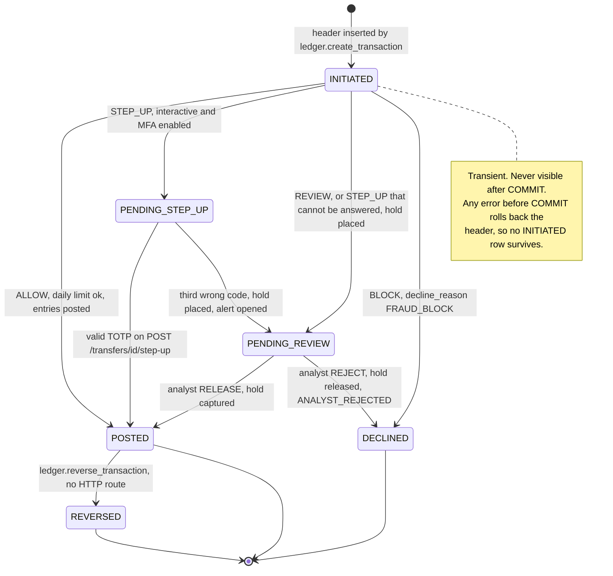
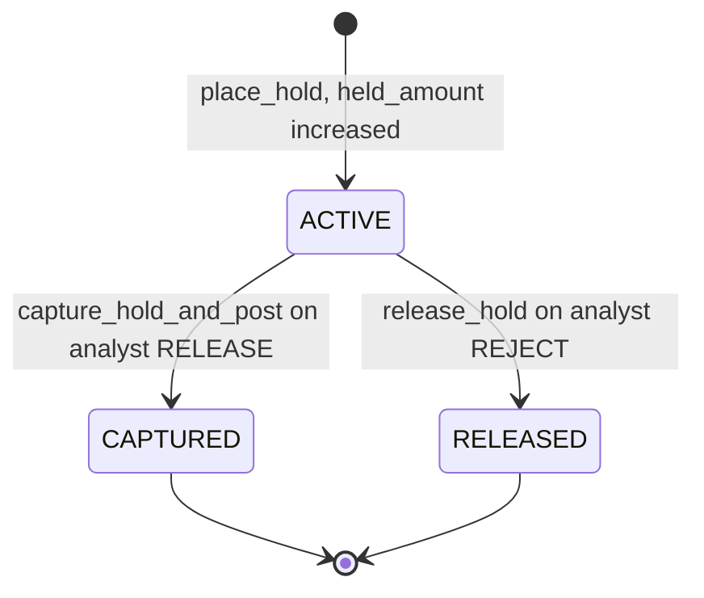
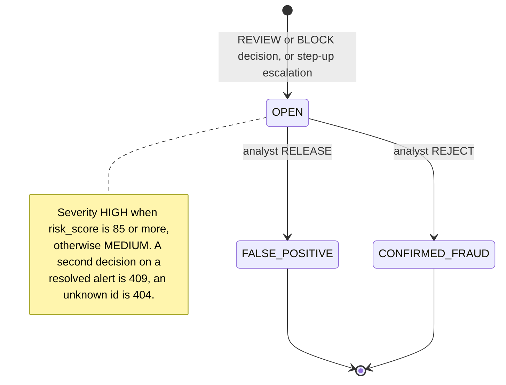
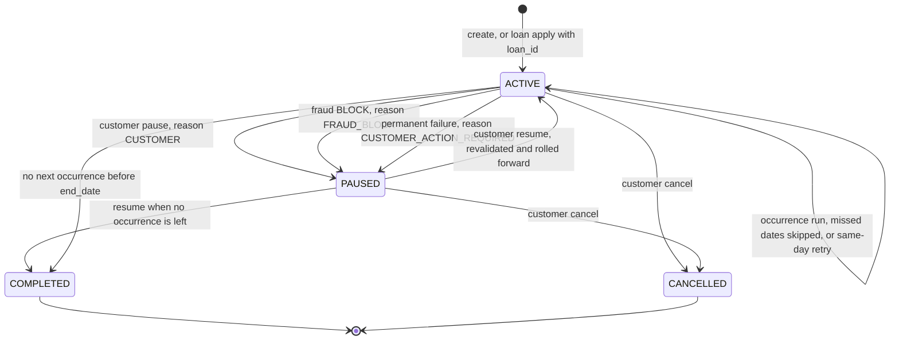
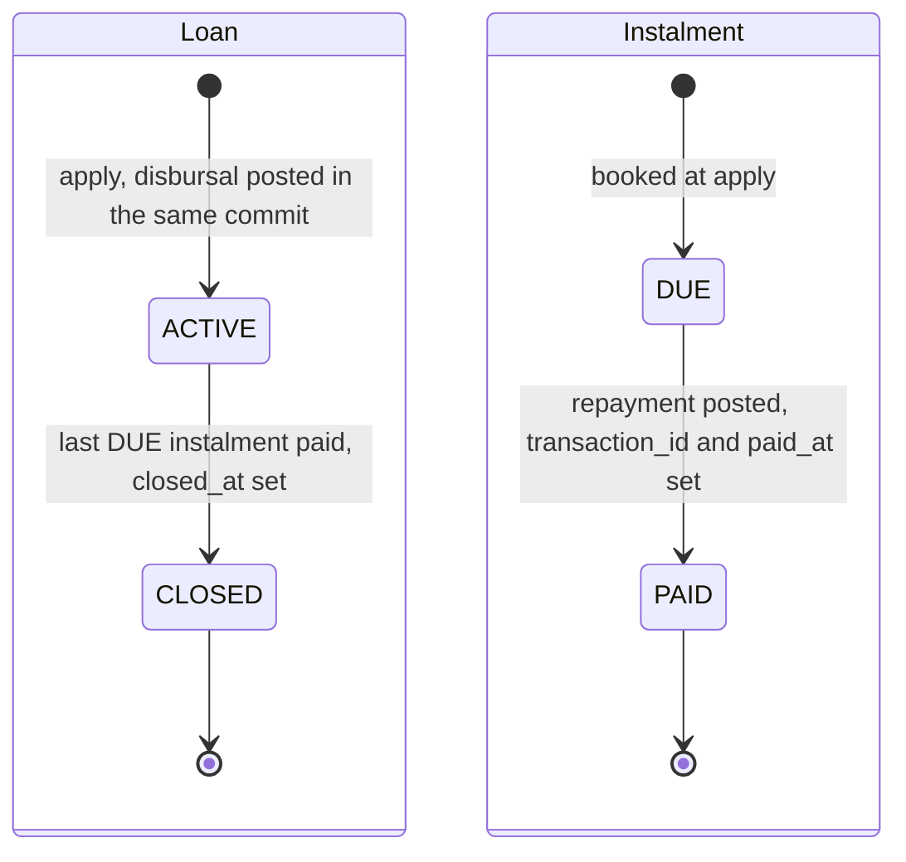
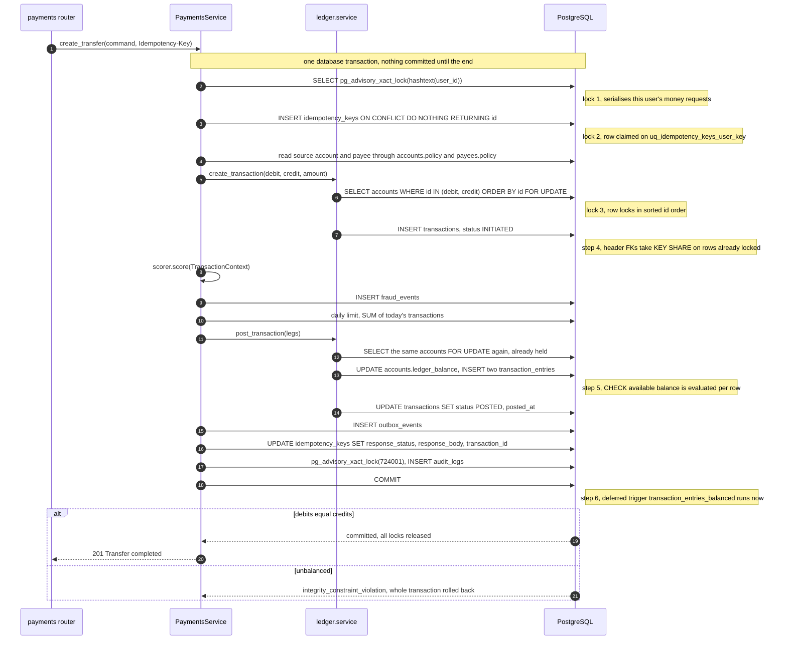
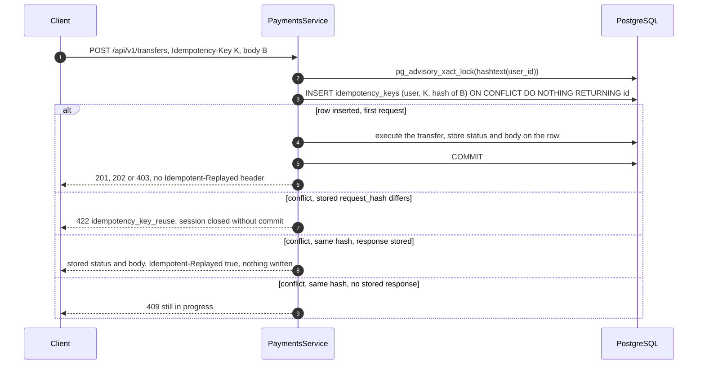
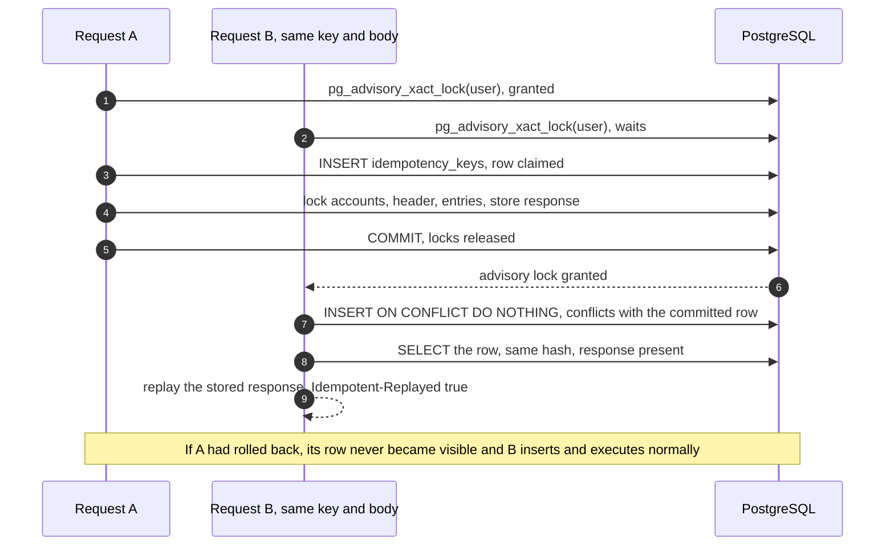

# PBIP Low-Level Design (LLD) and Data Model Specification

| | |
|---|---|
| Task | TASK-027 (#50) |
| Scope | Every table (columns that matter, keys, `ON DELETE`, CHECK constraints, indexes, triggers, owning module); state machines for transfers, holds, fraud alerts, bill payments, scheduled transfers and loans; the lock-order and idempotency sequences |
| Verified against | `main` at `da9a8fd` (2 Nov 2026): Alembic migrations `0001` to `0016`, the SQLAlchemy models and services, and the tests cited. Earlier documents were not used as evidence |
| Related | [HLD](HLD.md) (system context, containers, contracts), [ER diagram](er-diagram.md) (generated from the migrated schema, CI-checked), [Blueprint section 7](../PROJECT_BLUEPRINT.md#7-transaction-and-ledger-architecture), [ADR-0002](../adr/0002-double-entry-ledger.md), [ADR-0003](../adr/0003-idempotency-in-postgresql.md), [ADR-0023](../adr/0023-scheduled-transfers.md), [ADR-0024](../adr/0024-loan-disbursal-and-repayments.md) |

**How to read this document.** Every statement points at the file that proves it. Paths are relative to the
repository root; `api/` below is short for `apps/api/src/pbip_api/`, `versions/` for `apps/api/alembic/versions/`
and `tests/` for `apps/api/tests/`. Where the code differs from the blueprint, an ADR or the HLD, the code is
described and the difference is listed in [section 6](#6-where-the-code-differs-from-the-plan). Nothing here is
planned work unless it says so.

The relationship diagram is not repeated here. [`er-diagram.md`](er-diagram.md) is generated by
`scripts/er_diagram.py` from a database migrated to `0016` and CI fails when it drifts, so it is the
authoritative picture of columns, keys and relationships. This document adds what a diagram cannot show:
purpose, ownership, indexes, trigger behaviour and the rules the code follows on top of the schema.

---

## 1. Conventions used by every table

| Convention | Where it is defined | Detail |
|---|---|---|
| Primary keys | `api/core/db.py` (`uuid_pk`) | `UUID`, `server_default gen_random_uuid()`. Exceptions: `roles` (PK `name`), `user_roles` and `account_holders` (composite PKs), `clickstream_events` (PK `(id, event_timestamp)`, required by partitioning) |
| Money | AGENTS.md section 4, `api/core/money.py` | `BIGINT` integer minor units (paise). No `float` or `numeric` money column exists. `Float` appears only on non-money columns (`fraud_events.latency_ms`, `customer_segments` ratios) |
| Timestamps | `api/core/db.py` (`created_at_col`, `utcnow`) | `timestamptz`, `server_default now()` |
| Enumerations | `api/core/db.py` (`str_enum`, `in_check`) | Stored as `VARCHAR` (`native_enum=False`), constrained by a CHECK `col IN (...)` generated from the Python `StrEnum`. Three enum-valued columns have no CHECK (section 3.15) |
| Constraint names | `api/core/db.py` (`NAMING_CONVENTION`) | `pk_<table>`, `fk_<table>_<col>_<referred>`, `uq_<table>_<cols>`, `ix_<table>_<cols>`, `ck_<table>_<name>`. Migrations `0002` to `0004` pass already prefixed CHECK names, so the database holds double-prefixed names (section 3.15). The real names are the ones in `er-diagram.md` |
| `ON DELETE` | migrations | When a migration does not set it, PostgreSQL uses `NO ACTION` (the row cannot be deleted while referenced). This document writes that as `NO ACTION` |
| Model registry | `api/modules/__init__.py`, `apps/api/alembic/env.py` | Every `models.py` is imported in both, so Celery and scripts resolve cross-module FKs (regression-tested, see AGENTS.md section 2) |

The `synthetic` schema (migration `0002`) has no ORM models. It is written by `pbip_datagen.loader` with `COPY`
and is never joined to the operational schema ([ADR-0009](../adr/0009-synthetic-dataset-schema.md)).

---

## 2. Table inventory

36 tables: 33 in `public`, 3 in `synthetic` (the same count as `er-diagram.md`). Partitions of
`clickstream_events` and `alembic_version` are not counted.

| # | Table | Owning module (`models.py`) | Created in | Purpose |
|---|---|---|---|---|
| 1 | `roles` | `auth` | 0001 | The five roles (seeded) |
| 2 | `users` | `auth` | 0001, 0011 | Login identity, password hash, lockout, TOTP state, `token_version` |
| 3 | `user_roles` | `auth` | 0001 | User to role assignment |
| 4 | `refresh_tokens` | `auth` | 0001 | Rotating refresh tokens grouped in families (reuse detection) |
| 5 | `mfa_recovery_codes` | `auth` | 0001 | Hashed one-time recovery codes |
| 6 | `security_events` | `auth` | 0001 | Authentication telemetry, also read by fraud features |
| 7 | `customers` | `customers` | 0001 | Customer profile, one per customer user |
| 8 | `devices` | `customers` | 0001 | Known device fingerprints per customer |
| 9 | `accounts` | `accounts` | 0001 | Customer and system accounts with the materialised balance |
| 10 | `account_holders` | `accounts` | 0001 | Who holds an account (primary or joint) |
| 11 | `payees` | `payees` | 0001 | A customer's saved beneficiaries |
| 12 | `transactions` | `ledger` | 0001, 0008, 0016 | Payment instruction and lifecycle (the header) |
| 13 | `transaction_entries` | `ledger` | 0001, 0005 | Immutable double-entry lines: the financial truth |
| 14 | `holds` | `ledger` | 0001 | Funds reserved for a transaction under review |
| 15 | `idempotency_keys` | `ledger` | 0001 | One row per (user, `Idempotency-Key`) with the stored response |
| 16 | `fraud_events` | `fraud` | 0001, 0012 | Every scoring decision with its feature snapshot |
| 17 | `fraud_alerts` | `fraud` | 0001, 0013 | Analyst queue for REVIEW and BLOCK decisions |
| 18 | `billers` | `bills` | 0008 | Utility billers (five seeded) |
| 19 | `bill_payments` | `bills` | 0008, 0010 | A bill payment and its ledger transaction |
| 20 | `scheduled_transfers` | `payments` | 0014, 0016 | Standing orders and loan repayment instructions |
| 21 | `loans` | `loans` | 0016 | A disbursed loan with its contract snapshot |
| 22 | `loan_instalments` | `loans` | 0016 | The repayment schedule, one row per EMI |
| 23 | `wealth_products` | `wealth` | 0018 | Wealth catalogue (seeded reference data, ADR-0025) |
| 24 | `fixed_deposits` | `wealth` | 0018 | A booked fixed deposit with its contract snapshot |
| 25 | `notifications` | `notifications` | 0001, 0007 | In-app notification inbox |
| 26 | `outbox_events` | `notifications` | 0001 | Transactional outbox, relayed into notifications |
| 27 | `audit_logs` | `compliance` | 0001 | Hash-chained, append-only audit trail |
| 28 | `monthly_category_spending` | `analytics` | 0003 | Nightly spending aggregates per account, month and category |
| 29 | `customer_segments` | `analytics` | 0004 | Weekly rule-based customer segment |
| 30 | `clickstream_events` | `events` | 0006 | Web behaviour events, range-partitioned by month |
| 31 | `assistant_messages` | `assistant` | 0009 | AI assistant conversation history |
| 32 | `rm_interactions` | `insights` | 0015 | Relationship manager outreach log |
| 33 | `runtime_settings` | `runtime_config` | 0020 | ADMIN overrides of allow-listed business limits (ADR-0031) |
| 34 | `synthetic.generation_runs` | none (`pbip_datagen`) | 0002 | One seeded generator run |
| 35 | `synthetic.customers` | none (`pbip_datagen`) | 0002 | Synthetic customers of a run |
| 36 | `synthetic.transactions` | none (`pbip_datagen`) | 0002 | Synthetic transactions of a run (ML training data) |

---

## 3. Schema reference

Each entry lists the columns that carry rules (the full column list is in `er-diagram.md`), then foreign keys
with `ON DELETE`, CHECK constraints, unique constraints and indexes, and triggers. "Writers" names the code that
inserts or updates the table.

### 3.1 Identity and sessions (`api/modules/auth/models.py`)

**`roles`** (0001). PK `name VARCHAR(40)`, `description`. Seeded by `versions/20261006_0001_core_schema.py`
(`ROLES`): `CUSTOMER`, `RELATIONSHIP_MANAGER`, `FRAUD_ANALYST`, `COMPLIANCE_OFFICER`, `ADMIN`. No FKs, CHECKs or
triggers.

**`users`** (0001, 0011)
* Key columns: `email VARCHAR(320)`, `password_hash` (Argon2id, `api/core/security.py`), `status`,
  `failed_login_count`, `locked_until`, `mfa_enabled`, `mfa_secret_enc` (encrypted with MultiFernet,
  `api/core/crypto.py`), `mfa_last_step` (TOTP replay protection), `token_version INTEGER DEFAULT 0` (0011,
  [ADR-0021](../adr/0021-access-token-revocation.md)).
* CHECK: `ck_users_status_valid` `status IN ('ACTIVE','DISABLED')`; `ck_users_token_version_non_negative`
  `token_version >= 0` (0011).
* Unique: functional unique index `uq_users_email_lower` on `lower(email)` (case-insensitive email).
* FKs: none. Triggers: none.

**`user_roles`** (0001). PK `(user_id, role_name)`. FKs: `user_id -> users` `CASCADE`; `role_name -> roles`
`NO ACTION`. No CHECKs, no extra indexes.

**`refresh_tokens`** (0001, 0012)
* Key columns: `family_id` (all rotations of one login), `token_hash` (SHA-256, never the token), `amr`,
  `expires_at`, `used_at`, `revoked_at`, `replaced_by_id` (plain UUID, no FK), `ip`, `user_agent`.
* FK: `user_id -> users` `CASCADE`.
* Unique: `uq_refresh_tokens_token_hash`. Indexes: `ix_refresh_tokens_family_id`, `ix_refresh_tokens_user_id`
  (0012, revoke-all on password change).
* Reuse detection and rotation live in `api/modules/auth/service.py`
  ([ADR-0004](../adr/0004-refresh-rotation-cookie.md)).

**`mfa_recovery_codes`** (0001). `code_hash`, `used_at`. FK `user_id -> users` `CASCADE`. Index
`ix_mfa_recovery_codes_user_id`.

**`security_events`** (0001, 0012 unchanged)
* Key columns: `event_type VARCHAR(48)`, `ip`, `user_agent`, `request_id`, `details JSONB`.
* FK: `user_id -> users` `SET NULL` (telemetry survives the user).
* Indexes: `ix_security_events_user_id_created_at`, `ix_security_events_event_type_created_at`.
* No CHECK on `event_type` and no immutability trigger (section 3.15). The step-up failure counter reads this
  table: `PaymentsService._step_up_failures` counts `STEP_UP_FAILURE` rows whose `details.subject` is the
  transaction id.

### 3.2 Customers and devices (`api/modules/customers/models.py`)

**`customers`** (0001, 0018)
* Key columns: `full_name`, `date_of_birth`, `phone_enc` (encrypted), `kyc_status`, `segment`, `risk_profile` with
  `risk_score`, `risk_answers` (JSONB), `risk_questionnaire_version`, `risk_assessed_at` (TASK-097, all set together),
  and `recommendations_consent_at` with `recommendations_consent_policy` (TASK-107, NULL = no consent).
* FK: `user_id -> users` `RESTRICT`, unique (`uq_customers_user_id`): one customer per user.
* CHECK: `ck_customers_kyc_status_valid` `kyc_status IN ('PENDING','VERIFIED','REJECTED')`;
  `ck_customers_risk_profile_valid` (LOW, MODERATE, HIGH), `ck_customers_risk_score_range` (0-10),
  `ck_customers_risk_assessment_complete` (band, score, answers, version and time all set or all NULL),
  `ck_customers_recommendations_consent_complete` (consent time and policy version together).

**`devices`** (0001)
* Key columns: `fingerprint_hash`, `label`, `first_seen_at`, `last_seen_at`, `trusted`.
* FK: `customer_id -> customers` `NO ACTION`.
* Unique: `uq_devices_customer_fingerprint (customer_id, fingerprint_hash)`. Index `ix_devices_customer_id`.

### 3.3 Accounts and payees

**`accounts`** (0001, `api/modules/accounts/models.py`)
* Key columns: `account_number VARCHAR(20)` (unique), `account_type`, `currency VARCHAR(3)`, `status`,
  `ledger_balance BIGINT`, `held_amount BIGINT`, `overdraft_limit BIGINT`.
* CHECK:
  * `ck_accounts_type_valid` `account_type IN ('SAVINGS','CURRENT','SYSTEM')`
  * `ck_accounts_status_valid` `status IN ('ACTIVE','FROZEN','CLOSED')`
  * `ck_accounts_held_non_negative` `held_amount >= 0`
  * `ck_accounts_overdraft_non_negative` `overdraft_limit >= 0`
  * `ck_accounts_available_non_negative`
    `account_type = 'SYSTEM' OR (ledger_balance - held_amount + overdraft_limit) >= 0`. This is the database
    backstop against overdraft; `Account.spendable` computes the same expression in Python. Proven by
    `tests/integration/test_ledger.py::test_database_check_constraint_blocks_overdrawing_even_with_raw_sql`.
* Seeded system accounts (0001, `SYSTEM_ACCOUNTS`): `SYS-CLEARING` `00000000-0000-0000-0000-0000000000c1` and
  `SYS-FEES` `...0000c2`, referenced in code as `ledger.SYSTEM_CLEARING_ID` / `SYSTEM_FEES_ID`; 0018 adds
  `SYS-FIXED-DEPOSITS` `...0000c3` (`ledger.SYSTEM_FIXED_DEPOSITS_ID`, the deposit liability, ADR-0025). System accounts
  may go negative (the CHECK exempts them), which is how money enters and leaves the simulated bank.
* Writers: only `api/modules/ledger/service.py` changes `ledger_balance` and `held_amount` (AGENTS.md section 4).
  This is a code rule enforced by review; no trigger stops another `UPDATE` (section 3.15).

**`account_holders`** (0001). PK `(account_id, customer_id)`. FKs `account_id -> accounts` and
`customer_id -> customers`, both `NO ACTION`. CHECK `ck_account_holders_holder_role_valid`
`holder_role IN ('PRIMARY','JOINT')`. Index `ix_account_holders_customer_id`. Ownership checks for every
account read go through `api/modules/accounts/policy.py` (`get_owned_account`), which joins this table on the
authenticated customer id.

**`payees`** (0001, `api/modules/payees/models.py`)
* Key columns: `name`, `account_number`, `bank_code`, `nickname`, `status`, `verified_at`.
* FK: `customer_id -> customers` `NO ACTION`.
* CHECK: `ck_payees_status_valid` `status IN ('PENDING_VERIFICATION','VERIFIED','BLOCKED')`.
* Unique: `uq_payees_customer_destination (customer_id, bank_code, account_number)`. Index `ix_payees_customer_id`.
* Only `VERIFIED` payees can receive money (`PaymentsService._resolve_destination`). A payee whose `bank_code` is
  not `INTERNAL_BANK_CODE` is paid into `SYS-CLEARING` (simulated external rail).

### 3.4 The ledger (`api/modules/ledger/models.py`, written only by `api/modules/ledger/service.py`)

**`transactions`** (0001, type CHECK widened in 0008 and 0016, index added in 0012)
* Purpose: the payment instruction and its lifecycle. `debit_account_id` / `credit_account_id` are the
  *instruction*; the money is in `transaction_entries`.
* Key columns: `type`, `status`, `amount BIGINT`, `currency`, `reference VARCHAR(140)`, `decline_reason`
  (`FRAUD_BLOCK` or `ANALYST_REJECTED`), `channel VARCHAR(10)` (`WEB` or `SCHEDULED`, `TransferChannel` in
  `api/modules/payments/service.py`), `reversal_of_id`, `posted_at`.
* FKs, all `NO ACTION`: `initiated_by_user_id -> users`, `debit_account_id -> accounts`,
  `credit_account_id -> accounts`, `payee_id -> payees`, `reversal_of_id -> transactions` (self).
* CHECK:
  * `ck_transactions_type_valid` `type IN ('TRANSFER','DEPOSIT','REVERSAL','FEE','BILL_PAYMENT','LOAN_DISBURSAL','LOAN_REPAYMENT','FD_BOOKING','FD_CLOSURE','FD_INTEREST')`
    (0001 had the first four; 0008 added `BILL_PAYMENT`; 0016 added the two loan types; 0018 the three deposit types)
  * `ck_transactions_status_valid` `status IN ('INITIATED','PENDING_STEP_UP','PENDING_REVIEW','POSTED','DECLINED','REVERSED')`
  * `ck_transactions_amount_positive` `amount > 0`
* Indexes: `ix_transactions_initiated_by_user_id_created_at` (daily limit, customer history),
  `ix_transactions_debit_account_id_created_at`, `ix_transactions_status`, `ix_transactions_payee_id` (0012).
* Lifecycle: [section 4.1](#41-transfer-lifecycle-transactionsstatus).

**`transaction_entries`** (0001, index added in 0005)
* Purpose: immutable double-entry lines. From the account's own perspective a `DEBIT` decreases and a `CREDIT`
  increases its balance.
* Key columns: `seq BIGINT GENERATED ALWAYS AS IDENTITY` (unique, global posting order and the keyset cursor,
  [ADR-0008](../adr/0008-ledger-keyset-cursor.md)), `direction`, `amount`, `currency`, `balance_after` (running
  balance of that account after this line).
* FKs, both `NO ACTION`: `transaction_id -> transactions`, `account_id -> accounts`.
* CHECK: `ck_transaction_entries_direction_valid` `direction IN ('DEBIT','CREDIT')`;
  `ck_transaction_entries_amount_positive` `amount > 0`.
* Unique: `uq_transaction_entries_seq`. Indexes: `ix_transaction_entries_account_id_seq` (statement and history
  pages), `ix_transaction_entries_transaction_id`, `ix_transaction_entries_account_id_created_at` (0005, analytics
  windows).
* Triggers (0001, `_create_ledger_guards`):
  * `transaction_entries_immutable`: `BEFORE UPDATE OR DELETE ... FOR EACH ROW EXECUTE FUNCTION pbip_forbid_mutation()`.
    Raises `integrity_constraint_violation` ("table is append-only"). Proven by
    `tests/integration/test_ledger.py::test_entries_are_immutable`.
  * `transaction_entries_balanced`: `CREATE CONSTRAINT TRIGGER ... AFTER INSERT ... DEFERRABLE INITIALLY DEFERRED
    FOR EACH ROW EXECUTE FUNCTION pbip_check_transaction_balanced()`. At `COMMIT` it sums the `DEBIT` and
    `CREDIT` amounts of the inserted row's `transaction_id` and raises when they differ, so the whole database
    transaction fails. Because every amount is positive, a single unmatched entry can never pass. Proven by
    `tests/integration/test_ledger.py::test_database_itself_rejects_an_unbalanced_transaction_at_commit`. The same
    rule is checked first in Python (`post_transaction` raises `LedgerInvariantError`,
    `test_unbalanced_legs_are_refused_by_the_engine`).

**`holds`** (0001)
* Purpose: funds reserved for a transaction awaiting review. A hold raises `accounts.held_amount` (lowering the
  available balance) without touching `ledger_balance`.
* FKs `account_id -> accounts`, `transaction_id -> transactions`, both `NO ACTION`.
* CHECK: `ck_holds_status_valid` `status IN ('ACTIVE','RELEASED','CAPTURED')`; `ck_holds_amount_positive`.
* Unique: `uq_holds_transaction_id` (at most one hold per transaction). Index `ix_holds_account_id`.
* Lifecycle: [section 4.2](#42-hold-lifecycle-holdsstatus).

**`idempotency_keys`** (0001)
* Purpose: exactly-once execution of money-moving POSTs ([ADR-0003](../adr/0003-idempotency-in-postgresql.md)).
* Key columns: `key VARCHAR(255)`, `request_hash` (SHA-256 of a canonical JSON of the request, user included),
  `response_status`, `response_body JSONB`, `transaction_id`, `expires_at`.
* FKs `user_id -> users`, `transaction_id -> transactions`, both `NO ACTION`.
* Unique: `uq_idempotency_keys_user_key (user_id, key)`. This constraint is what makes retries and concurrent
  duplicates safe.
* Shared by four use cases, each with its own request hash, so a key reused across endpoints is a 422, never a
  replay of another endpoint's response: transfers (`PaymentsService._request_hash`), bill payments
  (`BillsService._request_hash`, `"kind": "bill_payment"`), scheduled-transfer creation
  (`_schedule_request_hash`, `"op": "scheduled_transfer.create"`) and loan applications (`loans/service.py`
  `_apply_hash`, `"op": "loan.apply"`). Scheduled occurrences use the deterministic key
  `sched-{instruction_id}-{YYYY-MM-DD}`.
* Resolution sequence: [section 5.3](#53-idempotency-resolution).

### 3.5 Fraud (`api/modules/fraud/models.py`, written by `api/modules/fraud/service.py`)

**`fraud_events`** (0001, index added in 0012)
* Purpose: one row per scoring decision, for audit and retraining (AGENTS.md section 8).
* Key columns: `risk_score INTEGER`, `decision VARCHAR(16)` (`ALLOW`, `STEP_UP`, `REVIEW`, `BLOCK` from
  `pbip_ml.fraud.contract.FraudDecision`), `reasons JSONB`, `features JSONB` (the feature snapshot),
  `model_version`, `latency_ms`.
* FKs `transaction_id -> transactions`, `customer_id -> customers`, both `NO ACTION`.
* No CHECK on `decision` (section 3.15).
* Indexes: `ix_fraud_events_transaction_id`, `ix_fraud_events_decision_created_at`,
  `ix_fraud_events_customer_id_created_at` (0012, read on every scored payment).

**`fraud_alerts`** (0001, index added in 0013)
* Purpose: the analyst queue. Opened by `fraud_service.open_alert` for `REVIEW` and `BLOCK` decisions and for a
  step-up escalation.
* Key columns: `status`, `severity` (`HIGH` when `risk_score >= 85`, else `MEDIUM`, `_HIGH_SEVERITY_SCORE` in
  `fraud/service.py`), `assigned_to_user_id`, `resolution_note`, `resolved_at`.
* FKs, all `NO ACTION`: `fraud_event_id -> fraud_events` (unique: one alert per decision),
  `transaction_id -> transactions`, `assigned_to_user_id -> users`.
* CHECK: `ck_fraud_alerts_status_valid` `status IN ('OPEN','CONFIRMED_FRAUD','FALSE_POSITIVE')`;
  `ck_fraud_alerts_severity_valid` `severity IN ('MEDIUM','HIGH')`.
* Indexes: `ix_fraud_alerts_status_created_at` (queue), `ix_fraud_alerts_transaction_id` (0013).
* Lifecycle: [section 4.3](#43-fraud-alert-review-flow-fraud_alertsstatus).

### 3.6 Bill payments (`api/modules/bills/models.py`, TASK-014)

**`billers`** (0008)
* CHECK: `ck_billers_category_valid` `category IN ('ELECTRICITY','WATER','TELECOM','GAS','BROADBAND','INSURANCE')`;
  `ck_billers_status_valid` `status IN ('ACTIVE','INACTIVE')`.
* Unique `uq_billers_biller_code`. Index `ix_billers_status`.
* Seeded in 0008: five active billers with fixed ids `...0000b1` to `...0000b5` (`ON CONFLICT DO NOTHING`).

**`bill_payments`** (0008, status CHECK widened in 0010)
* Key columns: `consumer_reference VARCHAR(64)`, `amount`, `currency`, `status`.
* FKs, all `NO ACTION`: `customer_id -> customers`, `account_id -> accounts`, `biller_id -> billers`,
  `transaction_id -> transactions` (unique: one bill payment per ledger transaction).
* CHECK: `ck_bill_payments_status_valid` `status IN ('POSTED','PENDING_REVIEW','DECLINED','REVERSED')` (0010
  added `PENDING_REVIEW`); `ck_bill_payments_amount_positive`.
* Indexes: `ix_bill_payments_biller_id`, `ix_bill_payments_customer_id_created_at`.
* The ledger side is a `transactions` row of type `BILL_PAYMENT` that debits the customer and credits
  `SYS-CLEARING` (`BillsService.pay_bill`). Lifecycle: [section 4.4](#44-bill-payment-status).

### 3.7 Scheduled transfers (`api/modules/payments/models.py`, TASK-015, ADR-0023)

**`scheduled_transfers`** (0014, `loan_id` added in 0016)
* Key columns: `amount`, `currency`, `reference`, `frequency`, `status`, `start_date`, `end_date`,
  `next_run_date`, `last_run_date`, `last_transaction_id`, `failure_count`, `last_failure_reason`,
  `last_failed_occurrence_date`, `pause_reason`, `loan_id`.
* FKs: `customer_id -> customers`, `user_id -> users`, `from_account_id -> accounts`, `payee_id -> payees`,
  `to_account_id -> accounts`, `loan_id -> loans` (0016), all `RESTRICT`; `last_transaction_id -> transactions`
  `SET NULL`.
* CHECK:
  * `ck_scheduled_transfers_amount_positive` `amount > 0`
  * `ck_scheduled_transfers_failure_count_non_negative` `failure_count >= 0`
  * `ck_scheduled_transfers_frequency_valid` `frequency IN ('DAILY','WEEKLY','MONTHLY')`
  * `ck_scheduled_transfers_status_valid` `status IN ('ACTIVE','PAUSED','CANCELLED','COMPLETED')`
  * `ck_scheduled_transfers_destination_xor` `num_nonnulls(payee_id, to_account_id, loan_id) = 1` (0016; 0014
    had the two-way XOR of `payee_id` and `to_account_id`)
  * `ck_scheduled_transfers_end_date_valid` `end_date IS NULL OR end_date >= start_date`
  * `ck_scheduled_transfers_pause_reason_valid`
    `(status = 'PAUSED' AND pause_reason IN ('CUSTOMER','FRAUD_BLOCK','CUSTOMER_ACTION_REQUIRED')) OR (status <> 'PAUSED' AND pause_reason IS NULL)`
* Unique: `uq_scheduled_transfers_loan_id` (0016, one repayment instruction per loan).
* Indexes: `ix_scheduled_transfers_status_next_run_date` (the engine's due query), `..._customer_id_created_at`,
  and one index per remaining FK (`user_id`, `from_account_id`, `payee_id`, `to_account_id`,
  `last_transaction_id`).
* Constraint behaviour is tested in
  `tests/integration/test_scheduled_transfers_db.py::test_scheduled_transfer_persists_valid_row_and_enforces_check_constraints`.
  Lifecycle: [section 4.5](#45-scheduled-transfer-lifecycle-scheduled_transfersstatus).

### 3.8 Loans (`api/modules/loans/models.py`, TASK-047, ADR-0024)

**`loans`** (0016)
* Purpose: a disbursed loan. Rate, tenure and EMI are a snapshot of the catalogue terms at approval
  (`api/modules/loans/catalogue.py`), so a catalogue change never rewrites a contract.
* Key columns: `product_id` (catalogue id, not an FK), `loan_type`, `annual_rate_bps`, `tenure_months`,
  `principal`, `emi`, `total_interest`, `currency`, `status`, `closed_at`.
* FKs, all `RESTRICT`: `customer_id -> customers`, `user_id -> users`, `account_id -> accounts`,
  `disbursal_transaction_id -> transactions` (unique: one loan per disbursal).
* CHECK: `ck_loans_loan_type_valid` `loan_type IN ('PERSONAL','AUTO','HOME')`; `ck_loans_status_valid`
  `status IN ('ACTIVE','CLOSED')`; `ck_loans_principal_positive`; `ck_loans_emi_positive`;
  `ck_loans_tenure_positive`; `ck_loans_rate_non_negative`; `ck_loans_total_interest_non_negative`;
  `ck_loans_closed_at_matches_status` `(status = 'CLOSED') = (closed_at IS NOT NULL)`.
* Indexes: `ix_loans_customer_id_created_at`, `ix_loans_user_id`, `ix_loans_account_id`.

**`loan_instalments`** (0016)
* Key columns: `seq`, `due_date`, `amount`, `principal`, `interest`, `balance_after` (outstanding principal),
  `status`, `transaction_id`, `paid_at`.
* FKs: `loan_id -> loans` `CASCADE`; `transaction_id -> transactions` `RESTRICT`.
* CHECK: `ck_loan_instalments_status_valid` `status IN ('DUE','PAID')`; `ck_loan_instalments_seq_positive`
  `seq >= 1`; `ck_loan_instalments_amount_positive`; `ck_loan_instalments_parts_non_negative`;
  `ck_loan_instalments_amount_is_principal_plus_interest` `amount = principal + interest`;
  `ck_loan_instalments_balance_after_non_negative`; `ck_loan_instalments_paid_has_transaction`
  `(status = 'PAID') = (transaction_id IS NOT NULL AND paid_at IS NOT NULL)`.
* Unique `uq_loan_instalments_loan_id_seq`. Index `ix_loan_instalments_transaction_id`.
* "Overdue" is not stored: it is derived as `DUE` and `due_date` before today (`loans/service.py` `_status`,
  ADR-0024).

### 3.8a Wealth (`api/modules/wealth/models.py`, TASK-063/064, ADR-0025)

**`wealth_products`** (0018)
* Purpose: the wealth catalogue, seeded by migration 0018 (eight products, `catalogue_version` `2026-11-v1`);
  a rate change is a new migration. Fixed ids `20000000-0000-4000-a000-00000000000N`.
* Key columns: `code` (unique), `product_type`, `name`, `risk_level`, `yield_basis`, `annual_rate_bps` (NULL
  when market-linked), `tenures_months INTEGER[]`, `min_lock_in_months`, `min_amount_minor`,
  `max_amount_minor`, `premature_penalty_bps` (NULL: no premature closure), `bookable`, `notes`.
* CHECK: enums; `ck_wealth_products_rate_only_when_not_market_linked`; non-negative rate, lock-in and penalty;
  positive minimum, maximum at least the minimum; `ck_wealth_products_bookable_is_a_complete_deposit` (only a
  fixed deposit with a rate, amount range and tenures can be bookable). Index `ix_wealth_products_risk_level`.

**`fixed_deposits`** (0018)
* Purpose: a booked deposit with a snapshot of its terms (`annual_rate_bps`, `tenure_months`, `lock_in_months`,
  `premature_penalty_bps`) and its exact figures (`principal`, `maturity_interest`, `maturity_amount`,
  `start_date`, `maturity_date`); closure fills `closure_kind`, `paid_interest`, `closed_on`, `closed_at`.
* FKs, all `RESTRICT`: `customer_id -> customers`, `user_id -> users`, `account_id -> accounts`,
  `product_id -> wealth_products`, `booking_transaction_id`, `closure_transaction_id`,
  `interest_transaction_id -> transactions` (each unique).
* CHECK: `status IN ('ACTIVE','CLOSED')`; `closure_kind IN ('MATURED','PREMATURE')`; `principal > 0`;
  `tenure_months > 0 AND mod(tenure_months, 3) = 0`; `maturity_amount = principal + maturity_interest`;
  `maturity_date > start_date`; `ck_fixed_deposits_closed_has_payout` (CLOSED exactly when the closure columns
  and the principal payout transaction are set); an interest transaction only when interest was paid.
* Indexes: `ix_fixed_deposits_customer_id_created_at`, `ix_fixed_deposits_user_id`, `ix_fixed_deposits_account_id`,
  `ix_fixed_deposits_product_id`.
* "Matured" is not stored: it is `ACTIVE` with `maturity_date` on or before today (IST), derived on read like
  loan arrears.

### 3.9 Notifications and outbox (`api/modules/notifications/models.py`)

**`notifications`** (0001, link columns added in 0007)
* Key columns: `type`, `title VARCHAR(140)`, `body`, `read_at`, `resource_type`, `resource_id`, `account_id`.
* FK `user_id -> users` `CASCADE`. `resource_id` and `account_id` are plain UUIDs without FKs (deep links only).
* CHECK `ck_notifications_resource_type_valid` `resource_type IS NULL OR resource_type IN ('transaction','security')`.
* Index `ix_notifications_user_id_created_at`.

**`outbox_events`** (0001)
* Key columns: `event_type`, `payload JSONB`, `processed_at`. No FKs.
* Partial index `ix_outbox_events_unprocessed` on `created_at WHERE processed_at IS NULL`.
* Written by `notifications.enqueue` inside the business transaction; the Celery beat task `pbip.outbox.relay`
  (every 10 s, `api/worker/celery_app.py`) runs `relay_outbox`, which claims rows with
  `FOR UPDATE SKIP LOCKED`, inserts notifications and sets `processed_at`. Proven by
  `tests/integration/test_audit_and_outbox.py::test_outbox_relay_creates_notifications_exactly_once_and_only_for_the_owner`.

### 3.10 Audit (`api/modules/compliance/models.py`, `compliance/service.py`)

**`audit_logs`** (0001)
* Key columns: `seq BIGINT GENERATED ALWAYS AS IDENTITY` (unique), `actor_user_id` (plain UUID, no FK, so the
  trail outlives users), `action`, `resource_type`, `resource_id`, `request_id`, `ip`, `details JSONB`,
  `prev_hash`, `hash`.
* Indexes: `ix_audit_logs_actor_user_id`, `ix_audit_logs_resource (resource_type, resource_id)`.
* Trigger: `audit_logs_immutable` `BEFORE UPDATE OR DELETE ... EXECUTE FUNCTION pbip_forbid_mutation()` (the same
  function as the ledger). Proven by `tests/integration/test_audit_and_outbox.py::test_audit_rows_are_append_only`.
* Hash chain: `hash = SHA-256(canonical JSON of prev hash and the row)` (`compute_hash`). `AuditService.record`
  takes the global advisory lock `pg_advisory_xact_lock(724001)` before reading the last hash, so concurrent
  writers cannot fork the chain. The row is written in the caller's transaction. Tampering detection:
  `test_audit_chain_verifies_and_detects_tampering`.

### 3.10a Runtime configuration (`api/modules/runtime_config/models.py`, TASK-108, ADR-0031)

**`runtime_settings`** (0020)
* Columns: `id` UUID PK, `key VARCHAR(64)` unique, `value BIGINT`, `updated_by_user_id` -> `users(id)`
  `ON DELETE RESTRICT`, `created_at`, `updated_at`. A row exists only while a setting is overridden.
* CHECKs: `ck_runtime_settings_key_valid` (the allow-list: `daily_transfer_limit_minor`, `max_transfer_minor`,
  `max_active_scheduled_transfers_per_customer`), `ck_runtime_settings_value_non_negative`. The per-key bounds
  live in `runtime_config/allowlist.py` and are checked on write and again on read.
* Index: `ix_runtime_settings_updated_by_user_id`.
* Readers: `runtime_config.service.effective_settings` at each limit check in `payments/service.py` and
  `bills/service.py`, in the use case's transaction (no cache). Writers: `PUT /api/v1/admin/settings/{key}` only,
  under the audit-chain lock, with a `RUNTIME_SETTING_CHANGED` audit row (old value, new value, reason).

### 3.11 Analytics, events, assistant and insights

**`monthly_category_spending`** (0003, `api/modules/analytics/models.py`). FK `account_id -> accounts` `CASCADE`.
CHECKs: year `>= 2000`, month `BETWEEN 1 AND 12`, `total_amount_minor >= 0`, `transaction_count >= 0`. Unique
`uq_monthly_category_spending_account_period_cat (account_id, year, month, category)`; index
`ix_monthly_category_spending_account_period`. Written nightly by `pbip.analytics.materialize_monthly_spending`
([ADR-0011](../adr/0011-monthly-spending-aggregates.md)).

**`customer_segments`** (0004, `analytics/models.py`). FK `customer_id -> customers` `CASCADE`, unique (one
segment per customer). CHECKs: `segment IN ('HIGH_NET_WORTH','BUDGET_CONSCIOUS','FREQUENT_TRANSACTOR','DISCRETIONARY_SPENDER','INACTIVE_SAVER')`,
`confidence_score` and `discretionary_ratio` in `[0, 1]`, `recency_days`, `frequency`, `monetary_minor`
non-negative. Index `ix_customer_segments_segment`. Written weekly by `pbip.analytics.segment_customers`
([ADR-0012](../adr/0012-customer-segmentation-offline-job.md)).

**`clickstream_events`** (0006, `api/modules/events/models.py`). Created with raw SQL as
`PARTITION BY RANGE (event_timestamp)`; PK `(id, event_timestamp)`. FK `customer_id -> customers` `SET NULL`.
Indexes on `(customer_id, event_timestamp)`, `(session_id, event_timestamp)`, `(event_type, event_timestamp)`.
Migration 0006 creates monthly partitions `clickstream_events_2026_08` to `clickstream_events_2027_03` and
`clickstream_events_default`; `pbip.events.ensure_partitions` (daily, `events/partitions.py`) creates future
months. Inserts use `ON CONFLICT (id, event_timestamp) DO NOTHING` (`events/repository.py`), so a resent event is
not an error. Tests: `tests/integration/test_events.py::test_events_partition_routing_across_months`,
`test_partition_job_creates_future_months_so_events_avoid_the_default_partition`.

**`assistant_messages`** (0009, `api/modules/assistant/models.py`). FK `customer_id -> customers` `CASCADE`.
CHECKs: `role IN ('user','assistant')`, `char_length(content) <= 2000`, `tool_name IS NULL OR tool_name IN
('get_account_summary','get_recent_transactions','get_spend','get_balance_forecast','get_loan_affordability',
'get_unusual_expenses')` (the approved tool registry, AGENTS.md section 9; 0018 added the last one). Index `(customer_id, created_at)`.

**`rm_interactions`** (0015, `api/modules/insights/models.py`,
[ADR-0022](../adr/0022-rm-insights-detail-and-outreach-log.md)). FKs `customer_id -> customers` `CASCADE`,
`staff_user_id -> users` `RESTRICT`. CHECKs: `channel IN ('CALL','MEETING','EMAIL','NOTE')`,
`outcome IN ('INTERESTED','NOT_INTERESTED','FOLLOW_UP','NO_ANSWER','INFORMATION_SENT','ACCOUNT_REVIEW')`,
`char_length(note) BETWEEN 1 AND 1000`. Indexes `(customer_id, created_at)`, `(staff_user_id)`.

### 3.12 Synthetic ML dataset (`synthetic` schema, migration 0002, ADR-0009)

| Table | Keys and FKs | CHECKs (as written in 0002) | Triggers |
|---|---|---|---|
| `synthetic.generation_runs` | PK `id` | `seed >= 0`, `customers > 0`, `months BETWEEN 1 AND 120` | none |
| `synthetic.customers` | PK `id`; FK `run_id -> generation_runs` `CASCADE`; unique `(run_id, customer_index)`; index `run_id` | `persona` in the five personas, `monthly_income_minor > 0`, `savings_rate_bps BETWEEN 0 AND 10000`, EMI fields consistent with `has_emi`, `churned_on >= joined_on` | `trg_customers_immutable` (BEFORE UPDATE, row), `trg_customers_cascade_delete` (AFTER DELETE, statement, deletes the customers' transactions), `trg_customers_guard_truncate` (BEFORE TRUNCATE, refuses while transactions exist) |
| `synthetic.transactions` | PK `id`; **no row-level FK** by design; indexes `(customer_id, occurred_at)`, `run_id` | `direction IN ('CREDIT','DEBIT')`, `amount_minor > 0`, `event_type` in the eight event types | `trg_transactions_customer_exists` (AFTER INSERT, statement, transition table: every row's customer must exist in the same run, takes `FOR KEY SHARE` like a real FK), `trg_transactions_immutable` (BEFORE UPDATE, row) |

Why statement-level triggers instead of FKs: per-row FK checks were about 85% of a 400k-row `COPY`
(docstring of `versions/20261025_0002_synthetic_dataset_schema.py`). Rows can be deleted (a run is replaced
wholesale) but never updated. Tested by `tests/integration/test_synthetic_loader.py::test_rows_are_immutable`.

### 3.13 Database functions and triggers (all of them)

| Function | Trigger(s) | Timing | Effect |
|---|---|---|---|
| `public.pbip_forbid_mutation()` | `transaction_entries_immutable`, `audit_logs_immutable` | BEFORE UPDATE OR DELETE, per row | Raises `integrity_constraint_violation` |
| `public.pbip_check_transaction_balanced()` | `transaction_entries_balanced` (constraint trigger) | AFTER INSERT, per row, `DEFERRABLE INITIALLY DEFERRED` (runs at COMMIT) | Raises when the transaction's debits differ from its credits |
| `synthetic.check_transaction_customers()` | `trg_transactions_customer_exists` | AFTER INSERT, per statement | Raises `foreign_key_violation` for a customer outside the run |
| `synthetic.cascade_customer_delete()` | `trg_customers_cascade_delete` | AFTER DELETE, per statement | Deletes the deleted customers' transactions |
| `synthetic.reject_mutation()` | `trg_customers_immutable`, `trg_transactions_immutable` | BEFORE UPDATE, per row | Raises `restrict_violation` |
| `synthetic.guard_customer_truncate()` | `trg_customers_guard_truncate` | BEFORE TRUNCATE, per statement | Refuses while `synthetic.transactions` has rows |

No other triggers exist (the "Triggers" column of `er-diagram.md` lists the same set). Row-level triggers do not
fire on `TRUNCATE`; no `public` table has a TRUNCATE guard.

### 3.14 Migration history

| Rev | File | Change |
|---|---|---|
| 0001 | `20261006_0001_core_schema.py` | 20 core tables, roles and system accounts seeded, ledger and audit triggers |
| 0002 | `20261025_0002_synthetic_dataset_schema.py` | `synthetic` schema, 3 tables, statement-level triggers |
| 0003 | `20261029_0003_analytics_monthly_spending.py` | `monthly_category_spending` |
| 0004 | `20261029_0004_customer_segments.py` | `customer_segments` |
| 0005 | `20261030_0005_entries_account_created_index.py` | `ix_transaction_entries_account_id_created_at` |
| 0006 | `20261031_0006_clickstream_events_partitioned.py` | Partitioned `clickstream_events` and its first partitions |
| 0007 | `20261101_0007_notification_links.py` | `notifications.resource_type`, `resource_id`, `account_id` and CHECK |
| 0008 | `20261101_0008_bill_payments.py` | `billers` (seeded), `bill_payments`, `BILL_PAYMENT` transaction type |
| 0009 | `20261101_0009_assistant_messages.py` | `assistant_messages` |
| 0010 | `20261101_0010_bill_payment_review.py` | `bill_payments.status` allows `PENDING_REVIEW` |
| 0011 | `20261101_0011_user_token_version.py` | `users.token_version` (ADR-0021) |
| 0012 | `20261101_0012_hot_path_indexes.py` | Indexes on `fraud_events (customer_id, created_at)`, `refresh_tokens.user_id`, `transactions.payee_id` |
| 0013 | `20261102_0013_fraud_alert_transaction_index.py` | `ix_fraud_alerts_transaction_id` |
| 0014 | `20261102_0014_scheduled_transfers.py` | `scheduled_transfers` (ADR-0023) |
| 0015 | `20261102_0015_rm_interactions.py` | `rm_interactions` (ADR-0022) |
| 0016 | `20261102_0016_loans.py` | `loans`, `loan_instalments`, `scheduled_transfers.loan_id`, loan transaction types (ADR-0024). Its downgrade fails on purpose if loan rows exist: ledger history is never deleted to make a downgrade pass |
| 0017 | `20261102_0017_customer_risk_profile_and_consent.py` | `customers` risk-tolerance columns (band, answers, score, questionnaire version, assessed at) and the ADR-0015 recommendations consent (timestamp, policy version); nothing backfilled (TASK-097, TASK-107) |
| 0018 | `20261102_0018_wealth_catalogue_and_fixed_deposits.py` | `wealth_products` (seeded), `fixed_deposits`, `SYS-FIXED-DEPOSITS`, deposit transaction types (ADR-0025). Its downgrade fails on purpose if deposit transactions exist |
| 0019 | `20261102_0019_assistant_unusual_expenses_tool.py` | Widens the `assistant_messages.tool_name` CHECK for `get_unusual_expenses` (TASK-110); no new table |
| 0020 | `20261103_0020_runtime_settings.py` | `runtime_settings` (TASK-108, ADR-0031). Its downgrade drops any overrides; the environment values apply again |

Every migration has a downgrade; CI runs up, down, up and `alembic check`. One head is enforced by
`tests/unit/test_migration_heads.py`.

### 3.15 Schema observations

Facts found while writing this reference. None is changed by this PR.

1. **Enum columns without a CHECK.** `security_events.event_type` (the model now has 16 values, including
   `ACCOUNT_UNLOCKED` and `PASSWORD_CHANGED`, which were added without a migration because no CHECK exists),
   `fraud_events.decision` and `refresh_tokens.amr` are free `VARCHAR` in the database.
2. **`security_events` is not append-only in the database.** The model docstring says "append-only", but only
   `transaction_entries` and `audit_logs` have the immutability trigger.
3. **Balance columns are guarded by code, not by a trigger.** Only `ck_accounts_available_non_negative` and
   `ck_accounts_held_non_negative` constrain `accounts`; that only `ledger/service.py` writes them is a rule
   enforced by review (AGENTS.md section 4).
4. **Foreign keys without a supporting index** (no index whose leading column is the FK column in 0001 to 0016,
   although AGENTS.md section 6 asks for one): `transactions.credit_account_id`, `transactions.reversal_of_id`,
   `idempotency_keys.transaction_id`, `fraud_alerts.assigned_to_user_id`, `bill_payments.account_id`,
   `user_roles.role_name`.
5. **Double-prefixed constraint names.** Migrations `0002`, `0003` and `0004` name their CHECKs `ck_<table>_<name>`
   and the naming convention prefixes them again, so the catalogue holds, for example,
   `ck_customers_ck_customers_persona_valid`, and names longer than 63 characters are truncated with a hash
   suffix (e.g. `ck_customer_segments_ck_customer_segments_confidence_sc_d5bb`). Behaviour is unaffected; use the
   names in `er-diagram.md` when writing a migration that drops one.
6. **`idempotency_keys.expires_at` is never read.** It is set to now plus `IDEMPOTENCY_TTL_HOURS` (default 24,
   `api/core/config.py`), but no code checks it and no job deletes expired rows, so a key replays for as long as
   the row exists.

---

## 4. State machines

### 4.1 Transfer lifecycle (`transactions.status`)

Statuses are `TransactionStatus` in `api/modules/ledger/models.py`. Transitions are made in
`api/modules/payments/service.py` and `api/modules/ledger/service.py`. The same machine applies to
`BILL_PAYMENT` transactions (`api/modules/bills/service.py`), except that bill payments have no step-up (a
`STEP_UP` decision is held for review), and to scheduled occurrences (`interactive=False`, so `STEP_UP` becomes
`PENDING_REVIEW`).

| From | To | Trigger and guard | Code | Proving test (`tests/integration/`) |
|---|---|---|---|---|
| none | `INITIATED` | Accounts locked in sorted order, then header inserted | `ledger.create_transaction` | `test_ledger.py::test_opposing_concurrent_transfers_do_not_deadlock_and_conserve_money` |
| `INITIATED` | `POSTED` | Decision `ALLOW`; `_enforce_daily_limit`; `post_transaction` (spendable check, entries, `posted_at`) | `PaymentsService._execute_transfer` | `test_transfers.py::test_transfer_moves_money_and_writes_balanced_entries` |
| `INITIATED` | `PENDING_STEP_UP` | Decision `STEP_UP`, `interactive=True`, user has MFA. No hold, no entries | `_execute_transfer` | `test_transfers.py::test_step_up_with_mfa_completes_after_a_valid_code` |
| `INITIATED` | `PENDING_REVIEW` | Decision `REVIEW`, or `STEP_UP` without MFA or non-interactive; daily limit; `place_hold`; alert opened | `_execute_transfer` | `test_transfers.py::test_review_holds_funds_and_analyst_release_posts_the_transfer`, `test_step_up_without_mfa_escalates_to_analyst_review`, `test_payments_execute_transfer.py::test_non_interactive_step_up_becomes_review_and_holds_funds_even_with_mfa` |
| `INITIATED` | `DECLINED` | Decision `BLOCK`; `decline_reason = FRAUD_BLOCK`; alert opened; no hold | `_execute_transfer` | `test_transfers.py::test_block_declines_without_moving_money_and_hides_the_reasons` |
| `PENDING_STEP_UP` | `POSTED` | Correct TOTP (`AuthService.verify_step_up`); daily limit rechecked; entries posted | `PaymentsService.confirm_step_up` | `test_transfers.py::test_step_up_with_mfa_completes_after_a_valid_code`, `test_a_correct_code_after_two_wrong_ones_still_completes` |
| `PENDING_STEP_UP` | `PENDING_REVIEW` | `STEP_UP_MAX_FAILURES = 3` wrong codes for this transfer (counted in `security_events`); the failure is committed first, then a new transaction places the hold and opens an alert | `_escalate_to_review` | `test_transfers.py::test_three_wrong_step_up_codes_hand_the_transfer_to_an_analyst`, `test_a_second_escalation_after_one_already_won_returns_the_state_and_holds_once` |
| `PENDING_REVIEW` | `POSTED` | Analyst `RELEASE`; `capture_hold_and_post` | `PaymentsService.review_alert` | `test_transfers.py::test_review_holds_funds_and_analyst_release_posts_the_transfer` |
| `PENDING_REVIEW` | `DECLINED` | Analyst `REJECT`; `release_hold`; `decline_reason = ANALYST_REJECTED` | `review_alert` | `test_transfers.py::test_analyst_reject_releases_the_hold_and_declines` |
| `POSTED` | `REVERSED` | Only `TRANSFER` type; a compensating `REVERSAL` transaction with swapped legs and `reversal_of_id` | `ledger.reverse_transaction` | `test_ledger.py::test_reversal_is_a_compensating_transaction_not_an_edit`, `test_ledger_guards.py::test_reversal_guards` |

Rules the diagram does not show:

* A wrong code below the limit, a daily-limit failure at confirm time, or a confirm on a transfer that is not
  `PENDING_STEP_UP` (409) leaves the transfer where it was.
* Business failures during creation (insufficient funds, limits, unverified payee) roll back the whole request,
  including the header and the idempotency row: no `DECLINED` row is written for them
  (`test_transfers.py::test_failed_request_is_not_cached_so_the_client_can_retry_with_the_same_key`).
* HTTP status per outcome (`_build_result`): `POSTED` 201, `PENDING_STEP_UP` and `PENDING_REVIEW` 202,
  `DECLINED` 403. Reads and step-up completions return 200. Reasons and scores are never in the customer
  response (`test_customer_sees_the_exact_plain_message_for_each_outcome`).
* `PENDING_STEP_UP` has no timeout (section 6).

### 4.2 Hold lifecycle (`holds.status`)

Both resolutions subtract the hold from `held_amount` and set `resolved_at`; only capture writes entries.
Resolving twice is a 409 (`_active_hold`, `tests/integration/test_ledger_guards.py::test_a_hold_can_be_resolved_only_once`).
Tested end to end by `tests/integration/test_ledger.py::test_hold_reserves_funds_then_capture_posts_or_release_returns`.

### 4.3 Fraud alert review flow (`fraud_alerts.status`)

An alert is opened in the same database transaction as the decision that caused it: `REVIEW` and `BLOCK` in
`_execute_transfer` and `BillsService.pay_bill`, and step-up escalation in `_escalate_to_review`. `STEP_UP` and
`ALLOW` open none. An analyst (`FRAUD_ANALYST` or `ADMIN`, session with MFA: `analyst_gate` in
`api/modules/fraud/router.py`) resolves it with `POST /api/v1/fraud/alerts/{alert_id}/decision`
`{"action": "RELEASE" | "REJECT", "note": ...}`, handled by `PaymentsService.review_alert`.

What the decision does to the transaction depends on the transaction's state, not on the alert:

| Transaction status when decided | `RELEASE` | `REJECT` |
|---|---|---|
| `PENDING_REVIEW` (held) | Hold captured, entries posted, transaction `POSTED`; customer notified `TRANSFER_POSTED` | Hold released, transaction `DECLINED` with `ANALYST_REJECTED`; customer notified `TRANSFER_DECLINED` |
| `DECLINED` (engine `BLOCK`, no hold) | Label only: alert `FALSE_POSITIVE`, transaction stays `DECLINED`, no money moves | Label only: alert `CONFIRMED_FRAUD` |

In both cases the resolver is stored in `assigned_to_user_id`, with `resolution_note` and `resolved_at`, and the
decision is audited as `FRAUD_ALERT_RESOLVED` in the same transaction. If the transaction is a bill payment,
`bills.service.settle_reviewed_bill` (passed in as `settle_other`) mirrors the outcome on `bill_payments` and sends
the bill notification instead. Tests (`tests/integration/test_transfers.py`):
`test_analyst_decision_records_who_why_and_tells_the_customer`,
`test_labelling_an_engine_block_keeps_it_declined_and_tells_the_customer`, `test_decision_errors_are_specific`;
`tests/integration/test_bills.py::test_the_analysts_decision_settles_the_held_bill_payment`.

### 4.4 Bill payment status

`bill_payments.status` is set once at creation from the fraud decision (`ALLOW` to `POSTED`; `STEP_UP` or
`REVIEW` to `PENDING_REVIEW` with a hold; `BLOCK` to `DECLINED`) and changes afterwards only from
`PENDING_REVIEW` to `POSTED` or `DECLINED` through `settle_reviewed_bill`. `REVERSED` is allowed by the CHECK
but no code sets it. Tests: `tests/integration/test_bills.py::test_a_flagged_bill_payment_is_held_for_review_like_a_transfer`,
`test_a_blocked_bill_payment_is_declined_and_opens_an_alert`.

### 4.5 Scheduled transfer lifecycle (`scheduled_transfers.status`)

ADR-0023. Customer actions are in `PaymentsService` (`create_scheduled_transfer`, `pause_`, `resume_`,
`cancel_scheduled_transfer`); the engine is `api/modules/payments/scheduled_service.py`, run by the beat task
`pbip.transfers.execute_scheduled` every 60 s. Each due instruction runs in its own database transaction.

| Event | Effect | Code | Test |
|---|---|---|---|
| Occurrence `POSTED` or `PENDING_REVIEW` | `next_run_date` advanced, `last_run_date`, `last_transaction_id`, `failure_count = 0`; `COMPLETED` if no next date | `_execute_due_occurrence` | `test_scheduled_transfers_engine.py::test_successful_scheduled_execution_posts_and_advances`, `test_fraud_step_up_converts_to_review_with_hold` |
| Insufficient funds or daily limit | Stays `ACTIVE`, `failure_count += 1`, retried on the next tick the same day; one notification per day | `_handle_transient_failure` | `test_insufficient_funds_retryable_failure_and_same_day_retry`, `test_the_daily_limit_applies_to_a_scheduled_run_and_it_retries_the_same_day` |
| `next_run_date` in the past | Missed dates audited (`SCHEDULED_TRANSFER_MISSED`) and skipped, `next_run_date` rolled forward or `COMPLETED`, one atomic transaction | `_recover_missed_occurrences` | `test_next_day_unfunded_transfer_marked_missed`, `test_multi_occurrence_outage_recovery_atomic` |
| Fraud `BLOCK` | `PAUSED` with `FRAUD_BLOCK`; the customer cannot resume it (409) | `_execute_due_occurrence`, `resume_scheduled_transfer` | `test_fraud_block_pauses_and_advances`, `test_scheduled_transfers_api.py::test_resume_fraud_block_fails_with_409` |
| Inactive account, payee no longer verified, other domain errors | `PAUSED` with `CUSTOMER_ACTION_REQUIRED` | `_handle_permanent_failure` | `test_permanent_failure_frozen_account_pauses`, `test_a_payee_that_is_no_longer_verified_is_not_paid_and_the_order_pauses` |
| Customer pause, resume, cancel | 409 on invalid transitions; resume re-validates and rolls `next_run_date` forward | `pause_`, `resume_`, `cancel_scheduled_transfer` | `test_scheduled_transfers_api.py::test_pause_and_resume_lifecycle`, `test_resume_roll_forward_past_due_date`, `test_cancel_completed_instruction_returns_409` |

Loan repayment instructions (`loan_id` set) follow the same machine with two differences: the customer cannot
pause or cancel them (`_refuse_loan_instruction`, 409), and missed dates are collected as arrears instead of
skipped (section 4.6).

### 4.6 Loan and instalment lifecycle (`loans.status`, `loan_instalments.status`)

ADR-0024. `POST /api/v1/loans/apply` (`loans/service.py` `apply_for_loan`) disburses and books in one commit: the
`LOAN_DISBURSAL` ledger transaction (debit `SYS-CLEARING`, credit the customer), the `loans` row, every
`loan_instalments` row as `DUE`, and the monthly repayment instruction (`create_loan_repayment_instruction` in
`payments/service.py`). The scheduler then calls `collect_due_instalments`, which posts one `LOAN_REPAYMENT`
transaction for every instalment due on or before today (arrears first).

* "Overdue" is `DUE` with `due_date` before today, computed on read, never stored.
* Insufficient funds keeps the instalments `DUE` and the instruction's `next_run_date` unchanged, so every later
  tick retries the arrears; an inactive account pauses the instruction (`CUSTOMER_ACTION_REQUIRED`) until the
  customer resumes it.
* Tests (`tests/integration/test_loan_applications.py`): `test_apply_disburses_books_the_schedule_and_links_repayments`,
  `test_a_repayment_marks_the_right_instalment_paid_and_reduces_the_balance`,
  `test_a_missed_repayment_is_retried_and_arrears_are_collected_together`,
  `test_the_last_repayment_closes_the_loan_and_completes_the_instruction`,
  `test_concurrent_repayment_runs_post_the_instalment_exactly_once`,
  `test_a_frozen_loan_account_pauses_repayments_until_resumed`,
  `test_customers_cannot_pause_or_cancel_a_loan_repayment_instruction`.
* There is no default, write-off, prepayment or foreclosure state (out of scope in ADR-0024).

---

## 5. Sequences

### 5.1 The lock-order contract

AGENTS.md section 4 fixes the order: (1) per-user advisory lock, (2) idempotency key insert, (3) accounts
`FOR UPDATE` in sorted id order, (4) transaction header insert. The reason for (3) before (4): inserting a header
takes `KEY SHARE` locks on the referenced accounts through its foreign keys, and upgrading to `FOR UPDATE`
afterwards deadlocks against a concurrent request doing the same. This was found by
`tests/integration/test_ledger.py::test_concurrent_spending_never_overdraws`, and the comment in
`ledger.create_transaction` records it.

What each use case actually takes, in order (all locks are transaction-scoped and released at COMMIT or
ROLLBACK):

| Use case | Locks, in order | Code |
|---|---|---|
| Create transfer | user advisory lock; idempotency row; accounts (debit, credit) `FOR UPDATE` sorted; header insert; on `REVIEW` the debit account again (already held) for the hold; entries; audit lock `724001` | `PaymentsService._execute_transfer`, `ledger.create_transaction`, `place_hold`, `post_transaction`, `AuditService.record` |
| Pay bill | same as create transfer (credit side is `SYS-CLEARING`) | `BillsService.pay_bill` |
| Apply for loan | user lock; idempotency row; accounts sorted (`disburse_loan` via `create_transaction`); header; entries; then `loans`, `loan_instalments`, `scheduled_transfers` inserts; audit lock | `loans/service.py` `apply_for_loan` |
| Book fixed deposit | user lock; idempotency row; accounts sorted (customer, `SYS-FIXED-DEPOSITS`) in `book_fixed_deposit`; header; entries; `fixed_deposits` insert; audit lock | `wealth/service.py` `book_fixed_deposit` |
| Close fixed deposit | user lock; idempotency row; deposit row `FOR UPDATE`; customer, `SYS-FIXED-DEPOSITS` and `SYS-CLEARING` sorted BEFORE both headers (`pay_out_fixed_deposit`); entries; audit lock | `wealth/service.py` `close_fixed_deposit` |
| Confirm step-up | user lock; the transfer row `FOR UPDATE`; accounts sorted in `post_transaction`; audit lock | `confirm_step_up` |
| Step-up escalation | (new transaction after the failure was committed) user lock; transfer row `FOR UPDATE`; debit account for the hold; audit lock | `_escalate_to_review` |
| Analyst decision | alert row `FOR UPDATE`; transaction row `FOR UPDATE`; RELEASE: accounts sorted then hold row; REJECT: hold row then its account; `bill_payments` row; audit lock. No user lock, no idempotency key | `PaymentsService.review_alert` |
| Scheduled occurrence | instruction try-lock `pg_try_advisory_xact_lock(1346521424, hashtext(id))` (skips if busy); user lock; instruction row `FOR UPDATE`; then the create-transfer order (the user lock is re-entrant) | `scheduled_service.execute_scheduled_instruction` |
| Loan repayment run | instruction try-lock; user lock; instruction row; loan row `FOR UPDATE`; `DUE` instalments `FOR UPDATE` by `seq`; accounts sorted; header; entries; audit lock | `_execute_loan_repayment`, `loans.service.collect_due_instalments` |
| Reversal | original transaction `FOR UPDATE`; accounts sorted; header; entries | `ledger.reverse_transaction` |
| Outbox relay | `outbox_events` rows `FOR UPDATE SKIP LOCKED` | `notifications.service.relay_outbox` |

Notes:

* Rows that already exist (a transfer, an alert, an instruction, a loan) are always locked before accounts. No
  path locks an account and then an existing transfer row.
* The analyst decision locks hold and account in a different order for RELEASE and REJECT. This cannot deadlock
  because both first lock the same transaction row, and a hold belongs to exactly one transaction.
* The instruction try-lock never waits, so it cannot join a deadlock cycle. The two-integer and single-`bigint`
  advisory key spaces never collide:
  `tests/integration/test_scheduled_transfers_db.py::test_advisory_lock_two_int_and_single_bigint_keyspaces_never_collide`.
* The audit lock is one global key, taken last. Every audited write in the system serialises on it for the
  remainder of its transaction.

### 5.2 Double-entry posting with lock ordering (create transfer, decision ALLOW)

For `REVIEW` the posting step is replaced by `place_hold` (debit account `held_amount`, a `holds` row) and an
alert; for `STEP_UP` and `BLOCK` no account balance changes. Evidence for each property:

| Property | Test |
|---|---|
| Concurrent debits never overdraw | `tests/integration/test_ledger.py::test_concurrent_spending_never_overdraws` (14 threads, exactly 10 succeed) |
| Opposing transfers do not deadlock and conserve money | `test_ledger.py::test_opposing_concurrent_transfers_do_not_deadlock_and_conserve_money` |
| Global sum of entries is zero | `test_ledger.py::test_global_ledger_always_sums_to_zero` |
| The database rejects an unbalanced transaction at COMMIT | `test_ledger.py::test_database_itself_rejects_an_unbalanced_transaction_at_commit` |
| A failure leaves no partial state | `test_ledger.py::test_insufficient_funds_changes_nothing`, `tests/integration/test_payments_execute_transfer.py::test_failure_rolls_back_without_partial_ledger_state` |
| Locking reads the committed balance, not a stale session copy | `tests/integration/test_ledger_guards.py::test_locking_reads_the_committed_balance_not_the_one_already_in_the_session` |
| One commit per use case | `test_payments_execute_transfer.py::test_public_create_transfer_commits_exactly_once_on_success` |

### 5.3 Idempotency resolution

`PaymentsService._begin_idempotent` (the same pattern is copied in `BillsService._begin_idempotent`,
`loans/service.py` `_begin_idempotent` and `create_scheduled_transfer`). The request hash is the SHA-256 of a
canonical JSON of the user and the request fields (`_request_hash`, pinned by
`tests/unit/test_transfer_request_hash.py`). The router sets `Idempotent-Replayed: true` on a replay
(`payments/router.py` `_respond`).

Concurrent duplicates (same user, key and body) are serialised by the per-user advisory lock before the insert.
Without that lock, the second `INSERT` would block on the unique index until the first commits, which gives the
same result (ADR-0003 describes this second mechanism).

| Path | Result | Proving test |
|---|---|---|
| First request | Executes, row stores status, body and `transaction_id` | `tests/integration/test_transfers.py::test_the_idempotency_row_records_which_transfer_it_answered` |
| Retry, same key and body | Same status and body, `Idempotent-Replayed: true`, no second transaction | `test_transfers.py::test_retry_with_same_key_returns_the_original_result_without_a_duplicate`, `tests/integration/test_payments_execute_transfer.py::test_replay_returns_the_original_transaction_and_writes_nothing` |
| Same key, different body | 422 `idempotency_key_reuse` | `test_transfers.py::test_same_key_with_a_different_request_is_rejected`, `tests/integration/test_transfer_contract.py::test_reusing_a_key_for_a_different_request_names_the_problem` |
| Ten concurrent duplicates | One execution, nine replays, one transaction | `test_transfers.py::test_concurrent_duplicates_create_exactly_one_transfer` |
| First attempt failed (business error) | Nothing stored, so a retry with the same key executes | `test_transfers.py::test_failed_request_is_not_cached_so_the_client_can_retry_with_the_same_key` |
| Row exists without a response | 409. With the user lock and the response stored before COMMIT, a committed row always has a response, so this branch is defensive; the test seeds such a row directly | `test_transfer_contract.py::test_a_key_without_a_complete_stored_response_is_still_in_progress` |
| Bill payments | Same paths | `tests/integration/test_bills.py::test_idempotent_retry_returns_original_receipt_and_increments_metric`, `test_concurrent_duplicate_idempotency_key_creates_single_bill_payment` |
| Loan application | Same paths | `tests/integration/test_loan_applications.py::test_idempotent_retry_returns_the_same_loan_and_disburses_once`, `test_concurrent_duplicate_applies_create_exactly_one_loan_and_one_disbursal` |
| Scheduled-transfer creation | Same paths | `tests/integration/test_scheduled_transfers_api.py::test_create_is_idempotent_so_a_retried_request_never_makes_a_second_standing_order`, `test_concurrent_creates_with_one_key_make_exactly_one_standing_order` |
| Scheduled occurrence (key `sched-{id}-{date}`) | A re-run of the same occurrence replays | `tests/integration/test_scheduled_transfers_engine.py::test_deterministic_idempotency_prevents_duplicate_post`, `test_concurrent_workers_on_one_due_occurrence_post_it_exactly_once`, `test_overlapping_beat_ticks_and_a_retried_task_never_post_twice` |

Loan repayment runs do not use an idempotency key: an instalment is paid only while it is `DUE` under its row
lock, so a repeated run finds nothing due and posts nothing (`test_concurrent_repayment_runs_post_the_instalment_exactly_once`).

---

## 6. Where the code differs from the plan

1. **`REVERSED` is reachable only from code, not from the product.** Blueprint section 7 lists
   `POSTED -> REVERSED`. `ledger.reverse_transaction` exists and is tested, but no route, job or script on `main`
   calls it, and it reverses only `TRANSFER` transactions. `bill_payments.status = 'REVERSED'` is allowed by the
   CHECK and never set. Both are **reserved** for a future reversal flow; the Blueprint and HLD say so (#316).
2. **`PENDING_STEP_UP` never expires.** No job times out an unanswered step-up. The transfer waits until a correct
   code or the third wrong one; no hold is placed meanwhile, and the daily limit is rechecked at confirm time.
3. **Not every money-moving POST takes an `Idempotency-Key`** (AGENTS.md section 4 says they must). The analyst
   decision (which posts on RELEASE) and step-up confirm have no key; they are replay-safe through row locks and
   status checks (a second call is 409), proven by `test_decision_errors_are_specific` and
   `test_a_second_escalation_after_one_already_won_returns_the_state_and_holds_once`.
4. **Idempotency TTL is not enforced** (section 3.15, item 6).
5. **Table counts in older documents are stale.** Blueprint section 4 says "Implemented (20 tables, migration
   `0001`)" and HLD section 5 says 26 `public` tables; `main` has 30 (`er-diagram.md`). HLD section 15 says there are
   no scheduled transfers yet; they exist since migration `0014`. Corrected in the Blueprint and HLD (#316).
6. **ADR-0023 section 10 (R16)** says loan disbursal creates its instruction through `create_scheduled_transfer(...)`.
   The code uses a separate module function, `create_loan_repayment_instruction`, inside the loan application's
   transaction, so loan instructions skip the customer-facing idempotency, capacity and date checks.
   ADR-0023 now names `create_loan_repayment_instruction`, with a dated correction note (#316).
7. **No alert assignment step.** `fraud_alerts.assigned_to_user_id` is set to the analyst who resolves the alert,
   at resolution. There is no claim or assign endpoint.
8. **docs/README.md planned one LLD per module** (`docs/lld/*.md`). The backlog's definition of done asks for a
   single `docs/architecture/LLD.md`, which is what this is.
9. **Suspected defect, found by reading and not reproduced:** in `_execute_due_occurrence`, a fraud `BLOCK` on the
   final occurrence of a standing order sets `status = PAUSED, pause_reason = FRAUD_BLOCK` and then
   `status = COMPLETED` without clearing `pause_reason`. That combination violates
   `ck_scheduled_transfers_pause_reason_valid`, so the COMMIT would fail and the run (including the declined
   transaction and its fraud event) would roll back and be retried. `test_fraud_block_pauses_and_advances` covers
   a block with later occurrences only. This needs a test and a fix in a separate PR.

## 7. What this document did not verify

* No test was run for this document; it cites tests by name and was checked by reading the code. The test
  results are whatever CI reports on `main`.
* The Mermaid diagrams were written in the same simple syntax as `HLD.md` but were not rendered with
  `mermaid-cli`.
* Table and constraint names were cross-checked against `er-diagram.md` (generated from a migrated database);
  index definitions were read from the migrations, not from a live catalogue.
