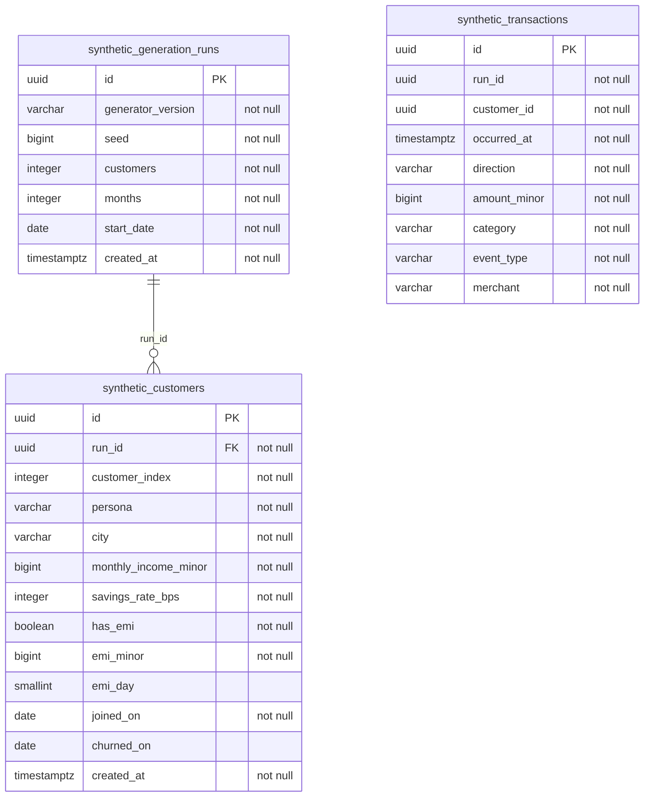

# Entity-relationship diagram

<!-- GENERATED FILE: do not edit by hand. Regenerate with scripts/er_diagram.py. -->

Generated by `scripts/er_diagram.py` from the PostgreSQL catalogue of a database
migrated to Alembic revision `0031` (TASK-106). CI regenerates it from the freshly
migrated test database and fails when this file differs, so it always matches the
migrations.

Regenerate after any migration:

```bash
make infra-up
uv run alembic -c apps/api/alembic.ini upgrade head
uv run python scripts/er_diagram.py          # --check verifies without writing
```

Notation: `PK` primary key, `FK` foreign key, `UK` single-column unique.
`||` the child row must reference a parent, `|o` the reference is optional (nullable FK),
`o{` many, `o|` at most one. Relationship labels name the FK column(s). Types are
simplified (lengths dropped). `alembic_version` and individual partitions are omitted;
the partition key is listed per table below.

## Operational schema (`public`): the bank, its ledger, security and analytics

43 tables.

```mermaid
erDiagram
    account_holders {
        uuid account_id PK,FK
        uuid customer_id PK,FK
        varchar holder_role "not null"
    }
    accounts {
        uuid id PK
        varchar account_number UK "not null"
        varchar account_type "not null"
        varchar currency "not null"
        varchar status "not null"
        bigint ledger_balance "not null"
        bigint held_amount "not null"
        bigint overdraft_limit "not null"
        timestamptz created_at "not null"
    }
    assistant_messages {
        uuid id PK
        uuid customer_id FK "not null"
        varchar role "not null"
        text content "not null"
        varchar tool_name
        timestamptz created_at "not null"
    }
    audit_logs {
        uuid id PK
        bigint seq UK "not null"
        uuid actor_user_id
        varchar action "not null"
        varchar resource_type "not null"
        varchar resource_id
        varchar request_id
        varchar ip
        jsonb details "not null"
        timestamptz created_at "not null"
        varchar prev_hash "not null"
        varchar hash "not null"
    }
    bill_payments {
        uuid id PK
        uuid customer_id FK "not null"
        uuid account_id FK "not null"
        uuid biller_id FK "not null"
        uuid transaction_id FK,UK "not null"
        varchar consumer_reference "not null"
        bigint amount "not null"
        varchar currency "not null"
        varchar status "not null"
        timestamptz created_at "not null"
    }
    billers {
        uuid id PK
        varchar name "not null"
        varchar category "not null"
        varchar biller_code UK "not null"
        varchar status "not null"
        timestamptz created_at "not null"
    }
    clickstream_events {
        uuid id PK
        timestamptz event_timestamp PK
        varchar event_type "not null"
        uuid customer_id FK
        varchar session_id "not null"
        varchar page_url
        jsonb properties "not null"
        timestamptz created_at "not null"
    }
    customer_behaviour_profiles {
        uuid id PK
        uuid customer_id FK,UK "not null"
        smallint window_days "not null"
        integer sessions "not null"
        integer avg_session_seconds "not null"
        integer page_views "not null"
        integer interactions "not null"
        timestamptz last_active_at
        timestamptz computed_at "not null"
        timestamptz created_at "not null"
        timestamptz updated_at "not null"
    }
    customer_product_interests {
        uuid id PK
        uuid customer_id FK "not null"
        varchar category "not null"
        double_precision score "not null"
        integer signals "not null"
        timestamptz last_signal_at "not null"
        timestamptz computed_at "not null"
        timestamptz created_at "not null"
    }
    customer_segments {
        uuid id PK
        uuid customer_id FK,UK "not null"
        varchar segment "not null"
        double_precision confidence_score "not null"
        integer recency_days "not null"
        double_precision frequency "not null"
        bigint monetary_minor "not null"
        double_precision savings_ratio "not null"
        double_precision discretionary_ratio "not null"
        varchar explanation "not null"
        timestamptz created_at "not null"
        timestamptz updated_at "not null"
    }
    customers {
        uuid id PK
        uuid user_id FK,UK "not null"
        varchar full_name "not null"
        date date_of_birth
        text phone_enc
        varchar kyc_status "not null"
        varchar segment
        varchar risk_profile
        timestamptz created_at "not null"
        smallint risk_score
        jsonb risk_answers
        varchar risk_questionnaire_version
        timestamptz risk_assessed_at
        timestamptz recommendations_consent_at
        varchar recommendations_consent_policy
        boolean analytics_consent "not null"
        timestamptz analytics_consent_updated_at
        varchar analytics_consent_policy
    }
    devices {
        uuid id PK
        uuid customer_id FK "not null"
        varchar fingerprint_hash "not null"
        varchar label
        timestamptz first_seen_at "not null"
        timestamptz last_seen_at "not null"
        boolean trusted "not null"
    }
    fixed_deposits {
        uuid id PK
        uuid customer_id FK "not null"
        uuid user_id FK "not null"
        uuid account_id FK "not null"
        uuid product_id FK "not null"
        uuid booking_transaction_id FK,UK "not null"
        uuid closure_transaction_id FK,UK
        uuid interest_transaction_id FK,UK
        integer annual_rate_bps "not null"
        integer tenure_months "not null"
        integer lock_in_months "not null"
        integer premature_penalty_bps
        bigint principal "not null"
        bigint maturity_interest "not null"
        bigint maturity_amount "not null"
        varchar currency "not null"
        date start_date "not null"
        date maturity_date "not null"
        varchar status "not null"
        varchar closure_kind
        bigint paid_interest
        date closed_on
        timestamptz closed_at
        timestamptz created_at "not null"
        timestamptz payout_held_at
    }
    fraud_alerts {
        uuid id PK
        uuid fraud_event_id FK,UK "not null"
        uuid transaction_id FK "not null"
        varchar status "not null"
        varchar severity "not null"
        uuid assigned_to_user_id FK
        text resolution_note
        timestamptz created_at "not null"
        timestamptz resolved_at
    }
    fraud_events {
        uuid id PK
        uuid transaction_id FK "not null"
        uuid customer_id FK "not null"
        integer risk_score "not null"
        varchar decision "not null"
        jsonb reasons "not null"
        jsonb features "not null"
        varchar model_version "not null"
        double_precision latency_ms "not null"
        timestamptz created_at "not null"
    }
    fund_sip_runs {
        uuid id PK
        uuid sip_id FK "not null"
        date run_on "not null"
        varchar status "not null"
        uuid order_id FK,UK
        varchar failure_reason
        timestamptz created_at "not null"
    }
    fund_sips {
        uuid id PK
        uuid customer_id FK "not null"
        uuid user_id FK "not null"
        uuid account_id FK "not null"
        uuid instrument_id FK "not null"
        bigint amount_minor "not null"
        integer day_of_month "not null"
        varchar status "not null"
        date next_run_on "not null"
        timestamptz cancelled_at
        timestamptz created_at "not null"
    }
    holds {
        uuid id PK
        uuid account_id FK "not null"
        uuid transaction_id FK,UK "not null"
        bigint amount "not null"
        varchar status "not null"
        timestamptz created_at "not null"
        timestamptz resolved_at
    }
    idempotency_keys {
        uuid id PK
        uuid user_id FK "not null"
        varchar key "not null"
        varchar request_hash "not null"
        integer response_status
        jsonb response_body
        uuid transaction_id FK
        timestamptz created_at "not null"
        timestamptz expires_at "not null"
    }
    insurance_applications {
        uuid id PK
        uuid customer_id FK "not null"
        uuid user_id FK "not null"
        uuid product_id FK "not null"
        bigint cover_minor "not null"
        integer term_years "not null"
        varchar age_band "not null"
        bigint annual_premium_minor
        varchar status "not null"
        varchar decision_reason "not null"
        varchar quote_version "not null"
        timestamptz created_at "not null"
    }
    insurance_products {
        uuid id PK
        varchar code UK "not null"
        varchar insurance_type "not null"
        varchar name "not null"
        varchar description "not null"
        bigint min_cover_minor "not null"
        bigint max_cover_minor "not null"
        integer min_entry_age "not null"
        integer max_entry_age "not null"
        integer max_cover_age
        integer_array policy_terms_years "not null"
        bigint reference_cover_minor "not null"
        integer reference_age "not null"
        integer reference_term_years "not null"
        bigint indicative_annual_premium_minor "not null"
        varchar notes "not null"
        varchar catalogue_version "not null"
        timestamptz created_at "not null"
    }
    investment_holdings {
        uuid id PK
        uuid customer_id FK "not null"
        uuid instrument_id FK "not null"
        bigint units_micro "not null"
        bigint cost_basis_minor "not null"
        timestamptz created_at "not null"
        timestamptz updated_at "not null"
    }
    investment_instruments {
        uuid id PK
        varchar code UK "not null"
        varchar kind "not null"
        varchar name "not null"
        varchar description "not null"
        varchar risk_level "not null"
        uuid wealth_product_id FK
        varchar currency "not null"
        bigint min_order_minor
        bigint price_base_minor "not null"
        integer price_drift_bps "not null"
        integer price_wobble_bps "not null"
        varchar notes "not null"
        varchar catalogue_version "not null"
        timestamptz created_at "not null"
    }
    investment_orders {
        uuid id PK
        uuid customer_id FK "not null"
        uuid user_id FK "not null"
        uuid holding_id FK "not null"
        uuid instrument_id FK "not null"
        uuid account_id FK "not null"
        uuid transaction_id FK,UK "not null"
        uuid sip_id FK
        varchar side "not null"
        bigint units_micro "not null"
        bigint price_minor "not null"
        date price_date "not null"
        bigint amount_minor "not null"
        bigint cost_basis_minor "not null"
        bigint realised_gain_minor
        timestamptz created_at "not null"
    }
    loan_instalments {
        uuid id PK
        uuid loan_id FK "not null"
        integer seq "not null"
        date due_date "not null"
        bigint amount "not null"
        bigint principal "not null"
        bigint interest "not null"
        bigint balance_after "not null"
        varchar status "not null"
        uuid transaction_id FK
        timestamptz paid_at
        timestamptz created_at "not null"
    }
    loans {
        uuid id PK
        uuid customer_id FK "not null"
        uuid user_id FK "not null"
        uuid account_id FK "not null"
        uuid disbursal_transaction_id FK,UK "not null"
        uuid product_id "not null"
        varchar loan_type "not null"
        integer annual_rate_bps "not null"
        integer tenure_months "not null"
        bigint principal "not null"
        bigint emi "not null"
        bigint total_interest "not null"
        varchar currency "not null"
        varchar status "not null"
        timestamptz created_at "not null"
        timestamptz closed_at
    }
    mfa_recovery_codes {
        uuid id PK
        uuid user_id FK "not null"
        varchar code_hash "not null"
        timestamptz used_at
        timestamptz created_at "not null"
    }
    monthly_category_spending {
        uuid id PK
        uuid account_id FK "not null"
        smallint year "not null"
        smallint month "not null"
        varchar category "not null"
        bigint total_amount_minor "not null"
        integer transaction_count "not null"
        timestamptz created_at "not null"
        timestamptz updated_at "not null"
    }
    notifications {
        uuid id PK
        uuid user_id FK "not null"
        varchar type "not null"
        varchar title "not null"
        text body "not null"
        timestamptz read_at
        timestamptz created_at "not null"
        varchar resource_type
        uuid resource_id
        uuid account_id
        uuid outbox_event_id UK
    }
    outbox_events {
        uuid id PK
        varchar event_type "not null"
        jsonb payload "not null"
        timestamptz created_at "not null"
        timestamptz processed_at
        integer attempts "not null"
        timestamptz next_attempt_at "not null"
        varchar last_error
        timestamptz dead_lettered_at
    }
    payees {
        uuid id PK
        uuid customer_id FK "not null"
        varchar name "not null"
        varchar account_number "not null"
        varchar bank_code "not null"
        varchar nickname
        varchar status "not null"
        timestamptz created_at "not null"
        timestamptz verified_at
    }
    refresh_tokens {
        uuid id PK
        uuid user_id FK "not null"
        uuid family_id "not null"
        varchar token_hash UK "not null"
        varchar amr "not null"
        timestamptz issued_at "not null"
        timestamptz expires_at "not null"
        timestamptz used_at
        timestamptz revoked_at
        uuid replaced_by_id
        varchar ip
        varchar user_agent
    }
    rm_assignments {
        uuid id PK
        uuid customer_id FK "not null"
        uuid rm_user_id FK "not null"
        uuid assigned_by_user_id FK "not null"
        timestamptz assigned_at "not null"
        timestamptz unassigned_at
        uuid unassigned_by_user_id FK
        timestamptz created_at "not null"
    }
    rm_interactions {
        uuid id PK
        uuid customer_id FK "not null"
        uuid staff_user_id FK "not null"
        varchar channel "not null"
        varchar outcome "not null"
        text note "not null"
        timestamptz created_at "not null"
    }
    roles {
        varchar name PK
        varchar description "not null"
    }
    runtime_settings {
        uuid id PK
        varchar key UK "not null"
        bigint value "not null"
        uuid updated_by_user_id FK "not null"
        timestamptz created_at "not null"
        timestamptz updated_at "not null"
    }
    scheduled_transfers {
        uuid id PK
        uuid customer_id FK "not null"
        uuid user_id FK "not null"
        uuid from_account_id FK "not null"
        uuid payee_id FK
        uuid to_account_id FK
        bigint amount "not null"
        varchar currency "not null"
        varchar reference
        varchar frequency "not null"
        varchar status "not null"
        date start_date "not null"
        date end_date
        date next_run_date "not null"
        date last_run_date
        uuid last_transaction_id FK
        integer failure_count "not null"
        varchar last_failure_reason
        date last_failed_occurrence_date
        varchar pause_reason
        timestamptz created_at "not null"
        uuid loan_id FK,UK
    }
    security_events {
        uuid id PK
        uuid user_id FK
        varchar event_type "not null"
        varchar ip
        varchar user_agent
        varchar request_id
        jsonb details "not null"
        timestamptz created_at "not null"
    }
    transaction_entries {
        uuid id PK
        bigint seq UK "not null"
        uuid transaction_id FK "not null"
        uuid account_id FK "not null"
        varchar direction "not null"
        bigint amount "not null"
        varchar currency "not null"
        bigint balance_after "not null"
        timestamptz created_at "not null"
    }
    transactions {
        uuid id PK
        varchar type "not null"
        varchar status "not null"
        bigint amount "not null"
        varchar currency "not null"
        uuid initiated_by_user_id FK
        uuid debit_account_id FK
        uuid credit_account_id FK
        uuid payee_id FK
        varchar reference
        varchar decline_reason
        varchar channel "not null"
        uuid reversal_of_id FK
        timestamptz created_at "not null"
        timestamptz posted_at
    }
    user_roles {
        uuid user_id PK,FK
        varchar role_name PK,FK
    }
    users {
        uuid id PK
        varchar email "not null"
        varchar password_hash "not null"
        varchar status "not null"
        integer failed_login_count "not null"
        timestamptz locked_until
        boolean mfa_enabled "not null"
        text mfa_secret_enc
        bigint mfa_last_step
        timestamptz last_login_at
        timestamptz password_changed_at
        timestamptz created_at "not null"
        integer token_version "not null"
    }
    wealth_products {
        uuid id PK
        varchar code UK "not null"
        varchar product_type "not null"
        varchar name "not null"
        varchar description "not null"
        varchar risk_level "not null"
        varchar yield_basis "not null"
        integer annual_rate_bps
        integer_array tenures_months "not null"
        integer min_lock_in_months "not null"
        bigint min_amount_minor
        bigint max_amount_minor
        integer premature_penalty_bps
        boolean bookable "not null"
        varchar notes "not null"
        varchar catalogue_version "not null"
        timestamptz created_at "not null"
    }
    accounts ||--o{ account_holders : "account_id"
    customers ||--o{ account_holders : "customer_id"
    customers ||--o{ assistant_messages : "customer_id"
    accounts ||--o{ bill_payments : "account_id"
    billers ||--o{ bill_payments : "biller_id"
    customers ||--o{ bill_payments : "customer_id"
    transactions ||--o| bill_payments : "transaction_id"
    customers |o--o{ clickstream_events : "customer_id"
    customers ||--o| customer_behaviour_profiles : "customer_id"
    customers ||--o{ customer_product_interests : "customer_id"
    customers ||--o| customer_segments : "customer_id"
    users ||--o| customers : "user_id"
    customers ||--o{ devices : "customer_id"
    accounts ||--o{ fixed_deposits : "account_id"
    transactions ||--o| fixed_deposits : "booking_transaction_id"
    transactions |o--o| fixed_deposits : "closure_transaction_id"
    customers ||--o{ fixed_deposits : "customer_id"
    transactions |o--o| fixed_deposits : "interest_transaction_id"
    wealth_products ||--o{ fixed_deposits : "product_id"
    users ||--o{ fixed_deposits : "user_id"
    users |o--o{ fraud_alerts : "assigned_to_user_id"
    fraud_events ||--o| fraud_alerts : "fraud_event_id"
    transactions ||--o{ fraud_alerts : "transaction_id"
    customers ||--o{ fraud_events : "customer_id"
    transactions ||--o{ fraud_events : "transaction_id"
    investment_orders |o--o| fund_sip_runs : "order_id"
    fund_sips ||--o{ fund_sip_runs : "sip_id"
    accounts ||--o{ fund_sips : "account_id"
    customers ||--o{ fund_sips : "customer_id"
    investment_instruments ||--o{ fund_sips : "instrument_id"
    users ||--o{ fund_sips : "user_id"
    accounts ||--o{ holds : "account_id"
    transactions ||--o| holds : "transaction_id"
    transactions |o--o{ idempotency_keys : "transaction_id"
    users ||--o{ idempotency_keys : "user_id"
    customers ||--o{ insurance_applications : "customer_id"
    insurance_products ||--o{ insurance_applications : "product_id"
    users ||--o{ insurance_applications : "user_id"
    customers ||--o{ investment_holdings : "customer_id"
    investment_instruments ||--o{ investment_holdings : "instrument_id"
    wealth_products |o--o{ investment_instruments : "wealth_product_id"
    accounts ||--o{ investment_orders : "account_id"
    customers ||--o{ investment_orders : "customer_id"
    investment_holdings ||--o{ investment_orders : "holding_id"
    investment_instruments ||--o{ investment_orders : "instrument_id"
    fund_sips |o--o{ investment_orders : "sip_id"
    transactions ||--o| investment_orders : "transaction_id"
    users ||--o{ investment_orders : "user_id"
    loans ||--o{ loan_instalments : "loan_id"
    transactions |o--o{ loan_instalments : "transaction_id"
    accounts ||--o{ loans : "account_id"
    customers ||--o{ loans : "customer_id"
    transactions ||--o| loans : "disbursal_transaction_id"
    users ||--o{ loans : "user_id"
    users ||--o{ mfa_recovery_codes : "user_id"
    accounts ||--o{ monthly_category_spending : "account_id"
    users ||--o{ notifications : "user_id"
    customers ||--o{ payees : "customer_id"
    users ||--o{ refresh_tokens : "user_id"
    users ||--o{ rm_assignments : "assigned_by_user_id"
    customers ||--o{ rm_assignments : "customer_id"
    users ||--o{ rm_assignments : "rm_user_id"
    users |o--o{ rm_assignments : "unassigned_by_user_id"
    customers ||--o{ rm_interactions : "customer_id"
    users ||--o{ rm_interactions : "staff_user_id"
    users ||--o{ runtime_settings : "updated_by_user_id"
    customers ||--o{ scheduled_transfers : "customer_id"
    accounts ||--o{ scheduled_transfers : "from_account_id"
    transactions |o--o{ scheduled_transfers : "last_transaction_id"
    loans |o--o| scheduled_transfers : "loan_id"
    payees |o--o{ scheduled_transfers : "payee_id"
    accounts |o--o{ scheduled_transfers : "to_account_id"
    users ||--o{ scheduled_transfers : "user_id"
    users |o--o{ security_events : "user_id"
    accounts ||--o{ transaction_entries : "account_id"
    transactions ||--o{ transaction_entries : "transaction_id"
    accounts |o--o{ transactions : "credit_account_id"
    accounts |o--o{ transactions : "debit_account_id"
    users |o--o{ transactions : "initiated_by_user_id"
    payees |o--o{ transactions : "payee_id"
    transactions |o--o{ transactions : "reversal_of_id"
    roles ||--o{ user_roles : "role_name"
    users ||--o{ user_roles : "user_id"
```

### Keys, constraints and triggers

| Table | Primary key | Foreign keys (column -> target, ON DELETE) | CHECK constraints | Triggers | Partitioned by |
|---|---|---|---|---|---|
| `account_holders` | account_id, customer_id | account_id -> accounts(id), NO ACTION<br>customer_id -> customers(id), NO ACTION | ck_account_holders_holder_role_valid | - | - |
| `accounts` | id | - | ck_accounts_available_non_negative<br>ck_accounts_held_non_negative<br>ck_accounts_overdraft_non_negative<br>ck_accounts_status_valid<br>ck_accounts_type_valid | - | - |
| `assistant_messages` | id | customer_id -> customers(id), CASCADE | ck_assistant_messages_content_length<br>ck_assistant_messages_role_valid<br>ck_assistant_messages_tool_name_valid | - | - |
| `audit_logs` | id | - | - | audit_logs_immutable | - |
| `bill_payments` | id | account_id -> accounts(id), NO ACTION<br>biller_id -> billers(id), NO ACTION<br>customer_id -> customers(id), NO ACTION<br>transaction_id -> transactions(id), NO ACTION | ck_bill_payments_amount_positive<br>ck_bill_payments_status_valid | - | - |
| `billers` | id | - | ck_billers_category_valid<br>ck_billers_status_valid | - | - |
| `clickstream_events` | id, event_timestamp | customer_id -> customers(id), SET NULL | - | - | RANGE (event_timestamp) |
| `customer_behaviour_profiles` | id | customer_id -> customers(id), CASCADE | ck_customer_behaviour_profiles_avg_session_seconds_non_negative<br>ck_customer_behaviour_profiles_interactions_cover_sessions<br>ck_customer_behaviour_profiles_last_active_iff_sessions<br>ck_customer_behaviour_profiles_page_views_range<br>ck_customer_behaviour_profiles_sessions_non_negative<br>ck_customer_behaviour_profiles_window_days_range | - | - |
| `customer_product_interests` | id | customer_id -> customers(id), CASCADE | ck_customer_product_interests_category_valid<br>ck_customer_product_interests_score_non_negative<br>ck_customer_product_interests_signals_positive | - | - |
| `customer_segments` | id | customer_id -> customers(id), CASCADE | ck_customer_segments_confidence_score_range<br>ck_customer_segments_discretionary_ratio_range<br>ck_customer_segments_frequency_non_negative<br>ck_customer_segments_monetary_minor_non_negative<br>ck_customer_segments_recency_days_non_negative<br>ck_customer_segments_segment_valid | - | - |
| `customers` | id | user_id -> users(id), RESTRICT | ck_customers_analytics_consent_decision_complete<br>ck_customers_analytics_consent_granted_has_time<br>ck_customers_kyc_status_valid<br>ck_customers_recommendations_consent_complete<br>ck_customers_risk_assessment_complete<br>ck_customers_risk_profile_valid<br>ck_customers_risk_score_range | - | - |
| `devices` | id | customer_id -> customers(id), NO ACTION | - | - | - |
| `fixed_deposits` | id | account_id -> accounts(id), RESTRICT<br>booking_transaction_id -> transactions(id), RESTRICT<br>closure_transaction_id -> transactions(id), RESTRICT<br>customer_id -> customers(id), RESTRICT<br>interest_transaction_id -> transactions(id), RESTRICT<br>product_id -> wealth_products(id), RESTRICT<br>user_id -> users(id), RESTRICT | ck_fixed_deposits_closed_has_payout<br>ck_fixed_deposits_closure_kind_valid<br>ck_fixed_deposits_interest_transaction_only_for_interest<br>ck_fixed_deposits_lock_in_non_negative<br>ck_fixed_deposits_matures_after_start<br>ck_fixed_deposits_maturity_amount_is_principal_plus_interest<br>ck_fixed_deposits_maturity_interest_non_negative<br>ck_fixed_deposits_paid_interest_non_negative<br>ck_fixed_deposits_payout_held_only_while_open<br>ck_fixed_deposits_penalty_non_negative<br>ck_fixed_deposits_principal_positive<br>ck_fixed_deposits_rate_non_negative<br>ck_fixed_deposits_status_valid<br>ck_fixed_deposits_tenure_in_quarters | - | - |
| `fraud_alerts` | id | assigned_to_user_id -> users(id), NO ACTION<br>fraud_event_id -> fraud_events(id), NO ACTION<br>transaction_id -> transactions(id), NO ACTION | ck_fraud_alerts_severity_valid<br>ck_fraud_alerts_status_valid | - | - |
| `fraud_events` | id | customer_id -> customers(id), NO ACTION<br>transaction_id -> transactions(id), NO ACTION | ck_fraud_events_decision_valid | - | - |
| `fund_sip_runs` | id | order_id -> investment_orders(id), RESTRICT<br>sip_id -> fund_sips(id), RESTRICT | ck_fund_sip_runs_executed_has_order<br>ck_fund_sip_runs_failed_has_reason<br>ck_fund_sip_runs_status_valid | - | - |
| `fund_sips` | id | account_id -> accounts(id), RESTRICT<br>customer_id -> customers(id), RESTRICT<br>instrument_id -> investment_instruments(id), RESTRICT<br>user_id -> users(id), RESTRICT | ck_fund_sips_amount_positive<br>ck_fund_sips_cancelled_has_time<br>ck_fund_sips_day_of_month_valid<br>ck_fund_sips_status_valid | - | - |
| `holds` | id | account_id -> accounts(id), NO ACTION<br>transaction_id -> transactions(id), NO ACTION | ck_holds_amount_positive<br>ck_holds_status_valid | - | - |
| `idempotency_keys` | id | transaction_id -> transactions(id), NO ACTION<br>user_id -> users(id), NO ACTION | - | - | - |
| `insurance_applications` | id | customer_id -> customers(id), RESTRICT<br>product_id -> insurance_products(id), RESTRICT<br>user_id -> users(id), RESTRICT | ck_insurance_applications_age_band_valid<br>ck_insurance_applications_cover_positive<br>ck_insurance_applications_premium_positive<br>ck_insurance_applications_premium_unless_declined<br>ck_insurance_applications_status_valid<br>ck_insurance_applications_term_positive | - | - |
| `insurance_products` | id | - | ck_insurance_products_entry_ages_valid<br>ck_insurance_products_indicative_premium_positive<br>ck_insurance_products_insurance_type_valid<br>ck_insurance_products_max_cover_age_valid<br>ck_insurance_products_max_cover_at_least_min<br>ck_insurance_products_min_cover_positive<br>ck_insurance_products_policy_terms_positive<br>ck_insurance_products_reference_age_eligible<br>ck_insurance_products_reference_cover_in_range<br>ck_insurance_products_reference_term_offered<br>ck_insurance_products_reference_term_within_cover_age | - | - |
| `investment_holdings` | id | customer_id -> customers(id), RESTRICT<br>instrument_id -> investment_instruments(id), RESTRICT | ck_investment_holdings_cost_basis_non_negative<br>ck_investment_holdings_cost_basis_only_with_units<br>ck_investment_holdings_units_non_negative | - | - |
| `investment_instruments` | id | wealth_product_id -> wealth_products(id), RESTRICT | ck_investment_instruments_fund_links_its_catalogue_row<br>ck_investment_instruments_kind_valid<br>ck_investment_instruments_min_order_only_for_funds<br>ck_investment_instruments_min_order_positive<br>ck_investment_instruments_price_base_positive<br>ck_investment_instruments_price_drift_bounded<br>ck_investment_instruments_price_wobble_bounded<br>ck_investment_instruments_risk_level_valid | - | - |
| `investment_orders` | id | account_id -> accounts(id), RESTRICT<br>customer_id -> customers(id), RESTRICT<br>holding_id -> investment_holdings(id), RESTRICT<br>instrument_id -> investment_instruments(id), RESTRICT<br>sip_id -> fund_sips(id), RESTRICT<br>transaction_id -> transactions(id), RESTRICT<br>user_id -> users(id), RESTRICT | ck_investment_orders_amount_positive<br>ck_investment_orders_buy_cost_is_its_amount<br>ck_investment_orders_cost_basis_non_negative<br>ck_investment_orders_price_positive<br>ck_investment_orders_realised_gain_only_on_sale<br>ck_investment_orders_side_valid<br>ck_investment_orders_sip_only_buys<br>ck_investment_orders_units_positive | - | - |
| `loan_instalments` | id | loan_id -> loans(id), CASCADE<br>transaction_id -> transactions(id), RESTRICT | ck_loan_instalments_amount_is_principal_plus_interest<br>ck_loan_instalments_amount_positive<br>ck_loan_instalments_balance_after_non_negative<br>ck_loan_instalments_paid_has_transaction<br>ck_loan_instalments_parts_non_negative<br>ck_loan_instalments_seq_positive<br>ck_loan_instalments_status_valid | - | - |
| `loans` | id | account_id -> accounts(id), RESTRICT<br>customer_id -> customers(id), RESTRICT<br>disbursal_transaction_id -> transactions(id), RESTRICT<br>user_id -> users(id), RESTRICT | ck_loans_closed_at_matches_status<br>ck_loans_emi_positive<br>ck_loans_loan_type_valid<br>ck_loans_principal_positive<br>ck_loans_rate_non_negative<br>ck_loans_status_valid<br>ck_loans_tenure_positive<br>ck_loans_total_interest_non_negative | - | - |
| `mfa_recovery_codes` | id | user_id -> users(id), CASCADE | - | - | - |
| `monthly_category_spending` | id | account_id -> accounts(id), CASCADE | ck_monthly_category_spending_month_valid<br>ck_monthly_category_spending_total_amount_minor_non_negative<br>ck_monthly_category_spending_transaction_count_non_negative<br>ck_monthly_category_spending_year_valid | - | - |
| `notifications` | id | user_id -> users(id), CASCADE | ck_notifications_resource_type_valid | - | - |
| `outbox_events` | id | - | ck_outbox_events_attempts_non_negative<br>ck_outbox_events_processed_or_dead_lettered | - | - |
| `payees` | id | customer_id -> customers(id), NO ACTION | ck_payees_status_valid | - | - |
| `refresh_tokens` | id | user_id -> users(id), CASCADE | ck_refresh_tokens_amr_valid | - | - |
| `rm_assignments` | id | assigned_by_user_id -> users(id), RESTRICT<br>customer_id -> customers(id), CASCADE<br>rm_user_id -> users(id), RESTRICT<br>unassigned_by_user_id -> users(id), RESTRICT | ck_rm_assignments_unassigned_after_assigned<br>ck_rm_assignments_unassigned_by_set | - | - |
| `rm_interactions` | id | customer_id -> customers(id), CASCADE<br>staff_user_id -> users(id), RESTRICT | ck_rm_interactions_channel_valid<br>ck_rm_interactions_note_length<br>ck_rm_interactions_outcome_valid | - | - |
| `roles` | name | - | - | - | - |
| `runtime_settings` | id | updated_by_user_id -> users(id), RESTRICT | ck_runtime_settings_key_valid<br>ck_runtime_settings_value_non_negative | - | - |
| `scheduled_transfers` | id | customer_id -> customers(id), RESTRICT<br>from_account_id -> accounts(id), RESTRICT<br>last_transaction_id -> transactions(id), SET NULL<br>loan_id -> loans(id), RESTRICT<br>payee_id -> payees(id), RESTRICT<br>to_account_id -> accounts(id), RESTRICT<br>user_id -> users(id), RESTRICT | ck_scheduled_transfers_amount_positive<br>ck_scheduled_transfers_destination_xor<br>ck_scheduled_transfers_end_date_valid<br>ck_scheduled_transfers_failure_count_non_negative<br>ck_scheduled_transfers_frequency_valid<br>ck_scheduled_transfers_pause_reason_valid<br>ck_scheduled_transfers_status_valid | - | - |
| `security_events` | id | user_id -> users(id), SET NULL | ck_security_events_event_type_valid | security_events_immutable | - |
| `transaction_entries` | id | account_id -> accounts(id), NO ACTION<br>transaction_id -> transactions(id), NO ACTION | ck_transaction_entries_amount_positive<br>ck_transaction_entries_direction_valid | transaction_entries_balanced<br>transaction_entries_immutable | - |
| `transactions` | id | credit_account_id -> accounts(id), NO ACTION<br>debit_account_id -> accounts(id), NO ACTION<br>initiated_by_user_id -> users(id), NO ACTION<br>payee_id -> payees(id), NO ACTION<br>reversal_of_id -> transactions(id), NO ACTION | ck_transactions_amount_positive<br>ck_transactions_status_valid<br>ck_transactions_type_valid | - | - |
| `user_roles` | user_id, role_name | role_name -> roles(name), NO ACTION<br>user_id -> users(id), CASCADE | - | - | - |
| `users` | id | - | ck_users_status_valid<br>ck_users_token_version_non_negative | - | - |
| `wealth_products` | id | - | ck_wealth_products_bookable_is_a_complete_deposit<br>ck_wealth_products_lock_in_non_negative<br>ck_wealth_products_max_amount_at_least_min<br>ck_wealth_products_min_amount_positive<br>ck_wealth_products_penalty_non_negative<br>ck_wealth_products_product_type_valid<br>ck_wealth_products_rate_only_when_not_market_linked<br>ck_wealth_products_rate_valid<br>ck_wealth_products_risk_level_valid<br>ck_wealth_products_yield_basis_valid | - | - |

## ML dataset schema (`synthetic`): seeded synthetic customers and transactions

3 tables.



### Keys, constraints and triggers

| Table | Primary key | Foreign keys (column -> target, ON DELETE) | CHECK constraints | Triggers | Partitioned by |
|---|---|---|---|---|---|
| `synthetic.customers` | id | run_id -> generation_runs(id), CASCADE | ck_customers_churn_after_join<br>ck_customers_emi_consistent<br>ck_customers_income_positive<br>ck_customers_persona_valid<br>ck_customers_savings_rate_range | trg_customers_cascade_delete<br>trg_customers_guard_truncate<br>trg_customers_immutable | - |
| `synthetic.generation_runs` | id | - | ck_generation_runs_customers_positive<br>ck_generation_runs_months_range<br>ck_generation_runs_seed_non_negative | - | - |
| `synthetic.transactions` | id | - | ck_transactions_amount_positive<br>ck_transactions_direction_valid<br>ck_transactions_event_type_valid | trg_transactions_customer_exists<br>trg_transactions_immutable | - |
