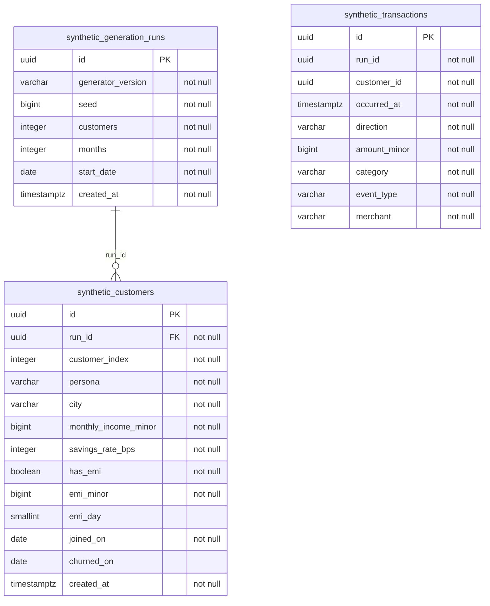

# Entity-relationship diagram

<!-- GENERATED FILE: do not edit by hand. Regenerate with scripts/er_diagram.py. -->

Generated by `scripts/er_diagram.py` from the PostgreSQL catalogue of a database
migrated to Alembic revision `0010` (TASK-106). CI regenerates it from the freshly
migrated test database and fails when this file differs, so it always matches the
migrations.

Regenerate after any migration:

```bash
make infra-up
uv run alembic -c apps/api/alembic.ini upgrade head
uv run python scripts/er_diagram.py          # --check verifies without writing
```

Notation: `PK` primary key, `FK` foreign key, `UK` single-column unique.
`||` the child row must reference a parent, `|o` the reference is optional (nullable FK),
`o{` many, `o|` at most one. Relationship labels name the FK column(s). Types are
simplified (lengths dropped). `alembic_version` and individual partitions are omitted;
the partition key is listed per table below.

## Operational schema (`public`): the bank, its ledger, security and analytics

26 tables.

```mermaid
erDiagram
    account_holders {
        uuid account_id PK,FK
        uuid customer_id PK,FK
        varchar holder_role "not null"
    }
    accounts {
        uuid id PK
        varchar account_number UK "not null"
        varchar account_type "not null"
        varchar currency "not null"
        varchar status "not null"
        bigint ledger_balance "not null"
        bigint held_amount "not null"
        bigint overdraft_limit "not null"
        timestamptz created_at "not null"
    }
    assistant_messages {
        uuid id PK
        uuid customer_id FK "not null"
        varchar role "not null"
        text content "not null"
        varchar tool_name
        timestamptz created_at "not null"
    }
    audit_logs {
        uuid id PK
        bigint seq UK "not null"
        uuid actor_user_id
        varchar action "not null"
        varchar resource_type "not null"
        varchar resource_id
        varchar request_id
        varchar ip
        jsonb details "not null"
        timestamptz created_at "not null"
        varchar prev_hash "not null"
        varchar hash "not null"
    }
    bill_payments {
        uuid id PK
        uuid customer_id FK "not null"
        uuid account_id FK "not null"
        uuid biller_id FK "not null"
        uuid transaction_id FK,UK "not null"
        varchar consumer_reference "not null"
        bigint amount "not null"
        varchar currency "not null"
        varchar status "not null"
        timestamptz created_at "not null"
    }
    billers {
        uuid id PK
        varchar name "not null"
        varchar category "not null"
        varchar biller_code UK "not null"
        varchar status "not null"
        timestamptz created_at "not null"
    }
    clickstream_events {
        uuid id PK
        timestamptz event_timestamp PK
        varchar event_type "not null"
        uuid customer_id FK
        varchar session_id "not null"
        varchar page_url
        jsonb properties "not null"
        timestamptz created_at "not null"
    }
    customer_segments {
        uuid id PK
        uuid customer_id FK,UK "not null"
        varchar segment "not null"
        double_precision confidence_score "not null"
        integer recency_days "not null"
        double_precision frequency "not null"
        bigint monetary_minor "not null"
        double_precision savings_ratio "not null"
        double_precision discretionary_ratio "not null"
        varchar explanation "not null"
        timestamptz created_at "not null"
        timestamptz updated_at "not null"
    }
    customers {
        uuid id PK
        uuid user_id FK,UK "not null"
        varchar full_name "not null"
        date date_of_birth
        text phone_enc
        varchar kyc_status "not null"
        varchar segment
        varchar risk_profile
        timestamptz created_at "not null"
    }
    devices {
        uuid id PK
        uuid customer_id FK "not null"
        varchar fingerprint_hash "not null"
        varchar label
        timestamptz first_seen_at "not null"
        timestamptz last_seen_at "not null"
        boolean trusted "not null"
    }
    fraud_alerts {
        uuid id PK
        uuid fraud_event_id FK,UK "not null"
        uuid transaction_id FK "not null"
        varchar status "not null"
        varchar severity "not null"
        uuid assigned_to_user_id FK
        text resolution_note
        timestamptz created_at "not null"
        timestamptz resolved_at
    }
    fraud_events {
        uuid id PK
        uuid transaction_id FK "not null"
        uuid customer_id FK "not null"
        integer risk_score "not null"
        varchar decision "not null"
        jsonb reasons "not null"
        jsonb features "not null"
        varchar model_version "not null"
        double_precision latency_ms "not null"
        timestamptz created_at "not null"
    }
    holds {
        uuid id PK
        uuid account_id FK "not null"
        uuid transaction_id FK,UK "not null"
        bigint amount "not null"
        varchar status "not null"
        timestamptz created_at "not null"
        timestamptz resolved_at
    }
    idempotency_keys {
        uuid id PK
        uuid user_id FK "not null"
        varchar key "not null"
        varchar request_hash "not null"
        integer response_status
        jsonb response_body
        uuid transaction_id FK
        timestamptz created_at "not null"
        timestamptz expires_at "not null"
    }
    mfa_recovery_codes {
        uuid id PK
        uuid user_id FK "not null"
        varchar code_hash "not null"
        timestamptz used_at
        timestamptz created_at "not null"
    }
    monthly_category_spending {
        uuid id PK
        uuid account_id FK "not null"
        smallint year "not null"
        smallint month "not null"
        varchar category "not null"
        bigint total_amount_minor "not null"
        integer transaction_count "not null"
        timestamptz created_at "not null"
        timestamptz updated_at "not null"
    }
    notifications {
        uuid id PK
        uuid user_id FK "not null"
        varchar type "not null"
        varchar title "not null"
        text body "not null"
        timestamptz read_at
        timestamptz created_at "not null"
        varchar resource_type
        uuid resource_id
        uuid account_id
    }
    outbox_events {
        uuid id PK
        varchar event_type "not null"
        jsonb payload "not null"
        timestamptz created_at "not null"
        timestamptz processed_at
    }
    payees {
        uuid id PK
        uuid customer_id FK "not null"
        varchar name "not null"
        varchar account_number "not null"
        varchar bank_code "not null"
        varchar nickname
        varchar status "not null"
        timestamptz created_at "not null"
        timestamptz verified_at
    }
    refresh_tokens {
        uuid id PK
        uuid user_id FK "not null"
        uuid family_id "not null"
        varchar token_hash UK "not null"
        varchar amr "not null"
        timestamptz issued_at "not null"
        timestamptz expires_at "not null"
        timestamptz used_at
        timestamptz revoked_at
        uuid replaced_by_id
        varchar ip
        varchar user_agent
    }
    roles {
        varchar name PK
        varchar description "not null"
    }
    security_events {
        uuid id PK
        uuid user_id FK
        varchar event_type "not null"
        varchar ip
        varchar user_agent
        varchar request_id
        jsonb details "not null"
        timestamptz created_at "not null"
    }
    transaction_entries {
        uuid id PK
        bigint seq UK "not null"
        uuid transaction_id FK "not null"
        uuid account_id FK "not null"
        varchar direction "not null"
        bigint amount "not null"
        varchar currency "not null"
        bigint balance_after "not null"
        timestamptz created_at "not null"
    }
    transactions {
        uuid id PK
        varchar type "not null"
        varchar status "not null"
        bigint amount "not null"
        varchar currency "not null"
        uuid initiated_by_user_id FK
        uuid debit_account_id FK
        uuid credit_account_id FK
        uuid payee_id FK
        varchar reference
        varchar decline_reason
        varchar channel "not null"
        uuid reversal_of_id FK
        timestamptz created_at "not null"
        timestamptz posted_at
    }
    user_roles {
        uuid user_id PK,FK
        varchar role_name PK,FK
    }
    users {
        uuid id PK
        varchar email "not null"
        varchar password_hash "not null"
        varchar status "not null"
        integer failed_login_count "not null"
        timestamptz locked_until
        boolean mfa_enabled "not null"
        text mfa_secret_enc
        bigint mfa_last_step
        timestamptz last_login_at
        timestamptz password_changed_at
        timestamptz created_at "not null"
    }
    accounts ||--o{ account_holders : "account_id"
    customers ||--o{ account_holders : "customer_id"
    customers ||--o{ assistant_messages : "customer_id"
    accounts ||--o{ bill_payments : "account_id"
    billers ||--o{ bill_payments : "biller_id"
    customers ||--o{ bill_payments : "customer_id"
    transactions ||--o| bill_payments : "transaction_id"
    customers |o--o{ clickstream_events : "customer_id"
    customers ||--o| customer_segments : "customer_id"
    users ||--o| customers : "user_id"
    customers ||--o{ devices : "customer_id"
    users |o--o{ fraud_alerts : "assigned_to_user_id"
    fraud_events ||--o| fraud_alerts : "fraud_event_id"
    transactions ||--o{ fraud_alerts : "transaction_id"
    customers ||--o{ fraud_events : "customer_id"
    transactions ||--o{ fraud_events : "transaction_id"
    accounts ||--o{ holds : "account_id"
    transactions ||--o| holds : "transaction_id"
    transactions |o--o{ idempotency_keys : "transaction_id"
    users ||--o{ idempotency_keys : "user_id"
    users ||--o{ mfa_recovery_codes : "user_id"
    accounts ||--o{ monthly_category_spending : "account_id"
    users ||--o{ notifications : "user_id"
    customers ||--o{ payees : "customer_id"
    users ||--o{ refresh_tokens : "user_id"
    users |o--o{ security_events : "user_id"
    accounts ||--o{ transaction_entries : "account_id"
    transactions ||--o{ transaction_entries : "transaction_id"
    accounts |o--o{ transactions : "credit_account_id"
    accounts |o--o{ transactions : "debit_account_id"
    users |o--o{ transactions : "initiated_by_user_id"
    payees |o--o{ transactions : "payee_id"
    transactions |o--o{ transactions : "reversal_of_id"
    roles ||--o{ user_roles : "role_name"
    users ||--o{ user_roles : "user_id"
```



### Keys, constraints and triggers

| Table | Primary key | Foreign keys (column -> target, ON DELETE) | CHECK constraints | Triggers | Partitioned by |
|---|---|---|---|---|---|
| `account_holders` | account_id, customer_id | account_id -> accounts(id), NO ACTION<br>customer_id -> customers(id), NO ACTION | ck_account_holders_holder_role_valid | - | - |
| `accounts` | id | - | ck_accounts_available_non_negative<br>ck_accounts_held_non_negative<br>ck_accounts_overdraft_non_negative<br>ck_accounts_status_valid<br>ck_accounts_type_valid | - | - |
| `assistant_messages` | id | customer_id -> customers(id), CASCADE | ck_assistant_messages_content_length<br>ck_assistant_messages_role_valid<br>ck_assistant_messages_tool_name_valid | - | - |
| `audit_logs` | id | - | - | audit_logs_immutable | - |
| `bill_payments` | id | account_id -> accounts(id), NO ACTION<br>biller_id -> billers(id), NO ACTION<br>customer_id -> customers(id), NO ACTION<br>transaction_id -> transactions(id), NO ACTION | ck_bill_payments_amount_positive<br>ck_bill_payments_status_valid | - | - |
| `billers` | id | - | ck_billers_category_valid<br>ck_billers_status_valid | - | - |
| `clickstream_events` | id, event_timestamp | customer_id -> customers(id), SET NULL | - | - | RANGE (event_timestamp) |
| `customer_segments` | id | customer_id -> customers(id), CASCADE | ck_customer_segments_ck_customer_segments_confidence_sc_d5bb<br>ck_customer_segments_ck_customer_segments_discretionary_dc58<br>ck_customer_segments_ck_customer_segments_frequency_non_b7b2<br>ck_customer_segments_ck_customer_segments_monetary_mino_effd<br>ck_customer_segments_ck_customer_segments_recency_days__10fd<br>ck_customer_segments_ck_customer_segments_segment_valid | - | - |
| `customers` | id | user_id -> users(id), RESTRICT | ck_customers_kyc_status_valid | - | - |
| `devices` | id | customer_id -> customers(id), NO ACTION | - | - | - |
| `fraud_alerts` | id | assigned_to_user_id -> users(id), NO ACTION<br>fraud_event_id -> fraud_events(id), NO ACTION<br>transaction_id -> transactions(id), NO ACTION | ck_fraud_alerts_severity_valid<br>ck_fraud_alerts_status_valid | - | - |
| `fraud_events` | id | customer_id -> customers(id), NO ACTION<br>transaction_id -> transactions(id), NO ACTION | - | - | - |
| `holds` | id | account_id -> accounts(id), NO ACTION<br>transaction_id -> transactions(id), NO ACTION | ck_holds_amount_positive<br>ck_holds_status_valid | - | - |
| `idempotency_keys` | id | transaction_id -> transactions(id), NO ACTION<br>user_id -> users(id), NO ACTION | - | - | - |
| `mfa_recovery_codes` | id | user_id -> users(id), CASCADE | - | - | - |
| `monthly_category_spending` | id | account_id -> accounts(id), CASCADE | ck_monthly_category_spending_ck_monthly_category_spendi_7c93<br>ck_monthly_category_spending_ck_monthly_category_spendi_80ad<br>ck_monthly_category_spending_ck_monthly_category_spendi_b91a<br>ck_monthly_category_spending_ck_monthly_category_spendi_d532 | - | - |
| `notifications` | id | user_id -> users(id), CASCADE | ck_notifications_resource_type_valid | - | - |
| `outbox_events` | id | - | - | - | - |
| `payees` | id | customer_id -> customers(id), NO ACTION | ck_payees_status_valid | - | - |
| `refresh_tokens` | id | user_id -> users(id), CASCADE | - | - | - |
| `roles` | name | - | - | - | - |
| `security_events` | id | user_id -> users(id), SET NULL | - | - | - |
| `transaction_entries` | id | account_id -> accounts(id), NO ACTION<br>transaction_id -> transactions(id), NO ACTION | ck_transaction_entries_amount_positive<br>ck_transaction_entries_direction_valid | transaction_entries_balanced<br>transaction_entries_immutable | - |
| `transactions` | id | credit_account_id -> accounts(id), NO ACTION<br>debit_account_id -> accounts(id), NO ACTION<br>initiated_by_user_id -> users(id), NO ACTION<br>payee_id -> payees(id), NO ACTION<br>reversal_of_id -> transactions(id), NO ACTION | ck_transactions_amount_positive<br>ck_transactions_status_valid<br>ck_transactions_type_valid | - | - |
| `user_roles` | user_id, role_name | role_name -> roles(name), NO ACTION<br>user_id -> users(id), CASCADE | - | - | - |
| `users` | id | - | ck_users_status_valid | - | - |

## ML dataset schema (`synthetic`): seeded synthetic customers and transactions

3 tables.



### Keys, constraints and triggers

| Table | Primary key | Foreign keys (column -> target, ON DELETE) | CHECK constraints | Triggers | Partitioned by |
|---|---|---|---|---|---|
| `synthetic.customers` | id | run_id -> generation_runs(id), CASCADE | ck_customers_ck_customers_churn_after_join<br>ck_customers_ck_customers_emi_consistent<br>ck_customers_ck_customers_income_positive<br>ck_customers_ck_customers_persona_valid<br>ck_customers_ck_customers_savings_rate_range | trg_customers_cascade_delete<br>trg_customers_guard_truncate<br>trg_customers_immutable | - |
| `synthetic.generation_runs` | id | - | ck_generation_runs_ck_generation_runs_customers_positive<br>ck_generation_runs_ck_generation_runs_months_range<br>ck_generation_runs_ck_generation_runs_seed_non_negative | - | - |
| `synthetic.transactions` | id | - | ck_transactions_ck_transactions_amount_positive<br>ck_transactions_ck_transactions_direction_valid<br>ck_transactions_ck_transactions_event_type_valid | trg_transactions_customer_exists<br>trg_transactions_immutable | - |
