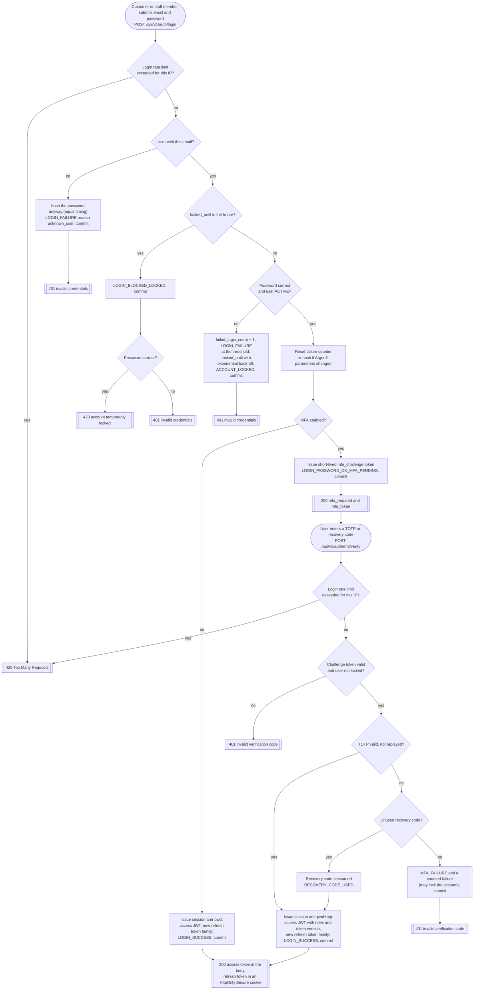
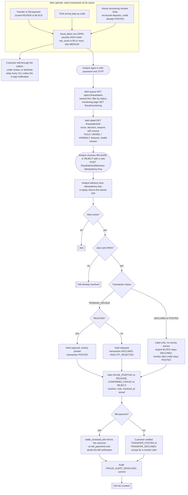
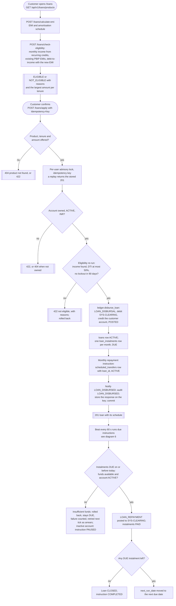
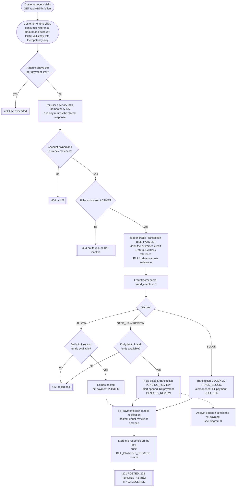
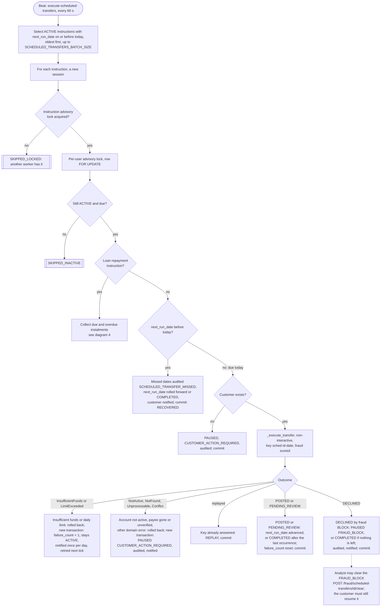
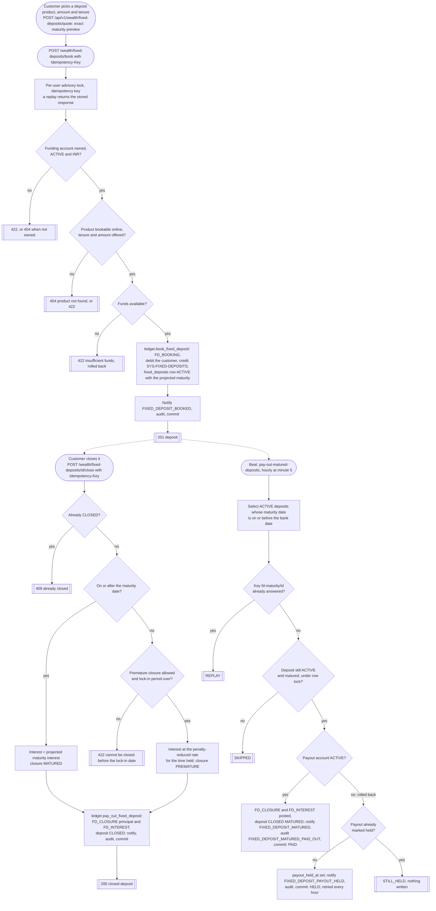

# Activity diagrams

Seven flows, each drawn from the service code that runs it. Rounded boxes are actions, diamonds are decisions,
and the boxes with a double border are outcomes the caller sees. HTTP codes are the ones the API returns
(RFC 7807 problem+json for errors). "Rolled back" means the database transaction is discarded and nothing of
the attempt persists, including the idempotency row, so the client may retry with the same key.

| Diagram | Source |
|---|---|
| [1. Login with MFA](#1-login-with-mfa) | `modules/auth/router.py` (`/login`, `/mfa/verify`), `modules/auth/service.py` (`login`, `verify_mfa_login`, `_register_failure`) |
| [2. Transfer with review, step-up and fraud decision](#2-transfer-with-review-step-up-and-fraud-decision) | `modules/payments/service.py` (`_execute_transfer`, `confirm_step_up`, `_escalate_to_review`), `payments/step_up_expiry.py`, `apps/web/src/pages/SendMoney.tsx` |
| [3. Fraud alert management (UC-10)](#3-fraud-alert-management-uc-10) | `modules/fraud/service.py` (`open_alert`), `modules/fraud/router.py`, `PaymentsService.review_alert`, `bills/service.py` (`settle_reviewed_bill`) |
| [4. Loan application and disbursal](#4-loan-application-and-disbursal) | `modules/loans/service.py` (`check_eligibility`, `apply_for_loan`, `collect_due_instalments`) |
| [5. Bill payment](#5-bill-payment) | `modules/bills/service.py` (`pay_bill`) |
| [6. Scheduled transfer run](#6-scheduled-transfer-run) | `modules/payments/scheduled_service.py`, beat entry `execute-scheduled-transfers` |
| [7. Fixed deposit booking and maturity payout](#7-fixed-deposit-booking-and-maturity-payout) | `modules/wealth/service.py` (`book_fixed_deposit`, `close_fixed_deposit`), `modules/wealth/maturity_service.py` |

All paths are relative to `apps/api/src/pbip_api/` unless they start with `apps/`.

## 1. Login with MFA

Exports: [SVG](svg/activity-login-mfa.svg), [PNG](png/activity-login-mfa.png).
Both endpoints share the login rate limiter (`RATE_LIMIT_LOGIN_PER_MINUTE`, default 10 per IP). Failed attempts
commit their evidence (security event, failure counter, lockout) before the error is returned. Customers may enable
MFA; every staff route requires a session whose `amr` contains `otp`.

<!-- diagram: activity-login-mfa -->

## 2. Transfer with review, step-up and fraud decision

Exports: [SVG](svg/activity-transfer.svg), [PNG](png/activity-transfer.png).
The review and confirm steps happen in the browser (`SendMoney.tsx`); the server sees one idempotent POST. The lock
order (user advisory lock, idempotency row, accounts `FOR UPDATE` in sorted id order, then the transaction header) is
the deadlock contract in AGENTS.md section 4. The customer response never contains the score or the reasons.

```mermaid
flowchart TD
    pick(["Customer picks the source account,<br/>a verified payee or own account, amount and reference"])
    review["Review dialog shows the details<br/>customer confirms"]
    post["POST /api/v1/transfers<br/>Idempotency-Key header, X-Device-ID"]
    max{"Amount above the<br/>per-transfer limit?"}
    r422max[["422 limit exceeded"]]
    lock["Per-user advisory lock"]
    idem{"Idempotency key<br/>already used?"}
    replay[["Stored response replayed<br/>Idempotent-Replayed: true"]]
    reuse[["422 key reused with a different body,<br/>409 if still in progress"]]
    own{"Source account owned<br/>and currency matches?"}
    r404[["404 not found, or 422"]]
    dest{"Destination resolvable?<br/>own account, or VERIFIED payee"}
    r422dest[["422, rolled back"]]
    header["ledger.create_transaction:<br/>accounts locked in sorted order,<br/>header INITIATED"]
    score["FraudScorer.score: rules, then the model<br/>when FRAUD_SCORER=hybrid;<br/>fraud_events row with score, reasons, features"]
    decision{"Decision"}
    canstep{"Interactive request<br/>and MFA enabled?"}
    allowlim{"Daily limit ok and<br/>funds available?"}
    r422lim[["422, rolled back:<br/>nothing persists"]]
    posted["Entries posted, POSTED<br/>notify TRANSFER_POSTED"]
    r201[["201 POSTED"]]
    stepup["PENDING_STEP_UP<br/>no hold, no entries"]
    r202s[["202 PENDING_STEP_UP"]]
    revlim{"Daily limit ok and<br/>funds available?"}
    hold["Hold placed, PENDING_REVIEW,<br/>alert opened, notify TRANSFER_UNDER_REVIEW"]
    r202r[["202 PENDING_REVIEW"]]
    block["DECLINED, FRAUD_BLOCK,<br/>alert opened, notify TRANSFER_DECLINED"]
    r403[["403 DECLINED"]]
    finish["Store the response on the key,<br/>audit TRANSFER_CREATED, commit;<br/>metrics and velocity counters after commit"]

    totpin(["Customer enters a TOTP code<br/>POST /api/v1/transfers/id/step-up with Idempotency-Key"])
    waiting{"Still PENDING_STEP_UP and<br/>younger than STEP_UP_EXPIRY_MINUTES?"}
    r409[["409 not waiting for verification"]]
    valid{"Code valid?"}
    fails{"Third wrong code<br/>for this transfer?"}
    r422code[["422 invalid code<br/>STEP_UP_FAILURE committed; retry"]]
    escal["Hold placed, PENDING_REVIEW,<br/>alert opened, TRANSFER_STEP_UP_ESCALATED"]
    confirm["Daily limit re-checked, entries posted,<br/>POSTED, TRANSFER_STEP_UP_CONFIRMED"]
    r200[["200 POSTED, or 200 PENDING_REVIEW"]]
    expiry["Beat every 60 s: expire-stale-step-ups<br/>DECLINED with STEP_UP_EXPIRED, notified, audited"]
    analyst["Analyst decision<br/>see diagram 3"]

    pick --> review --> post --> max
    max -- yes --> r422max
    max -- no --> lock --> idem
    idem -- "same body, answered" --> replay
    idem -- "different body or in progress" --> reuse
    idem -- new --> own
    own -- no --> r404
    own -- yes --> dest
    dest -- no --> r422dest
    dest -- yes --> header --> score --> decision
    decision -- ALLOW --> allowlim
    allowlim -- no --> r422lim
    allowlim -- yes --> posted --> finish --> r201
    decision -- STEP_UP --> canstep
    canstep -- yes --> stepup --> finish
    finish --> r202s
    canstep -- "no: becomes REVIEW" --> revlim
    decision -- REVIEW --> revlim
    revlim -- no --> r422lim
    revlim -- yes --> hold --> finish
    finish --> r202r
    decision -- BLOCK --> block --> finish
    finish --> r403

    r202s --> totpin --> waiting
    r202s -. "no answer in time" .-> expiry
    waiting -- no --> r409
    waiting -- yes --> valid
    valid -- no --> fails
    fails -- no --> r422code
    fails -- yes --> escal --> r200
    valid -- yes --> confirm --> r200
    r202r --> analyst
```

<!-- diagram: activity-transfer -->

## 3. Fraud alert management (UC-10)

Exports: [SVG](svg/activity-fraud-alert.svg), [PNG](png/activity-fraud-alert.png).
An alert is opened in the same database transaction as the decision that caused it. Alerts are not assigned in
advance: the analyst who resolves one is stored on it. The analyst routes require `FRAUD_ANALYST` or `ADMIN` with an
MFA session (`analyst_gate`).

<!-- diagram: activity-fraud-alert -->

## 4. Loan application and disbursal

Exports: [SVG](svg/activity-loan.svg), [PNG](png/activity-loan.png).
There is no human approval step: the eligibility check is re-run inside the application and decides (ADR-0024).
Disbursal, the loan, every instalment and the repayment instruction are written in one commit.

<!-- diagram: activity-loan -->

## 5. Bill payment

Exports: [SVG](svg/activity-bill-payment.svg), [PNG](png/activity-bill-payment.png).
Bill payments use the same fraud contract, limits and lock order as transfers, with two differences: the money goes
to the clearing account, and there is no step-up flow, so `STEP_UP` is held for review like `REVIEW`.

<!-- diagram: activity-bill-payment -->

## 6. Scheduled transfer run

Exports: [SVG](svg/activity-scheduled-run.svg), [PNG](png/activity-scheduled-run.png).
Celery beat publishes `pbip.transfers.execute_scheduled` every 60 seconds and a worker runs it. Each instruction
runs in its own database session and transaction, so one failure never affects another. The transfer itself is the
same `_execute_transfer` as an interactive one, with `channel=SCHEDULED`, `interactive=False` (a `STEP_UP` becomes
`REVIEW`) and the idempotency key `sched-<instruction id>-<date>`.

<!-- diagram: activity-scheduled-run -->

## 7. Fixed deposit booking and maturity payout

Exports: [SVG](svg/activity-fixed-deposit.svg), [PNG](png/activity-fixed-deposit.png).
Booking and early closure are customer requests; the maturity payout is the hourly beat job
`pay-out-matured-deposits` (minute 5). The payout uses one idempotency key per deposit, `fd-maturity/<deposit id>`,
which no client request can use, so a deposit is paid at most once (ADR-0029).

<!-- diagram: activity-fixed-deposit -->

**Extension point.** A new flow gets its own numbered section with a `<!-- diagram: activity-... -->` marker, a row in
the table at the top, and an entry in [the index](README.md).
