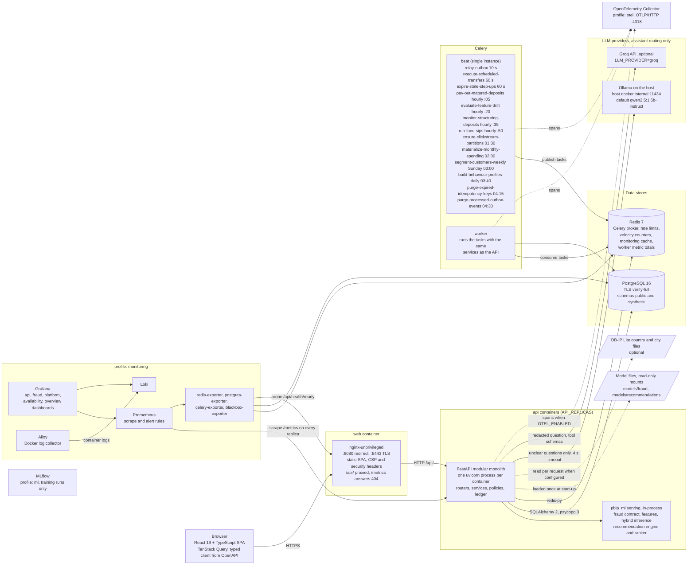

# Component diagram

Exports: [SVG](svg/component.svg), [PNG](png/component.png).

Every runtime component of PBIP and how they talk, from `docker-compose.yml`, `infra/nginx/default.conf.template`,
`infra/prometheus/prometheus.yml`, `infra/otel/collector.yml` and `apps/api/src/pbip_api/worker/celery_app.py`. The
[HLD container view](../architecture/HLD.md#3-c4-level-2-containers) is the C4 level 2 version of this picture; this
diagram adds the beat schedule, the ML package boundary and the optional profiles.

<!-- diagram: component -->

| Component | Defined in | Notes |
|---|---|---|
| web (nginx) | `apps/web/Dockerfile`, `infra/nginx/` | The only published port in staging (`infra/deploy/docker-compose.prod.yml`) |
| api | `apps/api/Dockerfile` | Replicas scale with `API_REPLICAS` (ADR-0045); `migrate` runs `alembic upgrade head` first |
| worker, beat | same image, `celery ... worker` and `celery ... beat` | Beat must stay a single instance; the schedule is in `worker/celery_app.py` |
| PostgreSQL, Redis | `postgres:16-alpine`, `redis:7-alpine` | Loopback-only ports in the local stack, none in staging |
| pbip_ml | `ml/src/pbip_ml` | Imported in-process; training code never runs on the request path (import contracts in [module.md](module.md#3-import-contracts)) |
| LLM providers | Ollama on the host; Groq optional (ADR-0018, ADR-0037) | Not provisioned in the staging compose; the rules route always answers |
| Monitoring | `docker-compose.yml` profiles `monitoring` and `otel` | Local stack only; staging has container logs and the availability probe |
| MLflow | profile `ml` | Experiment tracking and the model registry; not used on the request path |

**Extension point.** A new container is a new node inside the matching group and a row in the table; a new beat job
is a new line in the beat node, copied from `beat_schedule`.
