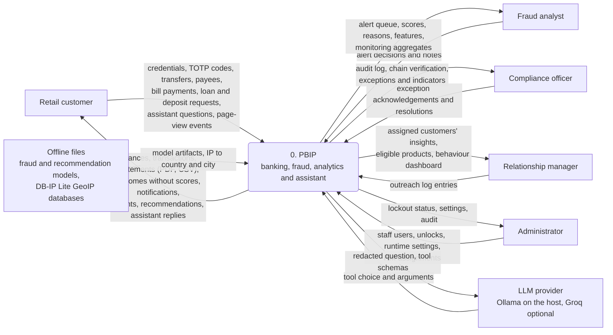
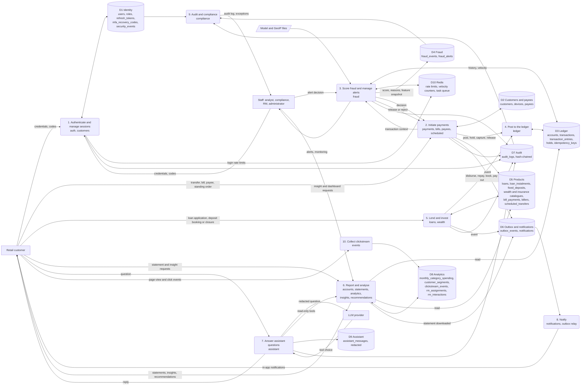

# Data flow diagrams

Level 0 shows PBIP as one process with the people and systems outside it. Level 1 opens it into its main processes
and the data stores they read and write. Process names follow the API modules (`apps/api/src/pbip_api/modules/`);
data stores are PostgreSQL tables (named as in the [ER diagram](../architecture/er-diagram.md)), Redis and files.
Notation: rounded boxes are processes, cylinders are data stores, plain boxes are external entities.

| Diagram | Source |
|---|---|
| [Level 0: context](#level-0-context) | the HLD system boundary, the role gates, `docker-compose.yml` |
| [Level 1: processes and data stores](#level-1-processes-and-data-stores) | the services and models of each module |

## Level 0: context

Exports: [SVG](svg/dfd-level-0.svg), [PNG](png/dfd-level-0.png).

<!-- diagram: dfd-level-0 -->

## Level 1: processes and data stores

Exports: [SVG](svg/dfd-level-1.svg), [PNG](png/dfd-level-1.png).
Every write to balances or entries goes through process 4; every security-relevant change also writes D7 inside the
same transaction. Notifications reach the customer only through the outbox (D6) and the relay job.

<!-- diagram: dfd-level-1 -->

**Extension point.** A new process is a numbered rounded node in level 1 with its flows to the stores it reads and
writes; a new table joins the data store it belongs to, or becomes a new `D` store.
