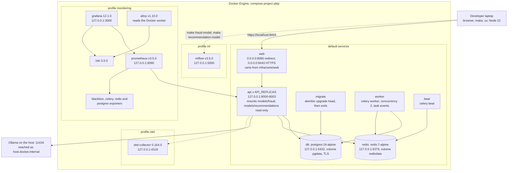
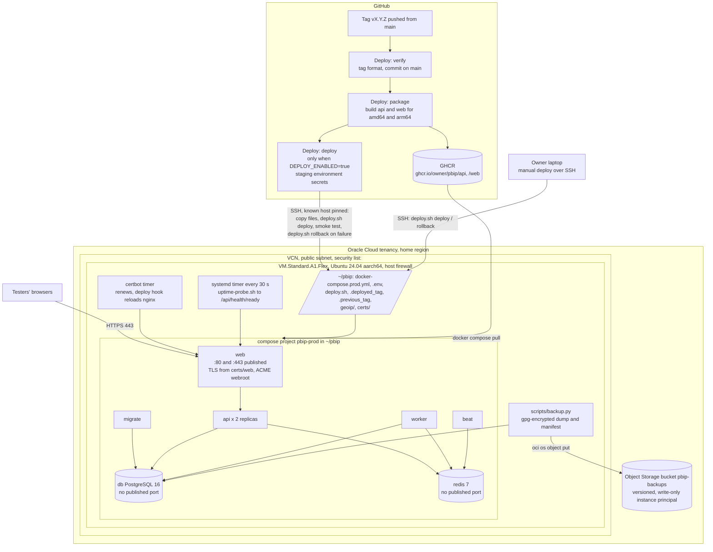

# Deployment diagrams

Two deployments exist: the local Docker Compose stack every developer runs (`docker-compose.yml`, `make up`), and the
staging target, one Oracle Cloud Always Free Arm VM running `infra/deploy/docker-compose.prod.yml`
([Oracle guide](../operations/deploy-oracle-cloud-arm.md),
[runbook](../operations/runbook.md)).

| Diagram | Source |
|---|---|
| [1. Docker Compose stack](#1-docker-compose-stack) | `docker-compose.yml`, `scripts/dev.py` (`up`, `up-all`) |
| [2. Oracle Cloud Arm staging](#2-oracle-cloud-arm-staging) | `infra/deploy/docker-compose.prod.yml`, `infra/deploy/deploy.sh`, `.github/workflows/deploy.yml`, `docs/operations/deploy-oracle-cloud-arm.md` |

## 1. Docker Compose stack

Exports: [SVG](svg/deployment-compose.svg), [PNG](png/deployment-compose.png).
Project name `pbip`. Only nginx listens on all interfaces; every other published port is bound to `127.0.0.1`.
`make up` starts the default services; `make up-all` adds the `monitoring` profile and MLflow; the `otel` profile is
started on its own.

<!-- diagram: deployment-compose -->

## 2. Oracle Cloud Arm staging

Exports: [SVG](svg/deployment-oracle-arm.svg), [PNG](png/deployment-oracle-arm.png).
One `VM.Standard.A1.Flex` instance (Ampere, arm64) with Ubuntu 24.04. Images are built for `linux/amd64` and
`linux/arm64` and pulled from GHCR. A release tag `vX.Y.Z` on `main` triggers the Deploy workflow; the SSH deploy job
runs only when the repository variable `DEPLOY_ENABLED` is `true`, otherwise the owner deploys by hand with the same
`deploy.sh`. Staging has no monitoring profile and no Ollama.

<!-- diagram: deployment-oracle-arm -->

**What is not drawn because it does not exist on staging:** the monitoring and OTel profiles, MLflow, Ollama and the
Groq key (staging sets no `OLLAMA_*` variables, so the assistant answers through its rules route), and demo data
(`scripts/seed_dev.py` refuses `APP_ENV=staging`).

**Extension point.** A new staging service is a new node inside `pbip-prod`, with its published port only if
`docker-compose.prod.yml` publishes one.
