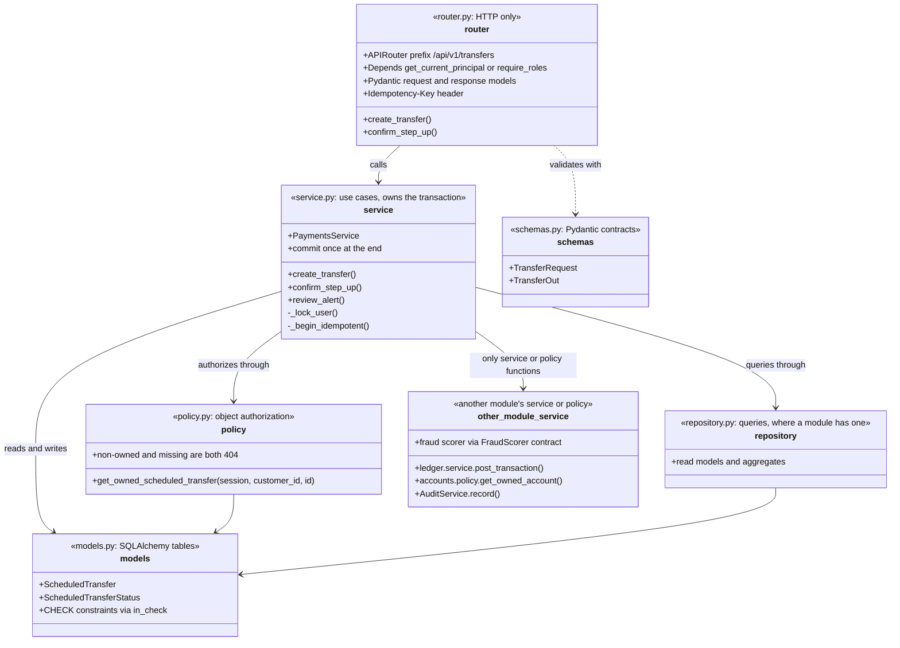
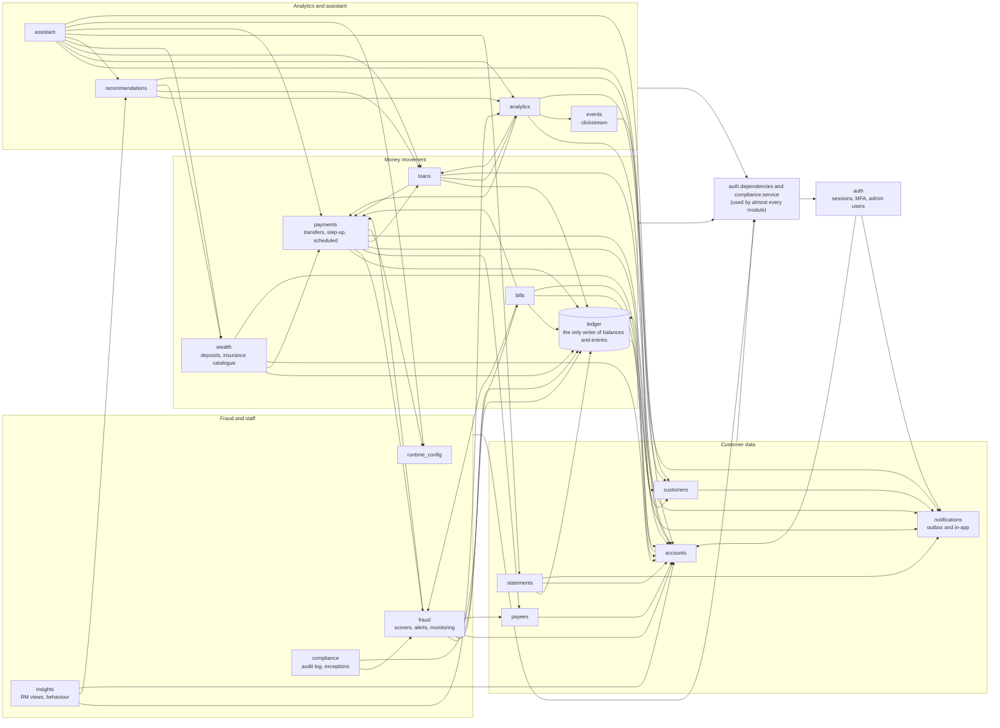
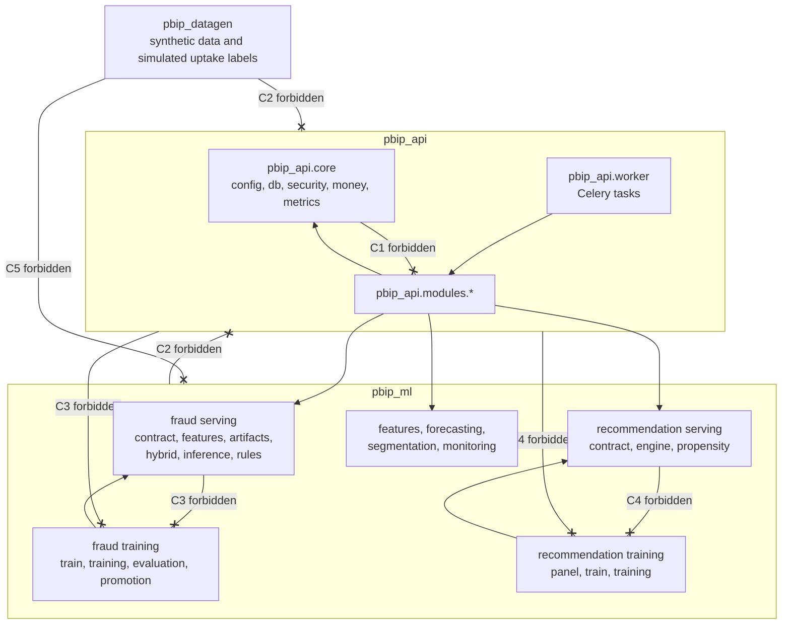

# Module and class diagrams

How the API is layered inside each module, which modules call which, and the package boundaries that
import-linter enforces in CI (`make imports`, the `[tool.importlinter]` contracts in `pyproject.toml`).
Paths are relative to `apps/api/src/pbip_api/`.

| Diagram | Source |
|---|---|
| [1. Layers inside a module](#1-layers-inside-a-module) | AGENTS.md section 2, `modules/payments/` as the worked example |
| [2. Module dependencies](#2-module-dependencies) | the `pbip_api.modules.*` imports of every module on `main` |
| [3. Import contracts](#3-import-contracts) | `pyproject.toml` `[[tool.importlinter.contracts]]` |

## 1. Layers inside a module

Exports: [SVG](svg/module-layers.svg), [PNG](png/module-layers.png).
Every module under `modules/` follows the same layers. Routers hold no business logic; services own the use case and
call `session.commit()` once at its end; customer data is read only through policy functions that take the
authenticated customer id. Not every module has every layer: `ledger` has no router (it is called by other services
only), `statements` and `recommendations` have no models, and `health` is a router only.

<!-- diagram: module-layers -->

## 2. Module dependencies

Exports: [SVG](svg/module-dependencies.svg), [PNG](png/module-dependencies.png).
An arrow means "imports from". Two dependencies are used by almost every module and are drawn once, as the shared
box at the bottom: `auth.dependencies` (the authenticated principal and role gates) and `compliance.service`
(`AuditService.record`, called inside the use case's transaction). Only `modules/ledger/service.py` changes balances or
writes entries; every money-moving module goes through it.

<!-- diagram: module-dependencies -->

## 3. Import contracts

Exports: [SVG](svg/module-import-contracts.svg), [PNG](png/module-import-contracts.png).
The five import-linter contracts that CI enforces (`API - lint, types, boundaries, contract` job). A crossed arrow is a
forbidden import, checked transitively; its label names the contract in the table below.

<!-- diagram: module-import-contracts -->

| | Contract name in `pyproject.toml` | Source | Forbidden |
|---|---|---|---|
| C1 | core must not depend on feature modules | `pbip_api.core` | `pbip_api.modules` |
| C2 | ml package must not depend on the API | `pbip_ml`, `pbip_datagen` | `pbip_api` |
| C3 | fraud serving must not depend on fraud training | `pbip_api` and the fraud serving modules | `pbip_ml.fraud.evaluation`, `.promotion`, `.train`, `.training` |
| C4 | recommendation serving must not depend on recommendation training | `pbip_api` and the recommendation serving modules | `pbip_ml.recommendations.panel`, `.train`, `.training` |
| C5 | simulated uptake labels must not depend on the recommendation rules | `pbip_datagen` | `pbip_ml` |

The layering inside a module (diagram 1) and the "service or policy only" rule between modules are review rules from
AGENTS.md section 2, not import-linter contracts. The route policy registry test
(`apps/api/tests/security/test_route_policy_registry.py`) enforces that every route is authenticated.

**Extension point.** A new module is a new node in diagram 2 with one arrow per module it imports; a new
import-linter contract is a new crossed arrow in diagram 3 and a row in the table.
