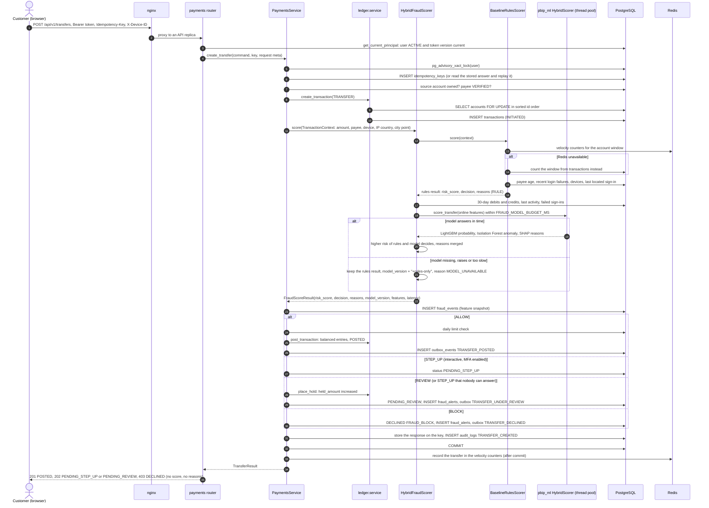
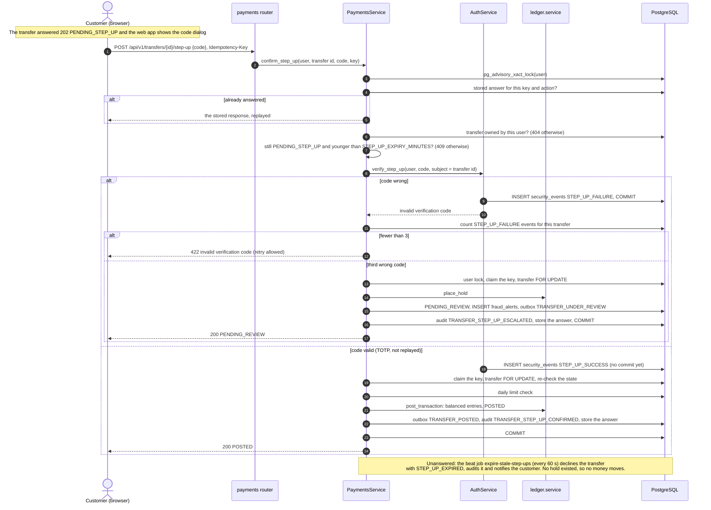
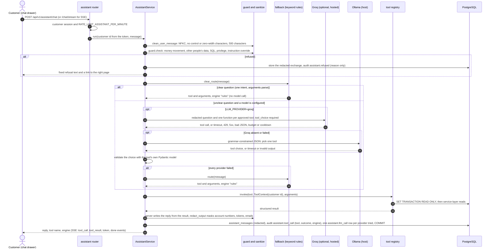
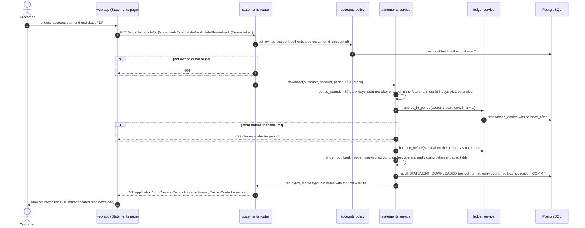
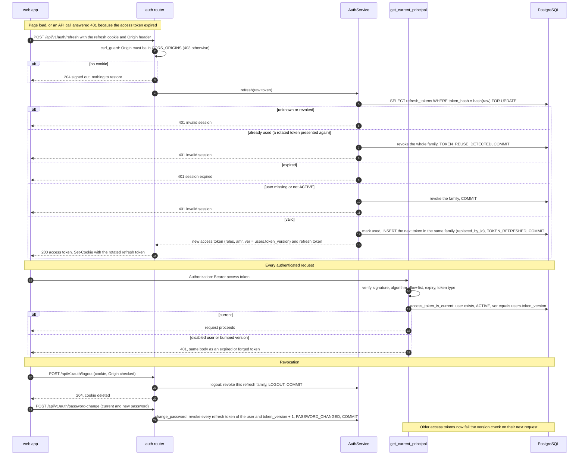

# Sequence diagrams

Five interactions, drawn from the routers and services that implement them. Paths are relative to
`apps/api/src/pbip_api/` unless they start with `apps/`. Every request passes through nginx (`web` container), which
terminates TLS and proxies `/api/` to an API replica; nginx is drawn only where it does something visible.

| Diagram | Source |
|---|---|
| [1. Transfer with hybrid fraud scoring](#1-transfer-with-hybrid-fraud-scoring) | `modules/payments/service.py`, `modules/fraud/hybrid.py`, `modules/fraud/baseline.py`, `modules/ledger/service.py`, ADR-0019 |
| [2. Step-up verification](#2-step-up-verification) | `modules/payments/service.py` (`confirm_step_up`, `_escalate_to_review`), `modules/auth/service.py` (`verify_step_up`), ADR-0036 |
| [3. Assistant question to answer](#3-assistant-question-to-answer) | `modules/assistant/service.py`, `guard.py`, `fallback.py`, `providers.py`, `llm.py`, `tools.py`, ADR-0018, ADR-0037 |
| [4. Statement PDF download](#4-statement-pdf-download) | `modules/statements/router.py`, `modules/statements/service.py`, `apps/web/src/pages/Statements.tsx` |
| [5. Token refresh and revocation](#5-token-refresh-and-revocation-adr-0021) | `modules/auth/router.py`, `modules/auth/service.py`, `modules/auth/dependencies.py`, ADR-0004, ADR-0021 |

## 1. Transfer with hybrid fraud scoring

Exports: [SVG](svg/sequence-transfer-hybrid-scoring.svg), [PNG](png/sequence-transfer-hybrid-scoring.png).
With `FRAUD_SCORER=hybrid` (the local and demo default) the models are loaded once per process at start-up and never
on a request. The rules always run first and are the floor: the model can raise a decision, never lower one. With
`FRAUD_SCORER=rules` (the code default) only the baseline rules run.

<!-- diagram: sequence-transfer-hybrid-scoring -->

## 2. Step-up verification

Exports: [SVG](svg/sequence-step-up.svg), [PNG](png/sequence-step-up.png).
The code is not part of the request hash: a retry after a wrong code is the same logical request. A wrong code
commits its own evidence before the idempotency key is claimed, so the key is never left without an answer.

<!-- diagram: sequence-step-up -->

## 3. Assistant question to answer

Exports: [SVG](svg/sequence-assistant.svg), [PNG](png/sequence-assistant.png).
The model only chooses a tool and its arguments; it never sees tool results, history or identity, and it never writes
the answer. The customer id comes from the access token, never from the model. With `LLM_PROVIDER=ollama` (the
default) the chain is Ollama then rules; with `LLM_PROVIDER=groq` it is Groq, then Ollama, then rules. Each provider
gets one attempt per question.

<!-- diagram: sequence-assistant -->

## 4. Statement PDF download

Exports: [SVG](svg/sequence-statement.svg), [PNG](png/sequence-statement.png).
Read-only over the ledger. The only writes are evidence: an audit row and a "statement downloaded" notification, so
the customer is told whenever their history leaves the bank.

<!-- diagram: sequence-statement -->

## 5. Token refresh and revocation (ADR-0021)

Exports: [SVG](svg/sequence-token-refresh.svg), [PNG](png/sequence-token-refresh.png).
The access token is a 15-minute JWT kept in memory by the web app. The refresh token is an opaque value in an
HttpOnly, Secure cookie; only its hash is stored. Each use rotates it inside its family (ADR-0004). Every authenticated
request also checks the user's status and token version (ADR-0021), so disabling a user or changing a password ends
every outstanding access token on the next request.

<!-- diagram: sequence-token-refresh -->

**Extension point.** A new interaction gets its own numbered section with a `<!-- diagram: sequence-... -->` marker,
a row in the table at the top, and an entry in [the index](README.md).
