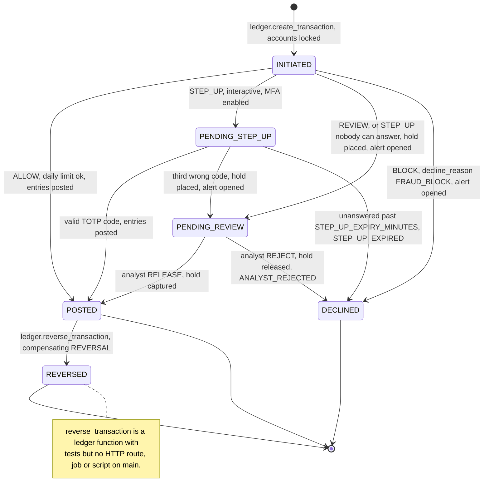
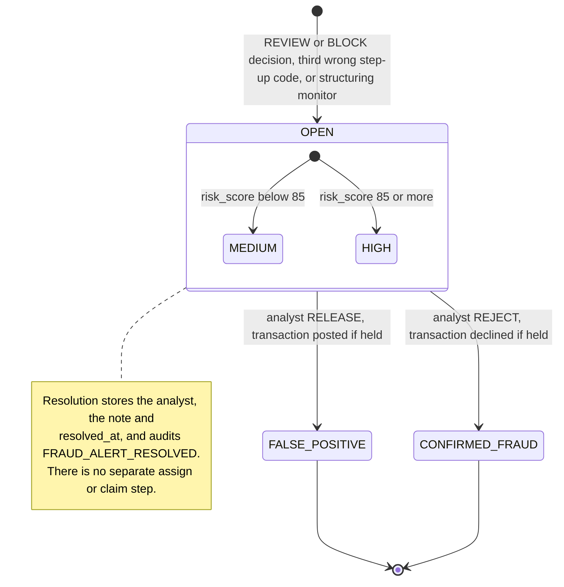
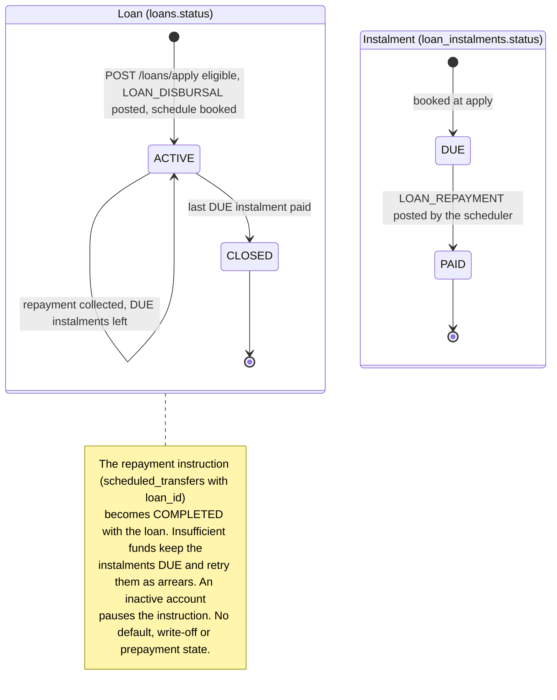
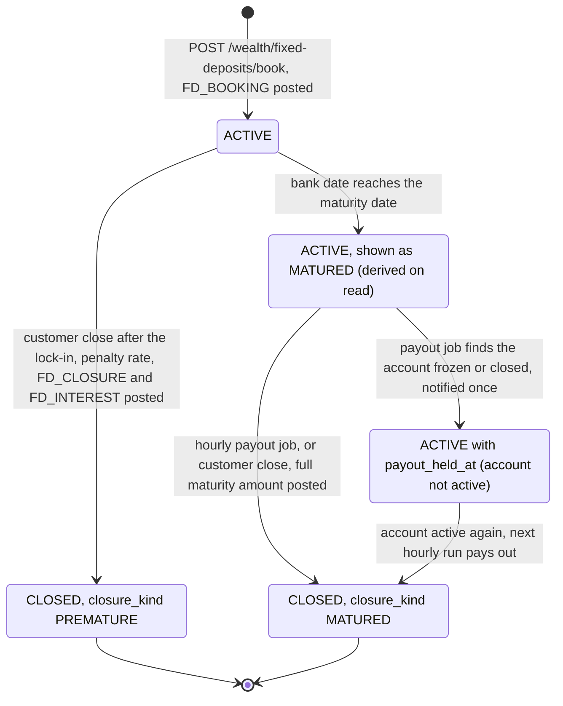
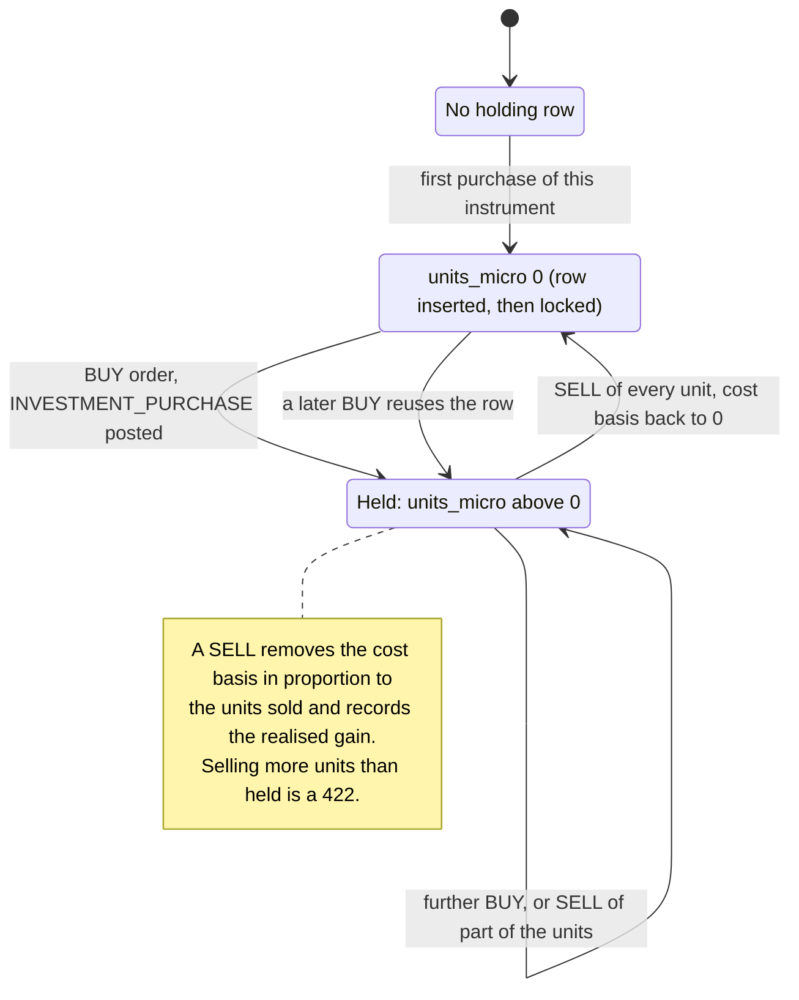
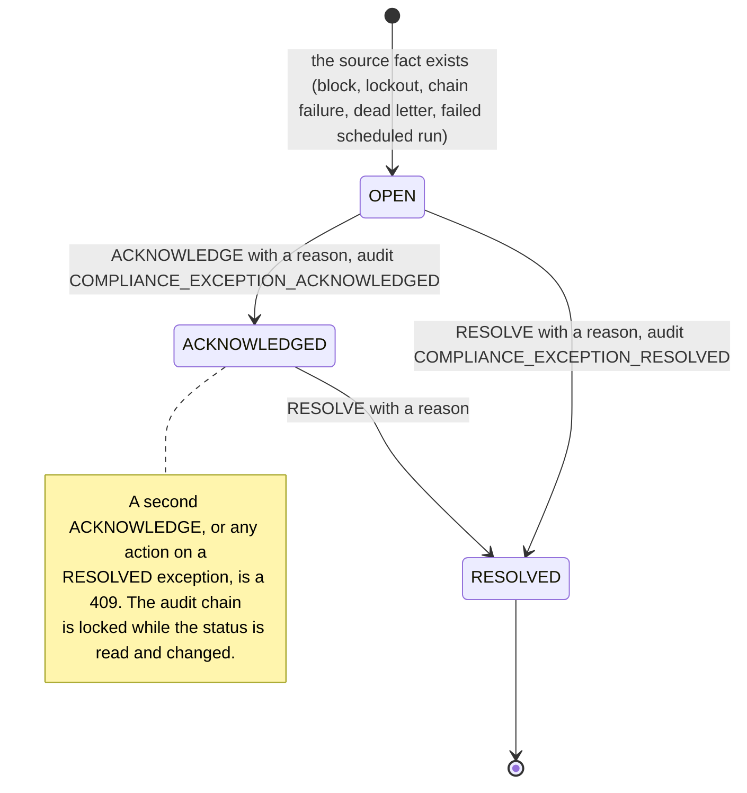
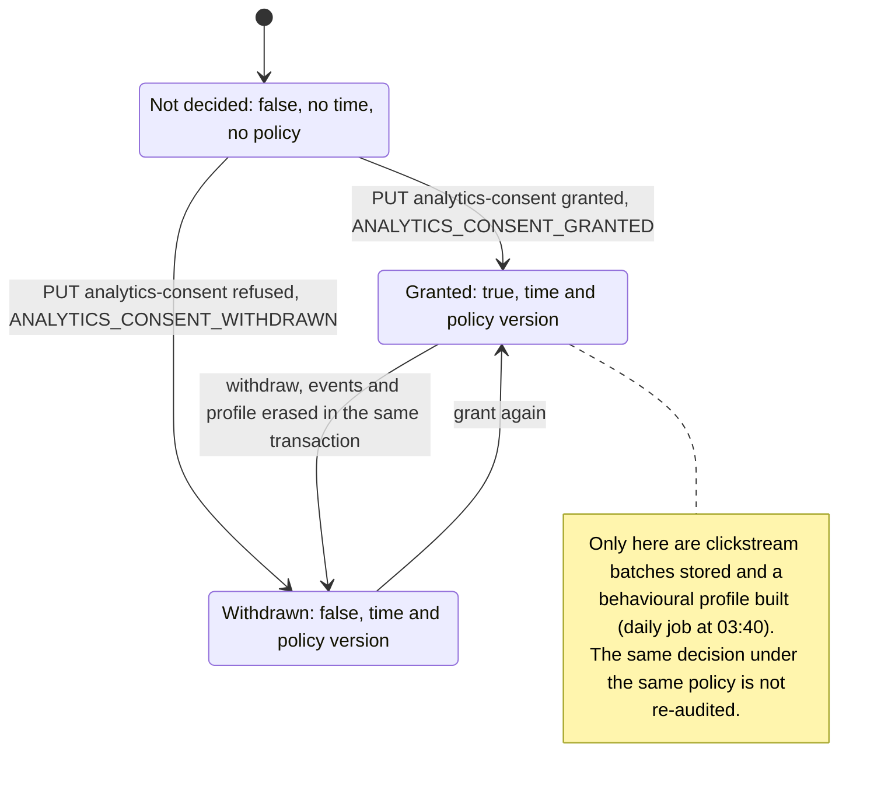

# State diagrams

Four lifecycles, with the statuses taken from the enums and the transitions from the services that set them. Paths are
relative to `apps/api/src/pbip_api/`. The [LLD section 4](../architecture/LLD.md#4-state-machines) has the
transition tables with the proving tests, plus the hold, bill payment and scheduled transfer machines.

| Diagram | Enum | Transitions |
|---|---|---|
| [1. Transaction](#1-transaction-lifecycle) | `TransactionStatus` in `modules/ledger/models.py` | `modules/payments/service.py`, `payments/step_up_expiry.py`, `modules/bills/service.py`, `modules/ledger/service.py` |
| [2. Fraud alert](#2-fraud-alert-lifecycle) | `AlertStatus`, `AlertSeverity` in `modules/fraud/models.py` | `modules/fraud/service.py` (`open_alert`), `fraud/structuring_monitor.py`, `PaymentsService.review_alert` |
| [3. Loan](#3-loan-lifecycle) | `LoanStatus`, `InstalmentStatus` in `modules/loans/models.py` | `modules/loans/service.py` |
| [4. Fixed deposit](#4-fixed-deposit-lifecycle) | `FixedDepositStatus`, `ClosureKind` in `modules/wealth/models.py` | `modules/wealth/service.py`, `modules/wealth/maturity_service.py` |
| [5. Investment holding](#5-investment-holding) | `OrderSide` in `modules/wealth/models.py` (PR #465) | `modules/wealth/investing_service.py` |
| [6. Compliance exception](#6-compliance-exception) | `ExceptionKind`, `ExceptionStatus` in `modules/compliance/exceptions.py` (PR #466) | `compliance/exceptions.py` (`apply_action`) |
| [7. Analytics consent](#7-analytics-consent) | `analytics_consent` columns in `modules/customers/models.py` (#463) | `modules/customers/service.py` (`set_analytics_consent`) |

## 1. Transaction lifecycle

Exports: [SVG](svg/state-transaction.svg), [PNG](png/state-transaction.png).
`TransactionStatus` has six values. `INITIATED` exists only inside the database transaction that creates the header:
any failure before the commit rolls the header back, so no `INITIATED` row is ever visible. The same machine serves
transfers, scheduled occurrences (where `STEP_UP` becomes `PENDING_REVIEW`) and bill payments (which have no step-up
flow). Ledger-internal types (deposits, loan disbursals and repayments, deposit bookings and payouts, and since PR #465
investment purchases and sales) are posted directly: `INITIATED` to `POSTED` in one commit.

<!-- diagram: state-transaction -->

## 2. Fraud alert lifecycle

Exports: [SVG](svg/state-fraud-alert.svg), [PNG](png/state-fraud-alert.png).
An alert has three statuses and two severities. It is opened in the same database transaction as its cause and
resolved once; a second decision is a 409. The decision changes the transaction only when the transaction is
`PENDING_REVIEW`; on a declined (engine `BLOCK`) or already posted (structuring monitor) transaction it is a label.

<!-- diagram: state-fraud-alert -->

## 3. Loan lifecycle

Exports: [SVG](svg/state-loan.svg), [PNG](png/state-loan.png).
A loan exists only once it is disbursed: there is no application, pending-approval or rejected state, because the
application either passes the eligibility check and disburses in the same commit or is refused with a 422 and leaves
nothing behind (ADR-0024). "Overdue" is computed on read (`DUE` with a due date before today) and never stored.

<!-- diagram: state-loan -->

## 4. Fixed deposit lifecycle

Exports: [SVG](svg/state-fixed-deposit.svg), [PNG](png/state-fixed-deposit.png).
The stored status is `ACTIVE` or `CLOSED`, with `closure_kind` `MATURED` or `PREMATURE` once closed. The API also
reports `MATURED` for an `ACTIVE` deposit on or after its maturity date; that state is derived on read. A held payout
is an `ACTIVE` deposit with `payout_held_at` set.

<!-- diagram: state-fixed-deposit -->

## 5. Investment holding

Exports: [SVG](svg/state-investment-holding.svg), [PNG](png/state-investment-holding.png).
An `investment_holdings` row is one customer's position in one instrument (unique per customer and instrument), with
integer micro-units and a cost basis in paise. It has no status column: its state is its units. Every buy or sell also
writes an immutable `investment_orders` row (`OrderSide` `BUY` or `SELL`) with the day's simulated price and the ledger
transaction (ADR-0058, PR #465).

<!-- diagram: state-investment-holding -->

## 6. Compliance exception

Exports: [SVG](svg/state-compliance-exception.svg), [PNG](png/state-compliance-exception.png).
`ExceptionStatus` is never stored on a row: it is read back from the `compliance_exception` audit rows of each
exception, so every transition is an append to the hash-chained audit log (ADR-0027). The five `ExceptionKind` values
share one lifecycle: `BLOCKED_TRANSFER`, `ACCOUNT_LOCKOUT`, `AUDIT_CHAIN_FAILURE`, and since PR #466
`NOTIFICATION_DEAD_LETTER` and `SCHEDULED_TRANSFER_FAILURE`.

<!-- diagram: state-compliance-exception -->

## 7. Analytics consent

Exports: [SVG](svg/state-analytics-consent.svg), [PNG](png/state-analytics-consent.png).
Stored on `customers` as `analytics_consent` (default false), `analytics_consent_updated_at` and
`analytics_consent_policy`; CHECK constraints keep the time and policy together (ADR-0057, #463).

<!-- diagram: state-analytics-consent -->

**Extension point.** A new lifecycle gets its own numbered section with a `<!-- diagram: state-... -->` marker, its
enum and service in the table at the top, and an entry in [the index](README.md). A new value in an existing enum is a
new state here and a new row in the LLD transition table.
