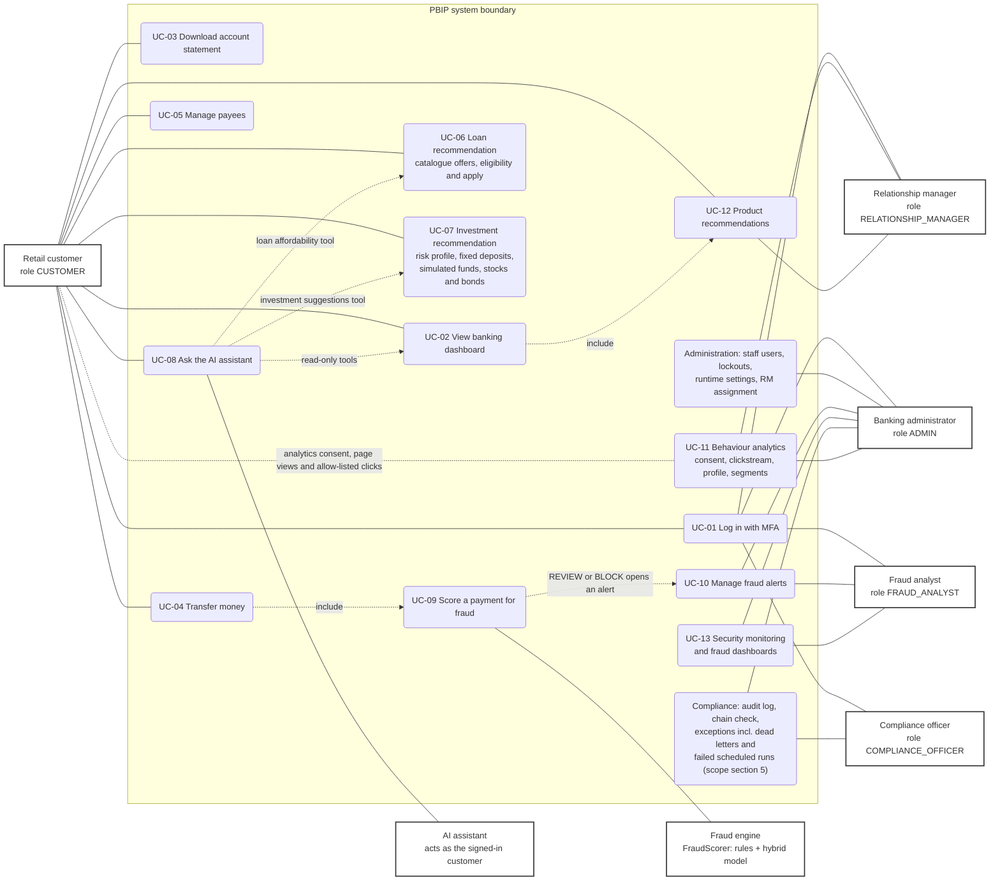

# Use case diagram

**Source of truth:** the use-case document (UC-01 to UC-13), the role gates in the API routers
(`require_roles(...)` in `apps/api/src/pbip_api/modules/*/router.py`) and the web routes in
`apps/web/src/shell/routes.tsx`. Exports: [SVG](svg/use-case.svg), [PNG](png/use-case.png).

Mermaid has no native use-case notation, so actors are drawn as bold boxes on the left and right, use cases as
rounded nodes inside the system boundary, and `include` relations as dotted arrows. Every staff role reaches its use
cases only with a session that completed TOTP (`require_roles(..., mfa=True)`); `ADMIN` passes every staff gate.

<!-- diagram: use-case -->

| Use case | Actors | Entry points on `main` |
|---|---|---|
| UC-01 | every human actor | `POST /api/v1/auth/login`, `POST /api/v1/auth/mfa/verify`; web `/login` |
| UC-02 | customer | `GET /api/v1/accounts`, `/accounts/summary`, `/accounts/{id}/transactions`, `/analytics/*`, `/recommendations`; web `/accounts`, `/insights` |
| UC-03 | customer | `GET /api/v1/accounts/{id}/statements?format=pdf\|csv`; web `/statements` |
| UC-04 | customer, fraud engine | `POST /api/v1/transfers`, `POST /api/v1/transfers/{id}/step-up`, `/transfers/scheduled`; web `/accounts` (Send money), `/scheduled` |
| UC-05 | customer | `/api/v1/payees` (add, list, edit, verify, delete); web `/payees` |
| UC-06 | customer, AI assistant | `/api/v1/loans/products`, `/calculate-emi`, `/check-eligibility`, `GET /loans/offers` (PR #470), `/apply`; recommendations carousel; web `/loans` |
| UC-07 | customer, AI assistant | `/api/v1/customers/me/risk-profile`, `/api/v1/wealth/*` including `GET /wealth/instruments`, `POST /wealth/investments/buy`, `GET /wealth/holdings`, `POST /wealth/holdings/{id}/sell` (PR #465, API only so far); web `/wealth`, `/wealth/compare` |
| UC-08 | customer, AI assistant | `POST /api/v1/assistant/chat`, `/chat/stream`, `GET /messages`; chat drawer on every customer page |
| UC-09 | fraud engine | in-process `FraudScorer.score` on every transfer and bill payment; hourly structuring monitor |
| UC-10 | fraud analyst, admin | `GET /api/v1/fraud/alerts`, `/alerts/{id}`, `POST /alerts/{id}/decision`; web `/staff/fraud` |
| UC-11 | customer (data subject), RM, admin | `GET`/`PUT /api/v1/customers/me/analytics-consent`, `POST /api/v1/events/batch`, `GET /api/v1/analytics/behaviour-profile/me`, `GET /api/v1/insights/customers/{id}/behaviour-profile`, `GET /api/v1/insights/behaviour` (#463); web `/staff/behaviour` |
| UC-12 | customer, RM | `GET /api/v1/recommendations`; RM detail `GET /api/v1/insights/customers/{id}`; web `/accounts`, `/staff/insights` |
| UC-13 | fraud analyst, admin | `GET /api/v1/fraud/monitoring`, `GET /api/v1/fraud/stats` (charted since PR #464); web `/staff/monitoring`, `/staff/fraud-dashboard` |
| Compliance | compliance officer, admin | `/api/v1/compliance/audit-logs`, `/audit-logs/verify`, `/exceptions`; web `/staff/compliance`, `/staff/audit-log` |
| Administration | admin | `/api/v1/admin/users`, `/admin/users/{id}/lockout`, `/unlock`, `/admin/settings`, RM assignment; web `/staff/admin` |

**Extension point.** A new use case is a new rounded node inside the boundary, one line per actor that reaches it, and a
row in the table above naming its routes. Re-render with `bash scripts/render_diagrams.sh use-case`.
