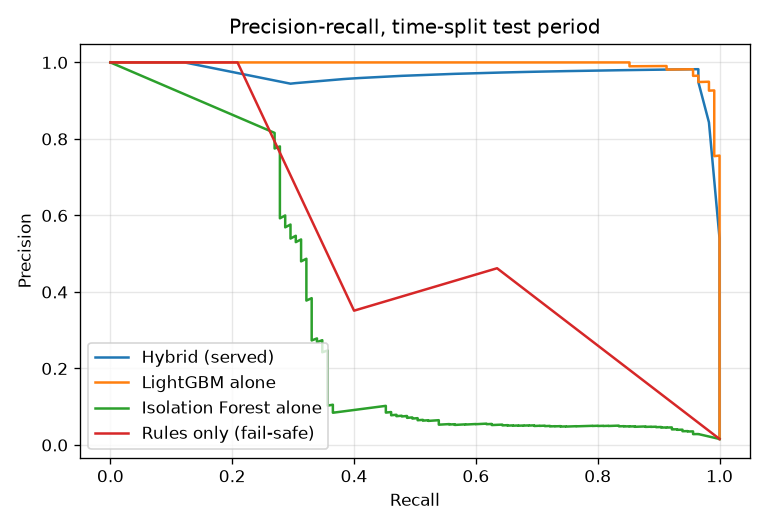
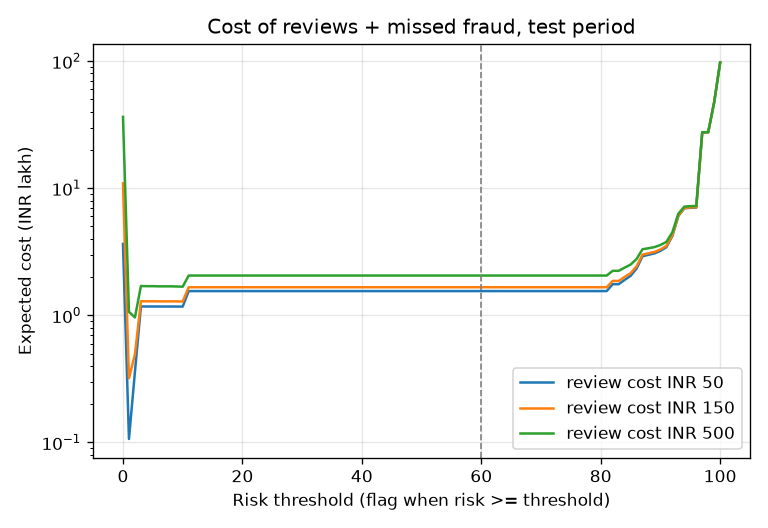

# Fraud engine evaluation report v1 (TASK-039)

**Date:** 1 Nov 2026. **Scorer evaluated:** `hybrid-lgbm-iforest-1`, loaded through the same
`pbip_ml.fraud.inference.load` the API uses (ADR-0019), with the VELOCITY_BURST floor added in TASK-080.
**MLflow run:** `79157b22dc9a46d0b2dcfbb0ccde5cd9` (experiment `pbip-fraud`).

> **All data in this report is synthetic.** It comes from the seeded generator (`pbip_datagen`, TASK-023),
> which plants six fraud scenarios (F1-F6) with recognisable signatures. Near-perfect scores mean the models
> learned the planted patterns. They are **not** an estimate of performance on real bank traffic. See §6.

## 1. Reproduce

```bash
uv run python -m pbip_datagen export --seed 42 --customers 3000 --months 6 --out data/fraud
uv run python -m pbip_datagen export --seed 4242 --customers 1500 --months 6 --out data/holdout
uv run python -m pbip_ml.fraud.train --data data/fraud --holdout data/holdout --out models/fraud
uv run python scripts/fraud_eval_report.py --model models/fraud --data data/fraud \
    --holdout data/holdout --json eval.json --img docs/ml/img
```

Training is deterministic (seeded, `deterministic=True`, one thread), so the same commands give the same
numbers.

## 2. Data and split

| Split | Rows | Fraud rows | Period (UTC) |
|---|---|---|---|
| Train | 21,842 | (used for fitting) | 1 Jan - 17 Apr 2025 |
| Validation | 7,280 | (calibration, stacking, early stopping) | 17 Apr - 22 May 2025 |
| **Test** | **7,281** | **115** | 22 May - 27 Jun 2025 |
| **Held-out seed 4242** | **18,320** | **268** | a different synthetic population |

The split is by **time**: every training row is earlier than every validation row, and every validation row
is earlier than every test row. A random split would leak the future into training. The held-out seed checks
that the models did not just memorise one generated population.

## 3. Results on the held-out test split

Risk is 0-100. ALLOW < 30 ≤ STEP_UP < 60 ≤ REVIEW < 85 ≤ BLOCK. "Flagged at X" means risk ≥ X.

### 3.1 Hybrid scorer (what the API serves when `FRAUD_SCORER=hybrid`)

| Data | Flagged at | Precision | Recall | F1 | FPR | TN | FP | FN | TP |
|---|---|---|---|---|---|---|---|---|---|
| Test | STEP_UP (30) | 0.982 | 0.957 | 0.969 | 0.028% | 7,164 | 2 | 5 | 110 |
| Test | REVIEW (60) | 0.982 | 0.957 | 0.969 | 0.028% | 7,164 | 2 | 5 | 110 |
| Test | BLOCK (85) | 0.981 | 0.878 | 0.927 | 0.028% | 7,164 | 2 | 14 | 101 |
| Held-out seed | REVIEW (60) | 0.996 | 0.944 | 0.969 | 0.006% | 18,051 | 1 | 15 | 253 |
| Held-out seed | BLOCK (85) | 0.996 | 0.881 | 0.935 | 0.006% | 18,051 | 1 | 32 | 236 |

Hybrid PR-AUC: **0.961** on test, **0.973** on the held-out seed. On test, STEP_UP and REVIEW give the
same confusion matrix: the calibrated scores are almost bimodal, so no test transfer lands between 30 and 59.

### 3.2 Components and the fail-safe (test split)

| Scorer | Flagged at | Precision | Recall | F1 | PR-AUC | FPR |
|---|---|---|---|---|---|---|
| LightGBM alone (F1-optimal threshold 0.949, chosen on validation) | - | 0.982 | 0.957 | 0.969 | 0.995 | 0.028% |
| LightGBM alone, held-out seed | - | 1.000 | 0.944 | 0.971 | 0.988 | 0 |
| Isolation Forest alone (anomaly ≥ 0.5) | - | 0.092 | 0.365 | 0.147 | 0.299 | 5.79% |
| Rules only (the fail-safe) | STEP_UP | 0.462 | 0.635 | 0.535 | 0.390 | 1.19% |
| Rules only | REVIEW | 1.000 | 0.148 | 0.258 | 0.390 | 0 |



What the comparison shows:
- **LightGBM carries the hybrid.** Its stacked weight is 8.31, against 1.97 for the anomaly score and
  1.69 for rule points. On this data the hybrid equals LightGBM at the operating thresholds. Its PR-AUC is
  slightly lower (0.961 vs 0.995) because the rule floors push a few low-probability normal transfers up.
- **The Isolation Forest is weak on its own** (PR-AUC 0.30). It is kept as the unsupervised net for
  patterns no label covers, and its reason ("unusual: …") helps analysts. It is not why the hybrid scores
  well.
- **The fail-safe is much weaker than the hybrid.** At STEP_UP it catches 64% of fraud at a 1.2%
  false-positive rate. At REVIEW it catches only 15%. A model outage therefore costs real detection; that is
  the price of "never ALLOW-all".
- **Missed fraud (5 of 115 at REVIEW)** comes mainly from F4 (location) and F5 (low-and-slow amounts), as
  documented in `docs/ml/fraud-models.md`. There is no location feature yet.

## 4. Cost analysis: choosing the threshold for a retail bank

A bank should choose the threshold with the lowest total cost, not the best F1. Every flagged transfer costs
an analyst review. Every missed fraud loses its whole amount; no recovery is assumed, which is the
conservative case for push payments. **The costs are assumptions:** ₹50, ₹150 (about 10 minutes of an
analyst at ₹900/hour) and ₹500 per review. Fraud losses are the real synthetic amounts: 115 frauds worth
₹97.56 lakh in the test period.

| Review cost | Cheapest threshold | Flagged | Missed | Total cost | Cost at REVIEW (60) | Flag nothing |
|---|---|---|---|---|---|---|
| ₹50 | 1 | 213 | 0 | ₹10,650 | ₹1,55,091 (112 flagged, 5 missed) | ₹97.56 lakh |
| ₹150 | 1 | 213 | 0 | ₹31,950 | ₹1,66,291 | ₹97.56 lakh |
| ₹500 | 2 | 134 | 2 | ₹96,244 | ₹2,05,491 | ₹97.56 lakh |



Reading it:
- A synthetic fraud averages about ₹85,000, so one missed fraud costs as much as hundreds of reviews. On this
  data the cheapest threshold is therefore very low: flag risk ≥ 1-2, review about 1.4% of normal transfers,
  and catch all or nearly all fraud.
- The curve is flat between about 11 and 80: moving REVIEW anywhere in that band changes little.
- **No threshold change is made from this.** The cost-optimal point depends on synthetic amounts and an
  assumed review cost, and it would put about 1 in 70 legitimate transfers in front of an analyst. The
  defensible use of the result is a recommendation: once real labelled outcomes exist, recalibrate STEP_UP
  downwards first, because step-up costs the customer seconds while review costs an analyst minutes.

## 5. Inference latency

Machine: the reference laptop, Intel Celeron N4500 (2 cores, no AVX), CPU otherwise idle. One transfer is
scored through `score_transfer`: feature row, LightGBM, Isolation Forest, rules and SHAP reasons. Each figure
is over 400 calls after a warm-up.

| Load | p50 | p95 | max | Throughput |
|---|---|---|---|---|
| 1 thread (single request) | 15.0 ms | 22.9 ms | 65.0 ms | 60 / s |
| 2 threads (= cores) | 30.6 ms | 49.5 ms | 76.0 ms | 61 / s |
| 4 threads | 61.4 ms | 108.6 ms | 181.2 ms | 62 / s |

Served end to end through the API (rules, DB look-ups and models, 25 transfers, TASK-033): p50 20.6 ms,
p95 24.7 ms.

- Scoring is CPU-bound. More threads than cores add queueing, not throughput: about 60 scores per second on
  this laptop.
- With 4 concurrent requests, p95 passes the contract's 100 ms. In that situation the API's
  `FRAUD_MODEL_BUDGET_MS` (50 ms) cuts the model off and serves the rules result, so the request is still
  answered within budget, with reduced detection.
- For more load: more API worker processes on more cores. LightGBM alone is 0.35 ms (p50), so the
  Isolation Forest (about 11 ms) and SHAP are the parts to optimise first.

## 6. Limitations of the synthetic evaluation, and mitigations

| Limitation | Effect on these numbers | Mitigation |
|---|---|---|
| Planted scenarios with clean signatures | Recall/precision near 1 overstate real performance | Treat as "the pipeline works", not "the model works"; validate on real labelled outcomes before relying on it |
| **No legitimate transfers to new payees** (#251): normal debits only go to payees ≥ 32 days old | The model learns "new payee = fraud". The offline test cannot show this (same blind spot). A small 600-customer model scored a ₹10 transfer to a 48 h-old payee at 75 (REVIEW); the 1,500-customer model scored a similar case at 16 | `FRAUD_SCORER` stays `rules` by default; fix the generator and retrain (#251) |
| No location feature | F4 misses | Add a country-change feature to both feature paths with a parity test |
| Labels are exact and immediate | Real labels arrive late (chargebacks, complaints) and noisily | Evaluate on outcome-matured windows; monitor drift (TASK-084) |
| Small positive counts (115 test frauds) | One miss moves recall by about 0.9 points | Report the held-out seed too (268 frauds); widen with more seeds |
| Fraud amounts drive the cost curve | Optimal threshold depends on synthetic amounts | Re-run §4 with real loss data and the bank's actual review cost |
| Same distribution in train and test | No adversarial adaptation | Red-team scenarios; keep rule floors as policy the model cannot lower |

Protections already in code: rule floors the model cannot lower (ADR-0019, and VELOCITY_BURST since TASK-080),
the rules-only fail-safe, the behaviour-regression suite (`ml/tests/test_fraud_behaviour_regression.py`, which
fails CI if a known-fraud score drops), and the metric gate in `test_fraud_hybrid.py`.
