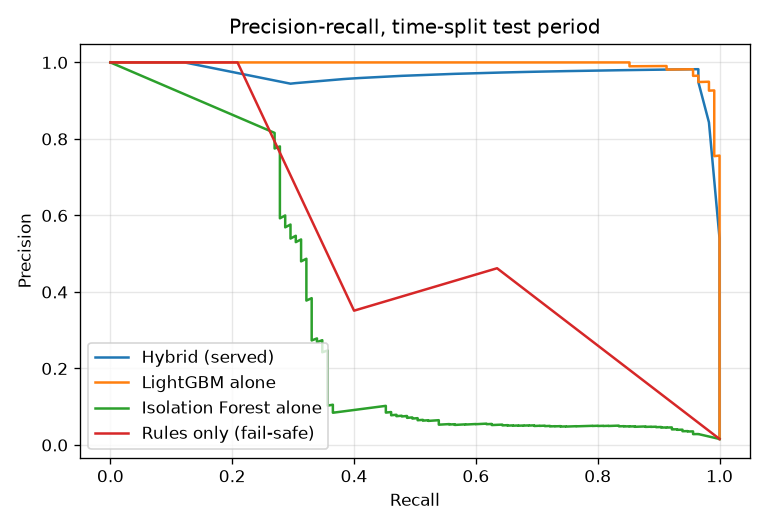
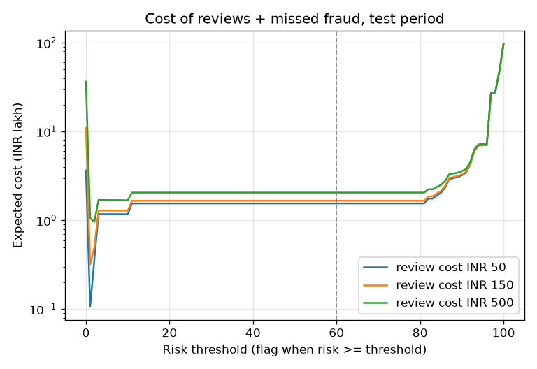
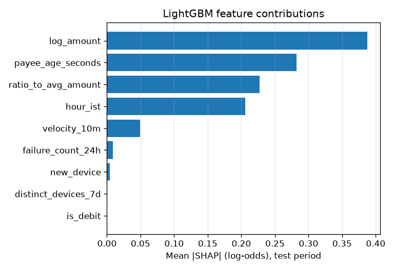

# Fraud engine evaluation report v1.1 (TASK-039, revised for GitHub issue #251)

**Date:** 1 Nov 2026. **Scorer evaluated:** `hybrid-lgbm-iforest-1`. It is loaded through the same
`pbip_ml.fraud.inference.load` the API uses (ADR-0019) and includes the TASK-080 VELOCITY_BURST floor.
**Data:** generator v2.1, which now includes legitimate first-time behaviour (GitHub issue #251).
**MLflow run:** `5de0a9dc7c534ed29701cd7703d4fb6a`, experiment `pbip-fraud`. The v1.0 report (generator
v2.0) used run `79157b22dc9a46d0b2dcfbb0ccde5cd9`; its headline numbers are kept in §3.3 for comparison.

> **Update for generator v2.2 (TASK-071): see §8.** From v2.2, models are trained and evaluated on outgoing
> transfers only, which is what the API scores. §8 has the retrained model's numbers, and they supersede §3.1
> and the four bars in §3.3. §1-§7 and the charts are the v1.1 (generator v2.1) evaluation, kept for comparison.
>
> **Update for generator v2.3 (#276) and TASK-084: see §9.** It covers the `hybrid-lgbm-iforest-2` retrain, the
> tuning run (the current params are kept) and the promotion gate result. Its numbers supersede §8.
>
> **Update for #396 (ADR-0047): see §10.** `hybrid-lgbm-iforest-3` calibrates on out-of-time folds. Its numbers
> supersede §9.

> **All data in this report is synthetic.** It comes from the seeded generator (`pbip_datagen`, TASK-023),
> which plants six fraud scenarios (F1-F6) and, since v2.1, three kinds of legitimate first-time behaviour.
> Scores show the models separate the planted patterns. They are **not** an estimate of performance on real
> bank traffic. See §7.

## 1. Reproduce

```bash
make fraud-model          # = export seed 42 (3,000 customers x 6 months) + train into models/fraud
uv run python -m pbip_datagen export --seed 4242 --customers 1500 --months 6 --out data/holdout
uv run python scripts/fraud_eval_report.py --model models/fraud --data data/fraud \
    --holdout data/holdout --json eval.json --img docs/ml/img
```

Training is deterministic (seeded, `deterministic=True`, one thread).

## 2. Data and split

| Split | Rows | Fraud rows | Period (UTC) |
|---|---|---|---|
| Train | 30,820 | (fitting) | Jan - mid Apr 2025 |
| Validation | 10,273 | (calibration, stacking, early stopping) | mid Apr - late May 2025 |
| **Test** | **10,274** | **115** | late May - end Jun 2025 |
| **Held-out seed 4242** | **26,009** | **268** | a different synthetic population |

The split is by **time**, so no future data leaks into training. Generator v2.1 adds about 40% more legitimate
rows than v2.0; the fraud rows are byte-identical (same random stream).

## 3. Results

Risk is 0-100. ALLOW < 30 ≤ STEP_UP < 60 ≤ REVIEW < 85 ≤ BLOCK. "Flagged at X" means risk ≥ X.

### 3.1 Hybrid scorer (what the API serves when `FRAUD_SCORER=hybrid`)

| Data | Flagged at | Precision | Recall | F1 | FPR | TN | FP | FN | TP |
|---|---|---|---|---|---|---|---|---|---|
| Test | STEP_UP (30) | 0.535 | 0.861 | 0.660 | 0.85% | 10,073 | 86 | 16 | 99 |
| Test | REVIEW (60) | 0.960 | 0.835 | 0.893 | 0.039% | 10,155 | 4 | 19 | 96 |
| Test | BLOCK (85) | 0.960 | 0.826 | 0.888 | 0.039% | 10,155 | 4 | 20 | 95 |
| Held-out seed | STEP_UP (30) | 0.475 | 0.892 | 0.620 | 1.03% | 25,477 | 264 | 29 | 239 |
| Held-out seed | REVIEW (60) | 0.965 | 0.832 | 0.894 | 0.031% | 25,733 | 8 | 45 | 223 |
| Held-out seed | BLOCK (85) | 0.965 | 0.817 | 0.885 | 0.031% | 25,733 | 8 | 49 | 219 |

Hybrid PR-AUC: **0.860** on test, **0.858** on the held-out seed.

### 3.2 Components and the fail-safe (test split)

| Scorer | Flagged at | Precision | Recall | F1 | PR-AUC | FPR |
|---|---|---|---|---|---|---|
| LightGBM alone (F1-optimal threshold 0.968, chosen on validation) | - | 0.959 | 0.817 | 0.883 | 0.970 | 0.039% |
| LightGBM alone, held-out seed | - | 0.965 | 0.817 | 0.885 | 0.960 | 0.031% |
| Isolation Forest alone (anomaly ≥ 0.5) | - | 0.120 | 0.470 | - | 0.301 | 3.90% |
| Rules only (the fail-safe) | STEP_UP | 0.256 | 0.626 | 0.364 | 0.214 | 2.06% |
| Rules only | REVIEW | 0.412 | 0.183 | 0.253 | 0.214 | 0.30% |



- **LightGBM carries the hybrid.** The stacked weights are 8.55 for the model, 1.43 for the anomaly score
  and 1.71 for rule points.
- **The hybrid's PR-AUC (0.86) is below LightGBM's (0.97).** The rule floors push some legitimate transfers
  up to STEP_UP (86 test false positives at STEP_UP; which floor caused each was not broken down). That is
  the price of rules the model cannot lower. At REVIEW and above, the hybrid matches LightGBM.
- **The hybrid is far better than the fail-safe.** At REVIEW it catches 0.835 of fraud against 0.183 for
  rules only, with a lower false-positive rate (0.039% vs 0.30%).
- The 19 misses at REVIEW were not broken down by scenario in this run. Expected contributors are F4 (no
  location feature), F5 (amounts near the customer's own range), and F1 cases that now resemble legitimate
  first payments.

### 3.3 Before and after GitHub issue #251: legitimate first-time transfers

"Before" is the v2.0 model (trained without legitimate new payees). "After" is the v2.1 model. Both score
the same v2.1 test and held-out rows. The table shows the share of legitimate transfers in each group that
each model flags.

| Legitimate group | Rows (test / held-out) | Before: flagged at REVIEW | After: REVIEW | After: STEP_UP |
|---|---|---|---|---|
| Payee added under 3 days ago | 1,082 / 3,280 | **100% / 100%** | **0.09% / 0.24%** | 7.6% / 8.0% |
| New device (phone change) | 134 / 352 | 0% / 0% | 0% / 0% | 0% / 0% |
| Earlier failed logins, usual device | 437 / 1,335 | 0% / 0% | 0% / 0% | 0% / 0% |
| All legitimate debits | 10,159 / 25,741 | 13.3% / 14.9% | 0.04% / 0.03% | 0.85% / 1.03% |
| **Fraud recall** | 115 / 268 | 0.948 / 0.944 | **0.835 / 0.832** | 0.861 / 0.892 |

**Reading it:**
- The v2.0 model held **every** legitimate transfer to a new payee for review. On data where such transfers
  exist, that meant 13-15% of all legitimate debits.
- After retraining, legitimate new-payee transfers are almost never held (under 0.25%). About 8% get a
  STEP_UP, which is a TOTP prompt, not a hold.
- Recall fell from 0.95 to 0.83. The old number was inflated: on v2.0 data "the payee is new" alone almost
  identified F1/F3/F6. Now the model has to separate fraud from honest first payments, which is the real
  problem. The v2.0 test set could not show this, because it had the same blind spot as the training set.

**Decision: switch local and demo to `FRAUD_SCORER=hybrid`.** The bar, and the results:

| Criterion | Bar | Result |
|---|---|---|
| Legitimate new-payee transfers held for REVIEW | ≤ 1% (a held payment blocks the customer and costs an analyst) | 0.09% / 0.24% |
| Legitimate new-payee transfers asked for STEP_UP | ≤ 10% (seconds of the customer's time) | 7.6% / 8.0% |
| All legitimate debits held at REVIEW | ≤ 0.1% | 0.04% / 0.03% |
| Recall at REVIEW, hybrid vs the rules alone | hybrid clearly better | 0.835 vs 0.183 |

- `.env.example` and docker-compose now set `hybrid`, with models from `make fraud-model`.
- The rules stay the floor and the fail-safe.
- The code default stays `rules`, so any other deployment has to opt in explicitly (AGENTS.md: safe
  defaults).

## 4. Cost analysis: choosing the threshold for a retail bank

Every flagged transfer costs an analyst review. Every missed fraud loses its whole amount (no recovery
assumed). **The review costs are assumptions:** ₹50, ₹150 (about 10 minutes at ₹900/hour) and ₹500.
Fraud losses are the real synthetic amounts: 115 frauds worth ₹97.56 lakh in the test period.

| Review cost | Cheapest threshold | Flagged | Missed | Total cost | At REVIEW (60): cost, flagged, missed | Flag nothing |
|---|---|---|---|---|---|---|
| ₹50 | 1 | 351 | 1 | ₹18,301 | ₹4,86,056, 100 flagged, 19 missed | ₹97.56 lakh |
| ₹150 | 1 | 351 | 1 | ₹53,401 | ₹4,96,056 | ₹97.56 lakh |
| ₹500 | 2 | 208 | 8 | ₹1,60,663 | ₹5,31,056 | ₹97.56 lakh |



- Missed fraud dominates: about ₹85,000 per synthetic fraud. On this data the cost-optimal point is
  "review about 2.3% of legitimate transfers" (351 flagged, 1 missed), against 19 missed at REVIEW.
- **No threshold is changed from this.** The result depends on synthetic amounts and an assumed review
  cost. Once real labelled outcomes exist, recalibrate STEP_UP downwards first: step-up costs the customer
  seconds, review costs an analyst minutes.

## 5. Inference latency

Machine: the reference laptop, Intel Celeron N4500 (2 cores, no AVX). One transfer is scored through
`score_transfer` (feature row, LightGBM, Isolation Forest, rules, SHAP reasons), 400 calls after a warm-up.
Other processes were running during the multi-thread rows (load average about 3).

| Load | p50 | p95 | max | Throughput |
|---|---|---|---|---|
| 1 thread (single request) | 15.7 ms | 22.7 ms | 81.9 ms | 59 / s |
| 2 threads (= cores) | 35.1 ms | 55.1 ms | 73.2 ms | 54 / s |
| 4 threads | 95.9 ms | 147.8 ms | 204.4 ms | 41 / s |

Served end to end through the API (rules, DB look-ups and models, TASK-033): p50 20.6 ms, p95 24.7 ms.

- Scoring is CPU-bound. Above the core count, concurrency adds queueing, not throughput.
- With 4 concurrent requests, p95 passes the contract's 100 ms. There the API's `FRAUD_MODEL_BUDGET_MS`
  (50 ms) cuts the model off and serves the rules result.
- Scaling is more worker processes on more cores. LightGBM alone is about 0.35 ms, so the Isolation Forest
  (about 11 ms) and SHAP are the parts to optimise first.

## 6. What changed between v1.0 and v1.1

| | v1.0 (generator v2.0) | v1.1 (generator v2.1) |
|---|---|---|
| Test recall at REVIEW | 0.957 | 0.835 |
| Test FPR at REVIEW | 0.028% | 0.039% |
| Legitimate new-payee transfers held | 100% (not measurable on v2.0 data; measured on v2.1 rows) | 0.09% |
| Behaviour baseline (TASK-080), APP scam | 97 (BLOCK) | 92 (BLOCK), re-recorded deliberately |

## 7. Limitations of the synthetic evaluation, and mitigations

| Limitation | Effect | Mitigation |
|---|---|---|
| Planted scenarios with clean signatures | Precision and recall overstate real performance | Treat as "the pipeline works"; validate on real labelled outcomes before relying on it |
| First-time behaviour is modelled, not observed (v2.1 rates: about 2 new payees per customer in 6 months, 12% switch phones) | FPR on new payees depends on these assumed rates and amounts | Calibrate the rates from real customer data when available |
| No location feature | F4 misses | Add a country-change feature to both feature paths, with a parity test |
| Labels are exact and immediate | Real labels arrive late and noisily | Evaluate on outcome-matured windows; monitor drift (TASK-084) |
| Small positive counts (115 test frauds) | One miss moves recall by about 0.9 points | Report the held-out seed too (268 frauds) |
| Fraud amounts drive the cost curve | The optimal threshold depends on synthetic amounts | Re-run §4 with real losses and the bank's actual review cost |
| No adversarial adaptation | Fraudsters adapt to a deployed model | Rule floors as policy the model cannot lower; red-team scenarios |

Protections in code:
- rule floors the model cannot lower (ADR-0019, plus VELOCITY_BURST);
- the rules-only fail-safe;
- the behaviour-regression suite (`ml/tests/test_fraud_behaviour_regression.py`);
- the metric gate in `test_fraud_hybrid.py`;
- the API test that a legitimate transfer to a 2-day-old payee is ALLOWed by the real models
  (`test_real_artifacts_load_once_and_every_transfer_is_scored_by_the_model`).

## 8. Generator v2.2 (TASK-071): F7/F8, and training on outgoing transfers only

**Date:** 1 Nov 2026. **MLflow run:** `394b64764f694164b3a1e0d356f4cf1d`, experiment `pbip-fraud-task071`.
Commands are the same as §1 on this branch. For F8, one extra export was scored with the same script:
`--seed 4242 --customers 1500 --months 12 --out data/holdout12`, passed as `--holdout`. Latency was not
re-measured: the model shapes are the same and the machine was shared.

**Data.** v2.2 only adds rows. Every v2.1 row and label is byte-identical, which `test_v2_1_rows_are_unchanged`
checks. The 6-month training export gains 31 F7 incidents (142 deposit rows). It has no F8: F8 needs more than
180 days of dormancy inside the data.

**Change: train and evaluate on outgoing transfers only.** `pbip_ml.fraud.training.build_dataset` drops incoming
rows. Training and evaluation both build their rows there, so the two cannot diverge
(`test_dataset_holds_outgoing_transfers_only_with_features_from_all_rows`). Features are still computed over
every row, because online history includes credits too.

Why: the API scores only outgoing transfers, so training on incoming rows was train/serve skew. The generator
has no legitimate incoming transfers, so "incoming" labelled itself as fraud. Adding the F7 deposits made this
visible:
- Trained on all rows, the v2.2 model scored the canonical APP scam **30 (STEP_UP)**; v2.1 scored it 99.
- With the F7 rate set to 0, the score returned to normal.

Effect on comparability: F6's inbound legs and F7's deposits are no longer scored. Recall now means recall on
outgoing fraud transfers. "Before" below is the v2.1 model scored on the same outgoing v2.2 rows.

| Measure (test / held-out) | Before: v2.1 model | After: v2.2 retrain, outgoing only |
|---|---|---|
| Fraud rows scored | 104 / 226 | 104 / 226 |
| Hybrid recall at REVIEW | 0.817 / 0.801 | 0.808 / 0.805 |
| False positives at REVIEW | 4 / 8 | 2 / 10 |
| Hybrid PR-AUC | 0.842 / 0.825 | 0.886 / 0.850 |
| Rules only, recall at REVIEW (test) | 0.202 | 0.202 |
| LightGBM alone (threshold 0.817 from validation) | - | P 0.903, R 0.894, PR-AUC 0.962 (test) |

Hybrid on the test split: STEP_UP precision 0.520, recall 0.865, FPR 0.82%. REVIEW precision 0.977, recall
0.808, FPR 0.020%. BLOCK precision 1.000, recall 0.789.

**The four bars from §3.3, retrained model (test / held-out):**

| Criterion | Bar | Result |
|---|---|---|
| Legitimate new-payee transfers held for REVIEW | ≤ 1% | 0.09% / 0.30% (pass) |
| Legitimate new-payee transfers asked for STEP_UP | ≤ 10% | 7.5% / 8.0% (pass) |
| All legitimate debits held at REVIEW | ≤ 0.1% | 0.02% / 0.04% (pass) |
| Recall at REVIEW, hybrid vs the rules alone | hybrid clearly better | 0.808 vs 0.202 (pass) |

These numbers are not directly comparable with the earlier 0.835 vs 0.183, which also counted the incoming
F6 legs. Those legs were easy for the model and almost never caught by the rules.

**Behaviour baseline (TASK-080):**
- The suite's model scores the canonical cases APP scam 94 (BLOCK), velocity burst 30, takeover 60 and routine
  grocery 0. Against the recorded baseline (92, 30, 60), all pass, so the baseline file is unchanged.
- The full 3,000-customer model scores the APP scam 88 (BLOCK).

**Recall by scenario, at REVIEW (test / held-out, outgoing rows):**

| Scenario | Recall |
|---|---|
| F1 | 0.93 / 0.75 |
| F2 | 0.79 / 0.86 |
| F3 | 1.00 / 1.00 |
| F4 | 0.63 / 0.69 |
| F5 | 0.67 / 0.46 |
| F6 (outbound leg) | 1.00 / 0.90 |
| F7 | **not applicable** |
| F8 (12-month held-out, 17 rows) | 0.88 (STEP_UP 1.00) |

- **F7 is not detected by the per-transfer scorer.** Structuring is a pattern of incoming deposits, and the
  scorer only sees outgoing transfers. Detecting it needs a deposit-window aggregate feature or a batch
  monitor. That is a follow-up (GitHub issue #274); F7 stays in the data as labelled ground truth for it.
- **F8 is caught by the takeover signals, not by dormancy.** It looks like F1/F3: a new device, a payee added
  minutes earlier and the maximum amount. No feature measures the time since the last activity, so a careful
  dormant-account fraud without those signals would be missed. That is also a follow-up (GitHub issue #275).

## 9. Generator v2.3 (#276) retrain and the TASK-084 tuning run

**Date:** 3 Nov 2026. **Scorer:** `hybrid-lgbm-iforest-2`, current `LGBM_PARAMS`, MLflow run
`7b43ecc3827f4e8ebef35699f9a8f1ab` (scratch tracking store; experiment `pbip-fraud`). **Data:** generator v2.3.0.
Exports are the same as §1 (seed 42, 3,000 customers × 6 months; held-out seed 4242, 1,500 × 6). The machine was
a shared 2-CPU laptop, and every run used `nice -n 19`.

**Data change.** v2.3 drops the ordinary transfers that churned customers made after they left (#276, a v2.0
defect). The seed-42 export loses 559 legitimate rows (51,509 to 50,950). No fraud row or label changes, and every
other row is byte-identical (`test_v2_1_rows_are_unchanged`). The test split now holds 10,146 outgoing transfers
(104 fraud), and the held-out split holds 25,602 (226 fraud).

**Model version.** The v2.1 and v2.2 models were both served as `hybrid-lgbm-iforest-1`, so their `fraud_events`
rows could not be told apart. The retrain is `hybrid-lgbm-iforest-2` (`HYBRID_VERSION`, `train.py`).

**The four bars (test / held-out).** "Before" is the model the demo stack serves today (v2.2 artifacts,
`-1`), scored on the same v2.3 rows with `scripts/fraud_eval_report.py`:

| Criterion | Bar | Before: `-1` on v2.3 rows | After: `-2` retrain |
|---|---|---|---|
| Legitimate new-payee transfers held for REVIEW | ≤ 1% | 0.09% / 0.24% | 0.28% / 0.37% (pass) |
| Legitimate new-payee transfers asked for STEP_UP | ≤ 10% | 7.61% / 7.96% | 7.61% / 8.02% (pass) |
| All legitimate debits held at REVIEW | ≤ 0.1% | 0.030% / 0.030% | 0.040% / 0.050% (pass) |
| Recall at REVIEW, hybrid vs rules alone (test) | hybrid clearly better | 0.817 vs 0.202 | **0.865 vs 0.202** (pass) |

| Measure (test / held-out) | Before: `-1` | After: `-2` |
|---|---|---|
| Hybrid PR-AUC | 0.852 / 0.826 | **0.922 / 0.852** |
| Hybrid recall at REVIEW | 0.817 / 0.801 | 0.865 / 0.845 |
| Precision at REVIEW | 0.966 / 0.958 | 0.957 / 0.936 |
| Confusion at REVIEW (TN / FP / FN / TP), test | 10,039 / 3 / 19 / 85 | 10,038 / 4 / 14 / 90 |
| Confusion at REVIEW (TN / FP / FN / TP), held-out | 25,368 / 8 / 45 / 181 | 25,363 / 13 / 35 / 191 |
| LightGBM alone, PR-AUC | - | 0.977 / 0.965 |

The trade-off is a few more legitimate reviews (test FP 3 to 4, held-out 8 to 13) in exchange for 5 / 10 more
frauds caught. All four bars still pass. On the test split, STEP_UP has precision 0.539, recall 0.942 and FPR
0.84%; BLOCK has precision 0.957, recall 0.846 and FPR 0.040%.

**Recall at REVIEW by scenario, `-2` (test / held-out):** F1 0.86 / 0.79, F2 0.88 / 0.90, F3 1.00 / 1.00,
F4 0.63 / 0.77, F5 0.83 / 0.50, F6 outbound 1.00 / 0.90. F7 and F8 are as in §8: F7 is not scored, and F8 was not
re-measured on a 12-month export in this run.

**SHAP summary.** The mean |TreeSHAP| on the test period (log-odds) is now in `report.json` and in MLflow as
`shap_mean_abs_<feature>`, and is drawn as `img/fraud-shap-summary.png`. Values: log_amount 0.387,
payee_age_seconds 0.282, ratio_to_avg_amount 0.227, hour_ist 0.206, velocity_10m 0.050, failure_count_24h 0.009,
new_device 0.004, distinct_devices_7d 0.000, is_debit 0.000. The weight on `hour_ist` reflects the generator's
planted timing (scenarios are drawn at daytime hours), not a real-world signal (§7).



**Tuning (TASK-084).** `scripts/fraud_tune.py`, Optuna 5.0 TPE with seed 42, 30 trials:
- Search space: learning rate, max depth, num_leaves, min_child_samples, L1/L2 and feature fraction.
- Folds: 3 expanding-window time folds inside the training and validation periods only. Each fold fits on the
  past, stops early on the first half of the next block and is scored on its second half. The test period is
  never used. Each fold has 55-91 positives.
- Result: the current params score a mean fold PR-AUC of **0.9839**; the best trial (#29: learning rate 0.021,
  max_depth 7, 8 leaves, min_child_samples 27, L1 0.015, L2 0.013, feature fraction 0.60) scores **0.9871**.

That +0.003 is within fold noise. When the full pipeline was trained with the winner (run
`e6a505d9e69042b3965148ef5cefe705`), it did worse on every measure:

| Measure (test / held-out) | Current params | Tuned params |
|---|---|---|
| Early-stopping iteration | 81 | 4 |
| LightGBM PR-AUC | 0.977 / 0.965 | 0.887 / 0.832 |
| Hybrid PR-AUC | 0.922 / 0.852 | 0.855 / 0.820 |
| Recall at REVIEW | 0.865 / 0.845 | 0.760 / 0.730 |
| All legitimate debits held at REVIEW | 0.040% / 0.050% | 0.090% / **0.120% (fails the 0.1% bar)** |

At its low learning rate, the tuned model peaks on the validation period after 4 trees, so it is under-trained. It
misses F4 and F5 completely. **Decision: keep the current `LGBM_PARAMS`.** Tuning on synthetic data mostly fits the
generator. The search is kept as a reproducible tool for when real labelled data exists.

**Behaviour baseline (TASK-080).** The suite trains with the production recipe (3,000 customers). With 1,500
customers on v2.3 data, the canonical APP scam scored 30. That model's raw score of 0.90 fell on a 0.40 step of an
isotonic calibration fitted on only 42 validation positives. The production-size model scores it 93 (BLOCK), the
velocity burst 30 and the takeover 60, so the recorded baseline (92, 30, 60) holds. The fragility is in the
calibration with few positives, and the follow-up issue tracks it.

**Promotion gate (TASK-038), in a scratch registry:** the gate measured:
- served PR-AUC 0.922 test and 0.852 held-out (gate ≥ 0.80: pass);
- recall at REVIEW 0.865;
- **p95 latency of 112 ms** against the 50 ms gate (**fail**). The laptop was CPU-starved at the time: load
  average 5-11 on 2 CPUs, and the gate ran at `nice -n 19`.

So the gate **did not promote** the model. There was also no champion to compare with. The demo's artifacts
(`models/fraud`, 1 Nov 2026) cannot be re-measured through the gate, because their `report.json` test period
matches no export from current code (10,274 test rows versus 10,258 for a v2.2 export of `main` today). The
`-1` vs `-2` comparison above uses the gate's own served scorer on the same rows. The model has to be re-gated
on an idle machine before it is exported. **Nothing was exported to `models/fraud` and nothing was loaded into
the demo stack.**

## 10. Out-of-time calibration (#396, ADR-0047): `hybrid-lgbm-iforest-3`

**Date:** 4 Nov 2026. **Scorer:** `hybrid-lgbm-iforest-3`, MLflow run `4d3a1ae903c4430d8745e9bb20fda674`
(registry `pbip-fraud`, local SQLite store). **Data:** the same generator v2.3 exports as §9 (seed 42, 3,000 × 6;
held-out seed 4242, 1,500 × 6). The LightGBM booster and the Isolation Forest are trained exactly as in §9 (same params, seed
and data; LightGBM best iteration 81 and PR-AUC 0.977, as in §9). Only the calibration and the stack changed.

**What changed.** The isotonic calibration is fitted on the validation scores plus out-of-time scores from 4
chronological folds of the training period: each fold model trains on the earlier blocks and scores the next one.
It rests on 317 positives (32,972 rows) instead of 106, and the table has 36 points instead of 14. The stack's L2
strength is `C = 10` instead of 1. Test and held-out rows were used for neither the fit nor the choice. The choice
evidence (calibration Brier and forward-in-time hybrid log-loss on the second half of validation, both recipes) is
in ADR-0047.

**The four bars (test / held-out),** measured with `scripts/fraud_eval_report.py` on the served artifacts:

| Criterion | Bar | `-2` (§9) | `-3` |
|---|---|---|---|
| Legitimate new-payee transfers held for REVIEW | ≤ 1% | 0.28% / 0.37% | 0.28% / 0.43% (pass) |
| Legitimate new-payee transfers asked for STEP_UP | ≤ 10% | 7.61% / 8.02% | 7.61% / 8.02% (pass) |
| All legitimate debits held at REVIEW | ≤ 0.1% | 0.040% / 0.050% | 0.040% / 0.059% (pass) |
| Recall at REVIEW, hybrid vs rules alone (test) | hybrid clearly better | 0.865 vs 0.202 | **0.923 vs 0.202** (pass) |

| Measure (test / held-out) | `-2` | `-3` |
|---|---|---|
| Hybrid PR-AUC | 0.922 / 0.852 | **0.945 / 0.887** |
| Recall at REVIEW | 0.865 / 0.845 | **0.923 / 0.894** |
| Precision at REVIEW | 0.957 / 0.936 | 0.960 / 0.931 |
| Confusion at REVIEW (TN / FP / FN / TP), test | 10,038 / 4 / 14 / 90 | 10,038 / 4 / 8 / 96 |
| Confusion at REVIEW (TN / FP / FN / TP), held-out | 25,363 / 13 / 35 / 191 | 25,361 / 15 / 24 / 202 |

On the test split the false holds are unchanged (4) and 6 more frauds are held. On the held-out seed 11 more
frauds are held for 2 more false holds (0.051% to 0.059% of legitimate debits). STEP_UP (test): precision 0.539,
recall 0.942, FPR 0.84%. BLOCK (test): precision 0.957, recall 0.846, FPR 0.040%.

**Recall at REVIEW by scenario (test / held-out):** F1 0.86 / 0.82, F2 0.97 / 0.98, F3 1.00 / 1.00, F4 0.63 / 0.77,
F5 0.83 / 0.50, F6 outbound 1.00 / 0.90. The gain is mostly F2 (velocity bursts: 0.88 / 0.90 in §9).

**Behaviour suite (TASK-080), production recipe:** APP scam 95 (BLOCK; §9: 93), velocity burst 30 (STEP_UP),
takeover 60 (REVIEW), routine grocery 0 (ALLOW). The baseline file now records the APP scam at 95.

**#396 on the 1,500-customer recipe** (seed 42, 42 validation positives, 115 more from the folds): the APP scam
goes from **30 (STEP_UP) to 64 (REVIEW)**; velocity burst 30, takeover 60, grocery 0. 64 is still below the suite's
80 bar, which applies to the production recipe; `test_half_size_model_still_holds_the_known_app_scam` pins REVIEW or
higher. Its hybrid PR-AUC is 0.876 / 0.831 and recall at REVIEW 0.855 / 0.779 (test / held-out). It holds 5 of 4,982
legitimate test debits (0.100%, at the 0.1% bar; it was 4 with `-2`'s method) and 0.05% on held-out. It is a test
fixture, not a served model, and its test split is half the size, so one row moves the rate by 0.02 points.

**Limitations.** The calibration is still a step function, now with finer steps on three times the positives. The
fold models see less data than the final model, so their scores are not exactly the final model's. All numbers are
on synthetic data (§7).

**Promotion gate (TASK-038), 4 Nov 2026 01:36 IST, passed:** `python -m pbip_ml.fraud.promotion promote --run-id
4d3a1ae903c4430d8745e9bb20fda674` against the team's local SQLite registry, on the 2-CPU laptop with the other jobs
paused (load average 2.06 / 5.28 / 6.71 just before, 1.84 / 4.97 / 6.57 just after; normal priority). The gate
measured:
- served PR-AUC 0.945 test and 0.887 held-out (gate ≥ 0.80: pass);
- recall at REVIEW 0.923, FPR at REVIEW 0.040% (10,146 test rows);
- **single-request p95 latency 20.2 ms** against the 50 ms gate (pass). §9's 112 ms was the CPU-starved machine,
  not the model.

The registry had no earlier champion, so there was no champion comparison. The run is registered as `pbip-fraud`
version 1 with the `champion` alias. Exporting it to `models/fraud` (`export-champion`) and loading it into the
demo stack is a separate, operator step after this change merges.
