# PBIP use cases as built

| | |
|---|---|
| Source | *PBIP Use Case Document v0.2*, section 7 (UC-01 to UC-13), with the actors of section 6 |
| Describes | `main` at `60b1af4` (5 Nov 2026), which includes #461 (risk band), #463 and #477 (behavioural profile and analytics consent), #464 (fraud dashboard), #466 (compliance system exceptions), #470 (catalogue loan recommendations) and #472 (E2E journeys); #474 (assistant FAQ for every feature and insurance discovery, batch N #488) and the wealth scope of ADR-0058: investing in funds, stocks and bonds through the ledger (#465), the insurance quote and application with the web Invest, Insurance and Holdings pages (#483), and fund SIPs with an hourly job (#484) and their web screens (#487).  |
| Companion documents | [Requirements specification](requirements-specification.md) (numbered FR/NFR), [traceability](traceability.md) (requirement to code, tests and gaps), [user stories](user-stories.md), [diagrams](../diagrams/README.md), [user manual](../user-manual/README.md) |

Each use case below gives the objective from the use-case document, the actors, the preconditions, the main and
alternative flows with the real routes (all under `/api/v1` unless they start with `/api/health`) and web screens,
the diagrams that draw it, the automated tests that prove it, and screenshots. Test paths are relative to
`apps/api/tests/` (Python), `apps/web/src/` (Vitest) and `apps/web/e2e/` (Playwright). Screenshots of the
v1.1.0 screens are listed [at the end](#screenshots-of-the-v110-screens).

## Actors and use case diagram

| Actor (section 6) | In the code | Gate |
|---|---|---|
| Retail customer | role `CUSTOMER` with a `customers` row | `get_current_customer` on every customer route; objects read only through policy functions with the authenticated customer id |
| Relationship manager | `RELATIONSHIP_MANAGER` | `rm_gate`: RM or ADMIN with an MFA session; only customers assigned by an administrator (ADR-0032) |
| Fraud analyst | `FRAUD_ANALYST` | `analyst_gate`: analyst or ADMIN with an MFA session |
| Compliance officer | `COMPLIANCE_OFFICER` | `compliance_gate`: officer or ADMIN with an MFA session |
| Banking administrator | `ADMIN` | `admin_gate`, `settings_admin_gate`, `assignment_gate`: ADMIN with an MFA session |
| AI assistant | not a role | Acts as the signed-in customer through read-only tools; the customer id comes from the access token |
| Fraud engine (system actor) | `FraudScorer` (`BaselineRulesScorer`, `HybridFraudScorer`) | In-process, on every transfer and bill payment |

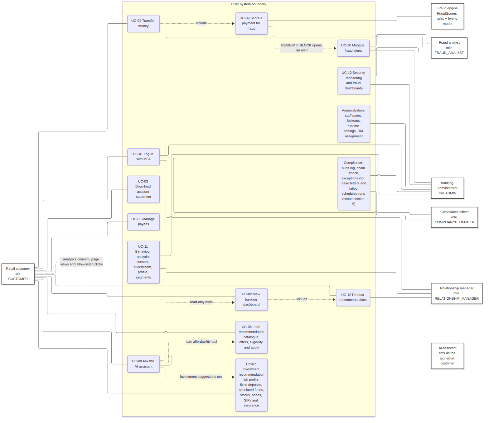

Source and the route table per use case: [diagrams/use-case.md](../diagrams/use-case.md).

---

## UC-01 Customer login

**Objective.** Allow customers (and staff) to access the platform securely.

**Actors.** Retail customer; every staff role. **Preconditions.** A user exists (self-registration at
`POST /auth/register` and `/register`, or a staff user created by an administrator); the user is `ACTIVE`.

**Main flow.**
1. The user enters e-mail and password on `/login`: `POST /auth/login` (rate-limited per IP).
2. The password is verified with Argon2id; failures are counted and the account locks progressively.
3. With MFA enabled, the API answers `mfa_required` and a short-lived challenge token; the user enters a TOTP or
   recovery code: `POST /auth/mfa/verify`. Staff must have MFA: every staff route needs `amr` with `otp`.
4. The API issues a 15-minute access token and a rotating refresh token in an HttpOnly cookie; the web app restores
   the session with `POST /auth/refresh`.

**Alternative flows.**
- Wrong e-mail or password: 401 with the same body for both; `LOGIN_FAILURE` security event.
- Too many failures: `ACCOUNT_LOCKED`, 423 while locked; an administrator can inspect and clear it (`/staff/admin`).
- Wrong or replayed code: 401 and a counted failure. Too many requests: 429 with `Retry-After`.
- A reused refresh token revokes its whole family (`TOKEN_REUSE_DETECTED`); a password change or a disabled user ends
  every access token on the next request (ADR-0021).
- MFA enrolment: `POST /auth/mfa/enroll`, `/auth/mfa/confirm` (screens on Profile & security and staff Sign-in security).

**Diagrams.** [Login with MFA](../diagrams/activity.md#1-login-with-mfa),
[token refresh and revocation](../diagrams/sequence.md#5-token-refresh-and-revocation-adr-0021).

**Tests.** `integration/test_auth.py`: `test_register_login_and_me`, `test_unknown_user_and_wrong_password_are_indistinguishable`,
`test_progressive_lockout_and_recovery`, `test_login_rate_limit_per_ip`,
`test_mfa_enrolment_login_replay_protection_and_recovery_codes`, `test_repeated_bad_mfa_codes_lock_the_account`,
`test_refresh_rotation_and_reuse_detection`; `integration/test_access_token_revocation.py`:
`test_disabling_a_user_rejects_their_access_token_on_the_next_request`,
`test_password_change_revokes_every_outstanding_access_token`; `integration/test_admin_lockout.py`:
`test_admin_inspects_and_unlocks_a_locked_customer`; `integration/test_rbac_bola.py`:
`test_staff_endpoints_demand_mfa_in_the_session`; E2E `journey-onboarding.spec.ts` (registers, enrols an authenticator,
signs back in with a code).

**Screenshots.**

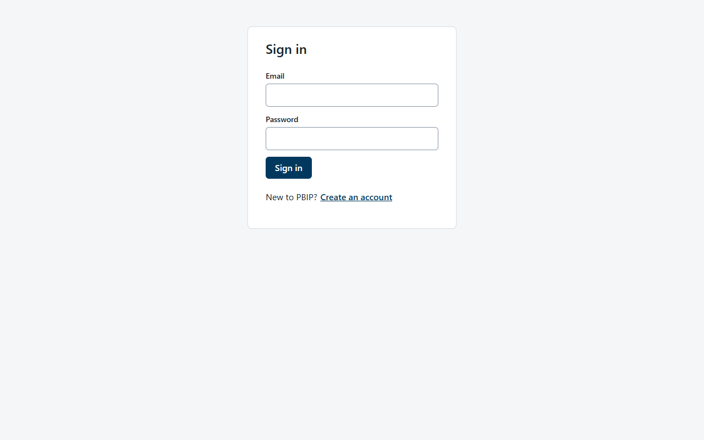
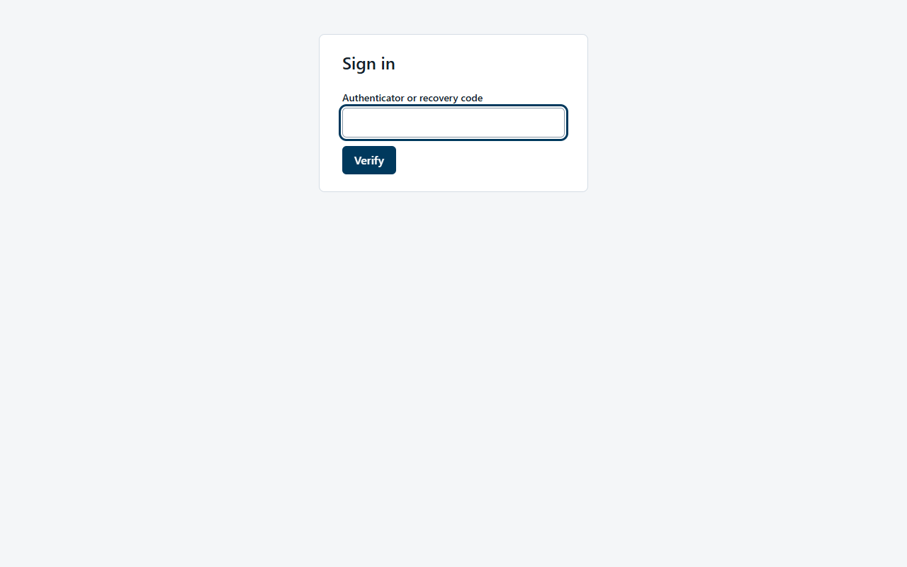
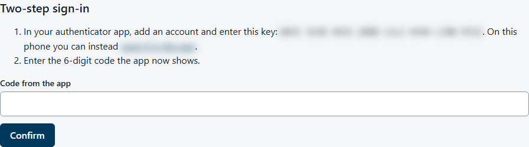

---

## UC-02 View banking dashboard

**Objective.** A consolidated view of the customer's finances.

**Actors.** Retail customer. **Preconditions.** Signed in.

**Main flow.**
1. `/accounts` loads `GET /accounts` (available, ledger and held balance per account) and `GET /accounts/summary`
   (total per currency).
2. Recent transactions: `GET /accounts/{id}/transactions` (keyset-paginated, filters by date, amount, type, text).
3. Spending insights on `/insights`: `GET /analytics/spending`, `/analytics/trends`, `/analytics/health-score`,
   `/analytics/forecast` (labelled as a prediction).
4. Product recommendations: the carousel on `/accounts` reads `GET /recommendations` (UC-12).

**Alternative flows.** An account too new to forecast returns `INSUFFICIENT_HISTORY`, not an error (ADR-0044); an
empty history shows empty states; another customer's account id is 404.

**Diagrams.** [Component diagram](../diagrams/component.md); [data flow level 1](../diagrams/data-flow.md#level-1-processes-and-data-stores) (process 6).

**Tests.** `integration/test_accounts.py`: `test_open_savings_account_success`; `integration/test_account_summary.py`:
`test_summary_totals_own_accounts_with_hold_frozen_and_closed`; `integration/test_analytics.py`:
`test_spending_breakdown_with_categorized_debits`; `integration/test_forecast_projection.py`; `integration/test_rbac_bola.py`:
`test_bola_customer_b_cannot_touch_customer_a_objects`; Vitest `pages/Accounts.test.tsx`, `pages/Insights.test.tsx`;
E2E `journey-transfer.spec.ts` (ledger entry under Accounts, Transactions).

**Screenshots.**

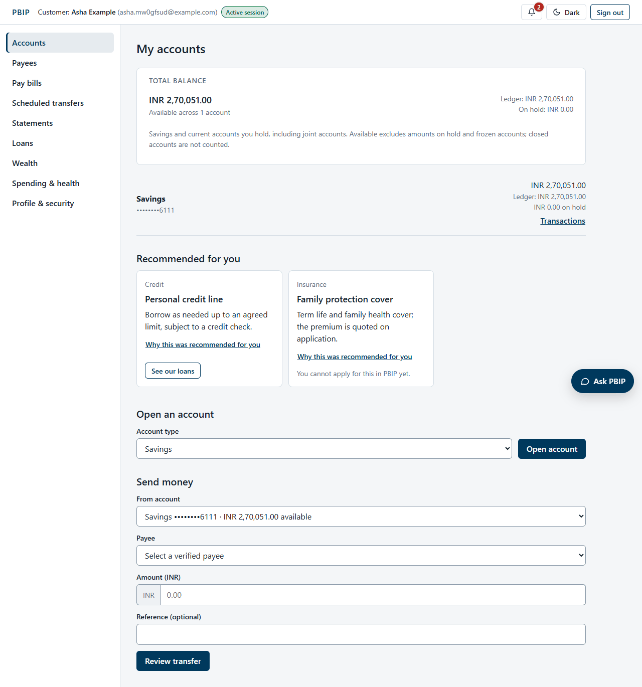
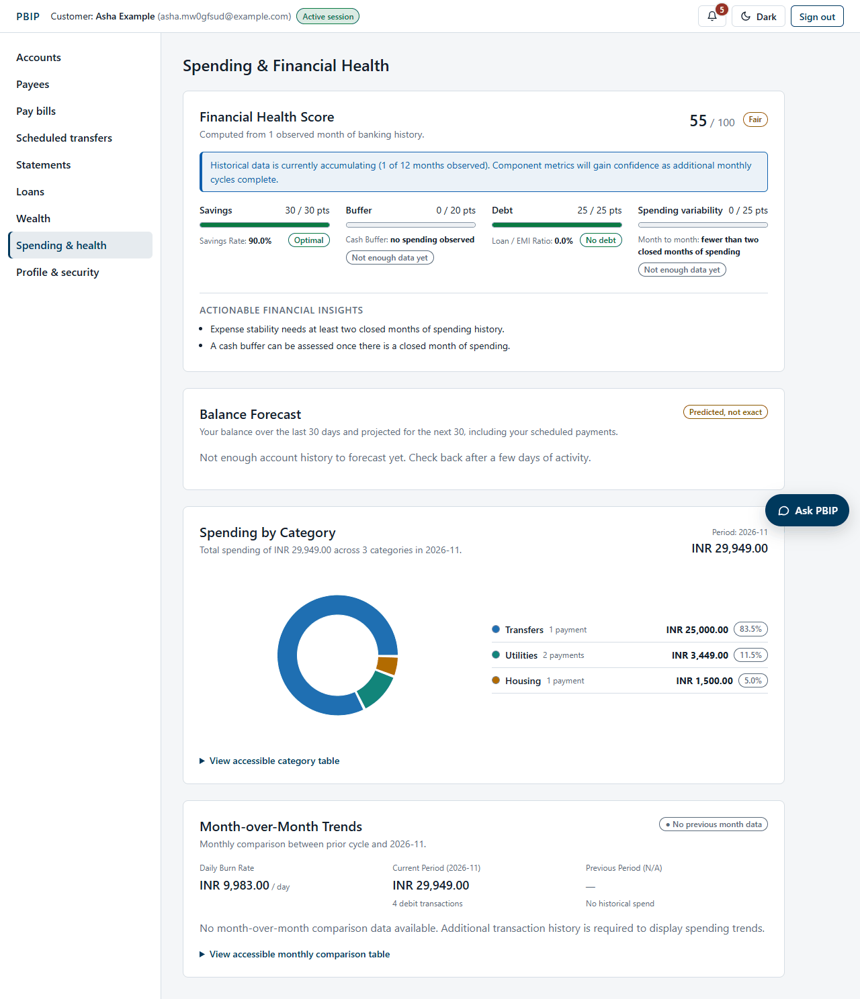

---

## UC-03 Download account statement

**Objective.** Let customers retrieve account statements.

**Actors.** Retail customer. **Preconditions.** Signed in; the account is theirs.

**Main flow.**
1. On `/statements` the customer picks an account, a start and end date (IST bank days) and PDF or CSV.
2. `GET /accounts/{id}/statements?start_date&end_date&format=pdf` checks ownership, builds the period from the ledger
   (opening and closing balance, every entry with its running balance) and renders the PDF.
3. The download is audited (`STATEMENT_DOWNLOADED`) and notified in the bell; the browser saves the file.

**Alternative flows.** End date in the future, start after end, more than 366 days or too many entries: 422 with a
plain message. Another customer's account: 404.

**Diagrams.** [Statement PDF download](../diagrams/sequence.md#4-statement-pdf-download).

**Tests.** `integration/test_statements.py`: `test_pdf_has_the_bank_header_summary_and_balances`,
`test_csv_lists_every_entry_with_running_balance`, `test_opening_balance_carries_history_before_the_period`,
`test_download_is_audited_and_notifies_without_amounts`; E2E `journey-statements.spec.ts` (#472: PDF and CSV download).

**Screenshots.**

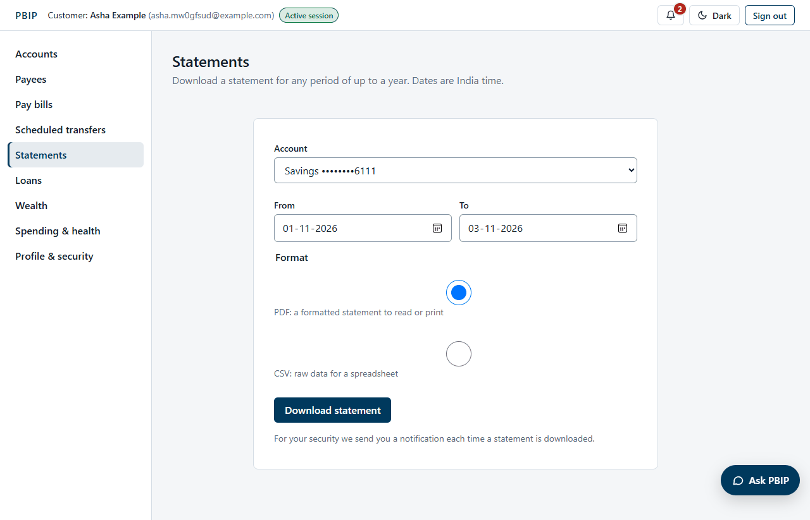

---

## UC-04 Transfer money

**Objective.** Let customers transfer funds securely.

**Actors.** Retail customer; fraud engine. **Preconditions.** Signed in; a funded account; a verified payee or a
second own account.

**Main flow.**
1. "Send money" on `/accounts`: the customer picks the source account and payee, enters the amount and reference.
2. A review dialog shows the details; the customer confirms.
3. `POST /transfers` with an `Idempotency-Key`: per-transfer limit, per-user lock, idempotency, ownership, verified
   payee, then the fraud engine scores the payment (UC-09).
4. `ALLOW`: daily limit and balance checked, balanced entries posted, 201 and a receipt.

**Alternative flows.**
- `STEP_UP`: 202; the customer enters a TOTP code (`POST /transfers/{id}/step-up`). Three wrong codes hand it to an
  analyst; no answer within 15 minutes declines it (`STEP_UP_EXPIRED`).
- `REVIEW`: funds held, 202, alert opened, customer notified (UC-10). `BLOCK`: 403, declined, alert opened.
- Insufficient funds, limits, unverified payee: 422 and nothing persists. A retry with the same key replays the
  original answer.
- Standing orders: `/scheduled` and `POST /transfers/scheduled`; the beat job runs each occurrence through the same
  use case.
- Bill payments: `/bills` and `POST /bills/pay` (same fraud contract; `STEP_UP` is held for review).

**Diagrams.** [Transfer activity](../diagrams/activity.md#2-transfer-with-review-step-up-and-fraud-decision),
[hybrid scoring sequence](../diagrams/sequence.md#1-transfer-with-hybrid-fraud-scoring),
[step-up sequence](../diagrams/sequence.md#2-step-up-verification),
[transaction lifecycle](../diagrams/state.md#1-transaction-lifecycle),
[scheduled run](../diagrams/activity.md#6-scheduled-transfer-run), [bill payment](../diagrams/activity.md#5-bill-payment).

**Tests.** `integration/test_transfers.py`: `test_transfer_moves_money_and_writes_balanced_entries`,
`test_retry_with_same_key_returns_the_original_result_without_a_duplicate`,
`test_concurrent_duplicates_create_exactly_one_transfer`, `test_per_transfer_and_daily_limits`,
`test_unverified_payee_cannot_receive_money`, `test_step_up_with_mfa_completes_after_a_valid_code`,
`test_three_wrong_step_up_codes_hand_the_transfer_to_an_analyst`, `test_block_declines_without_moving_money_and_hides_the_reasons`;
`integration/test_bills.py`: `test_pay_bill_posts_balanced_double_entry_and_records_audit_and_notification`,
`test_pay_bill_insufficient_funds_leaves_zero_partial_state`; `integration/test_scheduled_transfers_engine.py`:
`test_successful_scheduled_execution_posts_and_advances`, `test_deterministic_idempotency_prevents_duplicate_post`;
E2E `journey-transfer.spec.ts` (review to receipt, idempotent replay, TOTP step-up), `journey-scheduled.spec.ts`,
`journey-bills.spec.ts` (#472).

**Screenshots.**

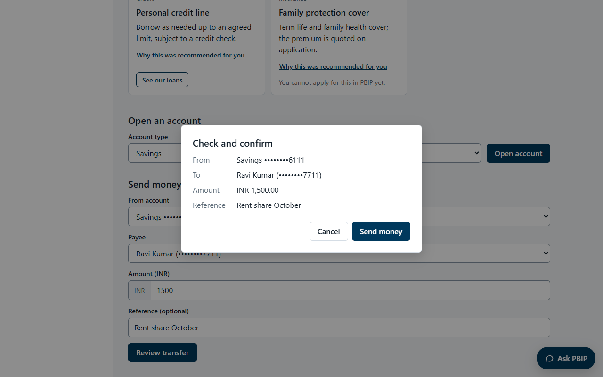
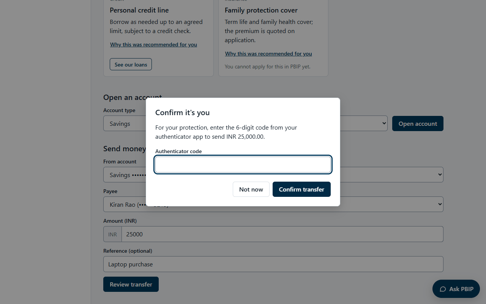
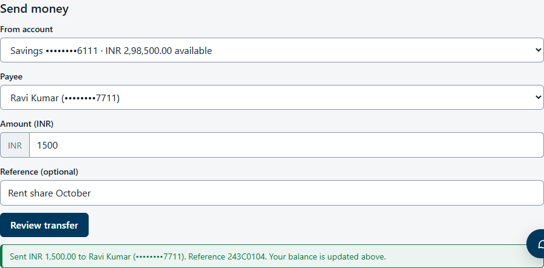
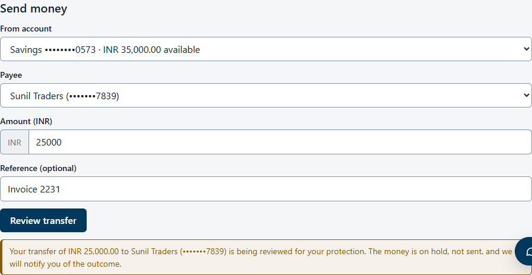
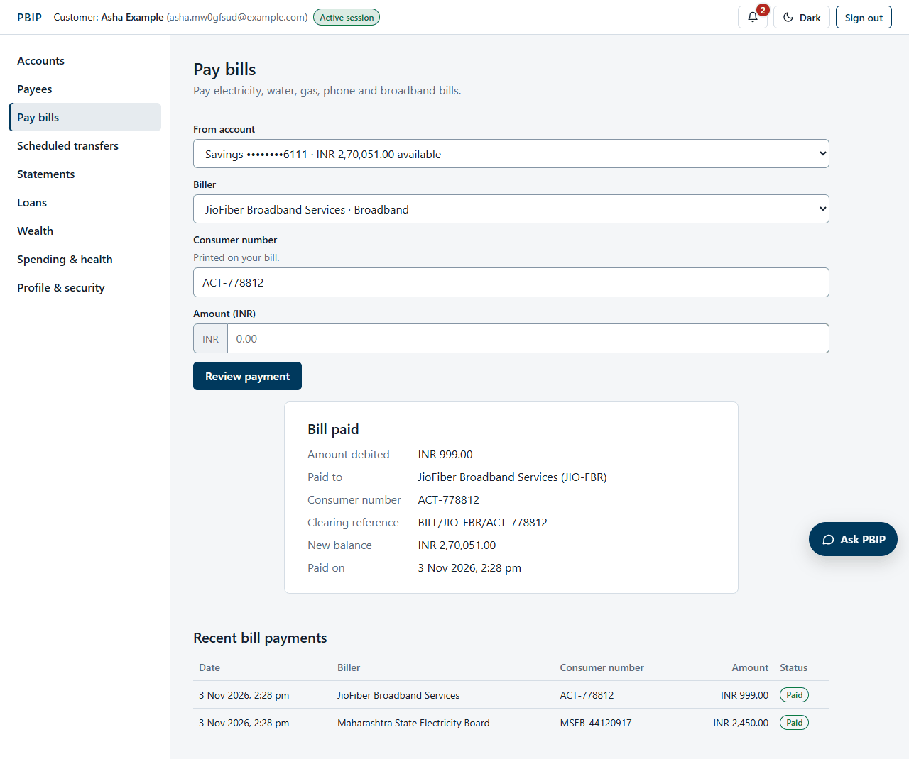
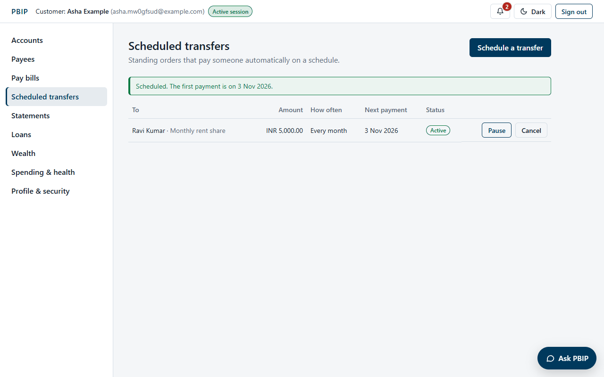

---

## UC-05 Manage payees

**Objective.** Manage payment beneficiaries.

**Actors.** Retail customer. **Preconditions.** Signed in.

**Main flow.**
1. Add: on `/payees`, name, account number and bank code: `POST /payees`.
2. Verify: a confirmation-of-payee name check, `POST /payees/{id}/verify`; only verified payees receive money.
3. Edit: `PATCH /payees/{id}` (name and nickname; account details are immutable; a new name resets verification).
4. Delete: `DELETE /payees/{id}` after confirmation.

**Alternative flows.** A name mismatch is reported without revealing the holder's name; external-bank names cannot be
checked in the simulation (`NOT_CHECKED`, stated in the UI); another customer's payee is 404.

**Tests.** `integration/test_payee_edit.py`: `test_renaming_resets_verification_and_blocks_transfers_until_verified_again`,
`test_account_details_are_immutable_and_input_is_validated`; `integration/test_transfers.py`:
`test_payee_name_mismatch_is_not_verified_and_never_reveals_the_real_name`; `integration/test_rbac_bola.py`
(payees in the BOLA matrix); Vitest `pages/Payees.test.tsx` ("adds a payee, runs the name check and warns on a
mismatch without revealing the name", "removes a payee after confirmation").

**Screenshots.**

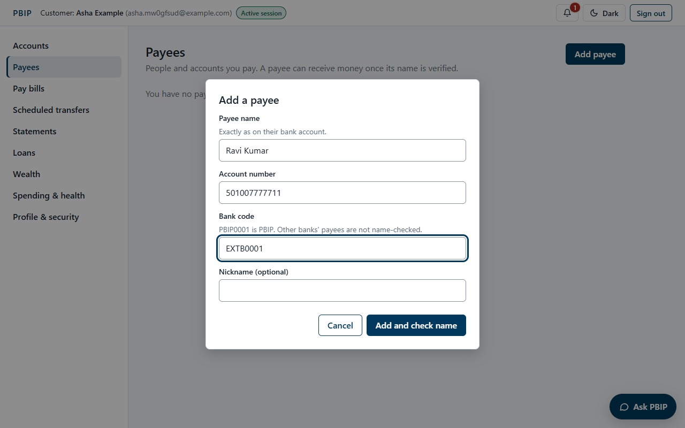
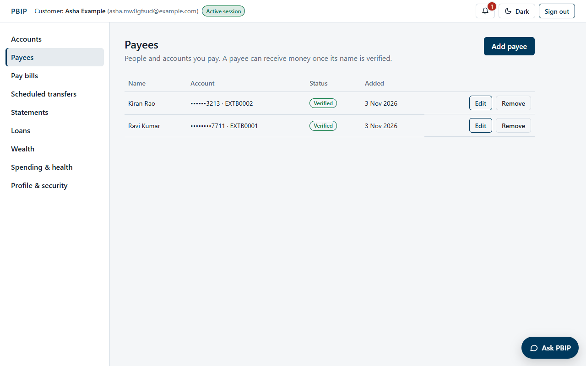

---

## UC-06 Loan recommendation

**Objective.** Recommend loans from the customer's balances, income and spending, with an eligibility assessment.

**Actors.** Retail customer; AI assistant (affordability tool). **Preconditions.** Signed in; for an eligible
outcome, regular income in the ledger (ADR-0043).

**Main flow** (#470).
1. `/loans` shows "Loans for you": `GET /loans/offers` assesses every catalogue loan (personal, car, home) with the
   loans module's rules and a suggested amount range at a reference tenure.
2. The carousel on `/accounts` shows eligible catalogue loans with their figures (`GET /recommendations`, `loan` object).
3. The customer adjusts amount and tenure: `POST /loans/calculate-emi`, then `POST /loans/check-eligibility`
   (income, debt-to-income at most 50%, spending plus EMIs at most 90% of income, available balance covers the first
   EMI, no lockout in 90 days), with reasons quoting the customer's own figures.
4. Apply: `POST /loans/apply` with an `Idempotency-Key` re-runs the check, disburses through the ledger, books the
   schedule and the monthly repayment instruction. Tracking: `GET /loans`, `GET /loans/{id}`.

**Alternative flows.** Not eligible: 422 with the reasons, nothing persists. No income: every offer is not eligible
and says why. A loan type already held is not recommended again. The assistant's "Can I afford a personal loan?"
decides through the same rules.

**Diagrams.** [Loan application and disbursal](../diagrams/activity.md#4-loan-application-and-disbursal),
[loan lifecycle](../diagrams/state.md#3-loan-lifecycle).

**Tests.** `integration/test_loans.py`: `test_eligible_with_explained_figures`,
`test_rejected_when_dti_would_exceed_half_of_income`; `integration/test_loan_applications.py`:
`test_apply_disburses_books_the_schedule_and_links_repayments`,
`test_not_eligible_is_refused_with_plain_reasons_and_leaves_no_state`; `integration/test_loan_offers.py`:
`test_offers_assess_every_catalogue_loan_with_a_suggested_range`,
`test_spending_refuses_a_loan_the_debt_ratio_alone_allows_and_apply_follows`,
`test_recommendations_offer_catalogue_loans_with_their_assessment_not_the_credit_line`,
`test_a_held_loan_type_is_not_recommended_again`; `unit/test_loan_eligibility_rules.py`;
`ml/tests/test_recommendations_loan_offers.py`; E2E `journey-loans.spec.ts` (#472: eligibility, apply, tracking).

**Screenshots.**

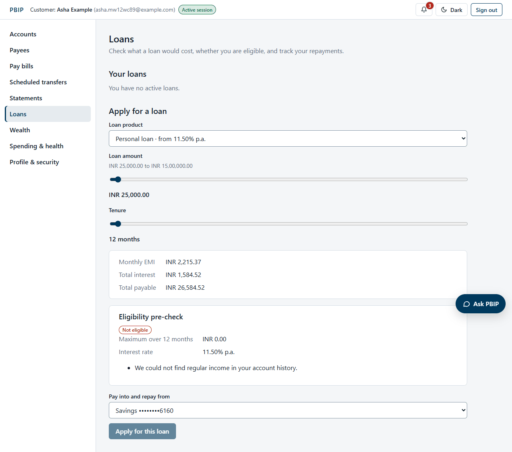

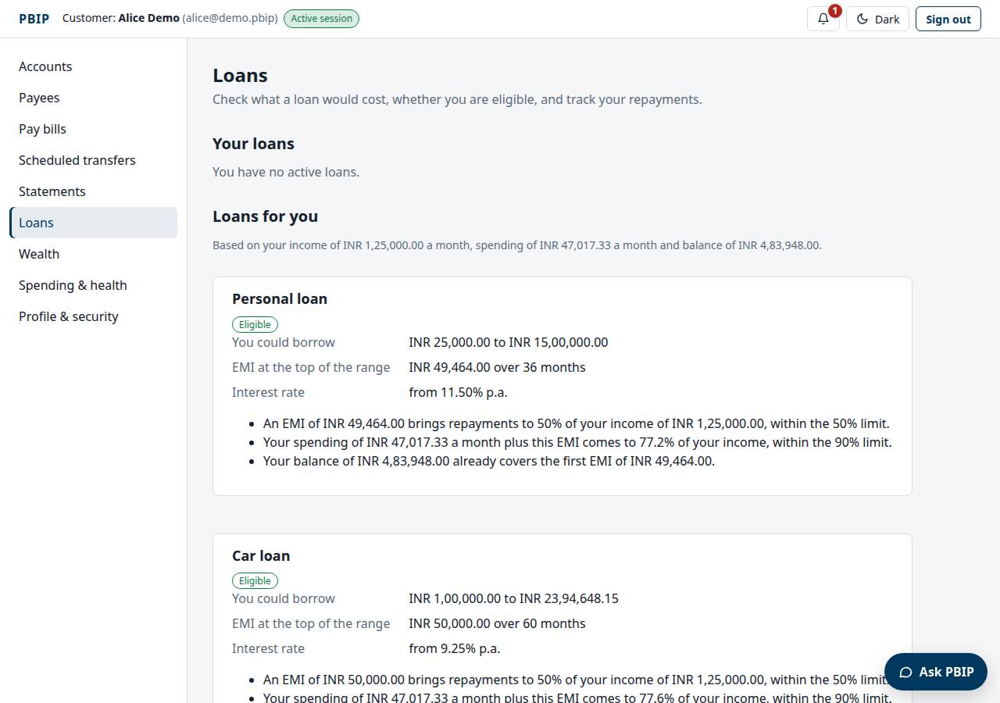

---

## UC-07 Investment recommendation

**Objective.** Recommend investments from risk tolerance, savings behaviour, income and available funds.

**Actors.** Retail customer; AI assistant (investment suggestions tool). **Preconditions.** Signed in.

**Main flow.**
1. Risk tolerance: the five-question questionnaire on Profile & security, `PUT /customers/me/risk-profile`, scored
   to LOW, MODERATE or HIGH, stored and audited.
2. `GET /recommendations` suggests a fixed deposit or an index-fund SIP from income, savings ratio, buffer and
   balance; the risk band is a suitability rule (#461): a band below HIGH excludes the high-risk SIP, and the
   last reason names the band (or says it was not considered).
3. `/wealth` lists the catalogue (`GET /wealth/products`) and insurance (`GET /wealth/insurance`); `/wealth/compare`
   compares two to four products.
4. Fixed deposits: `POST /wealth/fixed-deposits/quote`, `/book`, `/{id}/close`; automatic payout at maturity.
5. Investing (#465, #483): on `/wealth/invest` the customer buys a fund by amount or stocks and bonds in whole units
   at today's simulated price (`GET /wealth/instruments`, `POST /wealth/investments/buy` with an `Idempotency-Key`);
   the holdings on `/wealth` show value and gain and sell back (`GET /wealth/holdings`,
   `POST /wealth/holdings/{id}/sell`); the portfolio (`GET /wealth/portfolio`) adds funds, stocks and bonds.
6. Fund SIPs (#484 API, #487 web): "Start a monthly SIP" on `/wealth/invest` for a fund (`POST /wealth/sips`) sets up a monthly purchase on a day from 1 to 28; the hourly job
   `run-fund-sips` buys each instalment exactly once; "Your SIPs" on `/wealth` lists them, and "Cancel SIP" (`POST /wealth/sips/{id}/cancel`) stops one.
7. Insurance (#483): `/wealth/insurance` gives a simulated quote (`POST /wealth/insurance/quote`) from the declared
   cover, term and age band, and records an application (`POST /wealth/insurance/applications`) as
   APPROVED_SIMULATED, SUBMITTED (referred) or DECLINED; no policy is issued and nothing is charged.
8. `/wealth/compare` adds "Suits your risk band" from `GET /wealth/suitability`; every recommendation card now has
   its action (apply for a loan, invest, get a quote), except the rewards card (PBIP issues no cards).

**Alternative flows.** Insufficient funds or units: 422, nothing persists. A deposit inside its lock-in cannot be
closed. Another customer's deposit, holding, SIP or application: 404. A SIP instalment that is refused (funds,
account) is recorded as FAILED, notified, and the SIP moves to next month.

**Simulated by design** (ADR-0058, accepted at the owner's direction): prices, premiums and acceptance rules are
simulated and labelled so on every screen and response.

**Diagrams.** [Fixed deposit booking and payout](../diagrams/activity.md#7-fixed-deposit-booking-and-maturity-payout),
[fixed deposit lifecycle](../diagrams/state.md#4-fixed-deposit-lifecycle).

**Tests.** `integration/test_risk_profile.py`: `test_questionnaire_produces_the_band_at_each_boundary`;
`integration/test_recommendations_risk_band.py`: `test_a_band_below_high_removes_the_high_risk_sip`,
`test_a_high_band_keeps_the_sip_and_names_the_band_after_the_eligibility_figures`; `integration/test_wealth.py`:
`test_catalogue_lists_deposits_funds_and_the_gold_bond_with_yield_and_lock_in`; `integration/test_fd_maturity_payout.py`:
`test_a_matured_deposit_is_paid_once_to_its_account_audited_and_notified`; `integration/test_investing.py`
(#465): `test_buying_a_fund_debits_the_amount_and_credits_rounded_down_units`,
`test_insufficient_funds_is_422_and_leaves_no_partial_state`, `test_idempotent_retry_replays_and_debits_once`,
`test_concurrent_purchases_against_one_balance_never_overdraw`; `integration/test_insurance_applications.py`,
`integration/test_wealth_suitability.py`, `unit/test_wealth_insurance.py` (#483); `integration/test_fund_sips.py`
(#484); Vitest `pages/Invest.test.tsx`, `pages/InsuranceQuote.test.tsx`, `pages/Wealth.test.tsx`,
`pages/WealthCompare.test.tsx`; E2E `journey-compare.spec.ts`.

**Screenshots.**

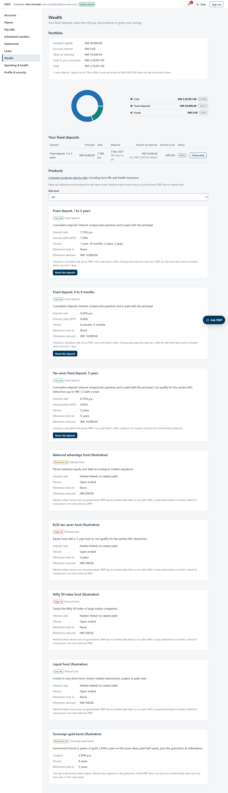
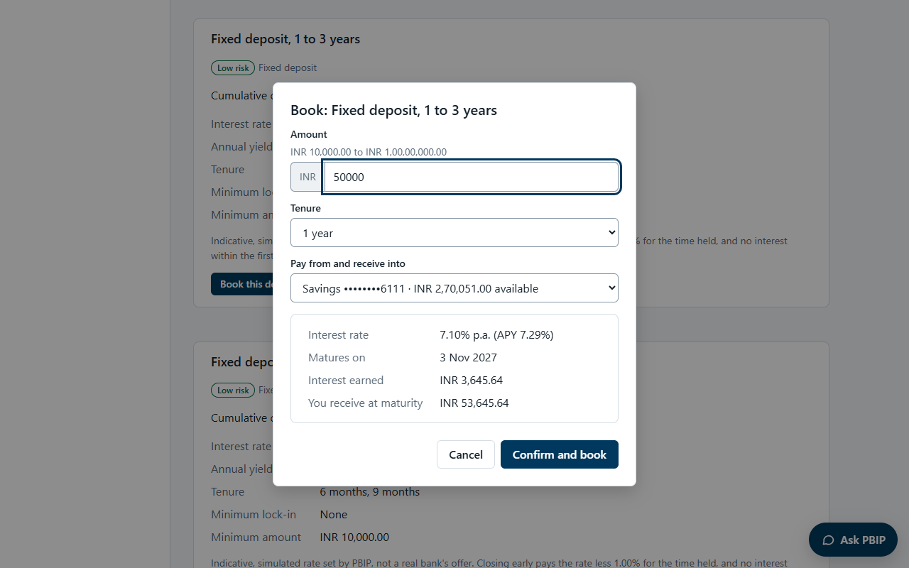
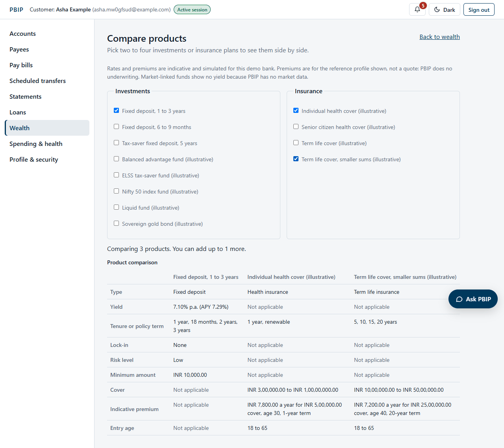
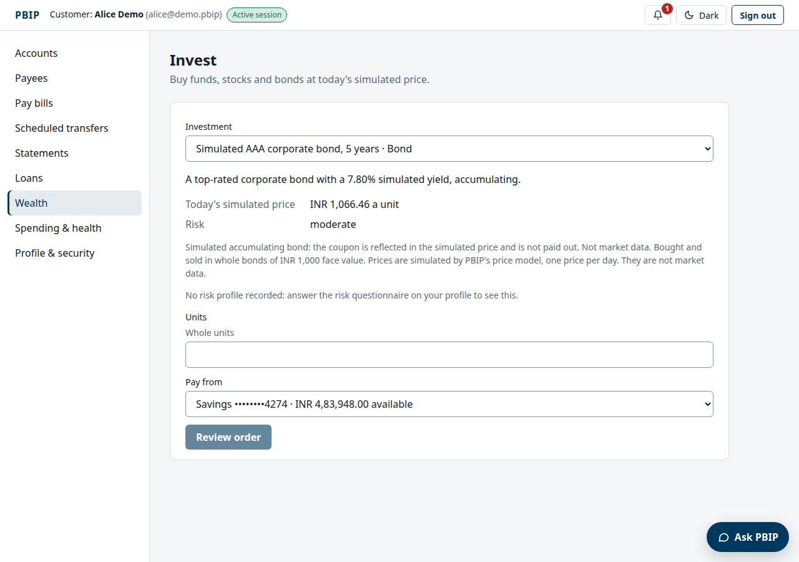
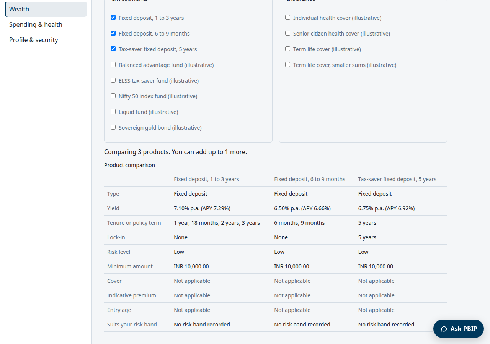
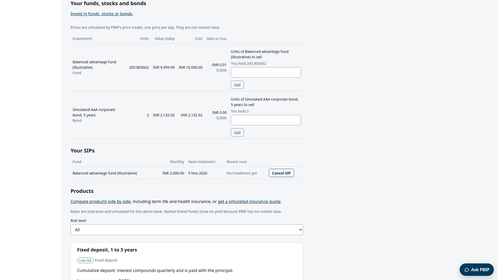
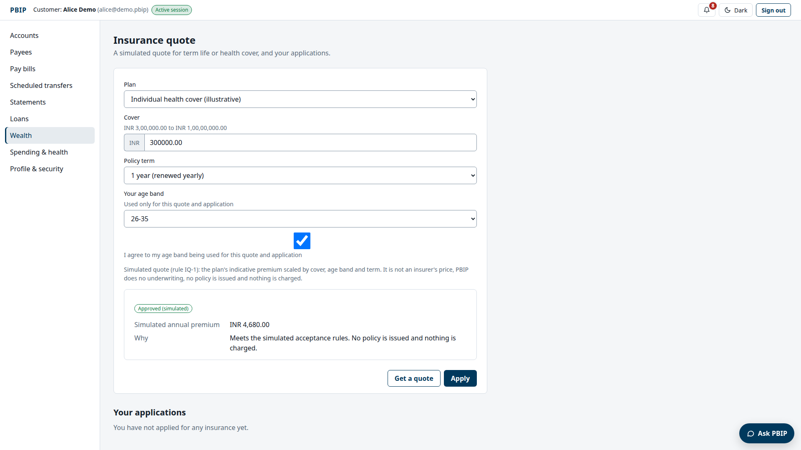

---

## UC-08 AI assistant interaction

**Objective.** Conversational banking on the customer's own data.

**Actors.** Retail customer; AI assistant. **Preconditions.** Signed in as a customer.

**Main flow.**
1. The chat drawer (every customer page) sends `POST /assistant/chat` or `/assistant/chat/stream` (SSE).
2. The message is cleaned and guarded; a clear question goes straight to one of nine read-only tools by the rules;
   an unclear one asks a model (Ollama, or Groq first when configured) only to choose a tool.
3. The tool runs in a read-only transaction with the customer id from the token; the server writes the reply and
   redacts account numbers, tokens and e-mails. Examples from the use-case document: spending last month
   (`get_spend`), "Can I afford a personal loan?" (`get_loan_affordability`), "Show unusual expenses"
   (`get_unusual_expenses`), "Suggest investment options" (`get_investment_suggestions`).
4. FAQ-2 and insurance discovery (#474): FAQ-2 answers how every customer feature works (`get_faq_answer`), and product
   discovery (`list_products`) also lists the simulated insurance plans with their indicative premiums, saying they
   are not quotes.

**Alternative flows.** Money movement, other customers' data, SQL and instruction overrides are refused before any
model; a model that fails, times out or answers badly falls back to the rules; 429 after
`RATE_LIMIT_ASSISTANT_PER_MINUTE`.

**Diagrams.** [Assistant sequence](../diagrams/sequence.md#3-assistant-question-to-answer).

**Tests.** `integration/test_assistant.py`: `test_rules_engine_answers_each_tool_from_own_data`,
`test_llm_engine_chooses_the_tool_and_the_server_writes_the_reply`, `test_clear_questions_are_answered_without_calling_the_model`;
`integration/test_assistant_adversarial.py`: `test_direct_jailbreaks_are_refused_before_the_model`,
`test_indirect_injection_in_a_transaction_reference_cannot_steer_anything`,
`test_cross_customer_probes_never_return_the_victims_data`; `integration/test_assistant_groq.py`:
`test_when_both_models_fail_the_rules_still_answer`; `unit/test_assistant_faq.py`; `test_every_customer_feature_has_an_faq_entry`, `test_every_page_in_the_customer_menu_is_explained_by_some_answer`,
`unit/test_assistant_discovery.py` (insurance listing); E2E `journey-assistant.spec.ts`.

**Screenshots.**

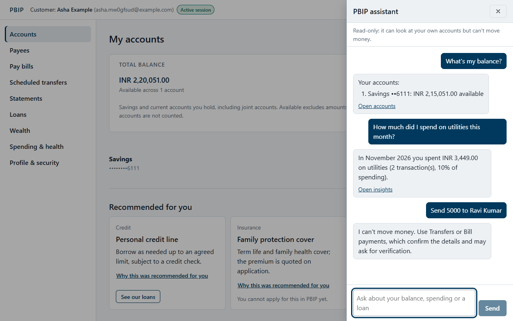
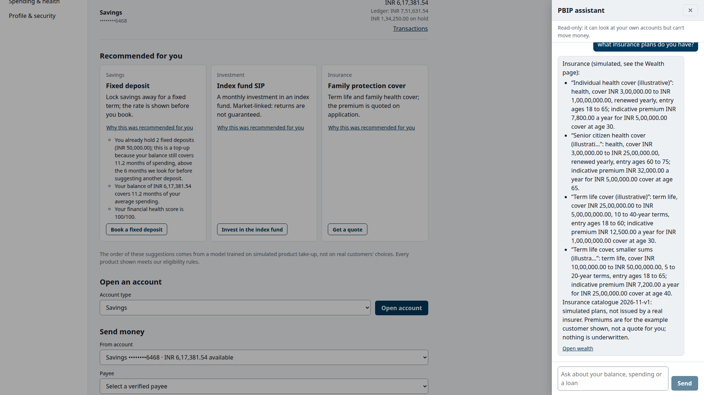

---

## UC-09 Fraud detection

**Objective.** Detect suspicious activity and produce a risk score.

**Actors.** Fraud engine. **Preconditions.** A transfer or bill payment is being created, or posted credits are
being scanned.

**Main flow.**
1. The baseline rules score the payment: large amount, new payee, velocity burst, amount spike, recent login
   failures, new country, new device or network, impossible travel, mule pass-through, structuring, dormant
   reactivation.
2. With `FRAUD_SCORER=hybrid` the LightGBM and Isolation Forest models score within a time budget; the higher risk
   decides and the model can never lower the rules' decision.
3. The decision (ALLOW, STEP_UP, REVIEW, BLOCK), 0-100 score, reasons with their source and the model version are
   stored with the feature snapshot in `fraud_events`.
4. Hourly, the structuring monitor scans posted credits and opens alerts for structured deposits.

**Alternative flows.** Model missing, failing or too slow: the rules result, marked `+rules-only`, never allow-all.
A missing GeoIP file turns off only the location rules.

**Diagrams.** [Hybrid scoring sequence](../diagrams/sequence.md#1-transfer-with-hybrid-fraud-scoring).

**Tests.** `integration/test_fraud_hybrid.py`: `test_hybrid_risk_drives_the_transfer_state_machine`,
`test_the_model_can_raise_but_never_lower_the_rules_decision`; `integration/test_transfers.py`:
`test_new_payee_plus_large_amount_is_held_with_human_readable_reasons`; `integration/test_fraud_mule.py`:
`test_pass_through_is_flagged_with_its_evidence`; `integration/test_fraud_impossible_travel.py`;
`integration/test_fraud_structuring_dormancy.py`: `test_dormant_account_moving_a_large_amount_to_a_new_payee_is_flagged`;
`integration/test_fraud_structuring_monitor.py`; `integration/test_fraud_demo_lab.py`:
`test_lab_does_not_exist_in_staging_or_production`.

**Screenshots.**

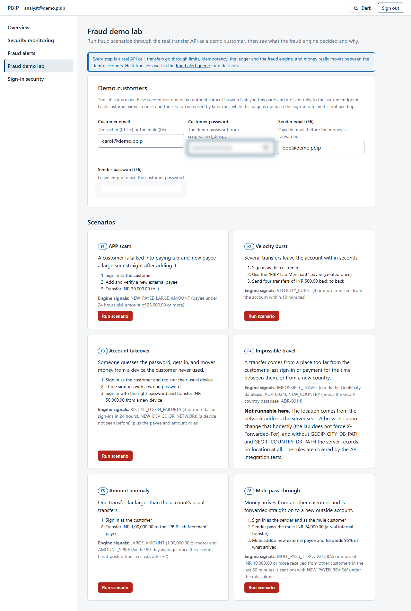
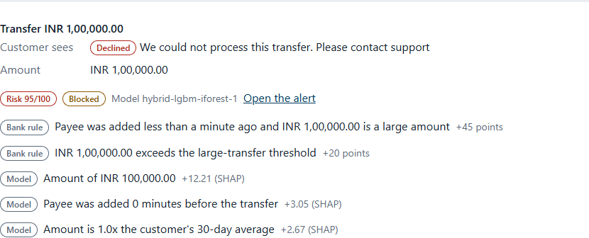

---

## UC-10 Fraud alert management

**Objective.** Notify stakeholders and resolve suspicious activity.

**Actors.** Fraud engine, retail customer, fraud analyst (or admin). **Preconditions.** A REVIEW or BLOCK decision,
a third wrong step-up code, or a structuring pattern.

**Main flow.**
1. The engine's decision opens a `fraud_alerts` row (MEDIUM or HIGH) in the same transaction.
2. The customer is notified through the outbox ("being reviewed" or "declined"), shown in the bell.
3. The analyst signs in with MFA, opens `/staff/fraud` (`GET /fraud/alerts`) and the alert detail
   (`GET /fraud/alerts/{id}`: score, reasons, features, model version).
4. The analyst releases or rejects with a note: `POST /fraud/alerts/{id}/decision` with an `Idempotency-Key`. A
   release posts the held money; a rejection releases the hold and declines. The customer is told the outcome.

**Alternative flows.** A resolved alert is 409; a block is only labelled; a held bill payment is settled the same
way; an analyst can clear a `FRAUD_BLOCK` pause on a standing order (`POST /fraud/scheduled-transfers/{id}/clear`).
Trends are charted on `/staff/fraud-dashboard` (#464, UC-13).

**Diagrams.** [Fraud alert management](../diagrams/activity.md#3-fraud-alert-management-uc-10),
[fraud alert lifecycle](../diagrams/state.md#2-fraud-alert-lifecycle).

**Tests.** `integration/test_transfers.py`: `test_review_holds_funds_and_analyst_release_posts_the_transfer`,
`test_analyst_reject_releases_the_hold_and_declines`, `test_analyst_decision_records_who_why_and_tells_the_customer`,
`test_labelling_an_engine_block_keeps_it_declined_and_tells_the_customer`; `integration/test_fraud_clear_scheduled.py`:
`test_analyst_clears_the_lock_and_the_customer_resumes`; `integration/test_notifications.py`; Vitest
`pages/staff/Fraud.test.tsx`; E2E `journey-fraud-review.spec.ts` (released, rejected).

**Screenshots.**

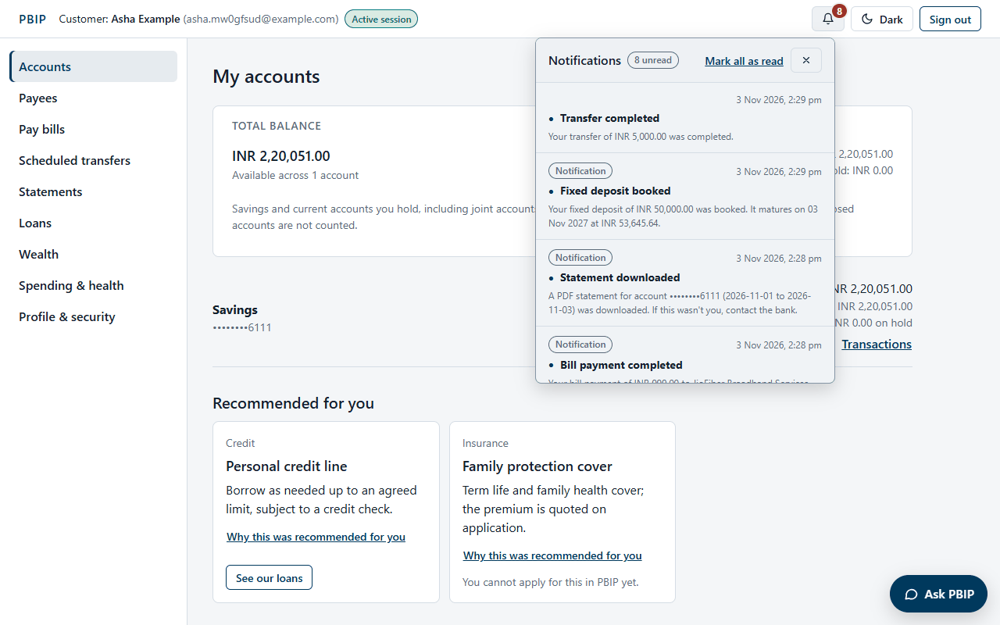
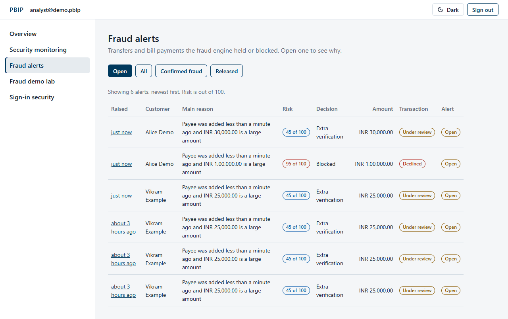
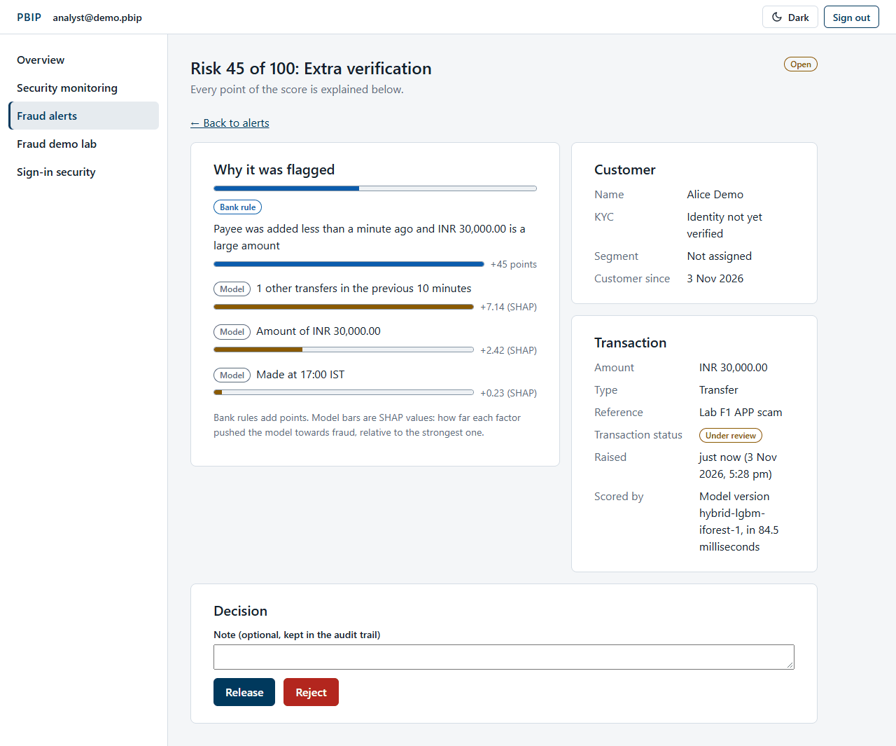
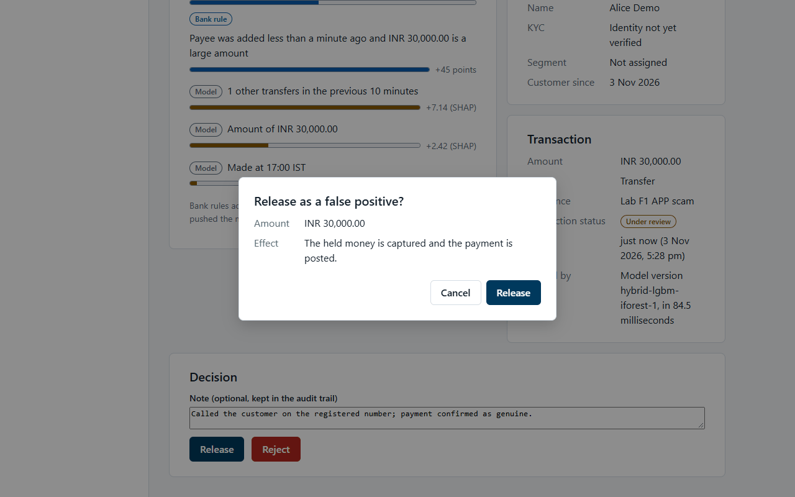

---

## UC-11 Customer behaviour analytics

**Objective.** Build a behavioural profile from page visits, clickstream, session duration, product interests,
spend and income.

**Actors.** Retail customer (data subject); relationship manager; administrator. **Preconditions.** For clickstream
and the profile, the customer has turned analytics consent on (ADR-0057).

**Main flow** (#463 backend, #477 web).
1. Consent: "App usage analytics" on the Profile page, `GET`/`PUT /customers/me/analytics-consent`, off by default,
   recorded with the policy version and audited; turning it off asks for confirmation and says the data is erased.
   The browser's Global Privacy Control signal overrides it in that browser.
2. Only with consent, the web app sends page views (route templates), allow-listed clicks and a session heartbeat
   every 60 s while the page is in use: `POST /events/batch` (at most 25 per batch). Without consent the API
   acknowledges batches and stores nothing.
3. The daily beat job `pbip.analytics.build_behaviour_profiles` (03:40 UTC) splits sessions after 30 minutes of
   inactivity and computes session counts and durations and decayed product interests for consenting customers only.
4. Spend and income patterns come from the ledger (`/analytics/*`); segments from the weekly RFM job.
5. The customer reads `GET /analytics/behaviour-profile/me`; an assigned RM or an admin reads
   `GET /insights/customers/{id}/behaviour-profile`, shown in the RM flyout on `/staff/insights`; staff see aggregates
   on `/staff/behaviour` (`GET /insights/behaviour`) with product-interest and sessions-per-day charts.

**Alternative flows.** Withdrawing consent erases the customer's events and profile in the same transaction. An
unassigned customer is 404 for an RM; fraud analysts and compliance officers are refused.

**Diagrams.** [Data flow level 1](../diagrams/data-flow.md#level-1-processes-and-data-stores) (process 10).

**Tests.** `integration/test_behaviour_profile.py`: `test_consent_is_off_by_default_then_recorded_audited_and_not_reaudited`,
`test_without_consent_events_are_acknowledged_and_not_stored`, `test_job_builds_the_profile_and_the_customer_reads_it`,
`test_withdrawal_erases_events_and_profile_and_is_audited`,
`test_staff_access_needs_rm_or_admin_with_mfa_and_an_rm_sees_assigned_customers_only`; `unit/test_behaviour_profiling.py`;
`integration/test_events.py`: `test_events_batch_happy_path`; `integration/test_behaviour_analytics.py`:
`test_engagement_from_clickstream_with_period_and_segment_filters`; `integration/test_segmentation.py`;
Vitest `pages/AnalyticsConsentSection.test.tsx`, `telemetry/tracker.test.ts`, `telemetry/PageViews.test.tsx`,
`pages/staff/BehaviourAnalytics.test.tsx`, `pages/staff/RMInsights.test.tsx`.

**Screenshots.**

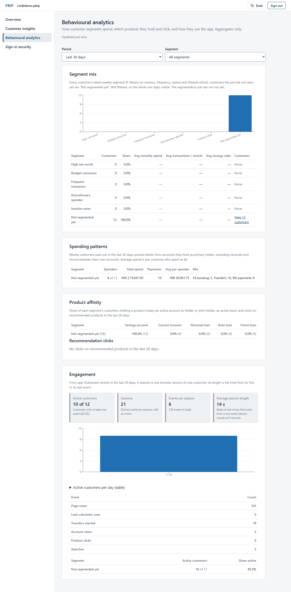

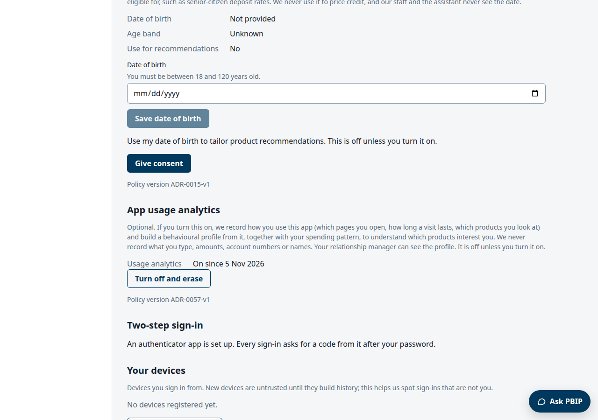
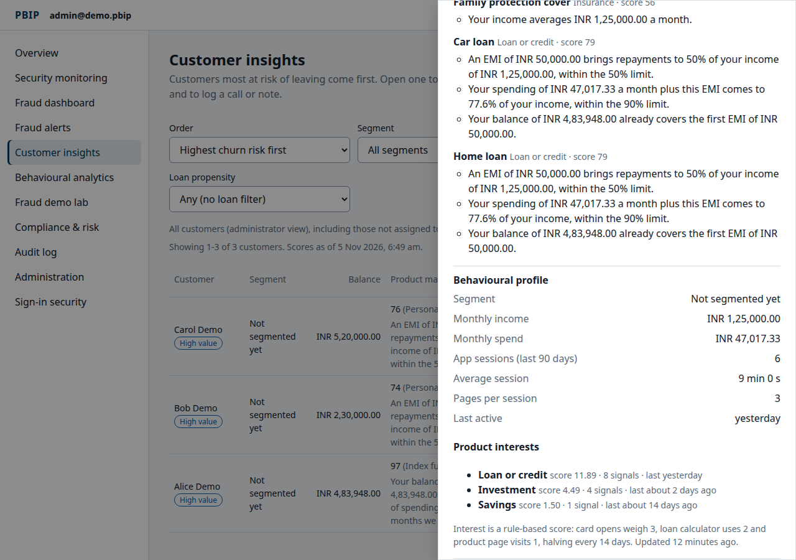
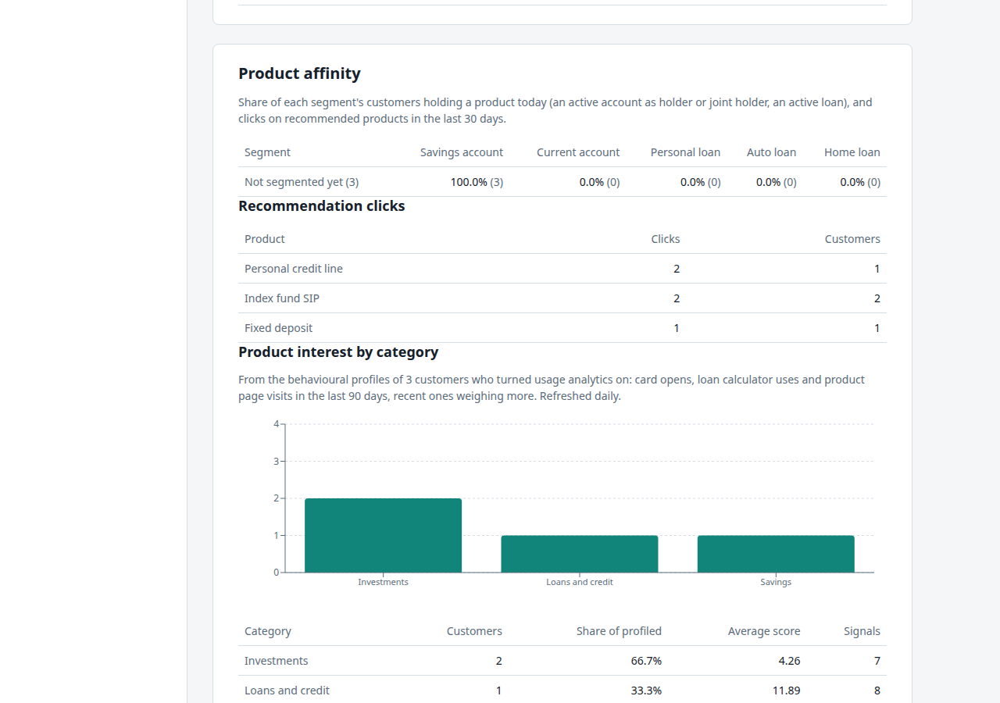

---

## UC-12 Product recommendation engine

**Objective.** Recommend products likely to interest the customer.

**Actors.** Retail customer; relationship manager. **Preconditions.** Signed in.

**Main flow.**
1. `GET /recommendations` builds the context: segment, spending, income, balance, held products (accounts, loans,
   deposits), the consented age band (ADR-0015) and the risk band (#461).
2. `rules-v1` applies eligibility and ranks savings, loan, investment and insurance products with reasons from the
   customer's own figures; when the gated `sim-propensity-v2` model is installed it only re-orders what the rules allow
   (ADR-0053).
3. Eligible catalogue loans (#470) replace the abstract credit line, each with its assessment.
4. The carousel on `/accounts` shows the cards with reasons and actions; RMs see every eligible product in the
   customer detail on `/staff/insights`.

**Alternative flows.** No consent for the date of birth: `unknown` age band. Held products are not offered again
(except a deposit top-up with a reason). A product without a flow (card, cover) has no action.

**Tests.** `integration/test_recommendations.py`: `test_recommendations_use_the_customers_real_figures_and_ignore_date_of_birth_without_consent`,
`test_engine_gets_the_age_band_only_with_consent_and_never_the_date`; `integration/test_recommendations_held_products.py`;
`integration/test_recommendations_risk_band.py`; `integration/test_loan_offers.py`; `integration/test_rm_insights_ui_api.py`:
`test_propensity_order_ranks_by_product_score_within_the_rm_scope`; `ml/tests/test_recommendations.py`; Vitest
`pages/ProductRecommendations.test.tsx`.

**Screenshots.**

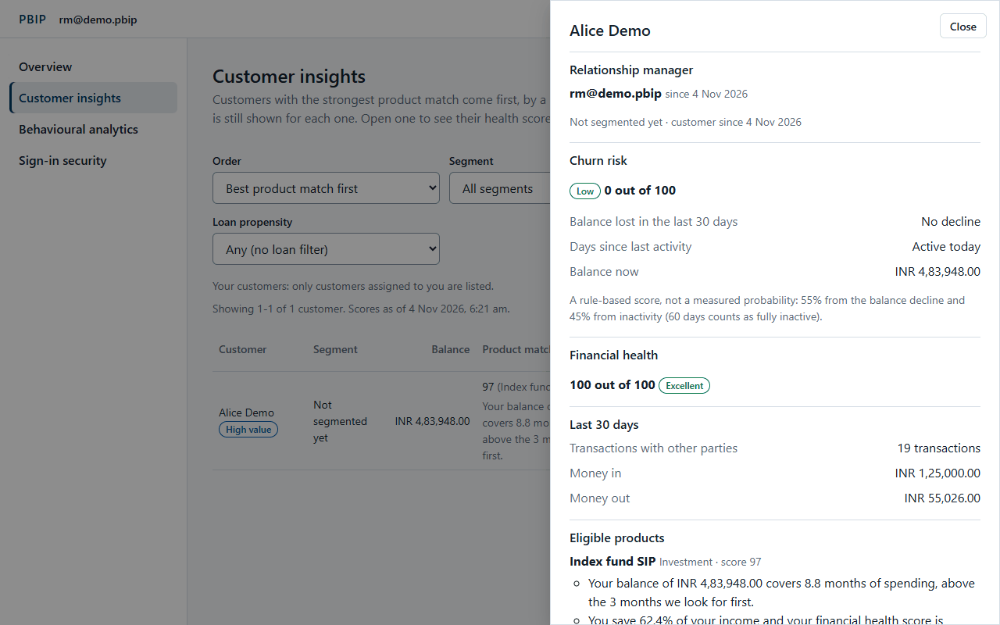

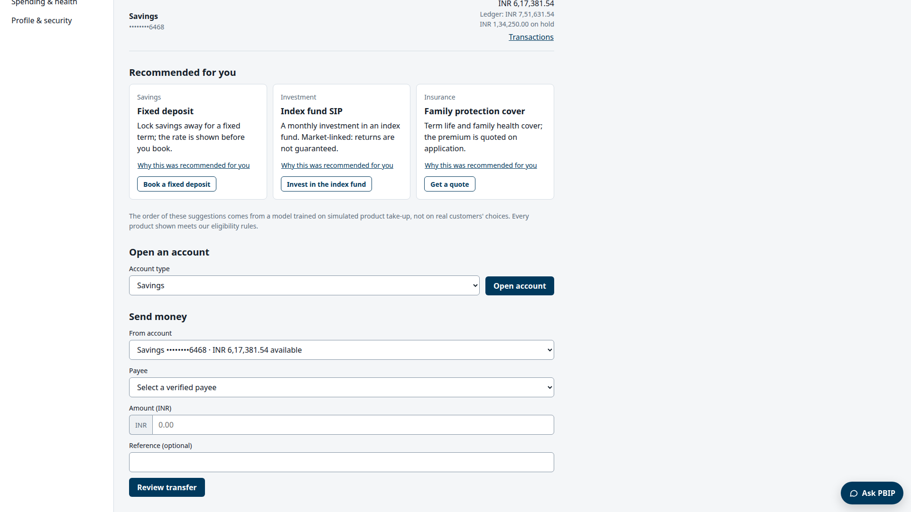

---

## UC-13 Security monitoring dashboard

**Objective.** Visibility into security events for the security team.

**Actors.** Fraud analyst; administrator; compliance officer (compliance view). **Preconditions.** Staff session with MFA.

**Main flow.**
1. `/staff/monitoring` (`GET /fraud/monitoring`): high-risk customers, open alerts by severity with the oldest wait,
   login anomalies (failure bursts, lockouts), recent fraud events, open investigations with links to each alert.
2. `/staff/fraud-dashboard` (`GET /fraud/stats`, #464): decisions per day, hold and block rate, risk-score bands, top
   reasons, alert outcomes, masked risky destinations.
3. Compliance (`/staff/compliance`, `GET /compliance/exceptions`): blocked payments, lockouts, audit-chain failures
   undelivered notifications and failed standing orders (#466); acknowledge and resolve with an audited
   reason; regulatory indicators against the 24 h service levels. Audit history on `/staff/audit-log` with hash-chain
   verification.

**Alternative flows.** Staff without the role or MFA: 403 and no API call from the page. Empty windows show zeros, not errors.

**Tests.** `integration/test_security_monitoring.py`: `test_high_risk_customers_open_alerts_and_flagged_events`,
`test_oldest_open_age_follows_the_injected_clock`; `integration/test_fraud_stats.py`:
`test_stats_report_the_risk_score_distribution_and_alert_outcomes`, `test_stats_are_staff_only_and_need_mfa`;
`integration/test_compliance_exceptions.py`: `test_acknowledge_then_resolve_is_audited_with_actor_and_reason`;
`test_dead_lettered_notifications_are_exceptions_without_their_payload`,
`test_missed_and_auto_paused_scheduled_transfers_are_exceptions`; Vitest `pages/staff/SecurityMonitoring.test.tsx`,
`pages/staff/FraudDashboard.test.tsx`, `pages/staff/ComplianceDashboard.test.tsx`; E2E `shell.spec.ts`.

**Screenshots.**

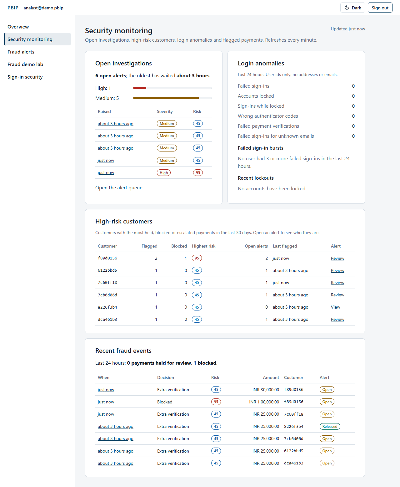
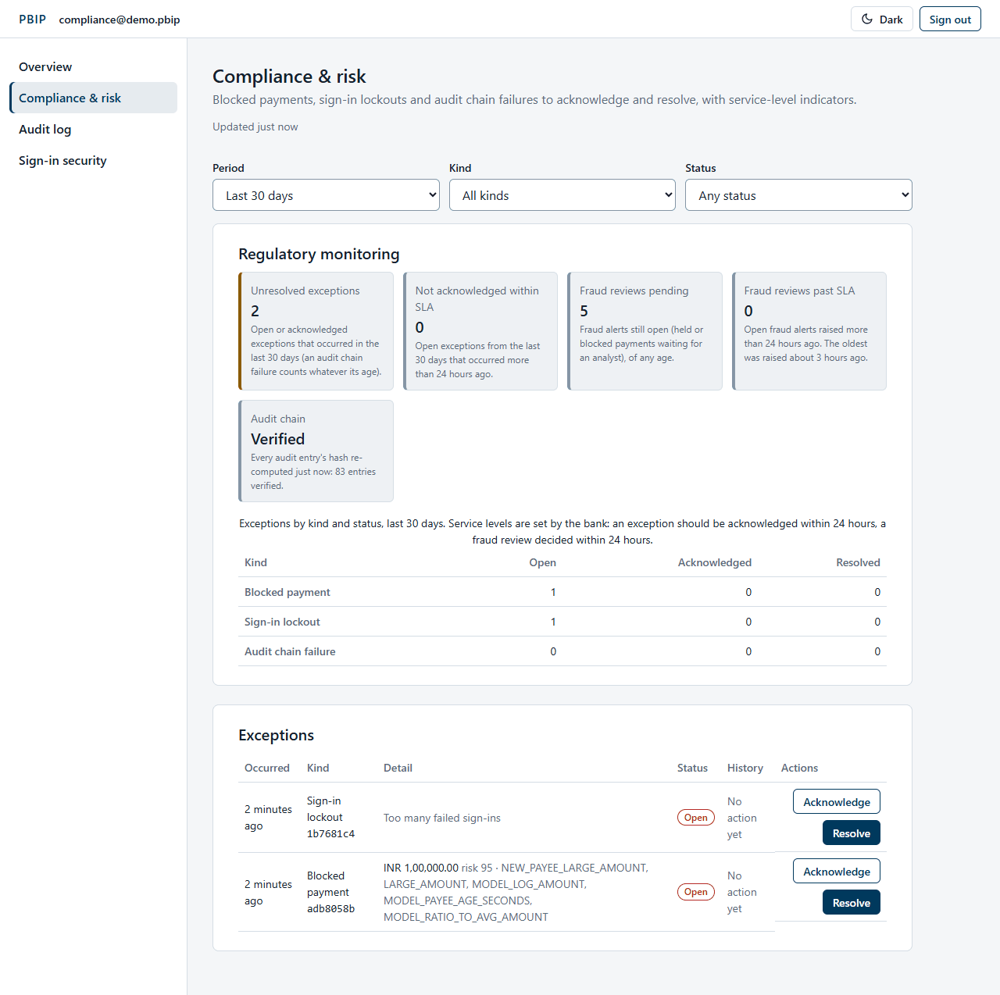
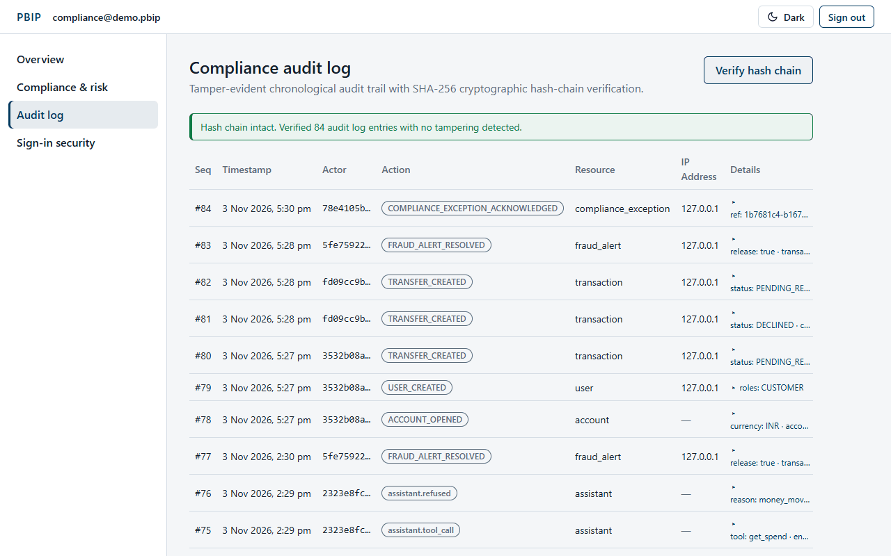

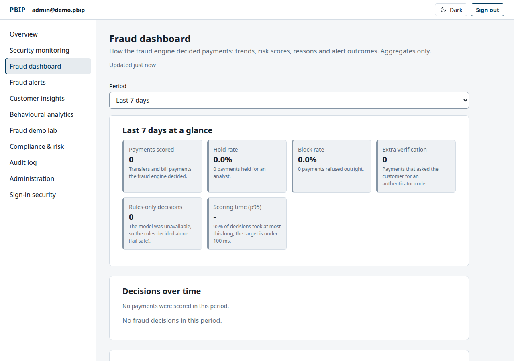
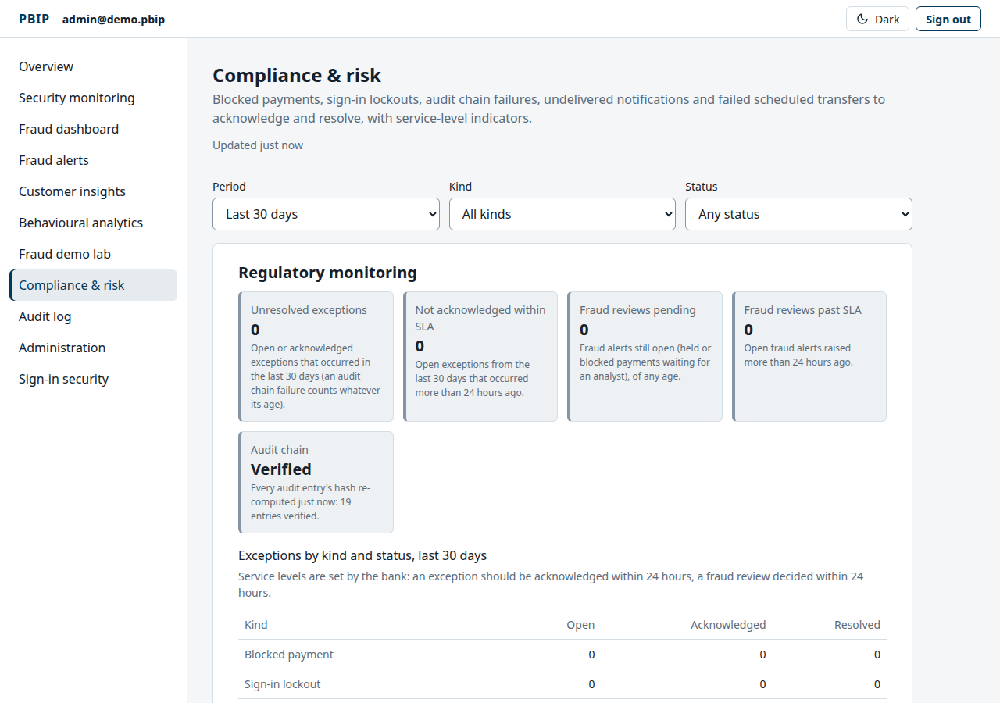

---

## Screenshots of the v1.1.0 screens

All v1.1.0 screenshots were captured on 5 Nov 2026 on the rebuilt v1.1.0 stack and are shown above and in the user
manual: `22b`, `23b`, `23c`, `23d`, `23e`, `26b`, `27b`, `28b`, `30b`, `42b`, `50b`, `61b`, `62c` (files under
`docs/user-manual/images/`).
