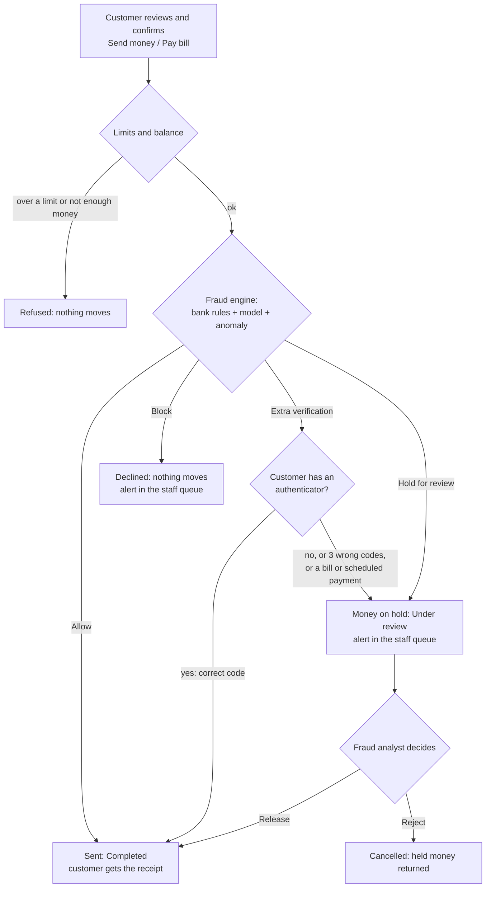

# Finora user manual and banking product guide

Finora is a simulated retail bank with a fraud and analytics layer. This manual explains how to use it,
screen by screen, for customers and for bank staff. It describes what the application does today; planned
features are not covered.

| Guide | For | Covers |
|---|---|---|
| [Customer banking guide](customer-guide.md) | Customers | Registration and two-step sign-in, accounts and total balance, payees, transfers (review, step-up, receipt, held for review), transaction search, bill pay, scheduled transfers, statements, spending and financial health, balance forecast, loans, wealth and fixed deposits, insurance comparison, recommendations, the assistant, notifications, profile and security |
| [Staff operations guide](staff-guide.md) | Fraud analysts, relationship managers, administrators | Staff sign-in with an authenticator, the fraud alert queue, alert reasons and SHAP values, releasing and rejecting held payments, security monitoring, the fraud demo lab, customer insights, behavioural analytics, administration |
| [Compliance guide](compliance-guide.md) | Compliance officers | The compliance and risk dashboard, exceptions, the audit log, hash-chain verification, account statements |

## Getting started

To run Finora on your own machine, follow the [setup guide](../SETUP_GUIDE.md):

- **Ubuntu:** [Native Ubuntu setup](../SETUP_GUIDE.md#3-native-ubuntu-setup-step-by-step), using `make`.
- **Windows 10/11:** [Native Windows setup](../SETUP_GUIDE.md#4-native-windows-setup-step-by-step), using
  `.\dev.ps1` in PowerShell.

Then [start the services](../SETUP_GUIDE.md#5-starting-services--local-development): start the database,
apply migrations, seed the demo data, and start the API, worker and web app. Open
<http://localhost:5173> (development) or <https://localhost:8443> (full Docker stack).

**Demo users.** The seed creates three customers (`alice@demo.pbip`, `bob@demo.pbip`, `carol@demo.pbip`)
and four staff users (`analyst@demo.pbip`, `compliance@demo.pbip`, `admin@demo.pbip`, `rm@demo.pbip`).
Alice has an authenticator (for the step-up demo); Carol is the fraud demo lab's customer and has none.
Where their password comes from, and how to print a staff or Alice's authenticator code
(`scripts/totp.py`), is explained in the
[README](../../README.md#1-run-it). This manual never prints a password. You can also register your
own customer from the sign-in page.

## How a payment is decided

Every transfer, scheduled payment and bill payment passes the same checks before money moves. This is the
part of Finora that customers and staff both see, from different sides.

Customers are never told why a payment was flagged. Staff see every reason, with points for bank rules and
SHAP values for the model ([staff guide, section 4](staff-guide.md#4-review-an-alert-and-its-reasons-shap)).

## Who can do what

| Person | Signs in with | Lands on | Main tasks |
|---|---|---|---|
| Customer | E-mail + password (+ authenticator code once set up) | **My accounts** | Banking, payments, insights, assistant |
| Fraud analyst | E-mail + password + authenticator code | **Staff workspace** | Fraud alerts, security monitoring |
| Relationship manager | E-mail + password + authenticator code | **Staff workspace** | Customer insights, behavioural analytics |
| Compliance officer | E-mail + password + authenticator code | **Staff workspace** | Compliance & risk, audit log |
| Administrator | E-mail + password + authenticator code | **Staff workspace** | Everything staff can do, plus administration |

## About the screenshots

The screenshots show Finora v1.2 (21 November 2026). Most were saved by the recorded A-to-Z walkthrough
(`demo/record/record-walkthrough.ts`, 1920x1080, light theme) on a freshly seeded local stack, as each screen
went by; a few come from the page screenshots in `docs/design/screenshots/after/` (1440 px, or 360 px for
phones). Keep in mind:

- **Demo data only.** Alice, Bob and Carol are the seeded demo customers; "Priya Walkthrough" is a customer
  the recording registers. Authenticator keys and recovery codes are blurred in the page before they are
  drawn, so they never reach an image.
- **The assistant** answered through a language model on Groq; without one it answers with its built-in,
  rule-based helper: the facts are the same and the wording is plainer.
- **The fraud model** was trained locally (`fraud-model` in the setup guide) so the alert screens show
  SHAP values. Without a trained model, Finora scores with bank rules only and says so on the alert.
