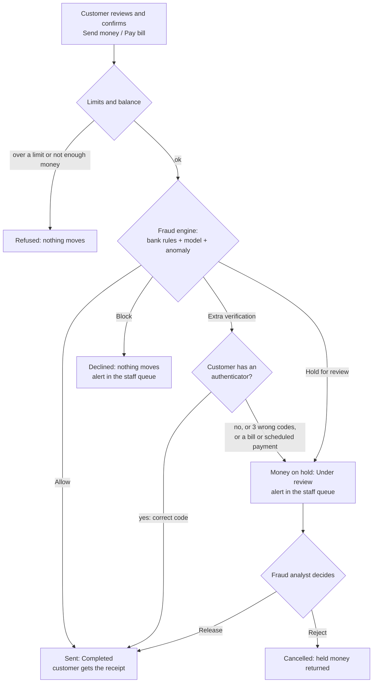

# PBIP user manual and banking product guide

PBIP is a simulated retail bank with a fraud and analytics layer. This manual explains how to use it,
screen by screen, for customers and for bank staff. It describes what the application does today; planned
features are not covered.

| Guide | For | Covers |
|---|---|---|
| [Customer banking guide](customer-guide.md) | Customers | Registration and two-step sign-in, accounts and total balance, payees, transfers (review, step-up, receipt, held for review), transaction search, bill pay, scheduled transfers, statements, spending and financial health, balance forecast, loans, wealth and fixed deposits, insurance comparison, recommendations, the assistant, notifications, profile and security |
| [Staff operations guide](staff-guide.md) | Fraud analysts, relationship managers, administrators | Staff sign-in with an authenticator, the fraud alert queue, alert reasons and SHAP values, releasing and rejecting held payments, security monitoring, the fraud demo lab, customer insights, behavioural analytics, administration |
| [Compliance guide](compliance-guide.md) | Compliance officers | The compliance and risk dashboard, exceptions, the audit log, hash-chain verification, account statements |

## Getting started

To run PBIP on your own machine, follow the [setup guide](../SETUP_GUIDE.md):

- **Ubuntu:** [Native Ubuntu setup](../SETUP_GUIDE.md#3-native-ubuntu-setup-step-by-step), using `make`.
- **Windows 10/11:** [Native Windows setup](../SETUP_GUIDE.md#4-native-windows-setup-step-by-step), using
  `.\dev.ps1` in PowerShell.

Then [start the services](../SETUP_GUIDE.md#5-starting-services--local-development): start the database,
apply migrations, seed the demo data, and start the API, worker and web app. Open
<http://localhost:5173> (development) or <https://localhost:8443> (full Docker stack).

**Demo users.** The seed creates two customers (`alice@demo.pbip`, `bob@demo.pbip`) and four staff users
(`analyst@demo.pbip`, `compliance@demo.pbip`, `admin@demo.pbip`, `rm@demo.pbip`). Where their password
comes from, and how to print a staff authenticator code (`scripts/totp.py`), is explained in the
[README](../../README.md#1-run-it). This manual never prints a password. You can also register your
own customer from the sign-in page.

## How a payment is decided

Every transfer, scheduled payment and bill payment passes the same checks before money moves. This is the
part of PBIP that customers and staff both see, from different sides.

Customers are never told why a payment was flagged. Staff see every reason, with points for bank rules and
SHAP values for the model ([staff guide, section 4](staff-guide.md#4-review-an-alert-and-its-reasons-shap)).

## Who can do what

| Person | Signs in with | Lands on | Main tasks |
|---|---|---|---|
| Customer | E-mail + password (+ authenticator code once set up) | **My accounts** | Banking, payments, insights, assistant |
| Fraud analyst | E-mail + password + authenticator code | **Staff workspace** | Fraud alerts, security monitoring |
| Relationship manager | E-mail + password + authenticator code | **Staff workspace** | Customer insights, behavioural analytics |
| Compliance officer | E-mail + password + authenticator code | **Staff workspace** | Compliance & risk, audit log |
| Administrator | E-mail + password + authenticator code | **Staff workspace** | Everything staff can do, plus administration |

## About the screenshots

The screenshots were taken from the running application on a local development stack (Windows, light
theme, 1280 px wide, plus three at 360 px for phones) with the seeded demo data and freshly registered test
customers at `example.com`. Keep in mind:

- **Test data only.** Names such as "Asha Example" and "Vikram Example" are throwaway test customers.
  Authenticator keys and recovery codes are blurred even though they belong to throwaway users.
- **New customers have little history,** so the balance forecast and month-on-month trends show their "not
  enough history yet" states.
- **The assistant** answered with its built-in, rule-based helper because no local language model was
  running. With a model running, the facts are the same and the wording is more natural.
- **The fraud model** was trained locally (`fraud-model` in the setup guide) so the alert screens show
  SHAP values. Without a trained model, PBIP scores with bank rules only and says so on the alert.
