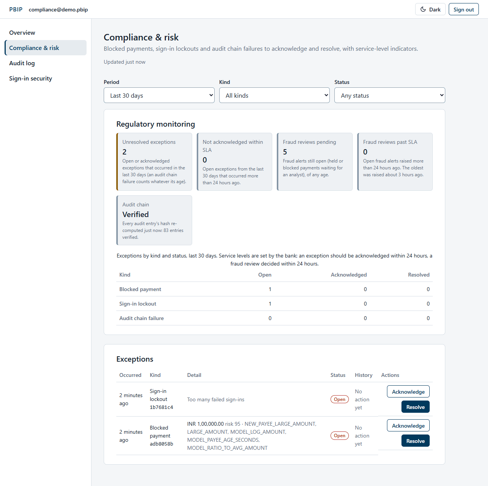
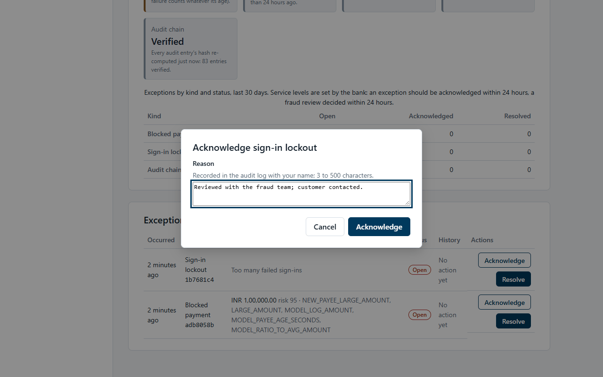
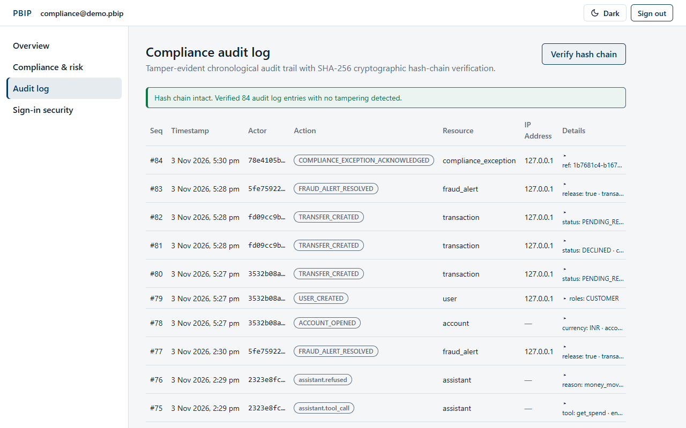
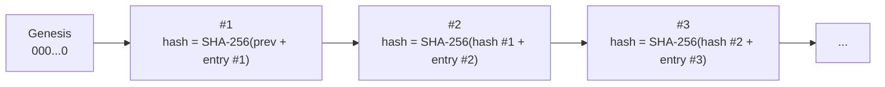

# Compliance guide

This guide is for compliance officers (and administrators, who can open the same screens). It covers the
**Compliance & risk** dashboard, the **Audit log** with hash-chain verification, and account statements.

[Back to the user manual](README.md)

## Contents

1. [Before you start](#1-before-you-start)
2. [Compliance & risk dashboard](#2-compliance--risk-dashboard)
3. [Acknowledge and resolve exceptions](#3-acknowledge-and-resolve-exceptions)
4. [The audit log](#4-the-audit-log)
5. [Verify the hash chain](#5-verify-the-hash-chain)
6. [Account statements](#6-account-statements)

## 1. Before you start

Sign in with your work e-mail, password and authenticator code, as described in the
[staff guide](staff-guide.md#2-sign-in-with-your-authenticator). Your menu shows **Overview**,
**Compliance & risk**, **Audit log** and **Sign-in security**. Every compliance request needs a session
verified with an authenticator code.

## 2. Compliance & risk dashboard

**What it is for:** the events that need a compliance decision, and whether the bank is meeting its own
service levels. Open **Compliance & risk**.

**Filters:** **Period** (last 7, 30 or 90 days; default 30), **Kind** and **Status**.

**Regulatory monitoring** (each tile explains how it is counted):

| Tile | Meaning |
|---|---|
| Unresolved exceptions | Open or acknowledged exceptions in the period. An audit chain failure counts whatever its age. |
| Not acknowledged within SLA | Open exceptions older than 24 hours. |
| Fraud reviews pending | Fraud alerts still open (held or blocked payments waiting for an analyst). |
| Fraud reviews past SLA | Open fraud alerts older than 24 hours, and how long the oldest has waited. |
| Audit chain | **Verified** or **Broken at #N**. The whole chain is re-checked, at most every 5 minutes. |

The 24-hour service levels are set by the bank, not by a regulator. Fraud reviews themselves are decided
by fraud analysts in the alert queue, not here.

**Exception kinds:**

| Kind | Raised when | Detail shown |
|---|---|---|
| **Blocked payment** | The fraud engine blocked a payment. | Amount, risk and the rule and model codes |
| **Sign-in lockout** | An account was locked after too many failed sign-ins. | "Too many failed sign-ins" |
| **Audit chain failure** | Hash-chain verification failed. | "First failing entry #N" |
| **Undelivered notification** | A customer notification could not be delivered after every retry (dead-lettered). | The event type, the number of attempts and the error class; never the message itself |
| **Scheduled transfer failure** | A standing order missed an occurrence, or the scheduler paused it. | "Order paused by the scheduler" or "Occurrence *date* not paid", the reason and the order id |

Screenshot to capture on the v1.1.0 stack: `images/50b-compliance-system-exceptions.png` (filtered to the two new kinds).

## 3. Acknowledge and resolve exceptions

Each exception moves **Open** → **Acknowledged** → **Resolved** (or straight from Open to Resolved).

1. In **Exceptions**, find the row. **History** shows earlier actions or "No action yet".
2. Choose **Acknowledge** (you have seen it and are looking into it) or **Resolve** (it is closed).
3. Enter a **Reason** (3 to 500 characters). It is recorded in the audit log with your name.
4. Confirm. The status and history update.

Acknowledging or resolving only records the compliance decision: it does not unblock a payment or clear a
lockout. Those are done by a fraud analyst (alert queue) or an administrator (Administration). The state of
an exception is stored as audit-log entries (`COMPLIANCE_EXCEPTION_ACKNOWLEDGED`,
`COMPLIANCE_EXCEPTION_RESOLVED`), so it is covered by the hash chain too.

## 4. The audit log

**What it is for:** the bank's tamper-evident record of security-relevant actions: sign-ins and lockouts,
payments, payee changes, statements, fraud decisions, setting changes, assistant tool calls and more.
Open **Audit log**.

The table is newest first, 50 rows at a time (**Load older entries** for more):

| Column | Meaning |
|---|---|
| Seq | The entry's position in the chain (#1 is the oldest). |
| Timestamp | When it happened. |
| Actor | The first 8 characters of the user id that acted, or **System**. |
| Action | What happened, for example `FRAUD_ALERT_RESOLVED`, `TRANSFER_CREATED`, `STATEMENT_DOWNLOADED`. |
| Resource | What it happened to; hover for the full id. |
| IP Address | Where the request came from, or "—". |
| Details | A summary; choose it to see every field. |

There is no search or export in the app.

## 5. Verify the hash chain

**What it is for:** proving that no audit entry has been changed, removed or inserted since it was
written.

**How the chain works.** Each entry stores the hash of the entry before it and its own hash:

The hash covers the entry's id, actor, action, resource, time and details. Changing any of these in one
entry changes its hash, so its stored hash no longer matches and every later entry's link breaks. The
database also refuses updates and deletes on the table, so a break means someone went around the
application and the database rules. (The IP address and request id are stored next to the entry but are
not part of the hash.)

**Steps:**

1. On **Audit log**, choose **Verify hash chain** (top right).
2. PBIP recomputes every hash from entry #1 onwards and shows the result:

| Result | Meaning | What to do |
|---|---|---|
| "Hash chain intact. Verified N audit log entries with no tampering detected." | Every entry matches. | Nothing. Record the count and time if you need evidence. |
| "Hash chain broken at entry #N. Entries #1–#N-1 verified." | Entry #N (or the link to it) was altered. Entries before it are proven intact; entries after it cannot be trusted. | The row is marked **TAMPERED** (load older entries if it is not on screen). Treat it as a security incident: escalate, and use the "Audit chain failure" exception on Compliance & risk to record your actions. |
| "Verification request failed: ..." | The check could not run. | Choose **Retry**. |

The **Audit chain** tile on Compliance & risk runs the same check automatically (at most every 5 minutes).

## 6. Account statements

Statements are produced by the customer for their own accounts (**Statements** page, see the
[customer guide](customer-guide.md#9-statements)). Staff cannot download a customer's statement in the app,
and there is no staff export or report download. When a customer provides a statement as evidence:

- **PDF:** "PBIP Bank, Account statement", the account holder, the masked account, the period (India
  time), opening balance, money in, money out and closing balance, then one line per entry (date,
  description, reference, debit, credit, balance). The footer shows when it was generated.
- **CSV:** columns `date, description, reference, debit, credit, balance, currency`; amounts are plain
  decimals.

A statement covers at most 366 days and 10,000 entries. Every download is written to the audit log
(`STATEMENT_DOWNLOADED`, with the account and period) and the customer is notified. Use the audit log to
confirm that a statement for a given account and period was really generated by PBIP, and when.
