# Customer banking guide

This guide is for people who bank with PBIP through the web app. It covers every page a customer can open
today. PBIP is a simulated bank: all money, rates and products are for demonstration only.

[Back to the user manual](README.md)

## Contents

1. [Create an account and sign in](#1-create-an-account-and-sign-in)
2. [Turn on two-step sign-in (MFA)](#2-turn-on-two-step-sign-in-mfa)
3. [Accounts and total balance](#3-accounts-and-total-balance)
4. [Payees](#4-payees)
5. [Send money: review, step-up and receipt](#5-send-money-review-step-up-and-receipt)
6. [Search your transactions](#6-search-your-transactions)
7. [Pay bills](#7-pay-bills)
8. [Scheduled transfers](#8-scheduled-transfers)
9. [Statements](#9-statements)
10. [Spending, financial health and balance forecast](#10-spending-financial-health-and-balance-forecast)
11. [Loans](#11-loans)
12. [Wealth and fixed deposits](#12-wealth-and-fixed-deposits)
13. [Compare investments and insurance](#13-compare-investments-and-insurance)
    - [13a. Insurance quote and application](#13a-insurance-quote-and-application)
14. [Recommendations](#14-recommendations)
15. [The PBIP assistant](#15-the-pbip-assistant)
16. [Notifications](#16-notifications)
17. [Profile and security](#17-profile-and-security)
18. [Using PBIP on a phone](#18-using-pbip-on-a-phone)
19. [What each status means](#19-what-each-status-means)

## Finding your way around

Every customer page has the same frame:

- **Left navigation:** Accounts, Payees, Pay bills, Scheduled transfers, Statements, Loans, Wealth,
  Spending & health, Profile & security. On a narrow screen it folds behind a **Menu** button.
- **Top bar:** your name and e-mail with an **Active session** badge, the notification bell, a theme
  switch (**Dark** / **Light**) and **Sign out**.
- **Ask PBIP:** the round button at the bottom right opens the assistant.

If you reload the page or come back later, PBIP may ask you to sign in again. Always choose **Sign out**
on a shared computer.

## 1. Create an account and sign in

**What it is for:** opening your online banking profile. PBIP opens a savings account for you when you
register.

There is no separate sign-in address. Any PBIP page shows **Sign in** when you are signed out. After you
sign in, you land on the page you asked for.

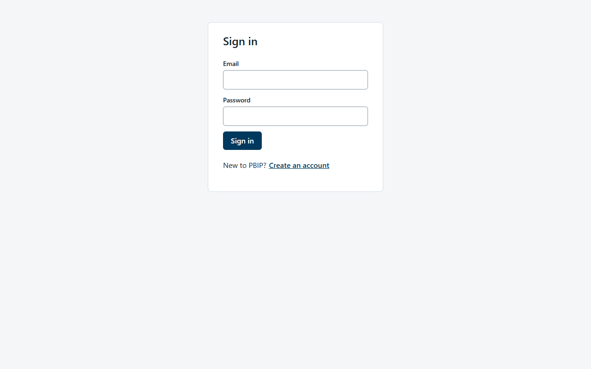

**To register:**

1. On the sign-in page, choose **Create an account**.
2. Enter your **Full name** (2 to 200 characters), **Email**, **Password** and **Confirm password**.
   The password must be at least 12 characters. The bank also refuses common or leaked passwords and tells
   you why.
3. Choose **Create account**. PBIP signs you in straight away and opens **My accounts**.

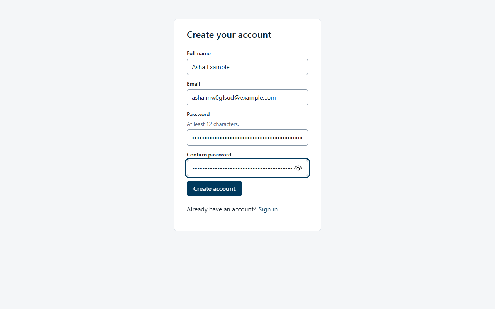

**What can go wrong:**

| Message | Meaning |
|---|---|
| "The password must be at least 12 characters." / "The passwords do not match." | Fix the password and try again. |
| "Online registration is not available. Visit a branch to open an account." | The bank has turned online registration off. |
| "Your account was created, but we could not sign you in: ..." | Your account exists. Sign in with the e-mail and password you just chose. |

**To sign in:** enter your **Email** and **Password** and choose **Sign in**. If you have turned on
two-step sign-in, a second step asks for your **Authenticator or recovery code**. Type the 6-digit code
from your app (or one of your recovery codes) and choose **Verify**.

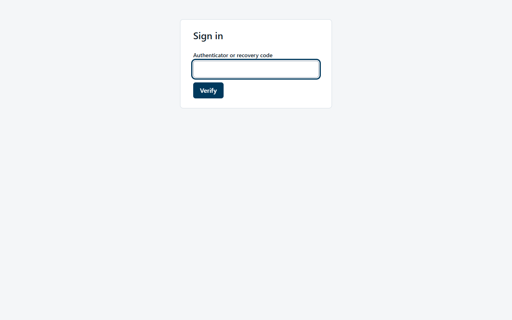

**Lockout:** after 5 wrong attempts in a row (password or code), sign-in is locked for 60 seconds. Each
further failure doubles the wait, up to one hour. Wait, then try again. A staff administrator can also
clear a lockout.

> Demo logins for a local copy of PBIP (`alice@demo.pbip`, `bob@demo.pbip`, `carol@demo.pbip`) and where
> their password comes from are listed in the [README](../../README.md). The password is never printed in
> this manual. Alice has an authenticator, so she is asked for a code after her password
> (`scripts/totp.py` prints it); Bob and Carol are not.

## 2. Turn on two-step sign-in (MFA)

**What it is for:** a second check at sign-in, and the code PBIP asks for when a payment looks unusual
(see [step-up](#step-up-confirm-its-you)). Without it, PBIP cannot ask you to confirm a risky payment, so
the payment is held for a staff review instead.

**Steps:**

1. Open **Profile & security**. Under **Two-step sign-in**, choose **Set up authenticator app**.
2. In your authenticator app (for example Google Authenticator, Microsoft Authenticator or 1Password), add
   an account and type the key PBIP shows in groups of four characters. On a phone you can tap the link to
   open it directly in the app. PBIP shows a key, not a QR code.
3. Type the 6-digit code the app now shows into **Code from the app** and choose **Confirm**.
4. PBIP shows **8 recovery codes**. Save them somewhere safe now: they are shown only once. Each one works
   a single time in place of an app code if you lose your phone.

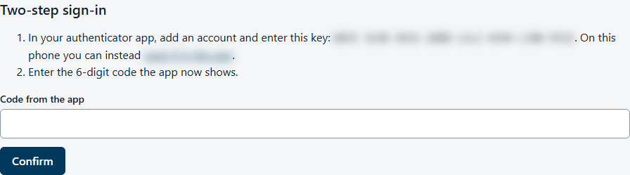

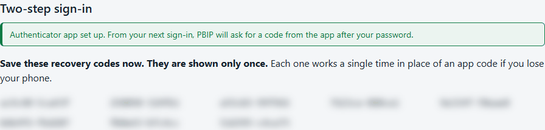

**Outcome:** "Authenticator app set up." From your next sign-in, PBIP asks for a code after your password.
You also get a **Two-step verification turned on** notification. Two-step sign-in cannot be turned off,
and recovery codes cannot be regenerated, in the app today.

## 3. Accounts and total balance

**What it is for:** your home page. **My accounts** shows, from top to bottom: **Total balance**, your
accounts, **Recommended for you**, **Open an account** and **Send money**.

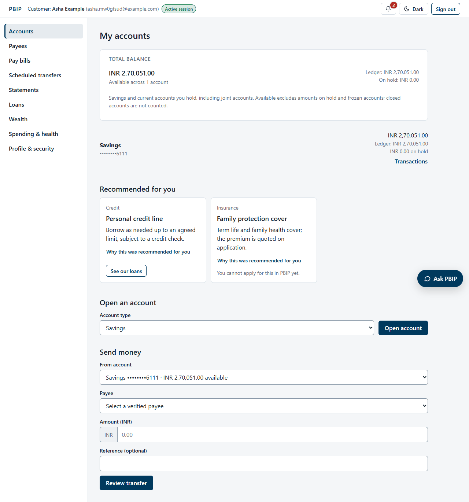

**Total balance** adds up your open savings and current accounts, including joint accounts. It shows one
line per currency (currencies are never added together):

- **Available**: what you can spend now, across N accounts. It leaves out money on hold and frozen
  accounts.
- **Ledger**: the booked balance, including money on hold.
- **On hold**: money reserved for payments that are still being checked.
- Closed accounts are not counted. A frozen account is listed as "N frozen, not counted as available".

**Each account** shows its type (Savings or Current (checking)), a masked number (only the last 4 digits),
the available balance, the ledger balance and the amount on hold. **Transactions** opens its history (see
[Search your transactions](#6-search-your-transactions)).

**Open another account:**

1. Under **Open an account**, pick the **Account type** (Savings or Current (checking)).
2. Choose **Open account**.
3. PBIP confirms "Account XXXX opened." The account appears in the list at once with a zero balance.

PBIP has no customer deposit screen. New money arrives as an opening balance or as a transfer from someone
else.

## 4. Payees

**What it is for:** the people and accounts you send money to. You can only send money to a payee whose
name is **Verified**.

**Add a payee:**

1. Open **Payees** and choose **Add payee**.
2. Enter the **Payee name** exactly as it is on their bank account, the **Account number** (6 to 20
   letters, digits or hyphens) and the **Bank code** (4 to 20 letters or digits; `PBIP0001` is PBIP
   itself). A **Nickname** is optional.
3. Choose **Add and check name**. PBIP checks the name against the account straight away (Confirmation of
   Payee).

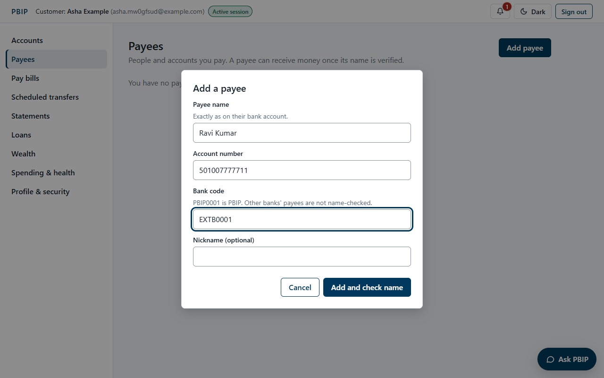

| Result of the name check | Meaning |
|---|---|
| "The name matches the account. You can now send money." | A PBIP account whose name matches. The payee is **Verified**. |
| "The name you entered does not match the name on this account, so the payee is not verified." | Check the exact name with the person, then choose **Edit** or **Verify** again. |
| "This account is at another bank, so its name cannot be checked. The payee is verified: make sure the details are right before you send money." | PBIP cannot see other banks' names. Double-check the details yourself. |

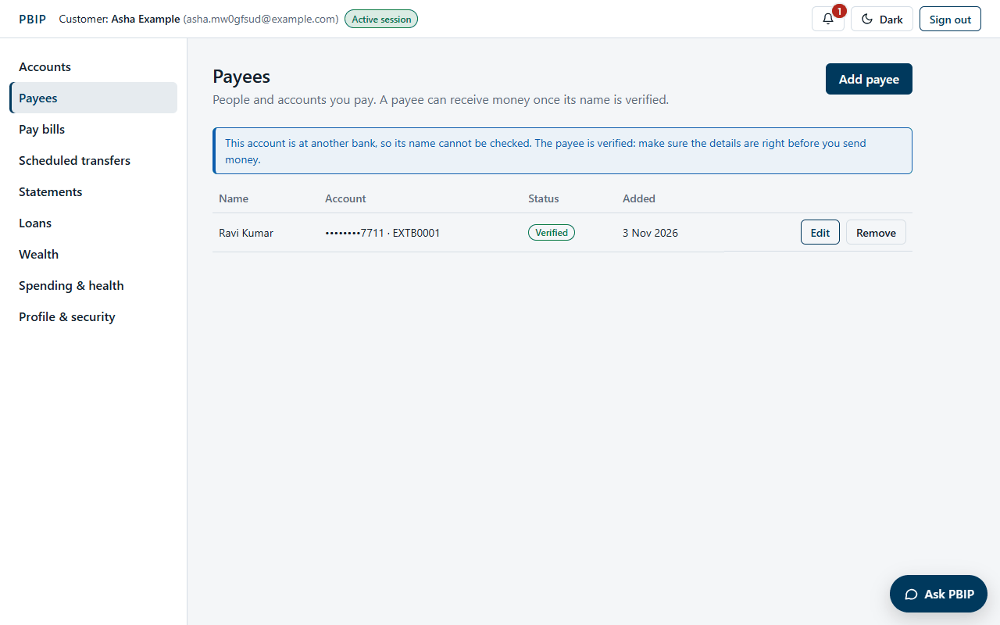

**The payee list** shows Name (and nickname), the masked account and bank code, **Status** (Verified, Not
verified) and the date added.

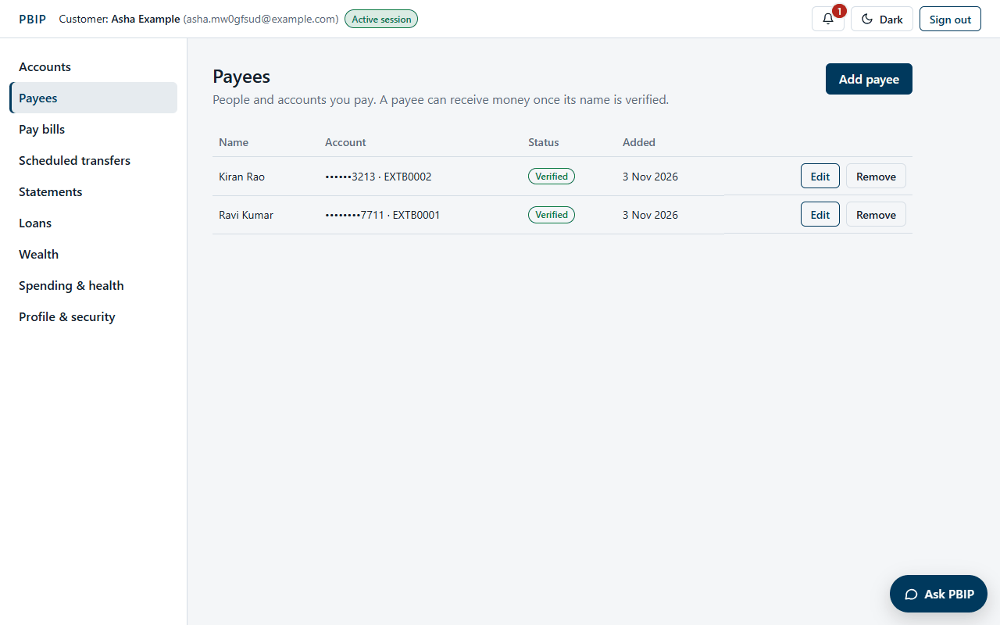

- **Verify** (only for a payee that is not verified) runs the name check again.
- **Edit** changes the name or nickname. The account number and bank code cannot be changed: add a new
  payee instead. Changing the name makes the payee **Not verified** until you verify it again.
- **Remove** asks "Remove this payee?" and then removes it.

A recently added payee is "new" to the fraud checks, so a large first payment to it is more
likely to need your authenticator code or a staff review.

## 5. Send money: review, step-up and receipt

**What it is for:** paying one of your verified payees from one of your accounts.

**Steps:**

1. On **My accounts**, go to **Send money**.
2. Choose the **From account** (each option shows what is available), the **Payee**, the **Amount (INR)**
   (up to 2 decimals) and, if you like, a **Reference** (up to 140 characters).
3. Choose **Review transfer**. The **Check and confirm** box shows From, To, Amount and Reference.
4. Check the details and choose **Send money**, or **Cancel** to go back.

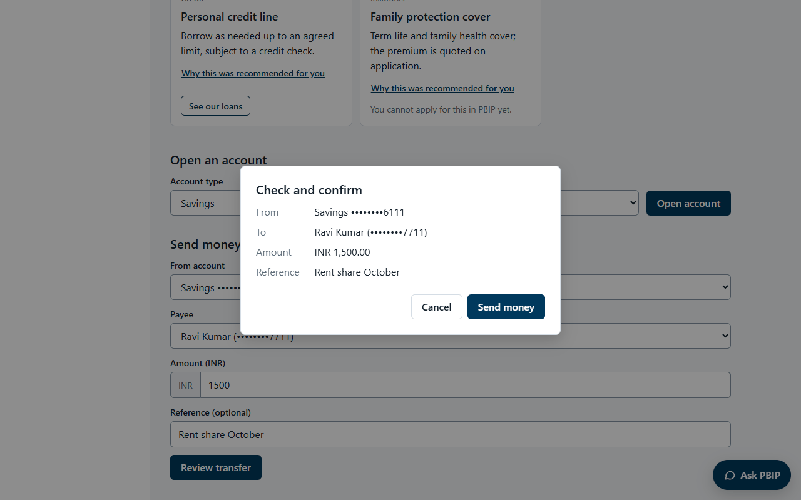

Every transfer is checked by PBIP's fraud engine before any money moves. The result is one of four
outcomes.

**Sent (posted).** The payment went through:

> "Sent INR 1,500.00 to Ravi Kumar (••••7711). Reference 1A2B3C4D. Your balance is updated above."

This message is your receipt. The **reference** is the short code to quote if you contact the bank. The
payment also appears in the account's transactions and you get a **Transfer completed** notification.

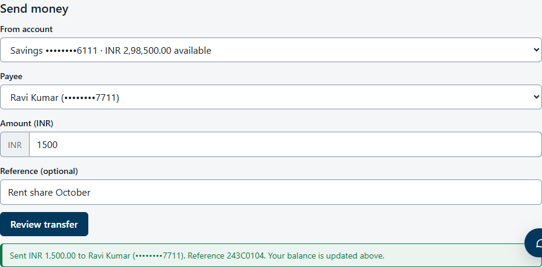

**Step-up: "Confirm it's you".** If the payment looks unusual (for
example a large amount to a new payee) and you have two-step sign-in, PBIP asks for a code before sending:

1. Open your authenticator app.
2. Type the 6-digit code into **Authenticator code** and choose **Confirm transfer**.
3. The payment is sent and you see the "Sent ..." receipt.

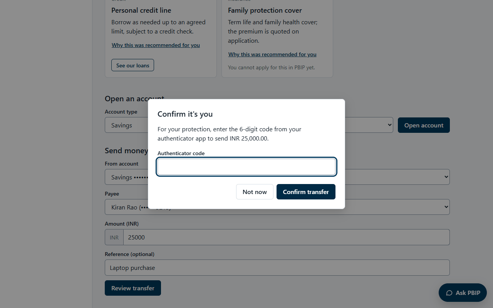

- **Not now** leaves the payment waiting: "Your transfer is waiting for your authenticator code. It has not
  been sent." Nothing has left your account.
- A wrong code shows "That code did not work. Check your authenticator app and try again."
- After 3 wrong codes the payment is moved to a staff review (see below).

**Held for review.** PBIP holds the money and a fraud analyst looks at the payment:

> "Your transfer of INR 25,000.00 to Sunil Traders (••••5285) is being reviewed for your protection. The
> money is on hold, not sent, and we will notify you of the outcome."

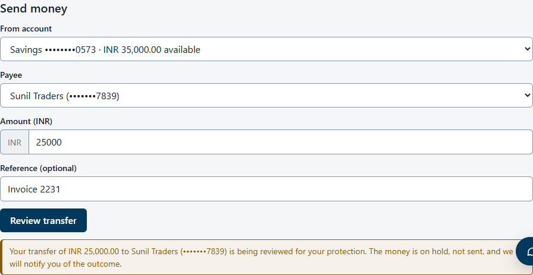

The amount moves from **available** to **on hold**; your ledger balance does not change yet:

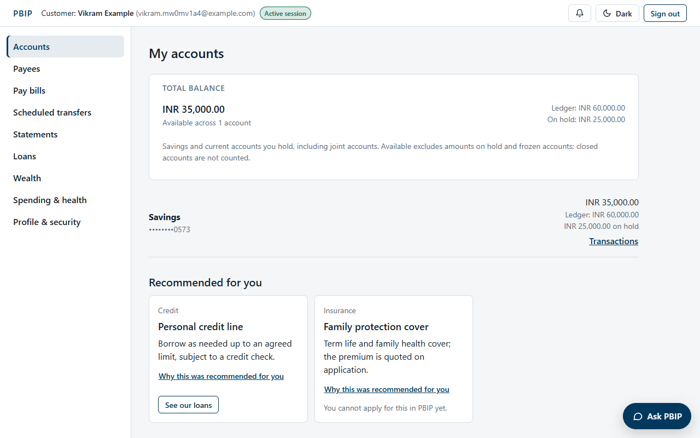

This also happens when PBIP wanted to ask for a code but you have not set up two-step sign-in. When the
analyst decides, you get a notification:

- **Released** (the analyst found it genuine): the held money is sent and the transfer shows as completed.
- **Rejected** (the analyst confirmed fraud): the payment is cancelled and the held money is available
  again. No money left your account.

**Declined.** "We could not process your transfer of INR X. No money left your account. Contact support if
you need help."

PBIP never tells you why a payment was flagged or what its risk score was. This protects the checks from
being gamed.

**Limits** (bank defaults; an administrator can change them):

| Limit | Default |
|---|---|
| Per transfer or bill payment | INR 2,00,000 |
| Total per day | INR 5,00,000 (sent, waiting for a code and held payments all count) |
| Day resets at | 00:00 UTC (05:30 India time) |

If your connection drops after you choose **Send money**, trying again is safe: PBIP recognises the repeat
and never sends the money twice.

## 6. Search your transactions

**What it is for:** finding a payment in an account's history.

1. On **My accounts**, choose **Transactions** under an account.
2. Use any of the filters: **Search references** (part of a reference, up to 64 characters), **Money in or
   out** (Both / Money in / Money out), **From date** and **To date**, **Minimum amount (INR)** and
   **Maximum amount (INR)**.
3. Choose **Apply filters**. **Clear** removes them.

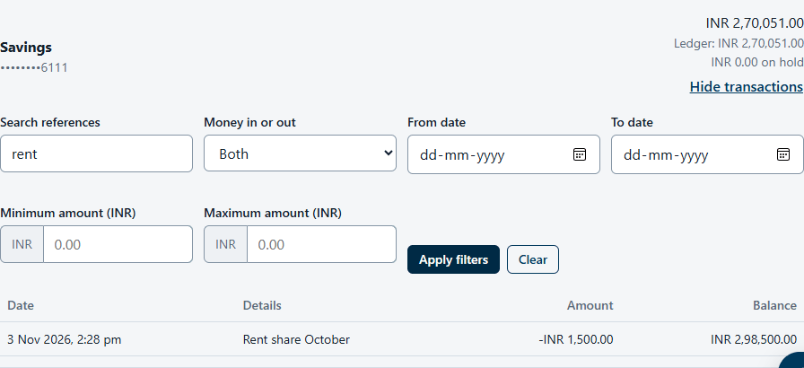

The table shows Date, Details (the reference or the type of transaction), Amount and the Balance after it,
newest first, 10 at a time. **Load older** shows the next 10. A payment that is not completed carries a
badge such as **Under review** (see [statuses](#19-what-each-status-means)).

Opening a payment notification takes you straight to the transaction, highlighted.

## 7. Pay bills

**What it is for:** paying a utility or service bill. Billers are grouped as Electricity, Water, Mobile and
telephone, Gas, Broadband and Insurance.

1. Open **Pay bills**.
2. Choose the **From account** and the **Biller**, then enter the **Consumer number** printed on your bill
   (2 to 64 characters) and the **Amount (INR)**.
3. Choose **Review payment**, check the **Check and confirm** box and choose **Pay bill**.

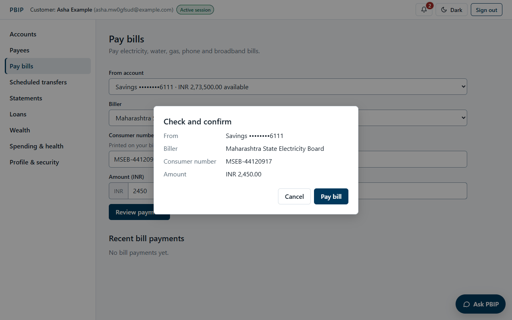

**Outcomes:**

- **Bill paid:** a receipt card shows the amount debited, who was paid, the consumer number, the
  **clearing reference**, your new balance and the time. Keep the clearing reference if the biller asks
  for proof.
- **Held for review:** "... being reviewed for your protection. The money is on hold, not paid ...". Bill
  payments never ask for an authenticator code; a payment that would need one is reviewed by staff.
- **Not paid:** "We could not pay *biller*. No money left your account."

**Recent bill payments** lists your last payments with status **Paid**, **On hold for review**, **Not
paid** or **Reversed**.

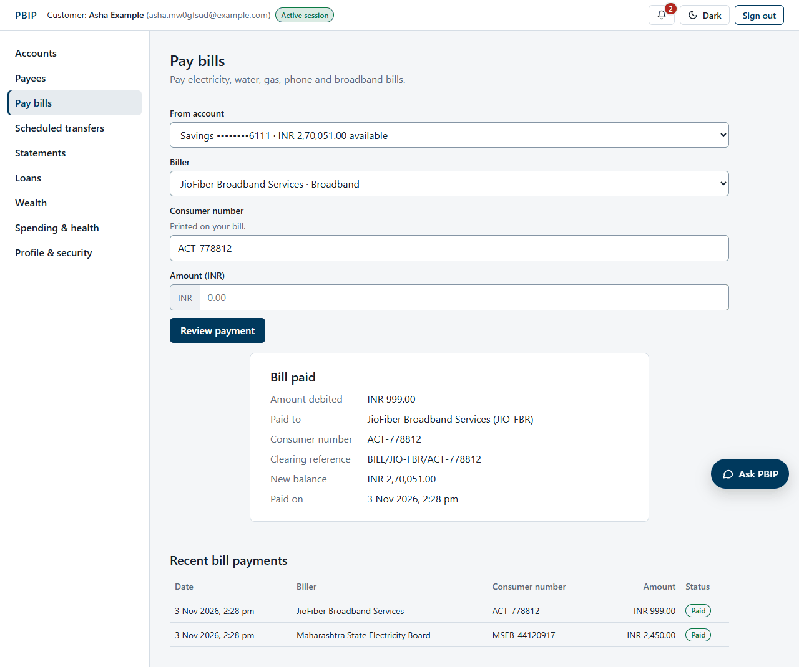

## 8. Scheduled transfers

**What it is for:** standing orders that pay someone automatically every day, week or month.

1. Open **Scheduled transfers** and choose **Schedule a transfer**.
2. Fill in **Pay from**, **Pay to** (a verified payee or one of your own accounts), **Amount (INR)**,
   **How often** (Every day / Every week / Every month), **First payment** (today up to one year ahead),
   an optional **Last date** and an optional **Reference**.
3. Choose **Schedule transfer**. PBIP confirms "Scheduled. The first payment is on *date*."

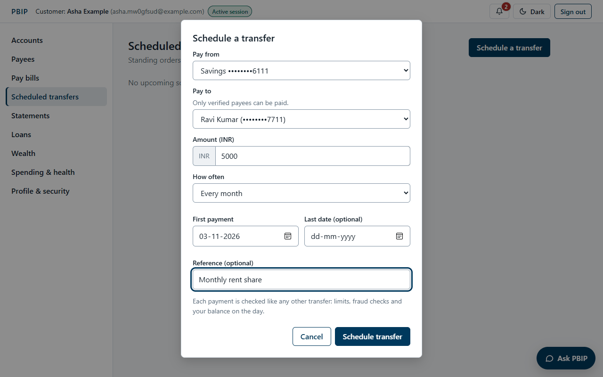

Each payment is checked on the day like any other transfer: limits, fraud checks and your balance. A
monthly payment keeps its day of the month, or the last day in a shorter month. You can have up to 20
active or paused scheduled transfers.

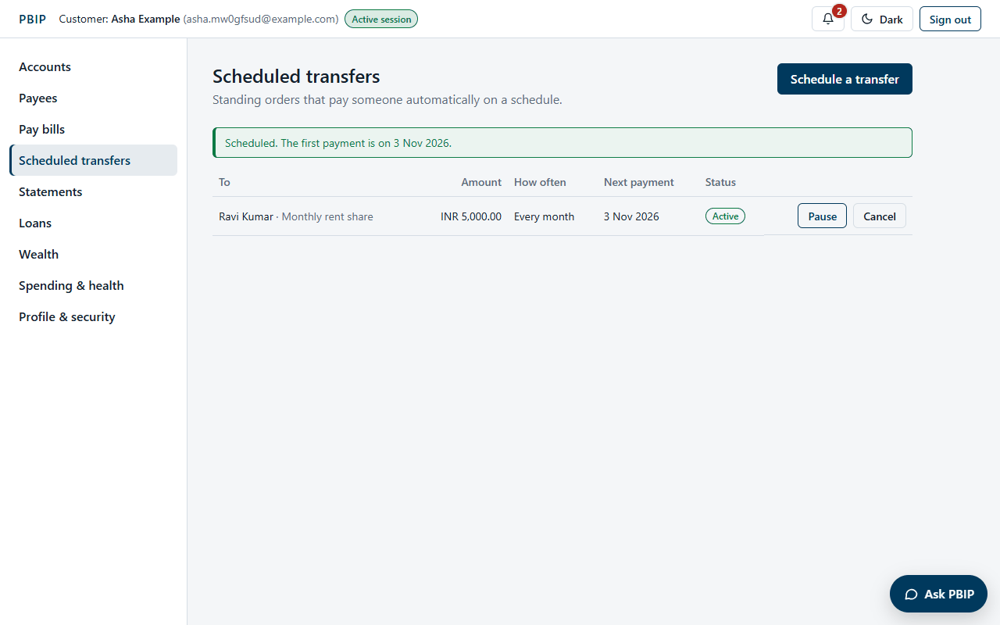

**Statuses and actions:**

| Status / note | Meaning | What you can do |
|---|---|---|
| **Active** | Payments run on schedule. | **Pause**, **Cancel** |
| **Paused**, "Paused by you." | No payments until you resume. | **Resume**, **Cancel** |
| **Paused**, "Paused because a payment could not be made." | A payment failed (for example the payee was removed). | Fix the cause, then **Resume** |
| **Paused**, "Stopped for your protection after a payment was blocked." | The fraud checks blocked a payment. | Contact the bank. Staff can lift the block; you can still **Cancel** |
| "The last payment did not go through: ..." | Not enough money, or the daily limit would have been exceeded. | Add money or lower other payments |
| **Cancelled** / **Finished** | No further payments. Listed under "Cancelled and finished". | - |

A payment that was missed (for example while the service was down) is not paid late; you get a
notification instead.

## 9. Statements

**What it is for:** downloading a statement of an account for any period of up to a year.

1. Open **Statements**.
2. Choose the **Account**, the **From** and **To** dates (India time; the default is the 1st of this month
   to today; the end date cannot be in the future).
3. Choose the format: **PDF** (a formatted statement to read or print) or **CSV** (raw data for a
   spreadsheet).
4. Choose **Download statement**. PBIP saves `pbip-statement-<start>-to-<end>.pdf` (or `.csv`) and
   shows "Downloaded *file name*."

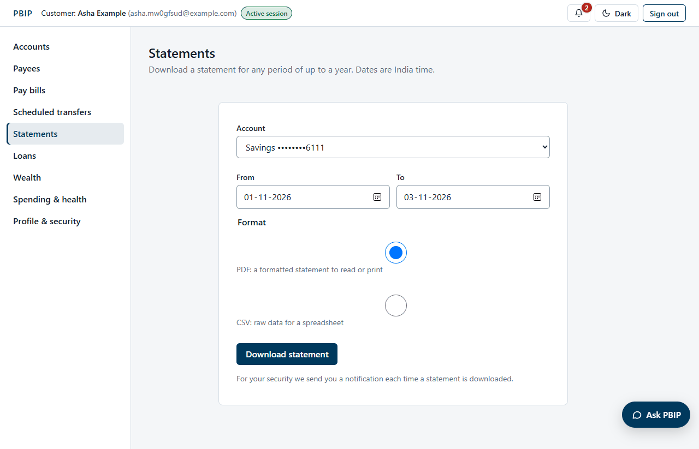

A statement covers at most 366 days and 10,000 entries. For your security PBIP sends a **Statement
downloaded** notification every time a statement is downloaded: if you did not do it, change your
password.

## 10. Spending, financial health and balance forecast

**What it is for:** understanding where your money goes. Open **Spending & health**. If you have more than
one account, pick it with **Account**.

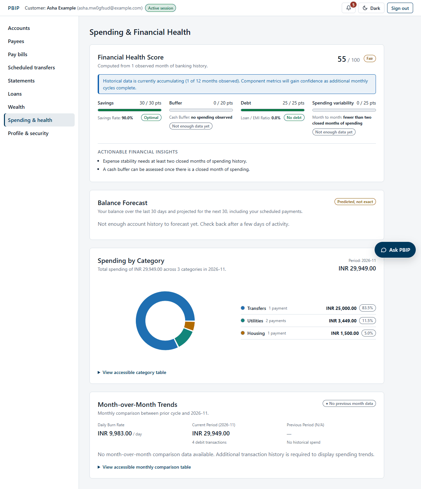

**Financial Health Score (0 to 100)** with a rating of Excellent, Good, Fair or Needs attention. It adds
four parts:

| Part | Points | Based on |
|---|---|---|
| Savings | 30 | Savings rate: how much of what comes in you keep |
| Buffer | 20 | Cash buffer: how many months of spending your balance covers |
| Debt | 25 | Loan EMIs compared with income |
| Spending variability | 25 | How much spending changes month to month |

Each part has a label such as Optimal, Adequate, Moderate, Low, Volatile, Burdened or Critical, and
**Actionable Financial Insights** lists what to improve. A new customer sees "Not enough data yet" for
parts that need at least one or two closed months, as in the screenshot.

**Income** means regular credits only: money from the same payer, for the same purpose, in at least 2 of
the last 3 months (a salary, for example). A one-off credit such as an opening deposit does not count. Until
a regular credit has arrived twice, Savings and Debt show "no income observed" and score 0, as in the
screenshot, and the insights say "No regular income recorded yet".

**Balance Forecast** (marked **Predicted, not exact**) draws your balance for the last 30 days and a
prediction for the next 30, with shaded 80% and 95% ranges and markers for scheduled payments and loan
EMIs. It shows the projected month-end balance and the payments still due this month. If your balance may
run low, it warns you ("Your balance may run low by *date* ...") and you get a **Your balance may run low
this month** notification. A new account shows "Not enough account history to forecast yet." until it has
a few days of activity.

**Spending by Category** is a donut chart of this month's spending (groceries, dining, utilities,
transfers, housing and so on), with the amount, share and number of payments per category. **Month-over-
Month Trends** compares this month with last month: daily burn rate, totals and the categories that rose or
fell most. Each chart has an accessible table view.

## 11. Loans

**What it is for:** working out what a loan would cost, checking eligibility, borrowing and tracking
repayments. Open **Loans**.

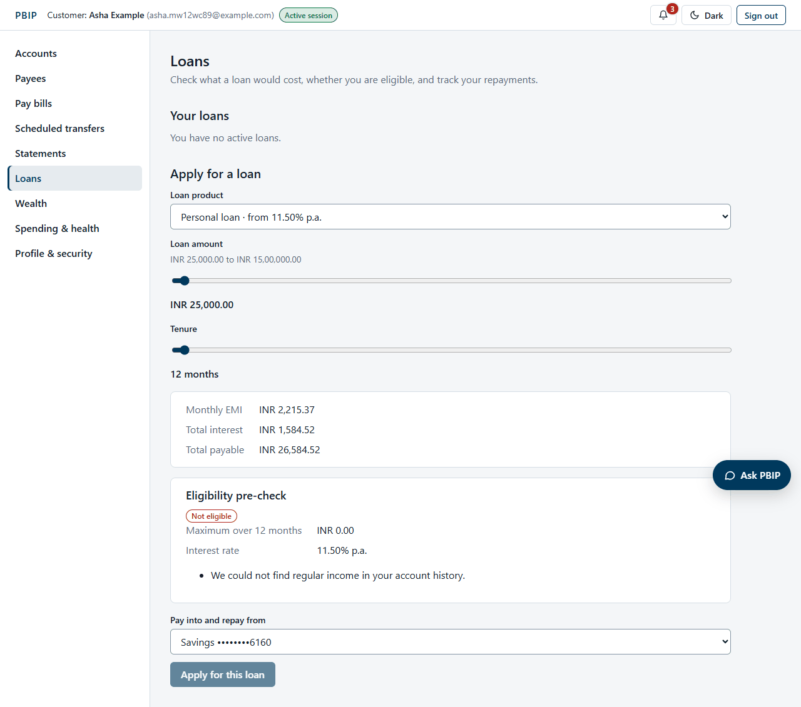

**Check a loan:**

1. Under **Apply for a loan**, choose the **Loan product** (each shows its starting interest rate).
2. Move the **Loan amount** and **Tenure** sliders. The calculator shows the **Monthly EMI**, **Total
   interest** and **Total payable**.
3. The **Eligibility pre-check** shows **Eligible** or **Not eligible**, the maximum you could borrow over
   that tenure, your interest rate and the reasons. PBIP checks five things from your own account history:
   regular income; all your loan repayments including the new EMI within 50% of your income; your monthly
   spending plus all EMIs within 90% of your income; enough available balance for the first EMI; and no
   sign-in lockout in the last 90 days. The reasons quote your own income, spending and balance. Only regular income counts (see
   [section 10](#10-spending-financial-health-and-balance-forecast)); without it the pre-check says
   **Not eligible**, "We could not find regular income in your account history.", as in the screenshot of a
   new customer. A sign-in lockout in the last 90 days pauses loan checks.

**Loans for you** lists every loan in the catalogue (personal, car and home) with **Eligible** or **Not
eligible** for you today. It starts with the figures it used ("Based on your income of ... a month, spending
of ... a month and balance of ..."). For an eligible loan it shows **You could borrow** (a range), the **EMI at
the top of the range** over a reference tenure, the **Interest rate** and the reasons; for a loan you are not
eligible for, it says why.

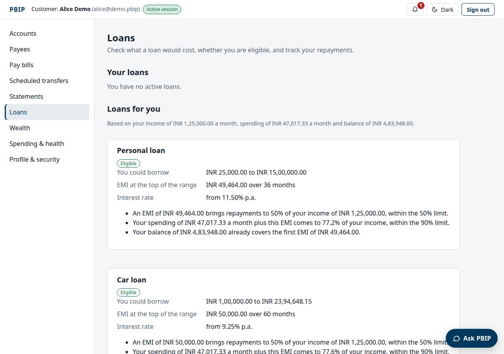

**Borrow:**

1. Choose the account under **Pay into and repay from**.
2. Choose **Apply for this loan** (only active when you are eligible).
3. Check the **Check and confirm your loan** box and choose **Confirm and receive the money**.
4. **Loan approved and disbursed** shows the amount credited, the account, the monthly EMI, the first EMI
   date and the disbursal reference. The money is in your account at once.

**Your loans** shows each loan's outstanding principal, monthly EMI, next EMI date, interest rate and
progress ("N of M EMIs paid"). **Show upcoming EMIs** lists the next 6 with their status (Paid, Upcoming,
Overdue). EMIs are collected automatically from the account on each due date. If one is overdue, PBIP
warns you and retries every day: keep enough money in the account.

## 12. Wealth and fixed deposits

**What it is for:** your fixed deposits and the savings products PBIP offers. Open **Wealth**.

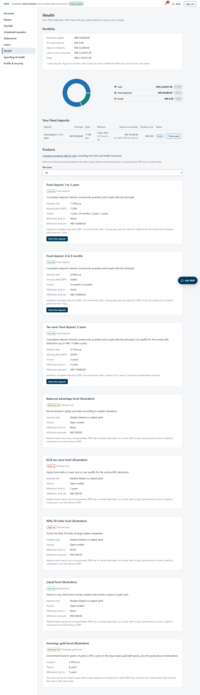

- **Portfolio** shows invested capital, accrued returns, value at maturity, cash in your accounts and the
  total, with a chart of cash, fixed deposits, funds, stocks and bonds, and your **Investment gain or loss**.
- **My fund, stock and bond holdings** lists each holding with units, today's simulated price, value and
  gain. **Sell** asks how much to sell (whole units for stocks and bonds, up to six decimals for funds, never
  more than you hold) and which account to **Receive into**, shows **You receive**, and credits the account.
- **Your fixed deposits** lists each deposit with principal, rate, maturity date (with "N days to go"),
  payout at maturity, interest earned so far and status (Active, Matured, Closed).
- **Products** lists fixed deposits, mutual funds and sovereign gold bonds with risk level, rate or coupon,
  annual yield, tenure, lock-in and minimum amount. Filter them by **Risk level**. Rates are indicative and
  simulated; market-linked funds show no yield.

**Book a fixed deposit:**

1. On a fixed-deposit product, choose **Book this deposit**.
2. Enter the **Amount** (within the product's minimum and maximum), choose the **Tenure** and the account
   to **Pay from and receive into**.
3. Check the preview (rate, maturity date, interest, amount at maturity) and choose **Confirm and book**.
4. **Fixed deposit booked** shows the principal, maturity date, amount at maturity and a reference.

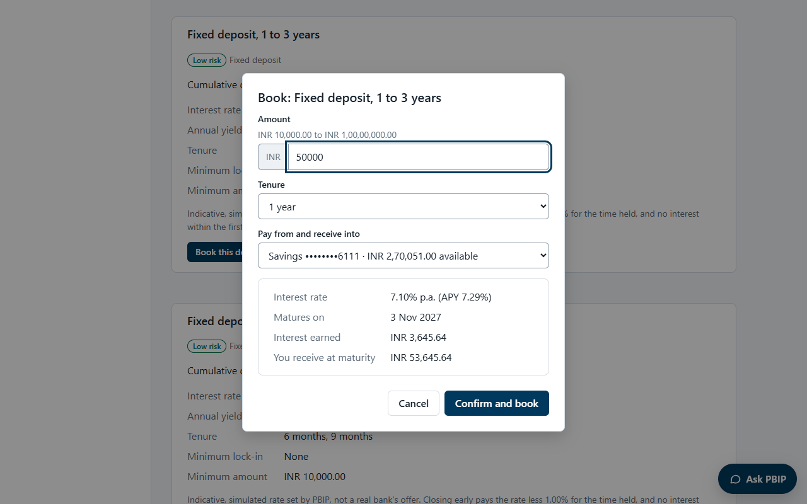

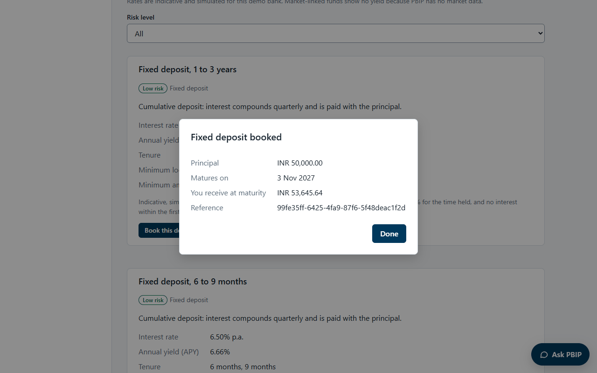

**Invest in funds, stocks and bonds:** open **Invest** (or **Invest in this fund** on a fund). PBIP sells
funds, fictional stocks and bonds at **Today's simulated price**: the price is the same all day, moves from
day to day and is not market data.

1. Choose the **Investment**. For a mutual fund enter an **Amount** (PBIP shows the **Units you get
   (about)**); for a stock or bond enter **Whole units**.
2. Choose the account to **Pay from** and **Confirm your order**.
3. **Order executed** shows the investment, units, price, amount and a **Reference**. The money leaves your
   account at once and the holding appears under your holdings.

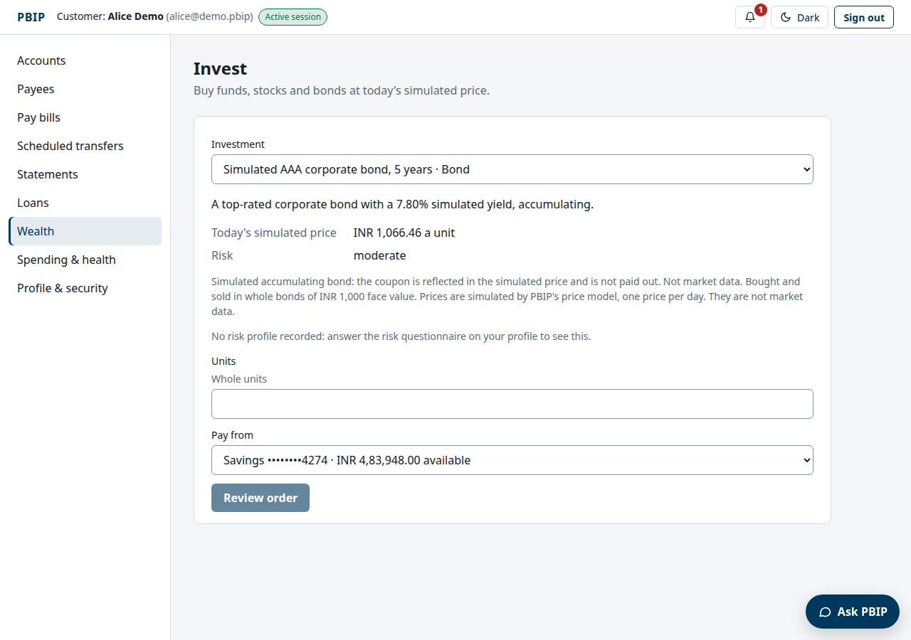

Screenshot to capture: `images/23c-wealth-holdings.png` (holdings with Sell).

**Monthly fund SIPs:** a SIP buys a fund for a fixed amount on the same day each month (day 1 to 28). On
**Invest**, choose a fund and **Start a monthly SIP**; nothing is taken until the first instalment day. **Your
SIPs** on **Wealth** lists them with the next instalment date; **Cancel SIP** stops future instalments. Each
month's purchase is made once, automatically; if the account cannot pay that day, you get a notification and the SIP tries again the
next month (a missed month is not caught up).

**Withdraw:** when a deposit has matured, choose **Withdraw** and then **Withdraw to my account**. A
matured deposit earns no more interest.

**Close early:** choose **Close early**. PBIP shows what you receive today against what you would receive
at maturity. Early closure pays a reduced rate (the deposit rate less a penalty), and no interest at all in
the first 7 days. Interest is compounded quarterly. Some deposits show "Locked until *date*" and cannot be
closed before then.

## 13. Compare investments and insurance

**What it is for:** seeing two to four products side by side, including term life and health insurance.
Open **Wealth** and choose **Compare products side by side ...**.

1. Tick two to four boxes under **Investments** and **Insurance**.
2. The table shows type, yield, tenure or policy term, lock-in, risk level, minimum amount, cover,
   indicative premium and entry age. "Not applicable" means the row does not apply to that product.

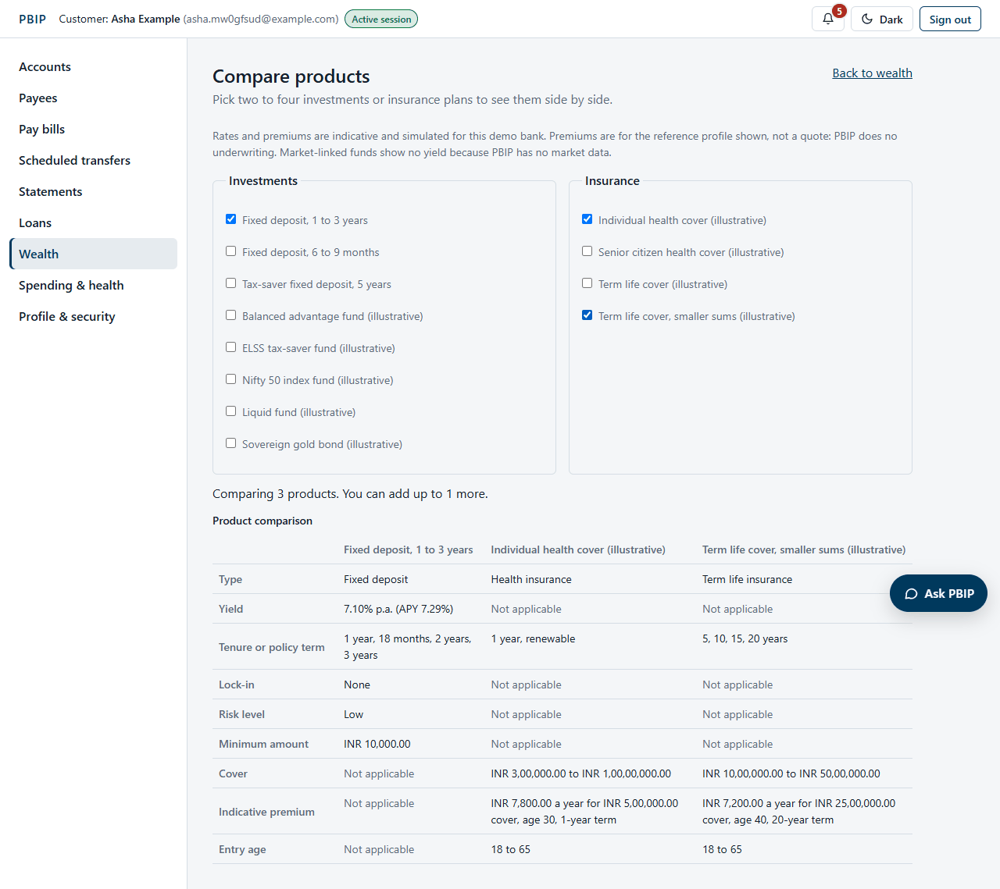

**Suits your risk band** says, for each investment, whether it is at or below the risk band from your risk
questions ("Yes" or "No" with the reason); without a risk band it says so. Insurance is protection, not an
investment, so it is not rated. Insurance premiums in the table are indicative for a reference profile.

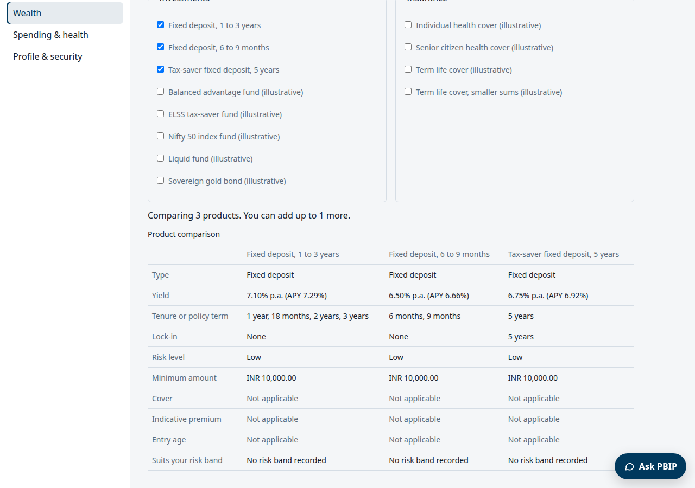

## 13a. Insurance quote and application

**What it is for:** a simulated quote for term life or health insurance, and an application. Open
**Insurance** (or **Get a quote** on an insurance card).

1. Choose the **Plan**, the **Cover** and the **Policy term**, and **Your age band** (used only for this quote
   and application).
2. The **Quote** shows the **Simulated annual premium** and the outcome: **Approved (simulated)**, referred
   (an insurer would need your exact age or a medical check), or not eligible, with the reason.
3. Apply: **Application recorded** confirms it. **Your applications** lists them, newest first.

Everything here is simulated: no policy is issued and no premium is taken from your account.

Screenshot to capture: `images/23d-insurance-apply.png`.

## 14. Recommendations

**What it is for:** products that may suit you, on **My accounts** under **Recommended for you**.

Each card says what the product is. **Why this was recommended for you** shows the reasons, for example
your balance or spending pattern. The button takes you to the right place:

| Card | Button | Goes to |
|---|---|---|
| Savings account | Open ... | **Open an account**, with Savings selected |
| Personal, car or home loan | **Apply for this loan** | **Loans**, with that loan selected. The card shows **Eligible**, **You could borrow**, **EMI at the top of the range** and **Interest rate** |
| Credit line (only when no catalogue loan is offered) | **See our loans** | **Loans** |
| Index-fund SIP | **Invest in the index fund** | **Invest**, with the fund selected |
| Other investments | **Invest** | **Invest** |
| Family cover or other insurance | **Get a quote** | **Insurance** |
| Rewards card | none | "PBIP does not issue cards yet, so there is nothing to apply for." |
| Fixed deposit | **Book a fixed deposit** | **Wealth**, with the booking box open |

Most products need a regular income (see
[section 10](#10-spending-financial-health-and-balance-forecast)) or a few months of history, so a new
customer whose only credit is the opening deposit sees "No product recommendations for you right now.", as
in the screenshot.

Recommendations use your age band only if you gave consent, and your risk band if you answered the risk
questions (see [Profile and security](#17-profile-and-security)): with a Low or Moderate risk band, PBIP does not
suggest the high-risk index-fund SIP, and the last reason on an investment card names your band.

Screenshot to capture: `images/27b-recommendations-loan-offer.png` (a catalogue loan card).

## 15. The PBIP assistant

**What it is for:** quick answers about your own accounts in plain language. It is read-only: it can look
at your accounts but cannot move money.

1. Choose **Ask PBIP** at the bottom right of any page.
2. Pick a starter question or type your own (up to 500 characters) and press **Enter** or **Send**.
   **Shift+Enter** adds a new line.
3. The answer appears in a few seconds. While it works you see what it is checking, for example "Checking
   account balance...". Many answers end with a link such as **Open insights**.

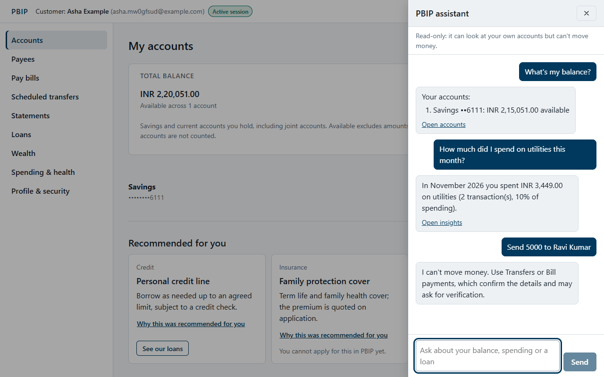

**What you can ask:**

| Topic | Example |
|---|---|
| Balances | "What's my balance?" |
| Recent transactions | "Show my last 5 transactions" |
| Spending by category, this or last month | "How much did I spend on dining?" |
| Balance forecast (7, 14 or 30 days) | "What will my balance be next week?" |
| Loan affordability | "Can I afford a personal loan of 2 lakh over 3 years?" |
| Unusual spending | "Anything unusual in my spending?" |
| How PBIP works | every feature: accounts, payees, transfers and their limits, held payments, bill payments, scheduled transfers, statements, loans, fixed deposits, investments, insurance, notifications, sign-in security and lockout, settings and consent, spending insights, and what the assistant can and cannot do |
| Products | "What fixed deposits do you have?", "What insurance plans do you offer?", "Suggest investments for me" (uses your risk profile) |

**What it will not do:** move money ("I can't move money. Use Transfers or Bill payments ..."), look at
anyone else's accounts ("I can only help with your own accounts."), run database queries or change its
instructions. If it does not understand, it lists what it can help with.

Clear questions are answered at once by a built-in, rule-based helper. For a question it cannot place, the
assistant asks a language model only which kind of answer you want (the demo uses a hosted model, which takes
under a second; a local model on an ordinary computer can take much longer). Without a model (as in the
screenshot) the rule-based helper still answers, so the facts are the same; only the wording is plainer.
Insurance plans are listed as simulated: the premium is an indication for a reference profile, not a quote.

Screenshot to capture: `images/28b-assistant-insurance.png` (the assistant listing insurance plans).

If you send many messages quickly, it asks you to wait a minute.

## 16. Notifications

**What it is for:** messages about your money and your security. The bell in the top bar shows the number
of unread notifications (up to "99+") and checks for new ones every 15 seconds.

1. Choose the bell. The **Notifications** tray shows your latest 20, newest first.
2. Choose a notification to mark it read and open the related page: a payment opens the account with the
   transaction highlighted, a security message opens **Profile & security**, a low-balance warning opens
   **Spending & health**.
3. **Mark all as read** clears the count. **Esc** or clicking outside closes the tray.

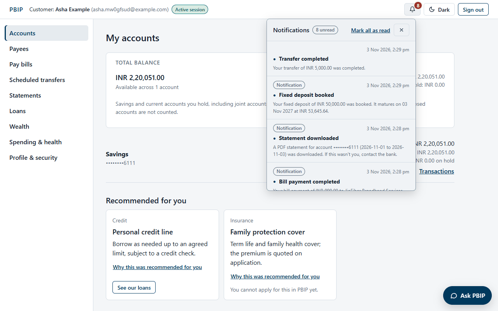

| Badge | Notifications |
|---|---|
| (none) | Transfer completed |
| **Under review** | Transfer or bill payment under review |
| **Not completed** | Transfer or bill payment not completed |
| **Security** | Password changed, Two-step verification turned on, New device registered |
| **Low balance ahead** | Your balance may run low this month |
| **Notification** | Bill payment completed, Loan disbursed, Loan EMI paid, Fixed deposit booked / closed / matured / payout on hold, Scheduled transfer failed / paused / can be resumed / missed, Statement downloaded |

If you see a **Security** notification you do not recognise, change your password at once.

## 17. Profile and security

Open **Profile & security**.

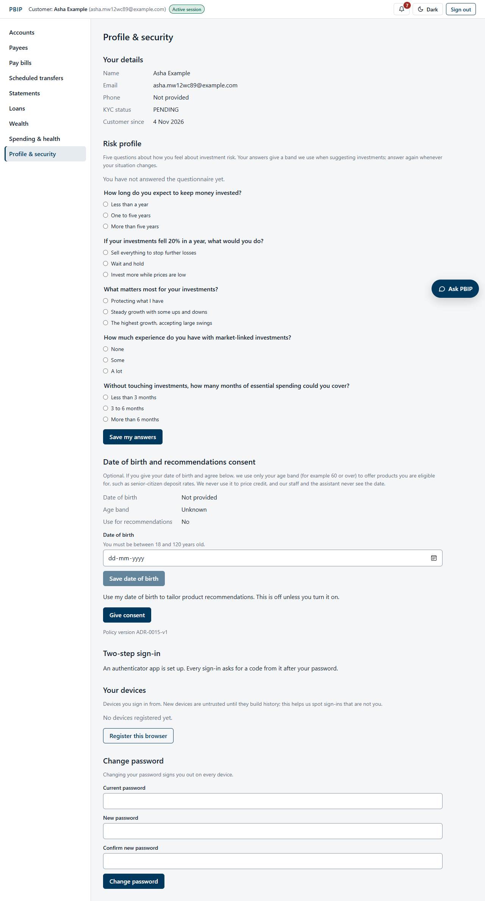

- **Your details:** name, e-mail, masked phone number, KYC status and customer-since date. These are read
  only; contact the bank to change them.
- **Risk profile:** answer five questions (investment horizon, how you would react to a 20% fall, goal,
  experience, emergency fund) and choose **Save my answers**. PBIP shows **Your risk band** (Low, Moderate
  or High) and uses it for investment suggestions.
- **Date of birth and recommendations consent:** optional. PBIP uses only your age band (for example
  senior-citizen deposit rates), never for credit pricing. Staff and the assistant never see the date.
  **Give consent** / **Withdraw consent** controls whether it is used for recommendations; **Delete date of
  birth** removes it.
- **App usage analytics:** off until you turn it on with **Turn on usage analytics**. When it is on, PBIP
  records which pages you visit, a few product clicks and how long you use the app, to build a usage profile
  (sessions and product interests) that the bank may use for insights. It never records what you type,
  amounts or account numbers. **Turn off usage analytics** asks you to confirm (**Turn off and erase**): PBIP
  stops recording at once and erases the activity and profile it holds. The section shows when you decided
  and the policy version. If your browser sends the Global Privacy Control signal, nothing is sent from that
  browser whatever the setting says.
- **Two-step sign-in:** see [section 2](#2-turn-on-two-step-sign-in-mfa).
- **Your devices:** browsers you registered, with first and last seen dates, marked **Trusted** or **New
  (N days)**. **Register this browser** adds the one you are using and sends a **New device registered**
  notification. A payment from a brand-new device is checked more closely.
- **Change password:** enter the **Current password** and the new one twice (at least 12 characters,
  different from the current one) and choose **Change password**. This signs you out on every device:
  sign in again with the new password.

There is no "forgot password" link: contact the bank if you cannot sign in.

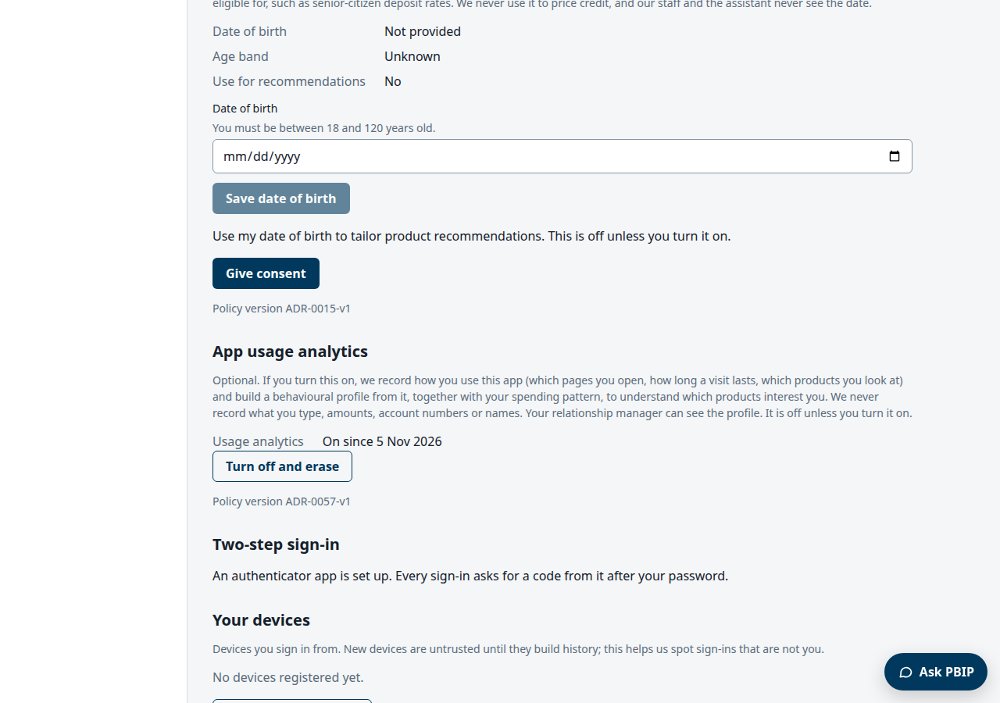

## 18. Using PBIP on a phone

PBIP works in a phone browser. Pages stack into one column and the navigation folds behind **Menu**.

| Sign in | My accounts | Menu open |
|---|---|---|
| 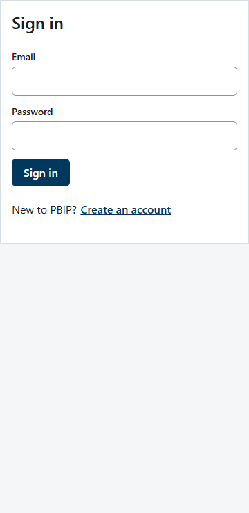 | 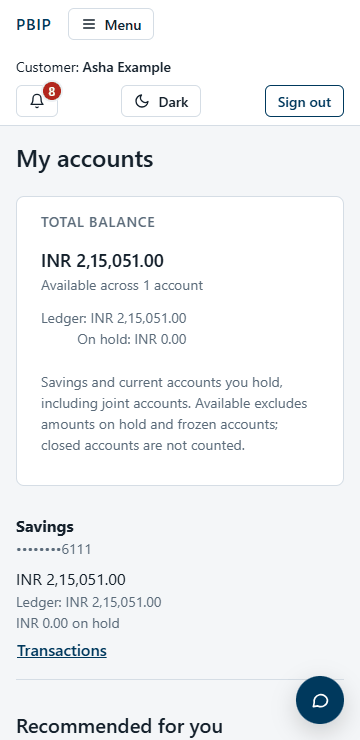 | 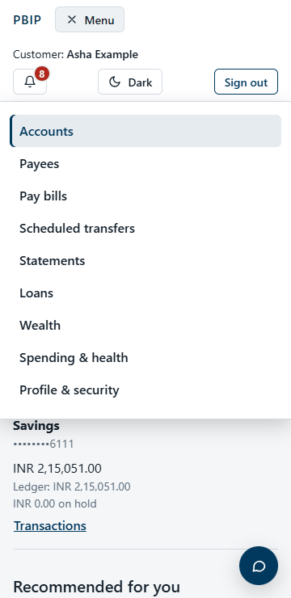 |

## 19. What each status means

| You see | Meaning | Money |
|---|---|---|
| **Completed** (or no badge) | The payment went through. | Left your account. |
| **Verification needed** | Waiting for your authenticator code. | Not sent; nothing reserved. |
| **Under review** / **On hold for review** | A fraud analyst is checking it. | Reserved (on hold), not sent. |
| **Declined** / **Not paid** / **Not completed** | Refused by the checks, rejected by an analyst, or over a limit. | Never left your account, or returned. |
| **Reversed** | Undone by a correcting entry. | Returned. |
