# Staff operations guide

This guide is for bank staff: fraud analysts, relationship managers and administrators. Compliance
officers have their own [compliance guide](compliance-guide.md).

[Back to the user manual](README.md)

## Contents

1. [Roles and what each one sees](#1-roles-and-what-each-one-sees)
2. [Sign in with your authenticator](#2-sign-in-with-your-authenticator)
3. [Fraud alerts: the queue](#3-fraud-alerts-the-queue)
4. [Review an alert and its reasons (SHAP)](#4-review-an-alert-and-its-reasons-shap)
5. [Release or reject a held payment](#5-release-or-reject-a-held-payment)
6. [Security monitoring](#6-security-monitoring)
   - [6a. Fraud dashboard](#6a-fraud-dashboard)
7. [Fraud demo lab (local and test only)](#7-fraud-demo-lab-local-and-test-only)
8. [Customer insights (relationship managers)](#8-customer-insights-relationship-managers)
9. [Behavioural analytics](#9-behavioural-analytics)
10. [Administration](#10-administration)

## 1. Roles and what each one sees

All staff screens live under **Staff workspace** (`/staff`). The left navigation only lists the screens
your role may use, and the server refuses every staff request from a session that was not verified with an
authenticator code.

| Screen | Fraud analyst | Relationship manager | Compliance officer | Administrator |
|---|:-:|:-:|:-:|:-:|
| Overview, Sign-in security | yes | yes | yes | yes |
| Security monitoring, Fraud alerts | yes | | | yes |
| Fraud demo lab (local/test environments only) | yes | | | yes |
| Customer insights, Behavioural analytics | | yes | | yes |
| Compliance & risk, Audit log ([compliance guide](compliance-guide.md)) | | | yes | yes |
| Administration | | | | yes |

Opening a screen without the right role shows "Access restricted: ... needs the X or Administrator role."
A person who is both a customer and staff sees **Staff workspace** in the customer menu and **My banking**
in the staff menu.

## 2. Sign in with your authenticator

Staff sign in on the same page as customers, with their work e-mail, password and an authenticator code.

1. Enter your **Email** and **Password** and choose **Sign in**.
2. Enter the 6-digit code from your authenticator app in **Authenticator or recovery code** and choose
   **Verify**.
3. **Staff workspace** opens. **Overview** shows who you are signed in as, your roles, and whether this
   session was verified with an authenticator code.

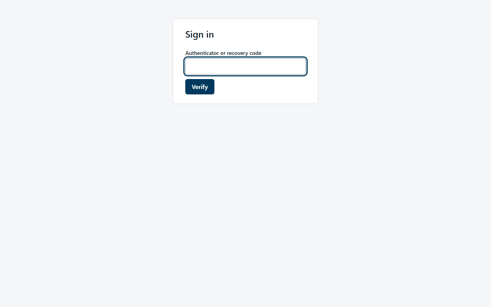

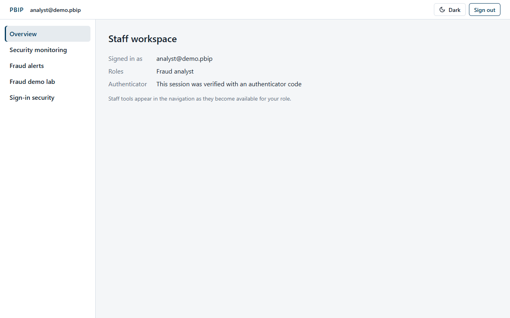

**First sign-in of a new staff member.** An administrator creates your user (see
[Administration](#10-administration)). Until you set up an authenticator, every staff page shows "Staff
tools need a session verified with an authenticator code." Open **Sign-in security**, choose **Set up
authenticator app**, follow the same steps as a customer (type the key into your app, confirm a code, save
the 8 recovery codes), then **sign out and sign in again** with a code. There is no way to reset or remove
an authenticator in the app today.

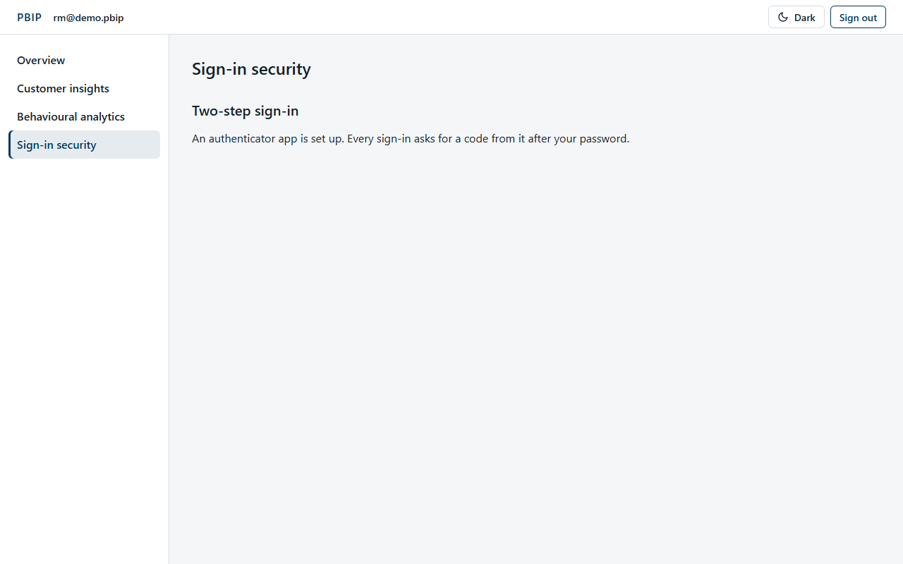

> **Local demo staff.** The seeded staff users (`analyst@demo.pbip`, `compliance@demo.pbip`,
> `admin@demo.pbip`, `rm@demo.pbip`) already have an authenticator. On a local copy, print the current code
> with `uv run python scripts/totp.py analyst@demo.pbip`. The password is explained in the
> [README](../../README.md); it is not repeated here.

## 3. Fraud alerts: the queue

**What it is for:** every transfer or bill payment the fraud engine held for review or blocked. Open
**Fraud alerts**.

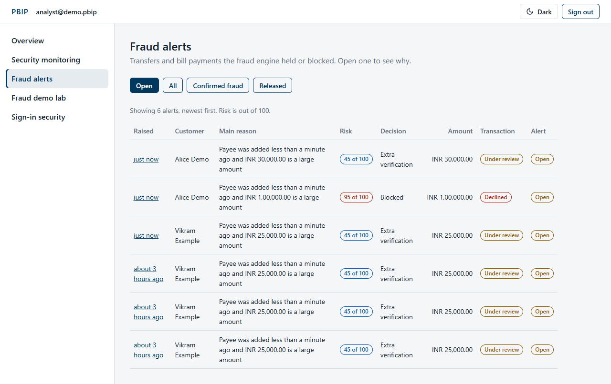

**How alerts arrive:**

| The engine decided | What happened to the payment | Alert |
|---|---|---|
| **Allowed** | Sent. | None. |
| **Extra verification** (step-up) | The customer was asked for an authenticator code. If they have none, or enter 3 wrong codes, the money is put on hold and the payment goes to review. Bill payments are always reviewed instead. | Opened only when the payment was held. |
| **Held for review** | Money on hold, status **Under review**. The customer is told it is being reviewed. | Opened. |
| **Blocked** | Declined at once; no money moved and nothing is on hold. | Opened, so an analyst can label it. |

**Using the queue:**

1. Choose a filter: **Open** (the default: still waiting for a decision), **All**, **Confirmed fraud** or
   **Released**.
2. Read the table, newest first (up to 100 alerts): when it was raised, the customer, the **Main reason**
   in plain language, the **Risk** out of 100, the engine's **Decision**, the amount, the transaction's
   status and the alert's status.
3. Choose the time in the **Raised** column to open the alert.

Risk badges are coloured by score: 85 and above is the highest band, then 60, then 30. An alert is "high
severity" from 85 (used on Security monitoring).

## 4. Review an alert and its reasons (SHAP)

The alert page explains every point of the score. Nothing on it is shown to the customer.

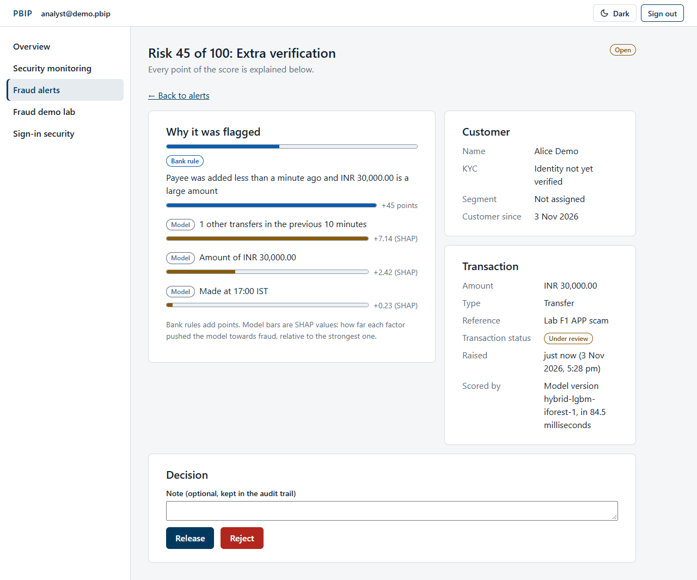

**Header:** "Risk *score* of 100: *decision*", and the alert status (**Open**, **Released** or
**Confirmed fraud**).

**Why it was flagged** lists each reason with its source and size:

| Badge | Source | The number means |
|---|---|---|
| **Bank rule** | A fixed rule, for example a new payee and a large amount, a velocity burst or failed sign-ins. | Points added to the score ("+45 points"). |
| **Model** | The machine-learning model (LightGBM). | The **SHAP value** ("+7.14 (SHAP)"): how far that factor pushed the model towards fraud. A longer bar is a stronger push, relative to the strongest model reason. |
| **Unusual pattern** | The anomaly detector (Isolation Forest). | How unusual the factor is ("82% unusual"), for example the amount compared with the 30-day average. |

How to read the example above: the bank rule for a payee added less than a minute ago with a large amount
added 45 points. The model's strongest factor was another transfer in the previous 10 minutes (+7.14),
then the amount (+2.42); the time of day barely mattered (+0.23).

If the model was not available when the payment was scored, the reasons include "Scored by rules only: the
model could not be used" and the model version ends in `+rules-only`. Rules alone never let a payment
through unchecked.

**Customer:** name, KYC status, segment and customer-since date. Contact details are not shown here.

**Transaction:** amount, type (Transfer or Bill payment), reference, current status, when the alert was
raised, and **Scored by**: the model version and how long scoring took. The model version tells you
exactly which model and rules produced the score, so the decision can be reproduced later.

**Checklist before deciding:** do the reasons fit the customer's history? Is the payee new? Did the
customer recently fail sign-ins or use a new device? If in doubt, contact the customer through the bank's
own records before releasing.

## 5. Release or reject a held payment

The **Decision** panel appears while an alert is **Open**.

1. Optionally write a **Note** (up to 1,000 characters). It is kept in the audit trail with your name;
   write what you checked and why.
2. Choose **Release** or **Reject**.
3. The confirmation box shows the amount and the effect. Confirm with **Release** or **Reject**.
4. PBIP shows "Decision recorded." and the alert says who resolved it and when, with your note.

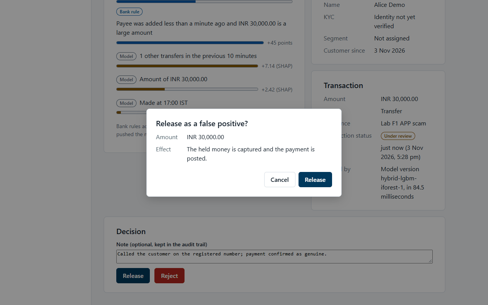

| Decision | Alert becomes | Held payment | Customer |
|---|---|---|---|
| **Release** ("Release as a false positive?") | **Released** | "The held money is captured and the payment is posted." | Gets **Transfer completed** (or bill payment completed). |
| **Reject** ("Reject as confirmed fraud?") | **Confirmed fraud** | "The payment is cancelled and the held money returns to the customer." | Gets **Transfer not completed** (or bill payment not completed). |

For a payment the engine **blocked**, no money is on hold: the decision only labels the alert (genuine or
confirmed fraud) for reporting.

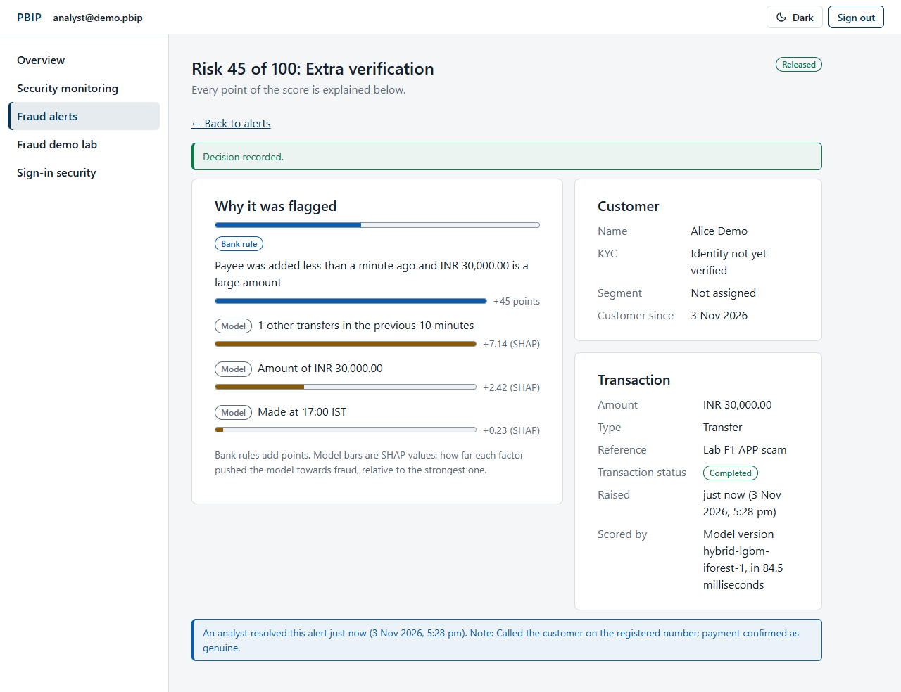

Notes:

- One analyst decides; there is no second approver in the app.
- If two analysts decide the same alert at once, the second gets an error that it is already resolved.
- Every decision is written to the audit log as `FRAUD_ALERT_RESOLVED`.

**Standing orders stopped by a block.** When a scheduled payment is blocked, the standing order is paused
for the customer's protection and they are told to contact the bank. There is no staff screen to lift
this pause yet. An analyst can lift it through the API (`POST /api/v1/fraud/scheduled-transfers/{id}/clear`
with a reason of 3 to 500 characters); the order then stays paused until the customer resumes it.

## 6. Security monitoring

**What it is for:** one page to see what needs attention. Open **Security monitoring**. It refreshes every
minute and shows customer and user ids only, never names, e-mails or IP addresses.

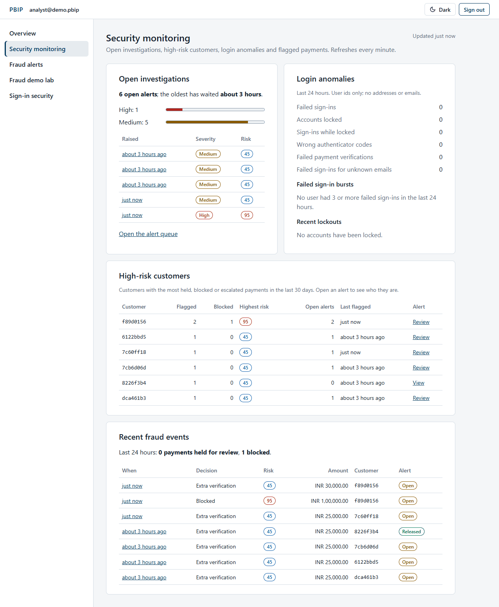

- **Open investigations:** how many alerts are open, how long the oldest has waited, high and medium
  severity counts, and the 5 longest-waiting alerts. **Open the alert queue** goes to Fraud alerts.
- **Login anomalies** (last hours): failed sign-ins, accounts locked, sign-ins tried while locked, wrong
  authenticator codes, failed payment verifications and failed sign-ins for unknown e-mails, plus
  **Failed sign-in bursts** and **Recent lockouts**.
- **High-risk customers:** customers with the most held, blocked or escalated payments recently, their
  highest risk and open alerts, with a **Review** or **View** link.
- **Recent fraud events:** payments held and blocked in the last 24 hours, and the 10 newest.

A burst of failed sign-ins followed by a payment from a new device is the account-takeover pattern: check
the customer's open alerts first.

## 6a. Fraud dashboard

**What it is for:** trends in the fraud engine's decisions. Open **Fraud dashboard** (fraud analysts and
administrators, signed in with an authenticator code). Pick the period (7, 30 or 90 days); the page refreshes
every minute. Every chart has a text summary and a table with the same figures.

- **At a glance:** **Payments scored**, **Hold rate**, **Block rate**, **Extra verification** (payments that
  asked for an authenticator code), **Rules-only decisions** (the model was unavailable, so the rules decided
  alone) and **Scoring time (p95)**, each with its definition.
- **Decisions over time:** allowed, extra verification, held for review and blocked per UTC day (a quiet day
  shows zero), and the hold and block rates per day.
- **Risk score distribution:** payments in ten score bands, with the decision thresholds explained (30 extra
  verification, 60 review, 85 block).
- **Top reasons:** the most frequent reason codes with their source (bank rule, model, unusual pattern).
- **Alerts raised in the period:** still open, confirmed fraud and released, with a link to the alert queue.
- **Destinations behind flagged payments:** masked payee accounts that received flagged payments.

Screenshot to capture on the v1.1.0 stack: `images/42b-fraud-dashboard.png`.

## 7. Fraud demo lab (local and test only)

**What it is for:** showing how the fraud engine reacts to known fraud patterns, for training and demos.
It appears only when the server runs in a local or test environment; staging and production switch it
off.

The lab really moves money as a demo customer (through the normal customer API), so the alerts it creates
appear in the queue like any other.

1. Open **Fraud demo lab**. **Customer email** starts as `carol@demo.pbip` and **Sender email (F6)** as
   `bob@demo.pbip`, the seeded customers without an authenticator. Enter the **Customer password** (the
   seeded demo password, see the [README](../../README.md)). Customers with an authenticator, such as
   Alice, are refused. Each customer signs in once; later runs reuse that session while the page stays
   open, so a series of scenarios does not use up the sign-in rate limit.
2. Choose **Run scenario** on a card:

   | Scenario | What it does | Rules it should trigger |
   |---|---|---|
   | F1 APP scam | New external payee, then INR 30,000 | New payee and large amount |
   | F2 Velocity burst | 4 payments of INR 500 | Velocity burst |
   | F3 Account takeover | 3 wrong passwords, then INR 50,000 from a new device | Recent failed sign-ins, new device |
   | F4 Impossible travel | Not runnable here: needs a GeoIP database and a real location | - |
   | F5 Amount anomaly | INR 1,00,000 | Large amount, amount spike |
   | F6 Mule pass-through | A sender pays the mule INR 24,000; the mule forwards 95% | Mule pass-through, new payee |

3. Each result shows what the customer saw, the risk, the decision, the model version, the reasons and
   **Open the alert**.

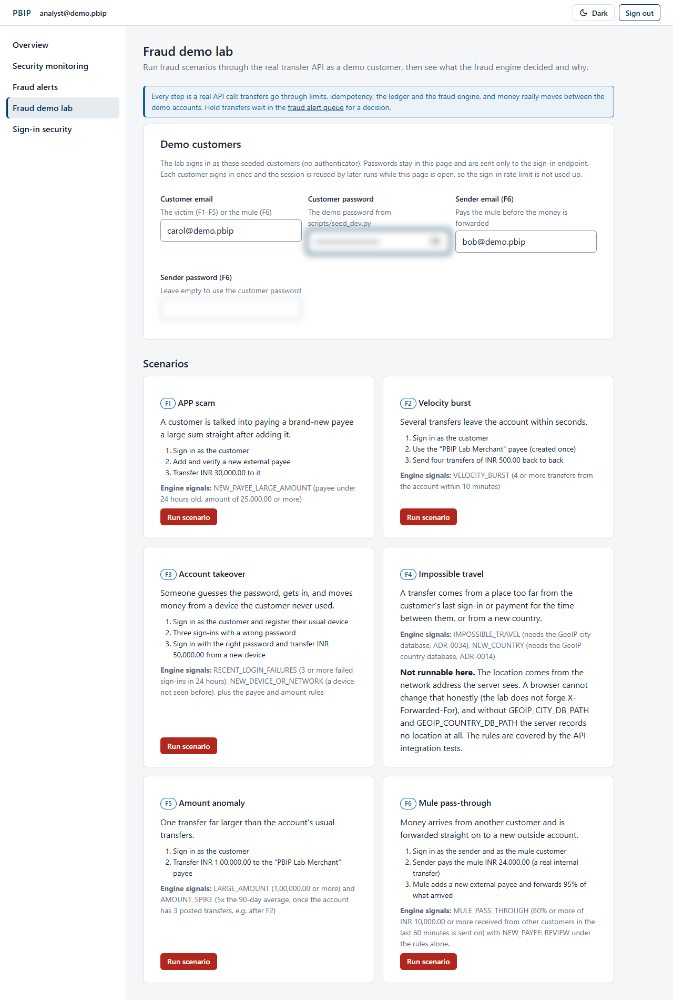

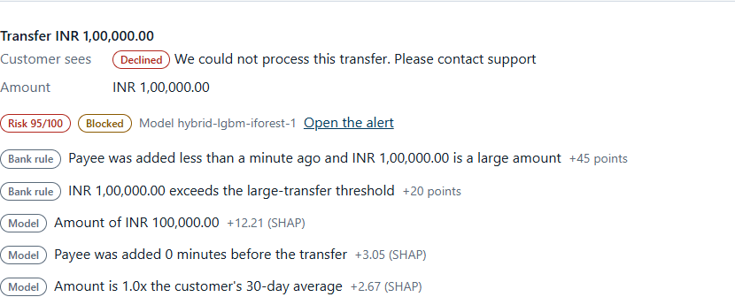

## 8. Customer insights (relationship managers)

**What it is for:** finding customers who may leave, and products they are eligible for. Open **Customer
insights**. A relationship manager sees only the customers assigned to them; an administrator sees
everyone.

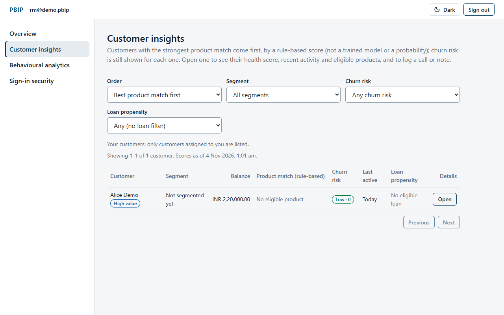

1. Choose the **Order**: **Best product match first** (the default for a relationship manager) or
   **Highest churn risk first** (the default for an administrator). Filter by **Segment**, **Churn risk**
   (any, medium or high, high only) and **Loan propensity**. The order and filters apply to all your
   customers before paging, 20 per page.
2. Each row shows the segment, balance, **Product match (rule-based)** (the best product's 0-100 score, its
   name and first reason, or "No eligible product"), churn risk (Low, Medium, High and a 0-100 score), last
   activity and loan propensity. The product match is a rule-based score, not a trained model or a
   probability.
3. Choose **Open** for the customer's details.

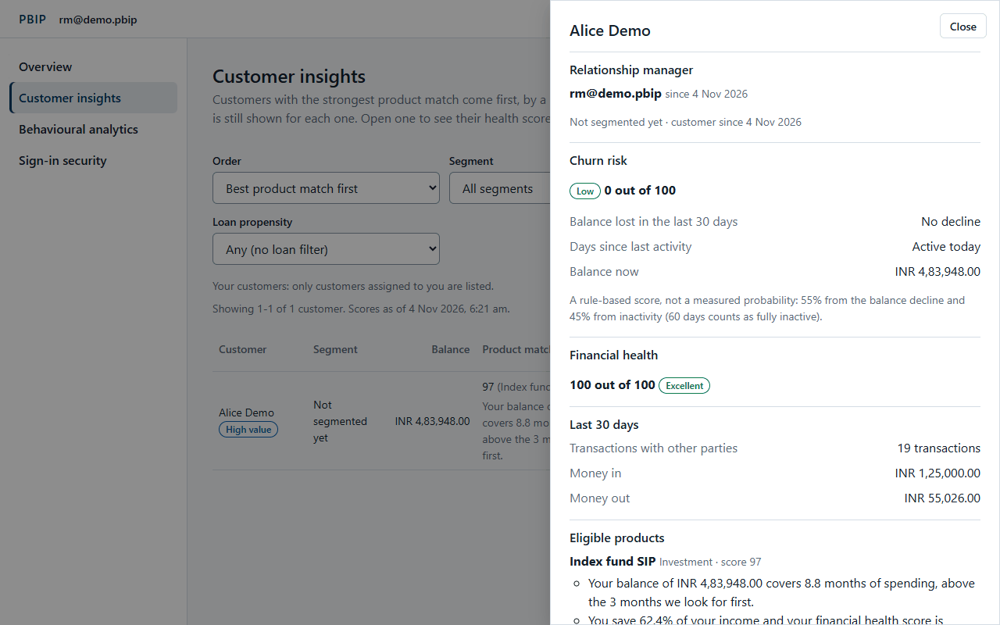

The details panel shows:

- **Relationship manager:** who looks after the customer. An administrator can **Assign**, **Reassign**
  or **Unassign** (audited).
- **Churn risk:** a rule-based score, not a probability: 55% from the balance decline in the last 30 days
  and 45% from inactivity (60 days counts as fully inactive).
- **Financial health**, **Last 30 days** (transactions, money in, money out) and **Eligible products** with
  the reasons.
- **Behavioural profile:** only for a customer who turned app usage analytics on: segment, monthly income
  and spend, app sessions in the last days, average session, pages per session, last active and product
  interests (which kinds of product they looked at recently, with the rule explained). Without the
  customer's consent it says that no profile is kept.
- **Calls and notes:** choose the **Type** (Phone call, Meeting, Email, Note) and **Outcome**, write a
  **Note** and choose **Log it**. Notes stay on the customer record for the next manager and are audited.

## 9. Behavioural analytics

**What it is for:** how customer segments spend and use the app, in aggregate only (no individual
customers). Open **Behavioural analytics** and pick a **Period** (30, 90 or 180 days) and a **Segment**.

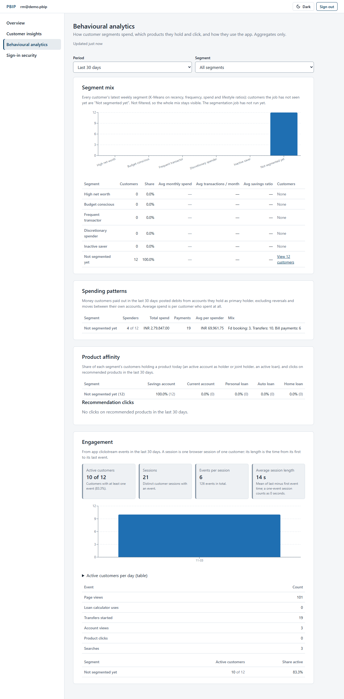

- **Segment mix:** customers per segment from the weekly segmentation job, with average spend,
  transactions and savings ratio, and a link to those customers in Customer insights. Before the job has
  run, everyone is "Not segmented yet", as here.
- **Spending patterns:** total and average spend per segment and the mix of transfers, bill payments and
  loan repayments.
- **Product affinity:** share of each segment holding each product, and clicks on recommendations.
- **Product interest by category:** a chart of how many profiled customers showed interest in loans,
  savings, investments and insurance, with a table (customers, share of profiled customers, average score,
  signals).
- **Engagement:** active customers, **Customers sharing analytics**, **Sessions** (a visit ends after 30
  minutes without activity), events per session, **Average session length**, a sessions-per-day chart and
  events by type. Only customers who turned usage analytics on are counted: nothing is recorded for the
  others.

Screenshots to capture on the v1.1.0 stack: `images/62c-behaviour-interest-chart.png` (this page) and
`images/61b-rm-behaviour-profile.png` (the behavioural profile in the customer details panel).

## 10. Administration

**What it is for:** administrators create staff users, clear lockouts and change business limits. Every
action is audited with your name. Open **Administration**.

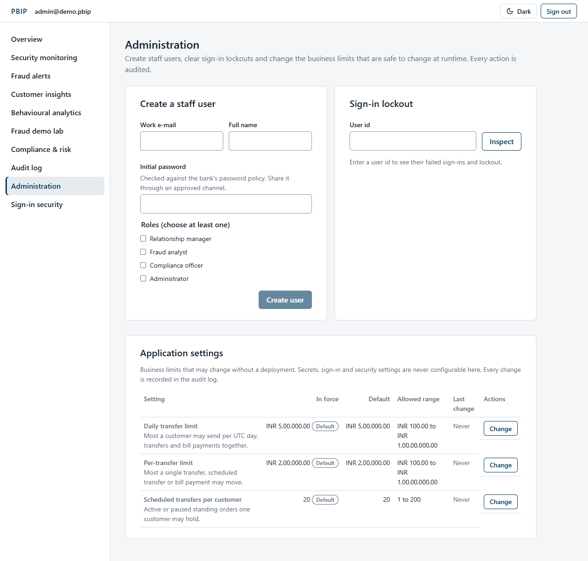

**Create a staff user:**

1. Enter the **Work e-mail**, **Full name** and an **Initial password** (it must pass the bank's password
   policy; share it through an approved channel).
2. Tick at least one role: Relationship manager, Fraud analyst, Compliance officer, Administrator.
3. Choose **Create user**. PBIP shows the new user id and reminds you that they must set up an
   authenticator before using staff tools.

Existing staff users cannot be listed, edited or deactivated in the app.

**Clear a sign-in lockout:**

1. Enter the person's **User id** and choose **Inspect**. PBIP shows whether they are locked, the failed
   sign-ins, until when, and the last failure.
2. Choose **Clear lockout** and confirm. This resets the failed sign-ins and the sign-in rate limit.

Confirm the person's identity through the bank's own process before clearing a lockout.

**Application settings:** the business limits that may change without a deployment. Secrets and security
settings never appear here.

| Setting | Default | Allowed range |
|---|---|---|
| Daily transfer limit | INR 5,00,000.00 | INR 100.00 to INR 1,00,00,000.00 |
| Per-transfer limit | INR 2,00,000.00 | INR 100.00 to INR 1,00,00,000.00 |
| Scheduled transfers per customer | 20 | 1 to 200 |

To change one, choose **Change**, enter the **New value** and a **Reason** (10 to 500 characters), and
choose **Save change**. The new value applies to the next payment, and the old and new values are written
to the audit log.
